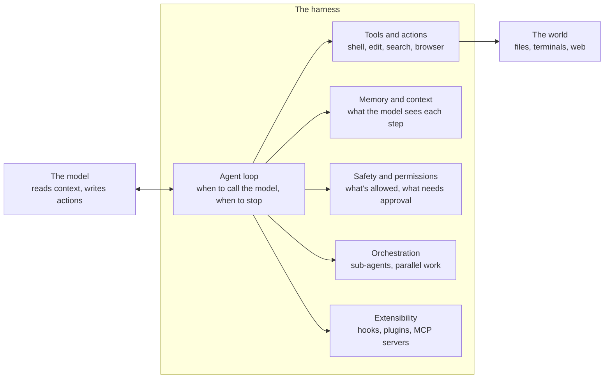
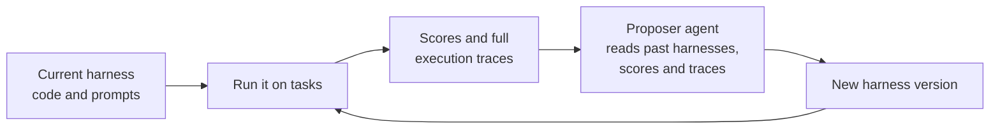

*By Gopi Krishna Tummala*

*An agent is a model plus a harness, the runtime that runs the loop, offers tools, manages context and enforces permissions. What's inside one, what research says matters, and how agents are starting to improve their own.*

A companion to the [agentic AI series](/posts/agentic-ai/agentic-ai-design-patterns).

---

Put the same model inside two different coding agents and ask both to fix the same failing test. One reads the error, searches the codebase for the function, makes a two-line change, runs the tests and stops. The other dumps whole files into its context, edits the wrong function, forgets which test was failing, and runs out of budget. Same model, very different results.

The difference is the **harness**: everything around the model that turns it into an agent. A recent source-code study of coding agents opens with the clearest definition: "An agent is a model plus a harness -- the runtime that couples an LLM to the world." Over the past year, harness design has become its own field of engineering and research, because it turns out to decide a large share of an agent's capability. This post covers what a harness contains, what the research says about designing one, and the newest twist: harnesses that agents improve themselves.

## The idea in one picture

*The model decides; the harness does everything else. The same model behaves very differently depending on the harness around it.*

## What's inside a harness

The source-code study, [Harness Engineering: Anatomy, Architecture, and Evolution of Coding Agents](https://arxiv.org/abs/2609.00006), read the code of eleven open and production coding harnesses, including Claude Code, Codex CLI, Gemini CLI, OpenHands, Aider and Mini-SWE-Agent. It describes each as seven subsystems:

- **The agent loop:** call the model, run the tools it asks for, feed back results, decide when to stop. The study found that "the field runs on hand-rolled async loops," simple loops rather than elaborate frameworks.
- **Model integration:** talking to the model API, including prompt caching, which matters a lot for cost because agents resend most of their context every turn.
- **Tools and actions:** what the agent can do. Some harnesses give a raw shell; others give purpose-built tools for reading, editing and searching files.
- **Memory and context:** what goes into the model's window at each step, and what's stored outside it.
- **Safety and permissions:** which actions run automatically, which need approval, and what's sandboxed.
- **Orchestration:** spawning sub-agents for side tasks.
- **Extensibility:** hooks that run custom code before or after actions, plugins, and MCP servers.

The designs are converging. The study notes that Claude Code's hook vocabulary and plugin format have been adopted as Codex interfaces, while the two still differ in details like how they share prompt caches with sub-agents and how many layers their permission systems have, with Codex leaning on native operating-system sandboxing.

## Context: the harness's most important job

Of all the subsystems, context management has the biggest effect on everyday behavior. Anthropic's guide to [context engineering](https://www.anthropic.com/engineering/effective-context-engineering-for-ai-agents) describes the main techniques harnesses use, introduced in [Part 2](/posts/agentic-ai/agentic-ai-design-patterns-part-2#context-engineering-the-scarce-resource) of the series:

- **Load just in time.** Claude Code is a good example of a hybrid: a project's memory file (`CLAUDE.md`) is loaded up front, while files are found with search tools only when needed.
- **Compact.** Summarize the conversation as it approaches the window limit; the lightest form simply clears old tool output.
- **Take structured notes** that persist outside the window.
- **Use sub-agents** with clean windows for focused side tasks, each returning a short summary.

For tasks that span many sessions, compaction alone isn't enough. Anthropic's post on [harnesses for long-running agents](https://www.anthropic.com/engineering/effective-harnesses-for-long-running-agents) describes splitting the work: an initializer agent sets up the project, including a feature list stored as JSON (which the model is "less likely to inappropriately change or overwrite" than prose), a progress file and a setup script, and then a coding agent makes incremental progress each session, committing to git and updating the progress file so the next session can pick up where it left off. The harness, not the model's memory, carries continuity.

## What research says matters

An [empirical study of harness design](https://arxiv.org/abs/2609.20804) (2026) held the loop fixed and varied planning, tools and context management across four models on two coding benchmarks, 176 configurations in all. Its findings are a useful guide because they're not "always do X":

- **Context management matters more as the budget tightens.** With a generous context window, it barely helps; with a small one, it's essential. Trimming old content in stages before summarizing gave the best efficiency, while letting the agent recall old content added machinery models rarely used.
- **Planning helps weaker models and saves money for stronger ones.** For a weaker model, an explicit planning step improved accuracy. For a strong one, it mainly reduced cost.
- **Purpose-built tools help models that are weak at the shell.** Models comfortable with raw bash did as well or better without them, since every extra tool adds choice and overhead.

The lesson: there's no universally best harness. The right one depends on the model, and features that help a weak model can be dead weight for a strong one.

A different study, [How Much Heavy Lifting Can an Agent Harness Do?](https://arxiv.org/abs/2604.07236), made the point even more strongly in one planning game. A well-structured harness did most of the work with no model calls at all, and the model's revision step activated on only 4.3 percent of turns. The authors argue the model's role should be "quantified as residual rather than assumed central," a useful reminder that a good harness can make a modest model look excellent.

## The newest idea: agents that improve their own harness

If the harness matters this much, why hand-tune it? Several 2026 papers automate harness design:

*An outer loop: run the harness, study what went wrong in the traces, and have an agent rewrite the harness. The inner agent does the task; the outer agent improves the inner agent's runtime.*

- **[Meta-Harness](https://arxiv.org/abs/2603.28052)** (Lee et al., with Chelsea Finn and Omar Khattab) uses Claude Code with Opus 4.6 as a proposer that reads the code, scores and execution traces of every previous harness candidate through the file system, often dozens of files per iteration, and writes a better one. On TerminalBench-2, its harness with Opus 4.6 reached 76.4 percent, ranking second among Opus 4.6 agents and ahead of a strong hand-engineered harness at 74.7 percent; with the much smaller Haiku 4.5 it ranked first among Haiku agents. Its key finding is that richer access to past experience, the full traces, not just scores, is what makes automated harness engineering work.
- **[The Last Harness You'll Ever Build](https://arxiv.org/abs/2604.21003)** adds a second level: a loop that evolves a task's harness, and a meta-loop that improves the evolution process itself across tasks, aiming for new domains that need "no human harness engineering at all."
- **[Natural-Language Agent Harnesses](https://arxiv.org/abs/2603.25723)** writes harness policy as an editable plain-language document that a shared runtime interprets, matching coded harnesses' results with much shorter policies that are easier to read and change.

These are early results, mostly preprints, on benchmarks rather than messy real work. But the direction is clear: harness engineering is becoming something agents help do.

## What this means in practice

For anyone building or choosing an agent:

- **Evaluate the agent, not the model.** A model's benchmark score tells you little until it's in your harness, on your tasks.
- **Fit the harness to the model.** Re-test harness features when you change models; what helped last year's model may slow down this year's.
- **Invest in context management and traces first.** They have the largest everyday effect, and traces are what both you and an automated optimizer learn from.
- **Keep the loop simple.** The best production harnesses are straightforward loops with well-designed tools around them.

## What I'd remember

- **Agent = model + harness.** Loop, model integration, tools, context, permissions, orchestration, extensibility.
- **Context management is the harness's biggest lever.** Just-in-time loading, compaction, notes and sub-agents.
- **There's no universal best harness.** Planning and tools help weaker models and can burden stronger ones.
- **A good harness can do the heavy lifting.** The model's role is sometimes smaller than assumed.
- **Harnesses are starting to improve themselves.** Outer loops that learn from execution traces.

## Where to go next

- [Discovery Harnesses](/posts/agentic-ai/co-scientist-alphaevolve-discovery-harnesses), for harnesses built to generate and test scientific ideas.
- [Craft Anything](/posts/agentic-ai/craft-anything-rebuilding-software), a harness that studies software and rebuilds it.
- [Part 2: Memory, Tools and Orchestration](/posts/agentic-ai/agentic-ai-design-patterns-part-2), for the context ideas harnesses implement.
- Anthropic's [context engineering](https://www.anthropic.com/engineering/effective-context-engineering-for-ai-agents) and [long-running harness](https://www.anthropic.com/engineering/effective-harnesses-for-long-running-agents) posts; papers: [the eleven-harness study](https://arxiv.org/abs/2609.00006), [the empirical study](https://arxiv.org/abs/2609.20804), [Meta-Harness](https://arxiv.org/abs/2603.28052).

**Questions to sit with**

1. If you switched your agent to a stronger model, which harness features would you re-test first?
2. Why might full execution traces help an automated optimizer more than scores alone?
3. What should a harness carry between sessions so that a long task survives a restart?
