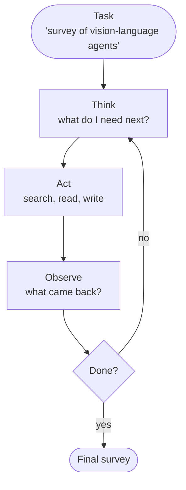
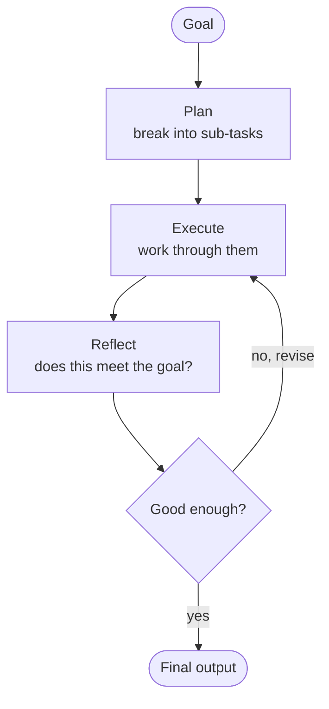
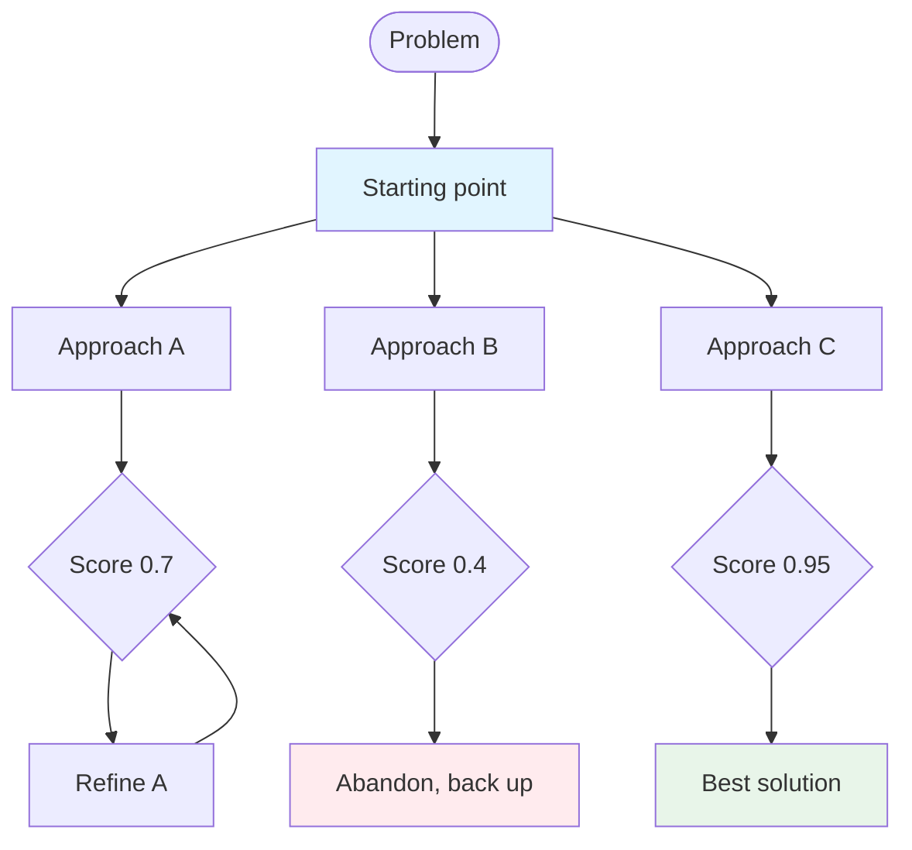
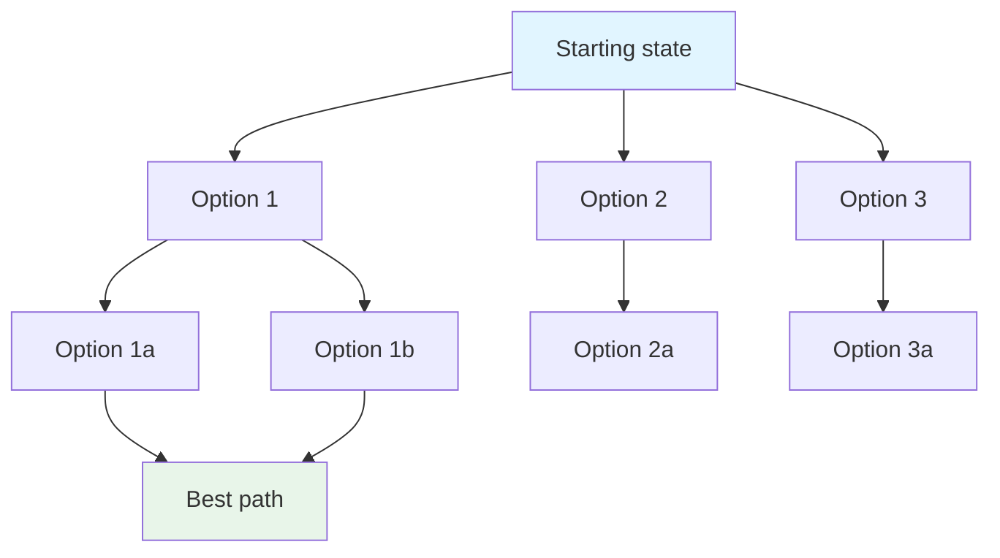
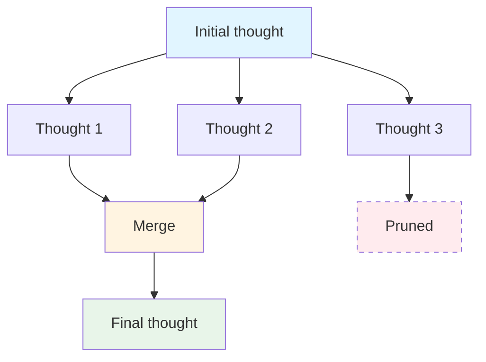

*By Gopi Krishna Tummala*

*The core of every agent is a loop: reason, act, observe, repeat. How planning and reflection make it more reliable, and how agents spend extra effort on hard problems.*

Part 1 of 5 in the [agentic AI series](/posts/agentic-ai/agentic-ai-design-patterns). Next: [Part 2: Memory, Tools and Orchestration](/posts/agentic-ai/agentic-ai-design-patterns-part-2).

---

Our agent has been asked to write a two-page survey of vision-language agents published this year, with citations. A plain language model would answer in one pass from what it remembers. The agent instead works in steps: decide what to look for, search, read what came back, notice what's missing, search again. Every step is a small decision based on what the last one revealed.

That loop is the foundation of every agent. This part covers the loop itself, the planning and reflection that keep it on track, and the techniques agents use when a problem is too hard to get right in a single pass: asking several times, exploring several paths, and learning from failure. Each one trades more model calls for better answers, and knowing when that trade is worth it is most of the skill.

## The idea in one picture

*Think, act, observe, repeat. Everything else in this series is a way to make this loop smarter, safer or cheaper.*

## The loop: reason and act together

The pattern was named in [ReAct](https://arxiv.org/abs/2210.03629) (Yao et al., 2022): interleave reasoning ("I need recent papers, so I should search arXiv for 2026 vision-language agents") with actions (run the search) and observations (the results). Before ReAct, systems either reasoned without acting, which led to confident made-up facts, or acted without reasoning, which led to aimless tool use. Together, each informs the other: the reasoning decides the next action, and the observation corrects the reasoning.

For the survey, the loop might run: search for recent papers; read the abstracts; notice that a well-known benchmark keeps being mentioned; search for it; find that two surveyed papers disagree about its results; read both more carefully. No step could have been planned at the start, because each depends on what the previous one found. That's what makes it an agent rather than a script.

The loop's weakness is that it's short-sighted. Each step reacts to the last observation, so on a long task the agent can wander, repeat itself, or lose track of the overall goal.

## Plan, execute, reflect

The fix for short-sightedness is to plan first. A planning step breaks the goal into sub-tasks ("find papers, group them by approach, summarize each group, compare benchmarks, write the introduction"). An execution step works through them. A reflection step checks the result against the goal and either accepts it or sends work back.

*The plan keeps the agent pointed at the goal; reflection catches what the plan missed.*

The plan doesn't have to be rigid. Good agents revise it as they learn: if the search turns up a whole category of work nobody anticipated, the plan grows a new section. The reflection step is often the same model in a different role, with instructions to be critical rather than helpful, and it catches a surprising amount: missing sections, claims without citations, a summary that drifted from the question.

## Thinking harder, option 1: ask several times

Language models are random in a useful way. Ask the same hard question several times and you get somewhat different answers; the answer that appears most often is more likely to be right. [Self-consistency](https://arxiv.org/abs/2203.11171) (Wang et al., 2022) formalized this for reasoning problems: sample several chains of reasoning and take a majority vote on the final answer. It reliably improved accuracy on math and logic problems.

For the survey, the same idea applies to judgment calls. Should a borderline paper count as a "vision-language agent"? Ask three times; if all three say yes, include it confidently; if they split, flag it for a closer read. The cost is obvious: three calls instead of one.

## Thinking harder, option 2: explore a tree

Majority voting only helps at the end. For problems with many decision points, it's better to explore different paths and drop the bad ones early. [Tree of Thoughts](https://arxiv.org/abs/2305.10601) (Yao et al., 2023) had the model propose several next steps, evaluate how promising each looked, and expand only the best, backing up when a branch hit a dead end, the way a person working a puzzle tries an idea, sees it won't work, and returns to an earlier point.

[Language Agent Tree Search](https://arxiv.org/abs/2310.04406) (LATS, Zhou et al., 2023) combined this with acting in the world and with Monte Carlo tree search, the method behind game-playing systems like AlphaGo. Each branch is scored, promising branches are refined, and poor ones are abandoned:

*Try several approaches, score them, refine the promising ones and drop the rest.*

Tree search across many levels looks like this, with most branches never fully explored:

*Monte Carlo tree search spends effort where the scores are promising, so the tree grows unevenly toward good solutions.*

Search shines on problems with a clear way to score partial progress: code that has tests, math with checkable steps, puzzles. It's much less useful when "good" is a matter of taste, and it multiplies cost by the number of branches explored.

## Thinking harder, option 3: a graph instead of a tree

Trees only branch. Real problem-solving also merges: two partial ideas combine into a better one. [Graph of Thoughts](https://arxiv.org/abs/2308.09687) (Besta et al., 2023) let thoughts branch, merge and be pruned, which suits tasks naturally built from parts.

*Thoughts can combine, not just split. Useful when the answer is assembled from independently developed parts.*

The survey is a good fit: separate threads summarize different families of agents, and a merge step combines them into one comparison, while a thread that turned out to be off-topic is pruned.

## Learning from mistakes within a task

The last foundational idea is reflection that persists. [Reflexion](https://arxiv.org/abs/2303.11366) (Shinn et al., 2023) had an agent, after a failed attempt, write itself a short note in plain language about what went wrong ("I cited a paper from its abstract without checking that its benchmark numbers matched the claim"), and include those notes in the next attempt. No model weights change; the "learning" is in the notes. On coding and reasoning tasks with clear success signals, it improved results significantly over plain retrying.

The idea generalizes far beyond the paper: give the agent a place to record lessons, and feed them back. It's the ancestor of the memory files that modern coding agents keep, covered in [Agent Harnesses](/posts/agentic-ai/agent-harness-engineering).

## Choosing how hard to think

All of these trade model calls for quality, so the choice depends on the task:

- **Simple, well-defined steps:** a single pass, or a fixed workflow.
- **Open-ended tasks with many steps:** the basic loop with planning and reflection.
- **Hard problems with a way to score progress:** sampling or tree search.
- **Repeated attempts at the same kind of task:** reflection notes that carry lessons forward.

Newer reasoning models do much of this internally, spending more computation on hard questions before answering, which removes the need for some explicit scaffolding. The ideas still matter, because they explain what those models are doing and when an explicit loop still helps.

## What I'd remember

- **The loop is the agent.** Think, act, observe; each step depends on the last.
- **Plan to stay on course, reflect to catch errors.** Short-sighted loops wander without both.
- **Sample, search or merge to think harder.** Each spends more calls for better answers.
- **Search needs a way to score progress.** Tests, checks or a reliable judge.
- **Written lessons are a cheap form of learning.** Reflexion's notes became today's memory files.

## Where to go next

- [Part 2: Memory, Tools and Orchestration](/posts/agentic-ai/agentic-ai-design-patterns-part-2), the next part.
- [The agentic AI map](/posts/agentic-ai/agentic-ai-design-patterns), for the whole series.
- Papers: [ReAct](https://arxiv.org/abs/2210.03629), [Tree of Thoughts](https://arxiv.org/abs/2305.10601), [LATS](https://arxiv.org/abs/2310.04406), [Reflexion](https://arxiv.org/abs/2303.11366).

Next: [Part 2: Memory, Tools and Orchestration](/posts/agentic-ai/agentic-ai-design-patterns-part-2).

**Questions to sit with**

1. Which steps of the survey task could be planned in advance, and which can only be decided after seeing results?
2. When would tree search be a waste of money?
3. What kind of lesson would be worth writing down after a failed attempt at the survey?
