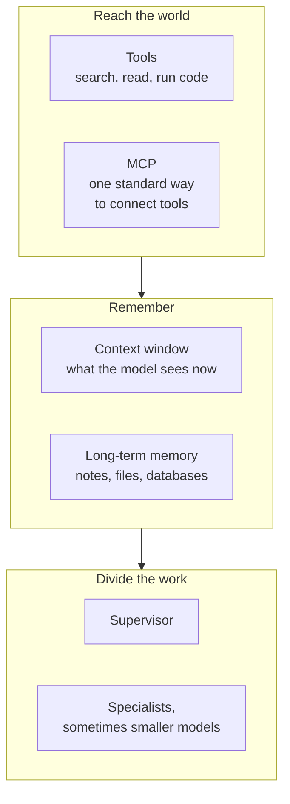
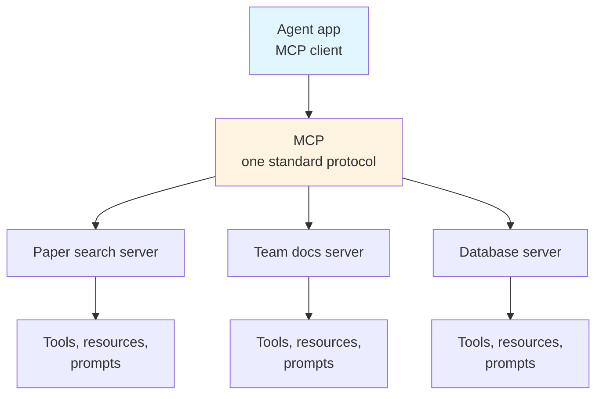
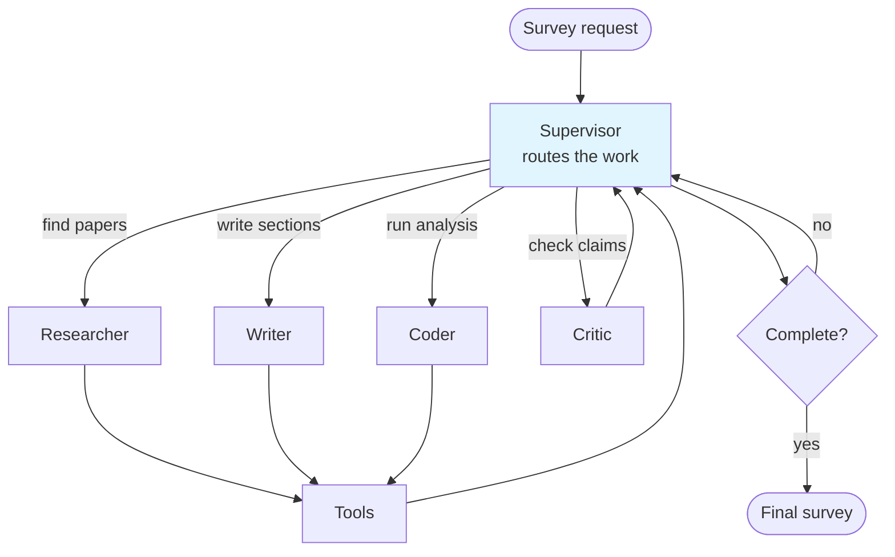
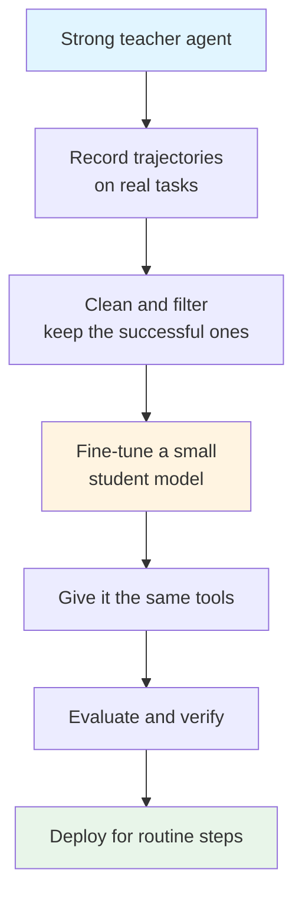

*By Gopi Krishna Tummala*

*How agents reach the world through tools, what they remember, why context is the scarce resource, and how work is split between a supervisor, specialists and smaller models.*

Part 2 of 5 in the [agentic AI series](/posts/agentic-ai/agentic-ai-design-patterns). Previous: [Part 1: The Loop](/posts/agentic-ai/agentic-ai-design-patterns-part-1). Next: [Part 3: Agents in the World](/posts/agentic-ai/agentic-ai-design-patterns-part-3).

---

Part 1's loop needs three things to do real work on our survey task. It needs **tools**, to search for papers and read them. It needs **memory**, because the agent will read dozens of papers over a long session and can't hold all of them in mind at once. And for a task this size, it helps to divide the work: one agent finding papers, another summarizing, another checking citations, coordinated by a supervisor.

These are the parts that turn a clever loop into a system that can work for an hour without losing its way.

## The idea in one picture

*Tools let the agent act; memory lets it keep track; orchestration lets several agents share a large task.*

## Tools: the agent's hands

A language model on its own can only produce text. Tools change that. The model is told which tools exist, a search function, a PDF reader, a code runner, with a short description of each. When it wants to use one, it writes a structured request ("search: vision-language agents 2026"). The surrounding program runs the tool and feeds the result back into the loop. The model never touches the internet directly; it asks, and the program acts.

Two practical lessons come up again and again:

- **Fewer, clearer tools work better.** Every tool's description takes up space in the model's context, and with dozens of similar tools the model picks the wrong one more often. Many systems route first: a quick step narrows the toolbox to the few relevant ones before the agent sees them.
- **Independent calls should run at the same time.** If the agent needs to fetch five papers, fetching them in parallel rather than one after another cuts the wait to roughly the slowest one. Modern model APIs let the model request several tool calls in a single step.

## MCP: one plug for every tool

Connecting every AI application to every tool with custom code doesn't scale. The [Model Context Protocol](https://modelcontextprotocol.io/), released by Anthropic in November 2024 and since adopted widely across the industry, standardizes the connection. A tool provider writes an MCP server once, exposing its tools, data and prompt templates; any application that speaks MCP can use it.

*Write a server once, use it from any agent. The agent app stays in charge of what's actually allowed.*

MCP standardizes how tools are described and called; it doesn't make them safe. Permissions, sandboxing and approval for risky actions are still the application's job, covered in [Part 4](/posts/agentic-ai/agentic-ai-design-patterns-part-4) and [Agentic MLOps](/posts/mlops/beyond-inference-agentic-mlops-mcp).

## Memory: what the agent keeps

People distinguish several kinds of memory, and agents borrow the same split:

- **Working memory** is the context window: everything the model sees right now, the task, recent steps, tool results. It's fast and limited.
- **Episodic memory** records what happened: "searched arXiv, found 40 candidates, rejected 12 as off-topic." It lets the agent avoid repeating itself.
- **Semantic memory** holds facts learned along the way: "the BenchX benchmark has three splits; most papers report only the hardest."
- **Procedural memory** holds how to do things: lessons like Part 1's Reflexion notes, or a project's conventions.

Two influential research systems shaped how agents manage this. [MemGPT](https://arxiv.org/abs/2310.08560) treated the context window like a computer's RAM and external storage like disk, letting the model move information in and out as needed. [Generative Agents](https://arxiv.org/abs/2304.03442) (the simulated town of 25 characters) kept a stream of memories and retrieved them by recency, importance and relevance, then periodically wrote higher-level reflections that summarized many memories into a few insights.

## Context engineering: the scarce resource

The single most important idea in this part: what's in the context window at each step largely decides what the agent does next. Too little and it lacks information; too much and it loses focus, gets slower and costs more. Anthropic's guide to [context engineering](https://www.anthropic.com/engineering/effective-context-engineering-for-ai-agents) puts the goal as finding "the smallest set of high-signal tokens" for each step, and describes the main techniques:

- **Load just in time.** Keep lightweight references, a file path, a paper ID, and fetch the content only when needed, rather than loading everything up front.
- **Compact.** When the conversation nears the window's limit, summarize it into the essentials and continue from the summary. The simplest version clears old tool results that are no longer needed.
- **Take notes outside the window.** The agent writes progress and findings to a file it can reread later, so nothing important depends on staying in context.
- **Give sub-tasks a fresh window.** A sub-agent explores a narrow question in its own clean context and returns only a short summary.

For our survey, that means the agent doesn't keep 40 full papers in context. It keeps a running notes file with one paragraph per paper, rereads the relevant paragraphs when writing each section, and fetches a full paper again only when a detail needs checking.

## Supervisor and specialists

When a task has distinct kinds of work, it often helps to split it across agents, each with its own instructions, tools and context. The most common structure in production is a supervisor that routes work to specialists and checks the results:

*Each specialist has a focused job and a clean context; the supervisor keeps the overall plan and decides when it's done.*

Anthropic described this structure in its [multi-agent research system](https://www.anthropic.com/engineering/multi-agent-research-system): a lead agent plans and spawns subagents that search in parallel, each returning condensed findings. The benefits are parallelism and focus. The costs are many more model calls, and the hardest part, coordination: the supervisor must give each specialist enough context to do its job without overloading it, and must notice when two specialists return conflicting results.

## Hidden reasoning and smaller models

Two trends changed how these systems are built.

**Reasoning models think internally.** Models trained to reason at length before answering, such as OpenAI's o-series and Claude with extended thinking, do much of the planning and self-checking that agents once needed explicit prompts for. In practice, that means simpler agent loops around stronger models, with the expensive reasoning reserved for the steps that need it.

**Routine steps move to smaller models.** Many steps in an agent's work are repetitive: classify this paper, extract this citation, format this table. A common pattern is to record a strong model's trajectories on real tasks and fine-tune a much smaller model to imitate them for those steps:

*The same teacher-student idea as in [diffusion distillation](/posts/generative-ai/diffusion-distillation-fewer-steps): pay once in training to save on every run.*

The supervisor stays on a strong model, specialists handling routine work run on small ones, and the cost of a long task drops considerably. The risk is the usual one with distillation: the student is reliable only on the kinds of task it was trained on.

## What I'd remember

- **Tools are requests the program carries out.** Fewer, clearer tools; independent calls in parallel.
- **MCP standardizes connections, not safety.** Permissions remain the application's job.
- **Context is the scarce resource.** Load just in time, compact, keep notes, use fresh sub-contexts.
- **Supervisor plus specialists is the common production shape.** Parallel and focused, at the cost of coordination.
- **Reasoning models simplify loops; small models cut costs.** Strong models where judgment matters, distilled ones for routine steps.

## Where to go next

- [Part 3: Agents in the World](/posts/agentic-ai/agentic-ai-design-patterns-part-3), the next part.
- [Agent Harnesses](/posts/agentic-ai/agent-harness-engineering), for how real coding agents implement memory, context and sub-agents.
- Anthropic's [context engineering](https://www.anthropic.com/engineering/effective-context-engineering-for-ai-agents) and [multi-agent research system](https://www.anthropic.com/engineering/multi-agent-research-system) posts, and the [MCP documentation](https://modelcontextprotocol.io/).

Previous: [Part 1: The Loop](/posts/agentic-ai/agentic-ai-design-patterns-part-1). Next: [Part 3: Agents in the World](/posts/agentic-ai/agentic-ai-design-patterns-part-3).

**Questions to sit with**

1. For the survey, what belongs in the context window at the moment the agent writes the conclusion?
2. When would splitting work across specialist agents cost more than it saves?
3. Which steps of the survey could a small distilled model handle safely?
