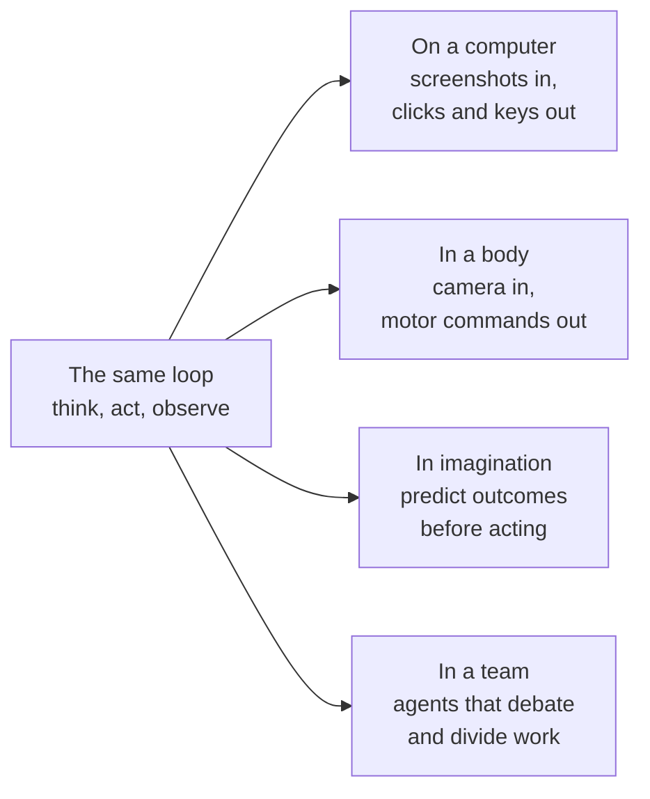
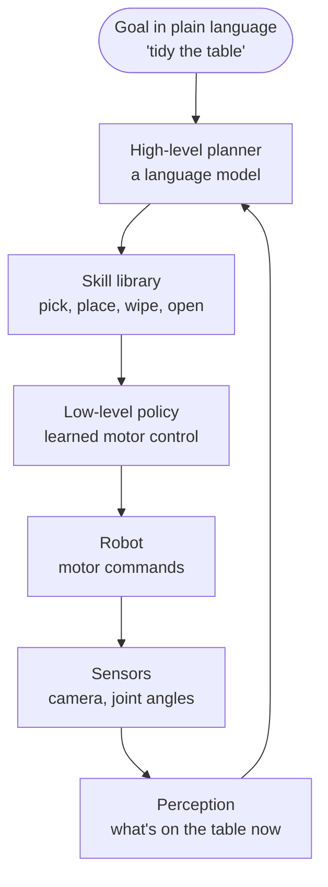
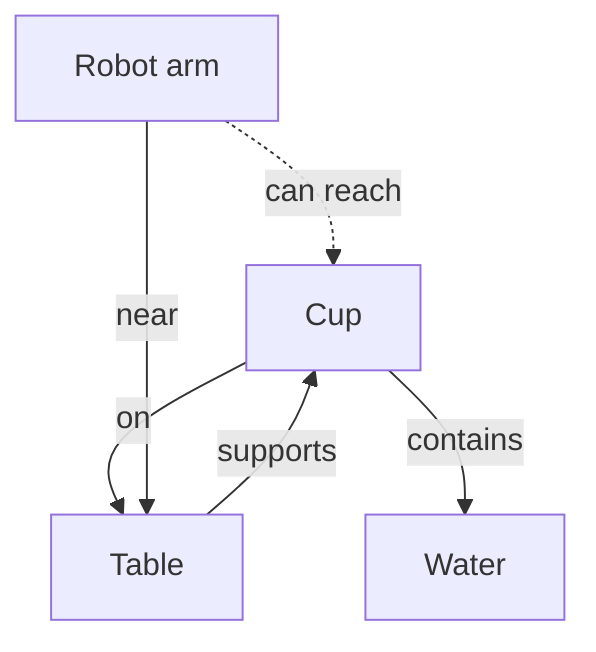
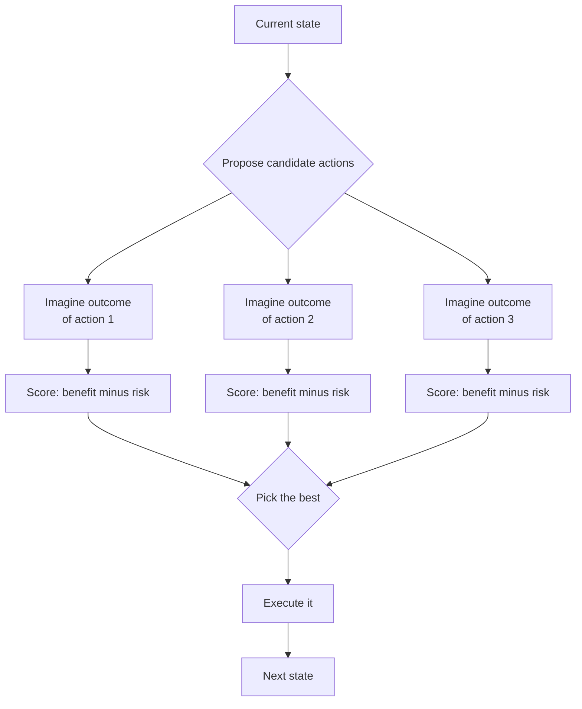

*By Gopi Krishna Tummala*

*Agents that operate computers like a person, robots that plan with language, imagining outcomes before acting, and teams of agents. What each adds, and what makes each hard.*

Part 3 of 5 in the [agentic AI series](/posts/agentic-ai/agentic-ai-design-patterns). Previous: [Part 2: Memory, Tools and Orchestration](/posts/agentic-ai/agentic-ai-design-patterns-part-2). Next: [Part 4: Failure Modes and Safety](/posts/agentic-ai/agentic-ai-design-patterns-part-4).

---

So far our survey agent has worked through clean interfaces: a search API, a PDF reader. Much of the world doesn't offer those. The conference's paper portal might only have a web page with filters and a "load more" button. A results table might only exist inside a spreadsheet someone emailed. And beyond screens, there's the physical world, where an agent's "tools" are a robot arm and a camera.

This part covers agents that act through the same interfaces people use, agents with bodies, and agents that work in groups. The loop from Part 1 stays the same. What changes is how messy and unforgiving the environment is.

## The idea in one picture

*The loop doesn't change. The environment does: from APIs to screens to physical space to other agents.*

## Operating a computer

Computer-use agents see the screen as images and act with mouse clicks and keystrokes, the way a person does. Anthropic released computer use for Claude in October 2024, and similar agents followed from OpenAI and others. The appeal is reach: any software with a screen becomes usable, no API required. For our survey, the agent could open the conference portal, set the filters, page through the results and copy the titles.

It's also hard. Screens are cluttered, buttons move, pages load slowly, pop-ups appear. A plan of thirty clicks fails if any one goes wrong. The benchmarks show the gap. [OSWorld](https://arxiv.org/abs/2404.07972) (2024) tested agents on real tasks across desktop applications; people completed about 72 percent, and the best model at the time about 12. [WebArena](https://arxiv.org/abs/2307.13854) built realistic websites for repeatable web tasks. Scores have risen quickly since, but reliability on long, unfamiliar tasks remains the limit.

One lesson from coding agents carries over: the interface matters as much as the model. [SWE-agent](https://arxiv.org/abs/2405.15793) showed that designing tools specifically for the model, compact file views, a search command, an editor that reports syntax errors immediately, made the same model far better at fixing real software bugs than giving it a raw terminal. That idea, now called harness design, gets its own post: [Agent Harnesses](/posts/agentic-ai/agent-harness-engineering).

Because these agents can click anything, they run in sandboxes, isolated virtual machines or containers with no access to anything they don't need, and pause for approval before irreversible actions.

## Agents with bodies

A robot agent faces everything above plus physics. Language models are good at high-level plans ("to tidy the table: pick up the cup, put it in the sink, wipe the table") and bad at the millisecond-level control of a gripper. So embodied agents split the work:

*The language model chooses which skill to use next; learned policies carry it out; perception reports back. The loop from Part 1, with a body.*

Google's [SayCan](https://arxiv.org/abs/2204.01691) (2022) made the split concrete. The language model proposed useful next skills, and a learned estimate of what the robot could actually do in its current situation ruled out impossible ones, so the plan stayed grounded in the robot's abilities. [Voyager](https://arxiv.org/abs/2305.16291) (2023), in Minecraft, had the agent write new skills as code, test them, and store the ones that worked in a growing library, getting steadily more capable without retraining. Newer robot foundation models fold planning and control into one network; see [Vision-Language-Action Models](/posts/robotics/vla-models-data-architecture-evaluation).

## Understanding 3D space

For a robot, "the cup" isn't a word, it's an object with a position, sitting on something, reachable or not. Scene graphs give language models that structure: objects as nodes, relationships as edges.

*A scene graph turns a camera view into something a language model can reason about: what's where, what's on what, what can be reached.*

Turned into text, the graph lets the model reason: "the cup contains water, so carry it upright; it's within reach, so no need to move the base." Systems like [SayPlan](https://arxiv.org/abs/2307.06135) used 3D scene graphs to plan across entire buildings, searching the graph for relevant rooms instead of loading everything into context, which is context engineering from Part 2 applied to physical space.

## Imagining before acting

Some actions can't be undone: a robot that knocks over the glass, an agent that sends an email. An imagination loop predicts the outcome of each candidate action before choosing one:

*Simulate, score, then act. It's Part 1's tree search, run through a model of the world instead of the world itself.*

The "world model" doing the imagining can be the language model's own commonsense ("if I pull the tablecloth, the cup falls"), a physics simulator, or a learned video model that predicts what the camera will see next. Research such as [LLM-MCTS](https://arxiv.org/abs/2305.14078) combined language models' commonsense with tree search for household planning. The approach is only as good as the predictions: a world model that's wrong about physics leads the agent confidently astray, the problem covered in [Physics-Aware Video Diffusion](/posts/generative-ai/physics-aware-video-diffusion-models).

## Teams of agents

Part 2's supervisor and specialists is one kind of team. Research has explored others:

- **Role-playing teams.** [CAMEL](https://arxiv.org/abs/2303.17760) and Microsoft's [AutoGen](https://arxiv.org/abs/2308.08155) set up agents with different roles that converse to solve a task, a user proxy, a coder, a critic.
- **Debate.** [Du et al. (2023)](https://arxiv.org/abs/2305.14325) had several model instances propose answers, read each other's reasoning and revise over rounds, improving factual accuracy and reasoning over a single model.
- **Standard protocols.** As agents from different vendors need to cooperate, protocols for agent-to-agent communication have emerged alongside MCP, such as Google's Agent2Agent (A2A) protocol, so one agent can discover another's capabilities and hand off tasks.

For the survey, a debate between two agents, one arguing a paper belongs in the survey and one arguing it doesn't, is a cheap way to make borderline judgments more careful. The caution from Part 2 applies more strongly here: every extra agent multiplies cost, and conversations between agents can drift, loop or reinforce each other's mistakes. Most production systems keep teams small and structured.

## What I'd remember

- **Computer use reaches any software, at the cost of reliability.** Long click sequences fail on any single misstep.
- **Interfaces designed for the model beat raw access.** SWE-agent's lesson, now called harness design.
- **Embodied agents split planning from control.** Language models choose skills; learned policies move.
- **Imagine before irreversible actions.** Only as good as the world model doing the imagining.
- **Teams help on hard judgments, and multiply cost.** Keep them small and structured.

## Where to go next

- [Part 4: Failure Modes and Safety](/posts/agentic-ai/agentic-ai-design-patterns-part-4), the next part.
- [Vision-Language-Action Models](/posts/robotics/vla-models-data-architecture-evaluation), for robot foundation models.
- Papers: [OSWorld](https://arxiv.org/abs/2404.07972), [SWE-agent](https://arxiv.org/abs/2405.15793), [SayCan](https://arxiv.org/abs/2204.01691), [Voyager](https://arxiv.org/abs/2305.16291).

Previous: [Part 2: Memory, Tools and Orchestration](/posts/agentic-ai/agentic-ai-design-patterns-part-2). Next: [Part 4: Failure Modes and Safety](/posts/agentic-ai/agentic-ai-design-patterns-part-4).

**Questions to sit with**

1. When should an agent use a computer's screen instead of an API, and what extra checks does that need?
2. Why does a robot need a skill library rather than letting the language model output motor commands directly?
3. What could go wrong when two agents debate, and how would you notice?
