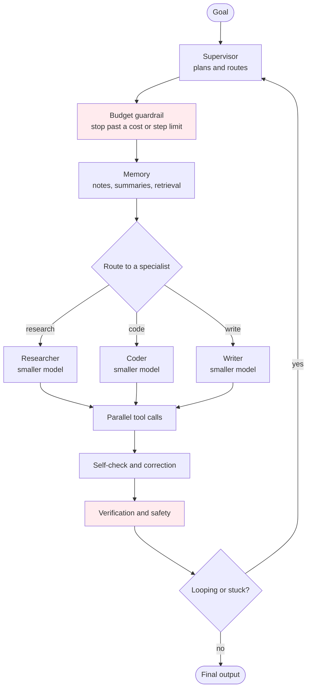
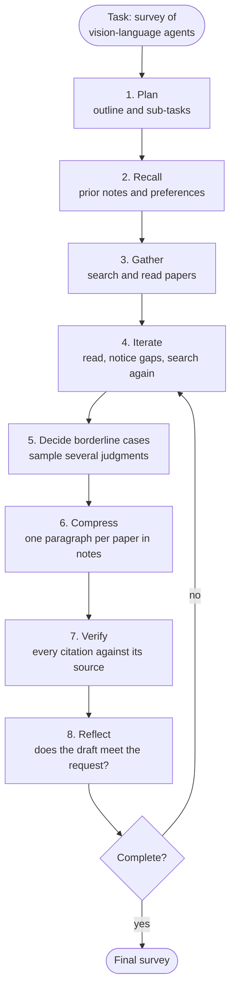

*By Gopi Krishna Tummala*

*How the patterns from this series fit together in a real agent, followed through one task, and what production adds: budgets, tracing, evaluation and cost control.*

Part 5 of 5 in the [agentic AI series](/posts/agentic-ai/agentic-ai-design-patterns). Previous: [Part 4: Failure Modes and Safety](/posts/agentic-ai/agentic-ai-design-patterns-part-4).

---

The first four parts described the pieces: the loop and ways to think harder, tools and memory, agents that work in the world and in teams, and the failures to guard against. This part assembles them into a working system and follows our survey task, "write a two-page survey of vision-language agents published this year, with citations," from request to result.

It also covers what demos skip. A production agent needs a spending limit, a record of every step it took, a way to know whether a change made it better or worse, and a clear idea of which clever techniques are worth their cost.

## The idea in one picture

*A supervisor on a strong model, specialists on cheaper ones, and guardrails at the points where agents typically fail.*

## Following the survey task end to end

Here's how the parts come together on one run:

*Every step uses a pattern from earlier in the series; the loop back from reflection is what makes it an agent.*

1. **Plan** ([Part 1](/posts/agentic-ai/agentic-ai-design-patterns-part-1)): the supervisor drafts an outline (definitions, families of approaches, benchmarks, open problems) and turns it into sub-tasks.
2. **Recall** ([Part 2](/posts/agentic-ai/agentic-ai-design-patterns-part-2)): it checks memory for anything relevant, such as the user's preferred citation style or a survey it wrote last month.
3. **Gather:** the researcher searches several sources in parallel and reads abstracts.
4. **Iterate:** reading reveals gaps, a benchmark everyone mentions, a lab whose work is missing, and triggers new searches. This is the loop doing its job.
5. **Decide borderline cases:** for papers that might or might not count as agents, sample several judgments and include only clear cases, flagging the rest.
6. **Compress:** instead of keeping full papers in context, the agent keeps a notes file with one paragraph per paper.
7. **Verify** ([Part 4](/posts/agentic-ai/agentic-ai-design-patterns-part-4)): every citation is checked against the retrieved paper; claims without a source are removed or flagged.
8. **Reflect:** a critic compares the draft with the original request. Missing comparison section? Back to step 4.

The result is a survey whose citations are real, whose coverage was actively checked for gaps, and whose borderline calls are marked as such: the three things a single-pass model couldn't guarantee.

## Budgets: agents spend money in loops

A single model call has a predictable cost. An agent's cost depends on how many steps it takes, which depends on what it finds. A confused agent can loop for hundreds of steps. Every production agent needs hard limits: maximum steps, maximum tokens or dollars, maximum wall-clock time. When a limit is hit, it should stop cleanly and report what it has, not fail silently.

Budgets also force design choices. Spend expensive reasoning only where it matters: the plan, the hard judgments, the final review. Route routine steps, extracting a citation, classifying a paper, to smaller, cheaper models, as described in [Part 2](/posts/agentic-ai/agentic-ai-design-patterns-part-2#hidden-reasoning-and-smaller-models).

## Tracing: you can't fix what you can't see

When the survey comes back missing an important paper, you need to know why. Was it never found? Found but rejected? Accepted but dropped during compression? Answering requires a trace of every step: each model call with its inputs and outputs, each tool call with its arguments and results, each decision, its cost and its timing.

Traces are the agent equivalent of logs and stack traces combined, and they're how almost every agent bug is found. Many teams build them from day one with standard tracing tools. They also become data: successful traces are training material for the distilled models in Part 2, and failed ones are test cases.

## Evaluation: test the whole trajectory

Evaluating an agent is harder than evaluating a model, because the same task can be done well in many ways and badly in many more. Useful layers:

- **Outcome checks:** did the task succeed? For the survey: are all citations real, are all required sections present, does it cover the key papers on a reference list?
- **Trajectory checks:** was the path reasonable? Did it waste steps, loop, or use tools it shouldn't have?
- **A fixed test set:** a collection of representative tasks, run automatically after every change to prompts, tools or models, so you see regressions before users do.
- **Judges, used carefully:** language models scoring outputs scale well, but they have biases, such as preferring longer answers, so check them against human ratings.

The field's public benchmarks for agents, from [SWE-bench](https://www.swebench.com/) for coding to OSWorld for computer use, are useful for comparing models, but your own test set, built from your own tasks and failures, is what tells you whether your agent works.

## What to ship, and what to skip

From the research covered in this series, a short practical list.

**Usually worth it:**

- A supervisor with focused specialists, using small models where they're reliable.
- Parallel tool calls wherever steps are independent.
- Budgets and loop detection from the first version.
- Notes files and compaction for long tasks.
- Verification of anything others will rely on.
- Tracing and an automatic test set before the first real user.

**Usually not worth it yet:**

- Large, free-form societies of many agents, when a supervisor and two specialists would do.
- Deep tree search on tasks without a reliable way to score progress.
- Elaborate custom frameworks when a simple loop with good tools works. As Anthropic's [Building effective agents](https://www.anthropic.com/engineering/building-effective-agents) advises, start simple and add complexity only when it measurably helps.

## The harness is where this is heading

Everything in this part, the loop, the tools, the context management, the guardrails, the traces, together is what's now called the agent's **harness**. A growing body of research finds that the harness affects results as much as the choice of model, and that it can even be improved automatically. That's the subject of the next posts: [Agent Harnesses](/posts/agentic-ai/agent-harness-engineering), [Discovery Harnesses](/posts/agentic-ai/co-scientist-alphaevolve-discovery-harnesses) and [Craft Anything](/posts/agentic-ai/craft-anything-rebuilding-software).

## What I'd remember

- **Every pattern has a place.** Plan, recall, gather, iterate, decide, compress, verify, reflect.
- **Agents need hard budgets.** Steps, tokens, dollars and time, with clean stops.
- **Trace everything.** Traces find bugs and become training data and test cases.
- **Evaluate outcomes and trajectories.** On your own test set, after every change.
- **Start simple.** Add agents, search and frameworks only when they measurably help.

## Where to go next

- [Agent Harnesses](/posts/agentic-ai/agent-harness-engineering), on the runtime that holds an agent together.
- [The agentic AI map](/posts/agentic-ai/agentic-ai-design-patterns), for the whole series.
- [Agentic MLOps](/posts/mlops/beyond-inference-agentic-mlops-mcp), for running agents on real infrastructure.

Previous: [Part 4: Failure Modes and Safety](/posts/agentic-ai/agentic-ai-design-patterns-part-4).

**Questions to sit with**

1. What would you put in a test set for the survey agent, and how would you score it automatically?
2. Where in the survey workflow would a budget limit most likely be hit, and what should the agent return when it is?
3. Which steps of your own agent idea could be a fixed workflow instead?
