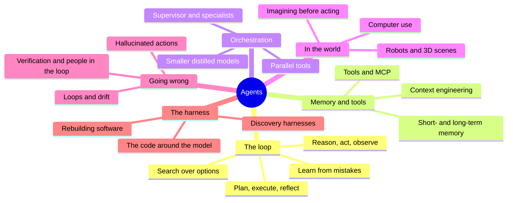

*By Gopi Krishna Tummala*

*The map for this series: what makes a language model an agent, the few ideas every agent is built from, where they go wrong, and the harness that holds it all together.*

---

Ask a chat model "write a two-page survey of vision-language agents published this year, with citations" and it will write something fluent from memory. Some of it will be out of date, and some of the citations may not exist. Ask an agent the same thing and it behaves differently: it plans the survey, searches for recent papers, reads them, notices that one key paper is missing, searches again, drafts, checks every citation against the source, and revises. Same kind of model underneath. The difference is everything around it.

An agent is a language model placed in a loop where it can act, see the results of its actions, and decide what to do next. That simple change, from answering once to acting repeatedly, is behind coding agents, deep-research tools, computer-use assistants and robot planners. This series explains the ideas, intuitively and without code, using that survey task as a running example.

## The idea in one picture

*Six areas, one part each. The harness posts at the end cover the runtime that turns these ideas into a working system.*

## Workflows and agents

Not every system with a language model in a loop needs to be an agent. Anthropic's widely cited [Building effective agents](https://www.anthropic.com/engineering/building-effective-agents) draws a useful line:

- **Workflows** follow paths you designed in advance: search, then summarize, then format. The model fills in each step, but the steps are fixed. They're predictable, cheap and easy to test.
- **Agents** decide their own steps. Given the survey task, an agent might search five times or fifteen, depending on what it finds. That flexibility handles open-ended problems, at the cost of predictability, latency and money.

The advice that follows is the best single piece of guidance in the field: use the simplest thing that works. Many problems that sound like they need an agent are well served by a workflow. Reach for an agent when the steps genuinely can't be known in advance.

## The series

1. **[Foundations](/posts/agentic-ai/agentic-ai-design-patterns-part-1)**: the core loop and the ways agents think harder. Reason and act, plan and reflect, try several approaches and pick the best, and learn from failures within a task.
2. **[Memory, Tools and Orchestration](/posts/agentic-ai/agentic-ai-design-patterns-part-2)**: how agents reach the world through tools and MCP, what they remember, how their limited context is managed, how work is split between a supervisor and specialists, and how smaller models take over routine steps.
3. **[Agents in the World](/posts/agentic-ai/agentic-ai-design-patterns-part-3)**: agents that operate computers and browsers, robots that plan with language, 3D scene understanding, imagining outcomes before acting, and teams of agents.
4. **[Failure Modes and Safety](/posts/agentic-ai/agentic-ai-design-patterns-part-4)**: the ways agents reliably go wrong and the defenses for each, from loops and drift to hallucinated actions and prompt injection.
5. **[The Production Guide](/posts/agentic-ai/agentic-ai-design-patterns-part-5)**: putting it together, following the survey task end to end, and the budgets, observability and evaluation that real deployments need.

Then the harness, the part of the field with the most momentum right now:

- **[Agent Harnesses](/posts/agentic-ai/agent-harness-engineering)**: why "agent = model + harness," what's inside a harness like Claude Code's or Codex's, and what research says about designing and even automatically improving them.
- **[Discovery Harnesses](/posts/agentic-ai/co-scientist-alphaevolve-discovery-harnesses)**: Google's Co-Scientist and AlphaEvolve, harnesses that generate, test and evolve scientific hypotheses and algorithms.
- **[Craft Anything](/posts/agentic-ai/craft-anything-rebuilding-software)**: the open-source project where a coding agent studies an app or website and rebuilds it, and what that means for software.

## What I'd remember

- **Act, observe, repeat.** Seeing the result of an action is what lets an agent correct itself.
- **Thinking harder costs more.** Search, sampling and reflection improve answers by spending more calls.
- **Context is the scarce resource.** What goes into the model's window at each step decides most of its behavior.
- **Every action needs a check.** Agents fail in characteristic ways; budgets, verification and people in the loop catch them.
- **The harness matters as much as the model.** The same model can be mediocre or excellent depending on the runtime around it.

## Where to go next

Start with [Part 1: Foundations](/posts/agentic-ai/agentic-ai-design-patterns-part-1). For running agents in production infrastructure, see [Agentic MLOps](/posts/mlops/beyond-inference-agentic-mlops-mcp). For agents in image and video generation, see [Behind the Generate Button](/posts/generative-ai/multi-stage-generation-pipelines#from-a-pipeline-to-an-agent). For working alongside coding agents, see [Coding With AI Without Losing Your Edge](/posts/interview-prep/ai-assisted-coding-conscious-practice-and-interviews).

**Questions to sit with**

1. For the survey task, which steps could be a fixed workflow, and which genuinely need an agent to decide?
2. What would make an agent's flexibility worth its extra cost and unpredictability?
3. Why might the same model perform very differently inside two different harnesses?
