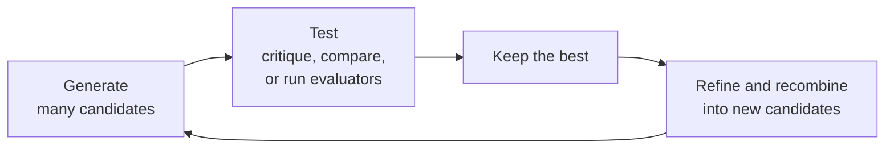
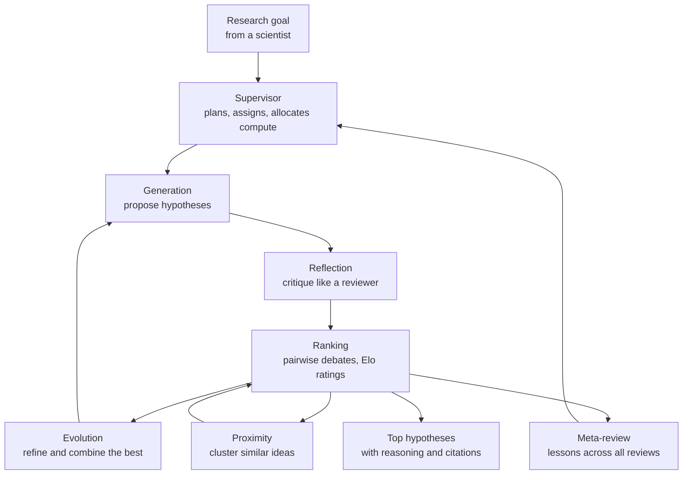
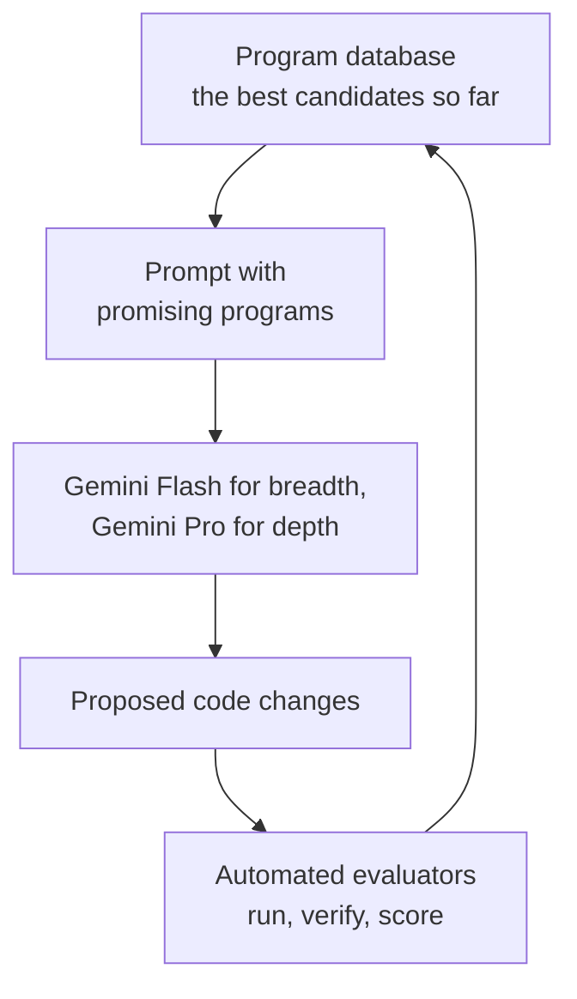

*By Gopi Krishna Tummala*

*Two Google systems show what a harness can do when the goal is discovery: Co-Scientist, agents that debate and rank hypotheses in a tournament, and AlphaEvolve, which evolves code against automated tests.*

A companion to [Agent Harnesses](/posts/agentic-ai/agent-harness-engineering) in the [agentic AI series](/posts/agentic-ai/agentic-ai-design-patterns).

---

A researcher studying a form of leukemia wants to know which existing, already-approved drugs might also work against it. The literature is enormous, the possible combinations of drug and mechanism are many, and most ideas will be wrong. A single chat with a language model produces a handful of plausible guesses with no sense of which are any good.

Google's answer has been to build harnesses around Gemini that behave less like a chat and more like a research group: many ideas generated, critiqued, compared head to head, refined and ranked, with the system spending more computation the harder it's pushed. Two systems show the pattern from different angles. **Co-Scientist** works on hypotheses in natural language, judged by debate. **AlphaEvolve** works on code, judged by automated tests. At Google I/O 2026 both became part of a product suite called [Gemini for Science](https://blog.google/innovation-and-ai/technology/research/gemini-for-science-io-2026).

## The idea in one picture

*The shared loop: generate widely, test hard, keep the winners, build on them. More rounds means better results, so quality scales with the compute you spend.*

## Co-Scientist: a research group made of agents

[Co-Scientist](https://arxiv.org/abs/2502.18864), first described by Google Research in February 2025 and published in Nature in 2026, is a multi-agent system built on Gemini. A scientist states a research goal in plain language. A **supervisor** agent breaks it into work and assigns specialized agents from a shared queue:

- **Generation** proposes hypotheses, exploring the literature through web search.
- **Reflection** acts as a peer reviewer, critiquing each hypothesis for correctness, novelty and testability.
- **Ranking** runs a tournament: hypotheses are compared in pairs through simulated scientific debates, and each gets an Elo rating, the same system used to rank chess players.
- **Evolution** improves top-ranked hypotheses by combining them, simplifying them or taking them in new directions.
- **Proximity** groups similar hypotheses so the tournament compares genuinely different ideas.
- **Meta-review** summarizes patterns across all the reviews and debates, which feeds back to improve the other agents in later rounds.

*A tournament at the center: ideas are generated, reviewed, debated head to head and evolved, with the supervisor deciding where to spend more effort.*

The design spends test-time compute deliberately: the longer it runs, the more rounds of debate and evolution, and the better its top ideas get by its own Elo measure. Google reports that higher Elo ratings correlated with a higher chance of correct answers on a hard science benchmark, while noting itself that Elo is an internal measure, not independent ground truth.

The validation that matters is in the lab. Google reported three examples with collaborators:

- **Drug repurposing for leukemia:** candidates proposed for acute myeloid leukemia were tested, and some inhibited tumor viability at clinically relevant concentrations in multiple cell lines.
- **Liver fibrosis:** the system proposed epigenetic targets grounded in preclinical evidence, investigated with Stanford collaborators.
- **Antimicrobial resistance:** asked to explain how a family of genetic elements spreads between bacteria, it independently proposed the mechanism a research group had found experimentally but not yet published, interaction with diverse phage tails to broaden which bacteria they can infect.

## AlphaEvolve: evolving code against tests

Co-Scientist's judges are other language models. That's flexible but soft. When the problem can be scored by running code, a much harder judge is available, and that's the idea behind Google DeepMind's [AlphaEvolve](https://deepmind.google/discover/blog/alphaevolve-a-gemini-powered-coding-agent-for-designing-advanced-algorithms/) (May 2025).

*An evolutionary loop: language models propose changes to programs, automated evaluators score them objectively, and the best survive to seed the next round.*

The loop has three parts. A database keeps a population of the best programs found so far. Language models, a fast one to generate many ideas and a stronger one for deeper changes, propose modifications to promising programs. Automated evaluators run and score every proposal. Because the scores come from actually running code, the system can't talk its way to a good rating, and it can run thousands of iterations unattended.

The results span pure math and Google's own infrastructure:

- **Matrix multiplication:** an algorithm to multiply 4×4 complex-valued matrices using 48 scalar multiplications, the first improvement in this setting since Strassen's algorithm 56 years earlier.
- **Data centers:** a scheduling heuristic for Google's Borg cluster manager that has been in production for over a year, continuously recovering on average 0.7 percent of Google's worldwide compute resources.
- **Training Gemini:** a 23 percent speedup of a key kernel in Gemini's architecture, cutting overall training time by about 1 percent, and up to a 32.5 percent speedup on a FlashAttention kernel.
- **Open math problems:** on more than 50 problems, it matched the best known results in about 75 percent and improved on them in about 20 percent, including a new lower bound for the kissing number in 11 dimensions.

## Why these are harnesses, not models

Neither system's power comes from a new model. Both use Gemini. What makes them work is the structure around it:

- **Many candidates instead of one answer.** Most ideas are wrong; the harness makes generating them cheap.
- **A judge that's hard to fool.** Co-Scientist uses structured critique and tournaments; AlphaEvolve uses executable tests. The stronger the judge, the more trustworthy the result.
- **Memory of what worked.** A tournament's ratings and an evolutionary database both carry knowledge across rounds.
- **Compute as a dial.** More rounds buy better results, so the harness turns money into quality in a controlled way.

That's the same recipe as Part 1's [tree search](/posts/agentic-ai/agentic-ai-design-patterns-part-1#thinking-harder-option-2-explore-a-tree), scaled up, and the same lesson as [Agent Harnesses](/posts/agentic-ai/agent-harness-engineering): the runtime around the model decides what it can achieve.

## The limits

Both systems are strongest where ideas can be tested. AlphaEvolve needs a problem with an automated evaluator; many important problems don't have one. Co-Scientist's internal rankings are only as good as the model's judgment, which is why its claims rest on lab validation, and it proposes hypotheses rather than proving them. In both cases, scientists still choose the problems, design the experiments and decide what to believe.

## What I'd remember

- **Discovery harnesses generate, test and keep the best.** Then build on the winners.
- **Co-Scientist is a research group of agents.** Generation, review, Elo tournaments and evolution, run by a supervisor.
- **AlphaEvolve evolves code against real evaluators.** Results from matrix multiplication to data-center scheduling.
- **The judge is the key design choice.** Debate is flexible; executable tests are hard to fool.
- **Compute becomes a quality dial.** More rounds, better results, where ideas can be tested.

## Where to go next

- [Agent Harnesses](/posts/agentic-ai/agent-harness-engineering), on harness design in general.
- [Part 1: The Loop](/posts/agentic-ai/agentic-ai-design-patterns-part-1), for the search ideas these systems scale up.
- Sources: [Co-Scientist paper](https://arxiv.org/abs/2502.18864) and [Google Research post](https://research.google/blog/accelerating-scientific-breakthroughs-with-an-ai-co-scientist/), [AlphaEvolve post](https://deepmind.google/discover/blog/alphaevolve-a-gemini-powered-coding-agent-for-designing-advanced-algorithms/) and [paper](https://arxiv.org/abs/2506.13131), [Gemini for Science](https://blog.google/innovation-and-ai/technology/research/gemini-for-science-io-2026).

**Questions to sit with**

1. For a problem in your own work, could you build an automated evaluator, or would you need a debate-style judge?
2. Why might a tournament of pairwise comparisons rank ideas better than scoring each idea alone?
3. What could make a discovery harness confidently converge on a wrong idea?
