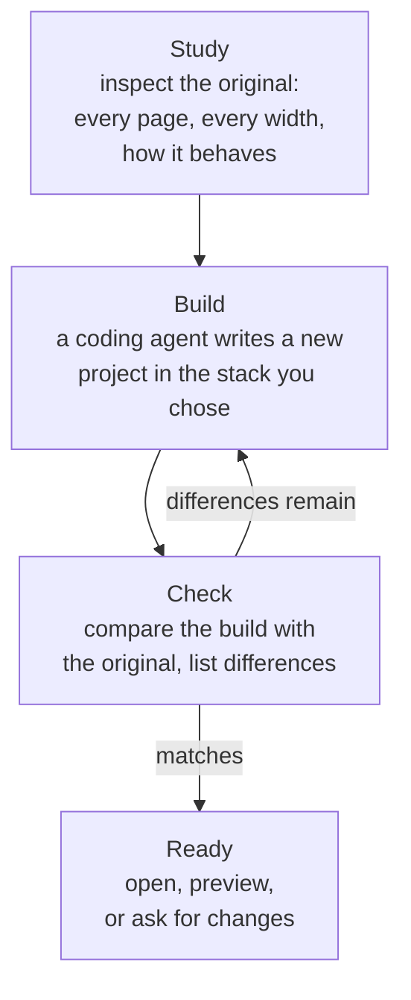

*By Gopi Krishna Tummala*

*An open-source harness that studies a website, app or game from the outside and has a coding agent rebuild it. How the loop works, what "clean room" means here, and the caveats its own authors spell out.*

A companion to [Agent Harnesses](/posts/agentic-ai/agent-harness-engineering) in the [agentic AI series](/posts/agentic-ai/agentic-ai-design-patterns).

---

Your team has an internal dashboard built eight years ago in a framework nobody wants to maintain. Nobody remembers all its behaviors, and the original authors have left. Rewriting it means someone has to click through every page, note how each filter and chart behaves at every screen width, rebuild it, and then compare the two side by side until they match. That's weeks of tedious, careful work.

[Craft Anything](https://github.com/storytold/craft-anything), an open-source project from the ArtCraft community, automates exactly that loop. You point it at software, a website, an app or a game, and say what to build it in. A coding agent studies the original, builds a new version, compares the two, and keeps refining until they match. It drew more than 30,000 GitHub stars within weeks of release in late 2026, partly because it works and partly because of what it implies: if an agent can rebuild software from the outside, much of what made software hard to copy is gone.

## The idea in one picture

*Study, build, check, repeat. The comparison step is what turns a one-shot code generator into an agent that converges on a working rebuild.*

## How the loop works

The project's README describes four stages:

- **Study.** The harness inspects the original as a user would: its pages at every width, its interactions, what happens when you click, type or resize. It records the request, including the target language, framework or game engine, in a project file.
- **Build.** A coding agent creates a new project in the stack you asked for, implementing what the study found.
- **Check.** The harness compares the build with the original and lists what doesn't match yet: a chart that renders differently, a filter that behaves differently on a narrow screen.
- **Ready.** When the differences are gone, you can open or preview the result, or ask for changes and it refines further.

It's [Part 1](/posts/agentic-ai/agentic-ai-design-patterns-part-1)'s plan, act and reflect loop, with an unusually good judge: the original software itself. The agent doesn't need to know what "correct" means in the abstract; it only needs to make the two behave the same. That's the same reason [AlphaEvolve](/posts/agentic-ai/co-scientist-alphaevolve-discovery-harnesses) works well: a concrete, checkable target lets an agent iterate without a person judging every step.

## What "clean room" means here

In software, a clean-room reimplementation is a long-established way to rebuild something without copying it. One team studies how the original behaves and writes a specification; a separate team, never shown the original's code, builds from the specification. The classic example is the reimplementation of the IBM PC's BIOS in the 1980s, which helped create the PC-compatible industry.

Craft Anything describes itself as a clean-room engine, written in Rust, and by default nothing inside the original is read: not its code, files or page source. It works only from observed behavior. A separate deep mode uses every tool available, including looking inside, and is intended for your private use. The README is careful that its clean-room default is a design choice, not a legal guarantee, and also notes plainly that it "is not an operating-system sandbox."

## The caveats, in the project's own words

The README is unusually direct about risks, and they're worth repeating:

- **Installing dependencies runs code.** Packages can run scripts while they install, so building a project the agent wrote means executing code you didn't write. It recommends flags like npm's `--ignore-scripts` and asks before running a kind of command it hasn't seen before.
- **Use it only on what you're allowed to examine.** Its responsible-use section limits it to software you own or have permission to study, and it never bypasses DRM, logins or anti-cheat.
- **It won't copy assets by default.** The agent is told not to reproduce logos, photos or text unless you confirm you own them or have permission.
- **It's early.** The project describes itself as early alpha.

Rebuilding behavior isn't the same as having the right to ship it. Trademarks, copyrighted content, patents and terms of service still apply to the result, and a rebuild that's indistinguishable from a commercial product invites exactly the disputes clean-room processes were invented to avoid. Our dashboard example is the uncontroversial case: your own software, rebuilt in a new framework.

## What it says about software

Craft Anything struck a nerve because it makes a trend concrete. Coding agents made writing code cheap; harnesses like this make reproducing observable behavior cheap too. That shifts where the value in software lives, toward what can't be observed from the outside:

- **Data and network effects:** a rebuilt marketplace has no sellers; a rebuilt social app has no users.
- **Operations and trust:** uptime, security, support, compliance and the reputation built on them.
- **Speed of change:** a clone matches yesterday's product; the original keeps moving.
- **Taste and judgment:** deciding what should exist in the first place, which is the architect's role described in [Coding With AI Without Losing Your Edge](/posts/interview-prep/ai-assisted-coding-conscious-practice-and-interviews#build-with-walls-not-bricks).

The constructive uses are substantial: migrating legacy systems you own, porting games to new engines, recovering software whose source was lost, and learning how something works by rebuilding it. The project's own tagline is about understanding: understand how any software works, and craft your own.

## What I'd remember

- **Study, build, check, repeat.** The original software is the judge, which makes convergence possible.
- **Clean room by default.** Built from observed behavior, not the original's code; a design choice, not a legal shield.
- **Building runs code you didn't write.** Treat dependency installs as untrusted; it's not a sandbox.
- **Permission still matters.** Use it on software you own or may examine; assets and trademarks are separate questions.
- **Value moves to what can't be observed.** Data, operations, trust, speed and judgment.

## Where to go next

- [Agent Harnesses](/posts/agentic-ai/agent-harness-engineering), on the runtime design behind tools like this.
- [Discovery Harnesses](/posts/agentic-ai/co-scientist-alphaevolve-discovery-harnesses), for other agents that iterate against a concrete judge.
- [Part 4: Failure Modes and Safety](/posts/agentic-ai/agentic-ai-design-patterns-part-4), for sandboxing and least privilege.
- The [Craft Anything repository](https://github.com/storytold/craft-anything) and its README.

**Questions to sit with**

1. For a migration you've seen or done, which parts would a study-build-check loop handle well, and which would it miss?
2. Why does having the original software as the judge make this easier than building from a written spec?
3. If a competitor could rebuild your product's interface in a day, what would still make yours worth choosing?
