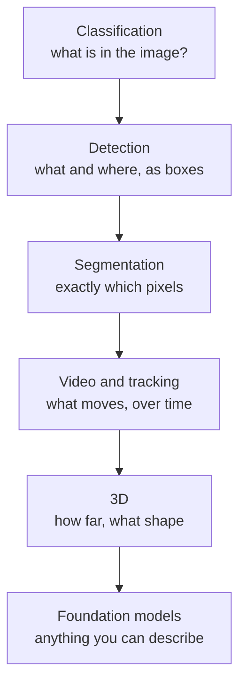
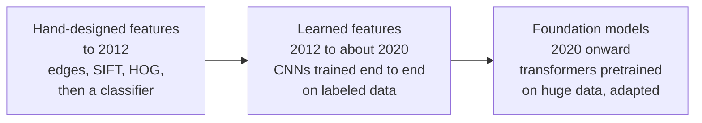

*By Gopi Krishna Tummala*

*The map for this series: the ladder of vision tasks, why vision is hard, and how the field moved from hand-designed features to learned ones to foundation models.*

Module 1 of 8 in the computer vision series. Next: [Module 2: Convolutional Networks](/posts/computer-vision/computer-vision-module-2-convolutional-networks).

---

A grocery store installs a camera above its self-checkout. The camera needs to recognize what's being scanned, notice an item that slipped past the scanner, tell a red onion from a red apple, follow a customer's hand as it moves a bag, judge whether an item is a small bottle or a large one, and handle a new product added to the shelves yesterday. Every one of those is a different computer vision problem, and together they span most of the field.

This series follows that camera from the simplest question, "what is this?", to the hardest, "what is happening here, in 3D, with things I've never seen before?" Each module covers one rung of that ladder, focusing on the ideas and the intuition rather than the math.

## The idea in one picture

*Each rung asks a harder question about the same image. Modules 4 to 8 climb it; Modules 2 and 3 cover the networks that power every rung.*

## Why vision is hard

To a computer, an image is a grid of numbers. A 1080p color frame is about six million of them. Nothing in those numbers says "onion." The same onion looks completely different under the store's fluorescent lights and in afternoon sun, partly hidden under a bag, rotated, close to the camera or far away. Meanwhile, two different objects, a red onion and a red apple, can produce very similar numbers.

A vision system has to be **invariant** to what doesn't matter (lighting, position, angle, size, partial occlusion) and **sensitive** to what does (the subtle difference between onion skin and apple skin). Every architecture in this series is a different answer to that balance.

## Three eras

*The shift each time: let the data decide more of what matters.*

**Hand-designed features.** For decades, engineers wrote algorithms to extract features they believed mattered: edges, corners, gradient histograms (HOG), scale-invariant keypoints (SIFT). A classifier like an SVM then learned from those features. It worked for narrow problems, like detecting pedestrians or matching photos of the same building, but every new problem needed new hand engineering.

**Learned features.** In 2012, AlexNet, a deep convolutional network trained on GPUs, won the ImageNet challenge by a wide margin, and the field changed almost overnight. Instead of designing features, you showed a network millions of labeled images and let it learn its own features, layer by layer. Module 2 covers how that works.

**Foundation models.** From around 2020, vision transformers and self-supervised learning made it possible to pretrain on enormous image collections, often without labels or with only loose web captions. Models like CLIP, DINOv2 and SAM learn general visual knowledge that transfers to many tasks with little or no task-specific training. Modules 3 and 8 cover them.

## Data is most of the work

ImageNet, with about 1.2 million labeled images in 1,000 categories, made the deep learning era possible: a benchmark big enough to train on and hard enough to matter. The lesson has only grown since. The self-checkout camera's accuracy will depend more on whether its training data includes onions under fluorescent light, half-covered by plastic bags, than on which network it uses.

Three data practices recur through the series:

- **Labels are expensive and inconsistent.** Drawing boxes is slow; drawing pixel-accurate masks slower still; different annotators draw different boundaries. Much of modern vision is about needing fewer labels.
- **Augmentation teaches invariance.** Flipping, cropping, recoloring and blurring training images tells the model what doesn't matter.
- **Distribution shift breaks models.** A model trained on product photos from a studio fails on a dim checkout camera. Training data has to look like deployment.

## How vision is measured

Each task has its own measure, introduced in its module:

- **Classification:** accuracy, top-5 accuracy.
- **Detection:** mean average precision (mAP), based on how much predicted and true boxes overlap.
- **Segmentation:** intersection-over-union per class (mIoU).
- **Tracking:** how often each object keeps the same identity over time.
- **3D:** depth error, reconstruction quality.

A recurring caution: benchmark scores measure performance on the benchmark's images. The number that matters is performance on your camera, in your lighting, on your products.

## The series

1. How Machines See (this post)
2. [Convolutional Networks](/posts/computer-vision/computer-vision-module-2-convolutional-networks): how CNNs learn features, from AlexNet to ConvNeXt
3. [Vision Transformers and Self-Supervised Learning](/posts/computer-vision/computer-vision-module-3-vision-transformers): ViT, MAE, DINO and CLIP
4. [Object Detection](/posts/computer-vision/computer-vision-module-4-object-detection): from R-CNN to YOLO to DETR
5. [Segmentation](/posts/computer-vision/computer-vision-module-5-segmentation): from U-Net to Segment Anything
6. [Video and Tracking](/posts/computer-vision/computer-vision-module-6-video-and-tracking): motion, action recognition and following objects
7. [3D Vision](/posts/computer-vision/computer-vision-module-7-3d-vision): depth, reconstruction, NeRF and Gaussian splatting
8. [Vision Foundation Models](/posts/computer-vision/computer-vision-module-8-vision-foundation-models): open-vocabulary vision and vision-language models

Companions: [When AI Sees and Speaks](/posts/computer-vision/vision-language-models-explained), on the history of vision-language models, and the [Computer Vision cheatsheet](/cheatsheets/computer-vision) for quick refreshers.

## What I'd remember

- **A ladder of tasks.** Classify, detect, segment, track, reconstruct in 3D, generalize to anything.
- **Invariance vs sensitivity.** Ignore lighting and pose; notice the difference between onion and apple.
- **Three eras.** Hand-designed features, learned features, foundation models.
- **Data decides most of it.** Labels, augmentation and matching deployment conditions.
- **Benchmarks aren't your camera.** Evaluate where the model will run.

## Where to go next

Start with [Module 2: Convolutional Networks](/posts/computer-vision/computer-vision-module-2-convolutional-networks). For a quick refresher on any concept, use the [Computer Vision cheatsheet](/cheatsheets/computer-vision).

**Questions to sit with**

1. For the self-checkout camera, which rung of the ladder is each requirement on?
2. What would you need in the training data to tell red onions from red apples under the store's lighting?
3. Why might a model that scores well on ImageNet still fail at the checkout?
