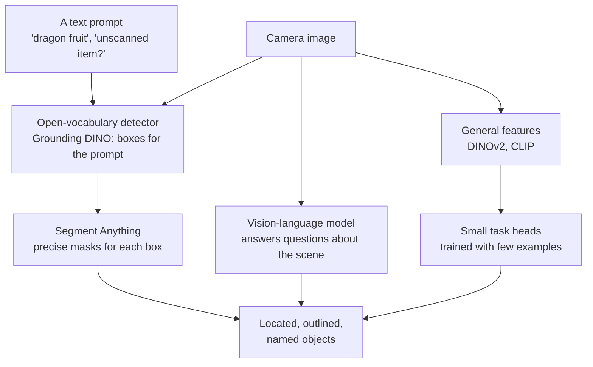

*By Gopi Krishna Tummala*

*How vision moved from fixed category lists to recognizing anything you can describe, and how to build with these models.*

Module 10 of 10 in the [computer vision series](/posts/computer-vision/computer-vision-module-1-how-machines-see). Previous: [3D Vision](/posts/computer-vision/computer-vision-module-9-3d-vision).

---

Every model in Modules 4 to 8 shares a limitation: it recognizes only the categories it was trained on. When the store stocks a new product, a vision team collects images, labels them, retrains and redeploys. A store adds products every week.

Vision foundation models remove most of that loop. Trained on enormous, loosely labeled collections of images and text, they can recognize, locate, segment and describe things they were never specifically trained on, given only a name or a question. Ask "where is the dragon fruit?" and an open-vocabulary detector finds it, even if the store never labeled one. This module covers the main families and how they fit together.

## The idea in one picture

*Foundation models are building blocks: features to build on, detectors and segmenters you prompt with words or clicks, and language models that reason about the image.*

## CLIP: images and words in one space

[CLIP](https://arxiv.org/abs/2103.00020), introduced in [Module 5](/posts/computer-vision/computer-vision-module-5-vision-transformers#learning-without-labels), trained image and text encoders so that an image and its caption land close together. That simple property enables **zero-shot classification**: embed the photo, embed text like "a photo of a dragon fruit," "a photo of a red onion," and pick the closest. New categories need only a name.

CLIP's limits matter in practice. It works on whole images, not individual objects. It's weaker on fine distinctions (two similar brands), counting, and text in images. And it inherits biases from web captions. It's a superb starting point, rarely the whole solution.

## Open-vocabulary detection

Detectors from Module 6 output boxes for a fixed list of classes. Open-vocabulary detectors take the list as text at run time. [Grounding DINO](https://arxiv.org/abs/2303.05499) (2023) fuses a transformer detector with language understanding, so a prompt like "oat milk carton . dragon fruit . plastic bag" returns boxes for each phrase, including categories absent from its training labels. OWL-ViT and its successor OWLv2 do similar, built directly on CLIP-style models.

For the checkout, the product catalog's names become the detector's vocabulary. A new product is recognized as soon as its name is added, with no retraining, though accuracy on new or look-alike products should be checked before trusting it.

## Detect, then segment

Combining an open-vocabulary detector with [Segment Anything](https://arxiv.org/abs/2304.02643) from Module 7 gives text-prompted segmentation: the detector finds "dragon fruit" boxes, and SAM turns each box into a precise mask. Pipelines like Grounded-SAM made this a popular recipe for labeling new datasets automatically: run it over thousands of images, have people correct the mistakes, and train a smaller, faster model on the result. That **auto-labeling** loop is now one of the main ways vision teams get training data.

## General-purpose features

Sometimes the best foundation model isn't one you prompt but one you build on. [DINOv2](https://arxiv.org/abs/2304.07193)'s features, learned without labels from a large curated image collection, capture shape, texture, parts and depth well enough that a small head trained on frozen features works for classification, segmentation and depth estimation. For the checkout, a frozen DINOv2 backbone plus a small classifier trained on a few dozen examples per product can outperform a fully fine-tuned model trained on the same small data, and adding a product means retraining only the tiny head.

## Vision-language models

The most general tools combine a vision encoder with a large language model, so you can ask questions about an image in plain language: "Is there anything in the bagging area that wasn't on the receipt?" or "What is the expiry date printed on this carton?" Models like LLaVA, Qwen-VL and Gemini read images and answer, reason, and read text in images (OCR), which classic vision models handle poorly.

How these models are built and trained is covered in depth in [When AI Sees and Speaks](/posts/computer-vision/vision-language-models-explained) and [Qwen3-VL and Mixture of Experts](/posts/generative-ai/vlm-moe-qwen-train-to-deploy). For a vision system, the practical points are that they're flexible and slow: far too heavy to run on every frame, but valuable for the rare hard case, such as checking a flagged transaction.

## Using foundation models well

A pattern that works across many products:

- **Big models offline, small models online.** Use foundation models to label data and handle rare cases; distill what they know into a small, fast model for the camera's continuous work.
- **Verify on your own data.** Zero-shot accuracy on benchmarks says little about look-alike products under your lighting.
- **Combine strengths.** Detector for where, SAM for exact shape, a VLM for reasoning, small heads for speed.
- **Watch for failure modes.** Counting, fine-grained distinctions, small objects, and confident answers about things that aren't there (hallucination, in VLMs).

## Where the series ends

The checkout camera started this series with a single question, "is this an onion?", answered by a CNN trained on store photos. It ends with a system that can find and outline products it has never seen from their names, follow them through video, judge their size in 3D, and answer questions about the scene. The trajectory of the field is the same: less hand-design, less labeling, more general knowledge learned from enormous data, and more of the system's behavior specified in words.

## What I'd remember

- **Vocabulary moved from a fixed list to text.** Name a category and the model can look for it.
- **CLIP is the shared foundation.** Great for zero-shot, weak at fine details and counting.
- **Detect with text, segment with SAM.** The recipe for prompted segmentation and auto-labeling.
- **Frozen features plus small heads.** DINOv2 makes few-example learning practical.
- **Big models offline, small ones online.** Foundation models label and handle rare cases; distilled models run continuously.

## Where to go next

- [When AI Sees and Speaks](/posts/computer-vision/vision-language-models-explained), for how vision-language models came together.
- [Vision-Language-Action Models](/posts/robotics/vla-models-data-architecture-evaluation), for vision foundation models that act.
- **Formal reading:** Georgia Tech CS 6476 lectures [19](https://faculty.cc.gatech.edu/~hays/compvision/lectures/19.pdf) and [20](https://faculty.cc.gatech.edu/~hays/compvision/lectures/20.pdf) on foundation models (CLIP, DINO and beyond) and on generative models, with Szeliski section 5.5.4 in [Computer Vision: Algorithms and Applications](https://szeliski.org/Book/).
- Papers: [CLIP](https://arxiv.org/abs/2103.00020), [Grounding DINO](https://arxiv.org/abs/2303.05499), [Segment Anything](https://arxiv.org/abs/2304.02643), [DINOv2](https://arxiv.org/abs/2304.07193).

Previous: [3D Vision](/posts/computer-vision/computer-vision-module-9-3d-vision). Back to the start: [How Machines See](/posts/computer-vision/computer-vision-module-1-how-machines-see).

**Questions to sit with**

1. Which checkout tasks would you hand to a vision-language model, and which must run on a small, fast model?
2. How would you test whether an open-vocabulary detector can tell two look-alike brands apart?
3. Design an auto-labeling loop for a new product line: which models, and where do people step in?
