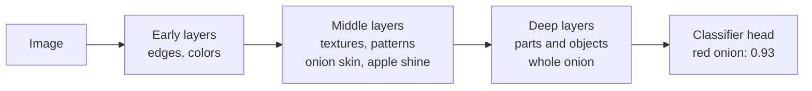
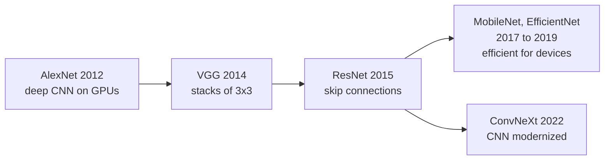

*By Gopi Krishna Tummala*

*How convolutional networks learn to see, why their design suits images, and the line of architectures from AlexNet to ConvNeXt.*

Module 2 of 8 in the [computer vision series](/posts/computer-vision/computer-vision-module-1-how-machines-see). Previous: [How Machines See](/posts/computer-vision/computer-vision-module-1-how-machines-see). Next: [Vision Transformers](/posts/computer-vision/computer-vision-module-3-vision-transformers).

---

The self-checkout camera's first job is classification: is the item in front of it a red onion, a red apple, or something else? An onion can appear anywhere in the frame, at any size, rotated any way. Whatever recognizes it has to find "onion-ness" regardless of where it is.

That requirement is exactly what convolutional neural networks (CNNs) were built around. For a decade they were the backbone of nearly all computer vision, and they're still everywhere: on phones, in cars, in the checkout camera's embedded chip. This module explains the idea and the architectures worth knowing.

## The idea in one picture

*Each layer combines the previous layer's patterns into larger, more abstract ones. Nobody designs the features; training discovers them.*

## Convolution: one small filter, everywhere

A convolution slides a small filter, say 3×3 pixels, across the whole image, computing at each position how strongly that patch matches the filter. One filter might respond to vertical edges, another to a particular shade of red. A layer has many filters, each producing a map of where its pattern appears.

Two properties make this the right bias for images:

- **Locality.** Each filter looks at a small neighborhood, because nearby pixels are what form edges and textures.
- **Weight sharing.** The same filter is used at every position, so an onion edge is detected the same way in the corner as in the center. This makes the network far smaller and more data-efficient than one that learned separate weights for every position.

Between convolutions, **pooling** or strided convolutions shrink the image, so each neuron in deeper layers sees a larger region of the original, its **receptive field**. That's how a stack of tiny 3×3 filters ends up recognizing a whole onion.

## What the layers learn

When researchers visualized trained CNNs, a consistent picture emerged: the first layers learn edges and color blobs, much like classical hand-designed filters; middle layers learn textures and repeated patterns; deep layers respond to object parts and whole objects. The network rediscovers a sensible hierarchy of features on its own, tuned to its data, which is why learned features beat hand-designed ones.

## The architectures worth knowing

*Each step answered one problem: depth, then trainability, then efficiency, then competing with transformers.*

- **AlexNet (2012)** showed that a deep CNN trained on GPUs with ReLU activations and dropout could crush hand-engineered approaches on ImageNet, cutting the top-5 error from about 26 percent to about 15. It started the deep learning era.
- **VGG (2014)** showed that simply stacking many small 3×3 convolutions works: two 3×3 layers see as much as one 5×5, with fewer parameters and more non-linearity.
- **ResNet (2015)** solved a puzzle: deeper networks were getting *worse*, even on training data, because signals and gradients degraded through many layers. Residual connections, which add each block's input to its output so the block only learns a correction, made networks of 100+ layers trainable. ResNet won ImageNet 2015 and skip connections became universal, including in transformers.
- **MobileNet and EfficientNet (2017–2019)** made CNNs cheap. MobileNet split convolutions into a per-channel spatial step and a cheap channel-mixing step (depthwise separable convolutions), cutting computation several-fold. EfficientNet scaled depth, width and resolution together in a principled ratio. These are what run on phones and embedded cameras like our checkout's.
- **ConvNeXt (2022)** asked whether CNNs had really been beaten by vision transformers or just by their newer training recipes. Modernizing a ResNet with transformer-era choices (larger kernels, fewer activations, layer norm, longer training with heavy augmentation) brought it level with transformers of similar size.

## Transfer learning: don't start from scratch

Training a CNN from scratch needs a lot of labeled data. The checkout store doesn't have a million labeled onion photos. Transfer learning solves this: take a network pretrained on a large dataset like ImageNet, keep its learned features, and retrain only the final layers (or fine-tune everything gently) on a few thousand store images. Early-layer features like edges and textures transfer almost universally; later layers adapt to the new categories. It's the default way vision models are built.

## Augmentation: teaching what doesn't matter

The fastest way to make a model hold up under real conditions is to show it variations of each training image: random crops, flips, rotations, color and brightness changes, blur. Each augmentation tells the model "this change doesn't affect the label." For the checkout camera, brightness and color jitter teach it to ignore lighting changes; random occlusion teaches it to recognize half-covered items. Stronger recipes like mixup and CutMix, which blend images and their labels, add further regularization.

The one rule: an augmentation must not change the label. Flipping a photo of an onion is fine; flipping a photo of text, or recoloring when color is the distinguishing feature, isn't.

## Where CNNs stand now

Transformers (Module 3) now lead at large scale and power most foundation models. But CNNs remain the practical choice when data is limited, latency and power are tight, or the deployment target is a small chip. Their built-in locality bias means they need less data to learn good features. Many production systems, including most detectors and segmenters in Modules 4 and 5, still use CNN backbones or hybrids.

## What I'd remember

- **Locality and weight sharing.** The same small filter everywhere: the right bias for images, and data-efficient.
- **Features build hierarchically.** Edges, textures, parts, objects, learned rather than designed.
- **Residual connections made depth work.** Every deep architecture since uses them.
- **Efficiency is its own design axis.** Depthwise separable convolutions and compound scaling for devices.
- **Transfer and augment.** Start from pretrained weights; teach invariance with augmentation.

## Where to go next

- [Module 3: Vision Transformers and Self-Supervised Learning](/posts/computer-vision/computer-vision-module-3-vision-transformers), the next module.
- [Deep Learning cheatsheet](/cheatsheets/modern-deep-learning), for activations, normalization and residuals.
- Papers: [ResNet](https://arxiv.org/abs/1512.03385), [MobileNet](https://arxiv.org/abs/1704.04861), [EfficientNet](https://arxiv.org/abs/1905.11946), [ConvNeXt](https://arxiv.org/abs/2201.03545).

Previous: [How Machines See](/posts/computer-vision/computer-vision-module-1-how-machines-see). Next: [Vision Transformers](/posts/computer-vision/computer-vision-module-3-vision-transformers).

**Questions to sit with**

1. Why does weight sharing make a CNN need less data than a fully connected network on the same images?
2. Which augmentations would help the checkout camera, and which would hurt it?
3. When would you pick a CNN over a vision transformer for a new product?
