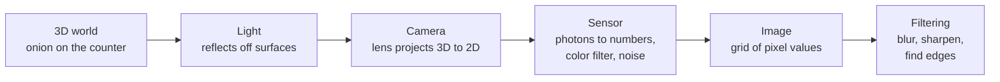
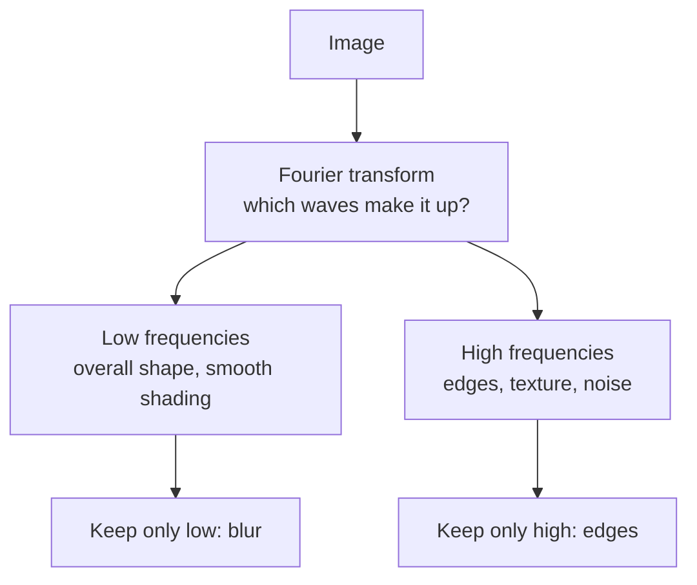

*By Gopi Krishna Tummala*

*Where images come from and the first things we do to them: projection, light and color, filtering, and thinking in frequencies.*

Module 2 of 10 in the [computer vision series](/posts/computer-vision/computer-vision-module-1-how-machines-see). Previous: [How Machines See](/posts/computer-vision/computer-vision-module-1-how-machines-see). Next: [Feature Detection and Matching](/posts/computer-vision/computer-vision-module-3-features-and-matching).

---

Before the checkout camera can recognize anything, light has to bounce off an onion, pass through a lens, land on a sensor and become numbers. Every step shapes what the vision system later sees. The lens makes the far end of the counter look smaller and bends straight edges near the corners of the frame. The store's fluorescent lights give everything a greenish cast. The sensor adds noise in dim light. Then, before any learning happens, the image is usually filtered: smoothed, sharpened, resized.

This module covers that first stage: how images form, and the filtering operations that are the direct ancestors of the convolutions in every CNN. It's the part of computer vision that explains *why* the later models behave the way they do.

## The idea in one picture

*From the world to a filtered image. Each step loses or distorts something, and knowing what is half of debugging a vision system.*

## How a camera sees: projection

The simplest camera model is a pinhole: light from each point in the scene passes through a single tiny hole and lands on the opposite wall. Real cameras use lenses to gather more light, but the geometry is the same, and it has three consequences worth holding onto:

- **Far things look smaller.** An object's size in the image shrinks in proportion to its distance. That's why two different bottles can look identical: size in pixels alone can't tell a small near bottle from a big far one.
- **Parallel lines meet.** The parallel edges of the checkout counter converge toward a **vanishing point** in the image.
- **Depth is lost.** Every point along one ray of light lands on the same pixel. Recovering depth needs more information ([Module 9](/posts/computer-vision/computer-vision-module-9-3d-vision)).

The camera's **intrinsics** (focal length, where the optical center falls on the sensor) and **extrinsics** (where the camera is and which way it points) together describe this projection exactly. Real lenses also **distort**, bending straight lines near the edges of wide-angle images; calibration measures and removes it ([Calibration](/posts/robotics/autonomous-stack-module-3-calibration) covers how).

## Light and color

A pixel's value depends on three things at once: the light falling on the surface, how the surface reflects it, and how the sensor responds. A white carton under warm light and a yellow carton under white light can produce the same numbers. Your visual system corrects for the light source automatically; a camera has to do it explicitly, which is what **white balance** does.

Most color sensors don't measure red, green and blue at every pixel. They put a mosaic of color filters over the sensor, the Bayer pattern, with half the sites green (our eyes are most sensitive to green) and a quarter each red and blue. The missing colors at each pixel are interpolated, a step called demosaicing. Artifacts from that step, plus noise in low light and compression, are part of every image a model sees.

**Color spaces** describe the same colors differently. RGB matches the sensor. HSV separates hue from brightness, so "red" stays red whether the light is bright or dim, which is handy for simple color rules. For the checkout, the lesson is that color is far less stable than it looks: the same onion can shift noticeably in RGB between the morning and evening lighting.

## Filtering: changing pixels by their neighbors

A **linear filter** replaces each pixel with a weighted sum of its neighborhood. The weights, a small grid called the **kernel**, decide what the filter does:

- **Blur (box or Gaussian):** average the neighborhood. A Gaussian weights nearby pixels more, giving smooth blur without blocky artifacts. Blurring removes noise and fine detail.
- **Sharpen:** add back the difference between the image and its blurred version, exaggerating edges.
- **Edge detection:** take differences between neighbors. A large difference means an edge. Sobel filters estimate the horizontal and vertical change; the Canny detector builds clean, thin edges from them.

Sliding a kernel across an image is **convolution**, and it's the same operation a CNN uses. The difference in [Module 4](/posts/computer-vision/computer-vision-module-4-convolutional-networks) is that a CNN *learns* its kernels; its first layer typically ends up with edge and color-blob detectors that look a lot like these hand-designed ones.

Not every useful filter is linear. A **median filter** replaces each pixel with the median of its neighborhood, which removes isolated speckles ("salt and pepper" noise) without blurring edges the way averaging does.

## Thinking in frequency

Here's the idea that ties filtering together. Any image can be described as a sum of waves, smooth gradients (low frequencies) plus fine stripes and edges (high frequencies). The **Fourier transform** converts an image into that recipe of frequencies.

*Blurring is throwing away high frequencies; edge detection is keeping them. Seen this way, filters are just ways of choosing which frequencies to keep.*

Three things become obvious once you think this way:

- **Blur is a low-pass filter; edges are high-pass.** A Gaussian blur keeps low frequencies and suppresses high ones.
- **Convolution in the image is multiplication in frequency.** Large filters can be applied faster in the frequency domain, and filter behavior is easier to understand there.
- **Shrinking an image can create false patterns.** If you downsample without blurring first, fine detail too small for the new resolution doesn't disappear, it masquerades as coarser patterns. That's **aliasing**: the moiré on a striped shirt in a photo, or wagon wheels that seem to spin backward on film. The fix is to blur before downsampling, removing frequencies the smaller image can't represent. **Image pyramids**, the same image at successively halved resolutions, do exactly this, and they're the ancestor of the multi-scale features in modern detectors.

A memorable demonstration is the **hybrid image** (Oliva, Torralba and Schyns, 2006): combine the low frequencies of one picture with the high frequencies of another, and you see one image up close and the other from across the room, because your eye's resolution changes with distance. Building one is the first project in many computer vision courses, including Georgia Tech's.

## Why this still matters in the deep learning era

It's tempting to skip straight to neural networks. But these foundations explain behavior you'll meet in practice:

- A model that fails on a new camera often fails because of image formation: a different lens distortion, white balance or noise level.
- CNNs that downsample without enough smoothing are known to be less stable to small shifts of the input, an aliasing problem; adding blur before downsampling helps.
- Augmentations like color jitter and blur are deliberate simulations of image-formation variation.
- Convolutions, pooling and multi-scale features are learned versions of filters and pyramids.

## What I'd remember

- **Projection loses depth.** Far things look smaller, parallel lines meet, and one pixel is a whole ray.
- **Pixel values mix light, surface and sensor.** Color is less stable than it looks; white balance and noise matter.
- **Filters are weighted neighborhoods.** Blur averages, sharpening exaggerates differences, edges are differences.
- **Think in frequency.** Blur removes high frequencies; downsampling without blurring causes aliasing.
- **CNNs learn these filters.** Their first layers rediscover edges and color blobs.

## Where to go next

- [Module 3: Feature Detection and Matching](/posts/computer-vision/computer-vision-module-3-features-and-matching), the next module.
- **Formal reading:** Georgia Tech CS 6476 lectures on [camera projection and image filtering](https://faculty.cc.gatech.edu/~hays/compvision/lectures/02.pdf), [thinking in frequency](https://faculty.cc.gatech.edu/~hays/compvision/lectures/03.pdf) ([part 2](https://faculty.cc.gatech.edu/~hays/compvision/lectures/04.pdf)) and [light, cameras, eyes and color](https://faculty.cc.gatech.edu/~hays/compvision/lectures/05.pdf), with Szeliski chapters 2 and 3 (sections 2.1–2.3, 3.2 and 3.4) in [Computer Vision: Algorithms and Applications](https://szeliski.org/Book/). The course's first project builds hybrid images.

Previous: [How Machines See](/posts/computer-vision/computer-vision-module-1-how-machines-see). Next: [Feature Detection and Matching](/posts/computer-vision/computer-vision-module-3-features-and-matching).

**Questions to sit with**

1. Why can't the checkout camera tell a small near bottle from a large far one using the image alone?
2. What goes wrong if you shrink a photo of a striped shirt without blurring it first?
3. How would you test whether a model's failure on a new camera comes from image formation rather than the model?
