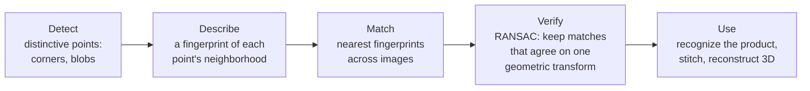
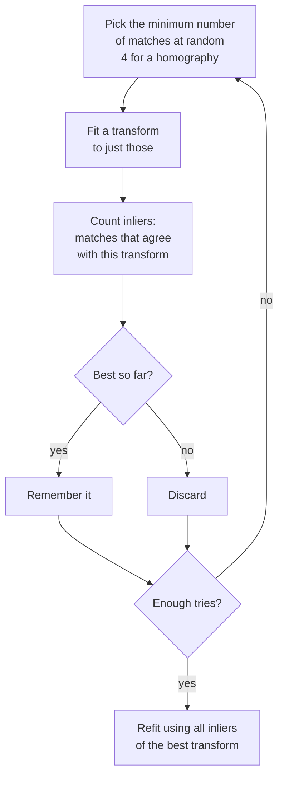

*By Gopi Krishna Tummala*

*How to find the same point in two different images: corners, SIFT descriptors, matching, and RANSAC for fitting models when many matches are wrong.*

Module 3 of 10 in the [computer vision series](/posts/computer-vision/computer-vision-module-1-how-machines-see). Previous: [Image Formation and Filtering](/posts/computer-vision/computer-vision-module-2-image-formation-and-filtering). Next: [Convolutional Networks](/posts/computer-vision/computer-vision-module-4-convolutional-networks).

---

A customer holds a box of breakfast cereal up to the checkout camera, tilted, partly covered by their hand, much closer than in the store's catalog photo. The catalog has a clean, front-on product image. Is this the same box, or the similar-looking store brand next to it on the shelf?

One classic answer doesn't involve learning categories at all: find distinctive points on the label in both images, describe each one in a way that survives the tilt, the scale change and the lighting, and check whether enough of them match in a geometrically consistent way. That pipeline, detect, describe, match, verify, powered panorama stitching, 3D reconstruction, visual search and robot localization for two decades, and its ideas still underlie modern systems.

## The idea in one picture

*Find, fingerprint, pair up, and check that the pairs tell one consistent geometric story.*

## Why points, and which points

Matching every pixel across images is hopeless; most pixels look like their neighbors. A blank patch of blue sky could match anywhere. An edge is better but still ambiguous: you can tell where you are across the edge, not along it. A **corner** is distinctive in every direction: move a small window over it in any direction and the content changes. That's the definition behind the **Harris corner detector** (Harris and Stephens, 1988): look for spots where shifting a window in any direction causes a large change in intensity.

Corners alone aren't enough, because the cereal box is closer to the camera than in the catalog photo, so its features appear at a different **scale**. A corner at one zoom level can look like a smooth curve at another. Scale-invariant detectors search across a pyramid of blurred, downsampled images (from [Module 2](/posts/computer-vision/computer-vision-module-2-image-formation-and-filtering#thinking-in-frequency)) for blob-like structures, and record the scale at which each point is most distinctive.

## SIFT: a fingerprint that survives change

Once you've found a point, you need to describe its neighborhood so the same point can be recognized in another image. Raw pixel values fail as soon as the lighting or angle changes. [SIFT](https://www.cs.ubc.ca/~lowe/papers/ijcv04.pdf) (Scale-Invariant Feature Transform, David Lowe, 2004) became the standard answer:

- **Scale:** detect points across scales (using differences of Gaussians) and describe each at its own scale.
- **Rotation:** find the dominant direction of image gradients around the point and describe everything relative to it, so a tilted box gives the same description.
- **Description:** split the neighborhood into a 4×4 grid of cells and record a histogram of gradient directions in each, 8 directions per cell: a 128-number fingerprint.
- **Lighting:** gradient directions, unlike raw brightness, barely change when the light gets brighter or dimmer, and the fingerprint is normalized.

SIFT descriptors hold up well enough to match the cereal box's logo, lettering and pictures between the catalog photo and the tilted, closer view.

## Matching, and the ratio test

To match, compare each descriptor in one image with all descriptors in the other and take the nearest. But on a cereal box, many features look alike: the same letter appears many times, patterns repeat. Lowe's **ratio test** handles this: accept a match only if the nearest neighbor is clearly closer than the second-nearest. If the best and second-best candidates are about equally close, the feature is ambiguous and the match is discarded. It's a simple rule that removes most false matches.

Even so, some wrong matches survive, often a large share. That's what the next step is for.

## Geometry and RANSAC

If the two images really show the same flat box label, the matched points shouldn't land just anywhere: they should all be related by one geometric transformation.

| Transform | Allows | Points needed to fit |
|---|---|---|
| Translation | Shifting | 1 |
| Similarity | Shift, rotate, uniform scale | 2 |
| Affine | Also shear, non-uniform scale | 3 |
| Homography | Full perspective view of a plane | 4 |

The cereal box's front is a plane seen at an angle, so a homography relates the catalog image to the camera view. Fitting one to all matches at once fails, because the wrong matches drag the answer away. [RANSAC](https://dl.acm.org/doi/10.1145/358669.358692) (Random Sample Consensus, Fischler and Bolles, 1981) does something cleverer:

*Try many tiny random fits and keep the one most matches agree with. Wrong matches disagree with each other, so they never win the vote.*

The intuition: a random sample of four matches is occasionally all correct, and when it is, the transform it produces agrees with every other correct match. Wrong matches scatter randomly, so they don't agree with each other. After enough tries, the transform with the most supporters is almost certainly right, and the matches that disagree with it are the outliers. If enough consistent inliers remain, the checkout can be confident it's the same product; if the store brand has a different layout, few matches will agree on any single transform.

RANSAC is one of the most widely reused ideas in computer vision, used wherever a model has to be fitted to data with many outliers: stitching panoramas, estimating camera motion, fitting planes to point clouds, calibrating sensors.

## Panoramas: the classic application

Stitching a panorama is this whole pipeline: detect and describe features in overlapping photos, match them, fit a homography between each pair with RANSAC, warp the images into one frame, and blend the seams. The same chain, extended to 3D, becomes structure from motion ([Module 9](/posts/computer-vision/computer-vision-module-9-3d-vision#structure-from-motion)).

## Learned features

Deep learning eventually replaced the hand-designed parts. **SuperPoint** (2018) learned to detect keypoints and compute descriptors with a neural network. **SuperGlue** (2020) and its faster successor **LightGlue** (2023) learned to match features using attention, reasoning about all the points together instead of one at a time. **LoFTR** (2021) skipped explicit keypoints and matched dense features directly, working even on textureless surfaces where corners are scarce. These now lead benchmarks for difficult matching, under big changes in viewpoint or lighting.

But the pipeline's logic survived intact: find distinctive structure, describe it so it survives change, match, and verify geometrically, usually still with RANSAC.

## What I'd remember

- **Detect, describe, match, verify.** The pipeline behind panoramas, visual search and 3D reconstruction.
- **Corners are distinctive in every direction.** Edges are ambiguous along their length; flat regions everywhere.
- **SIFT survives scale, rotation and lighting.** Gradient-direction histograms around each point.
- **The ratio test removes ambiguous matches.** Accept only matches that are clearly better than the runner-up.
- **RANSAC fits models despite outliers.** Many small random fits, keep the one most data agrees with.

## Where to go next

- [Module 4: Convolutional Networks](/posts/computer-vision/computer-vision-module-4-convolutional-networks), the next module: learning features instead of designing them.
- **Formal reading:** Georgia Tech CS 6476 lectures on [interest points and the Harris corner detector](https://faculty.cc.gatech.edu/~hays/compvision/lectures/06.pdf), [local image features and SIFT](https://faculty.cc.gatech.edu/~hays/compvision/lectures/07.pdf) and [RANSAC and geometric transformations](https://faculty.cc.gatech.edu/~hays/compvision/lectures/08.pdf), with Szeliski sections 7.1 and 8.1 in [Computer Vision: Algorithms and Applications](https://szeliski.org/Book/). The course's second project implements SIFT matching and RANSAC.
- Papers: [SIFT (Lowe, 2004)](https://www.cs.ubc.ca/~lowe/papers/ijcv04.pdf), [SuperPoint](https://arxiv.org/abs/1712.07629), [SuperGlue](https://arxiv.org/abs/1911.11763), [LoFTR](https://arxiv.org/abs/2104.00680).

Previous: [Image Formation and Filtering](/posts/computer-vision/computer-vision-module-2-image-formation-and-filtering). Next: [Convolutional Networks](/posts/computer-vision/computer-vision-module-4-convolutional-networks).

**Questions to sit with**

1. Why is a corner a better point to match than a spot on an edge?
2. Why does the ratio test throw away matches on repeated letters on the cereal box?
3. If 70 percent of matches are wrong, why can RANSAC still find the right homography?
