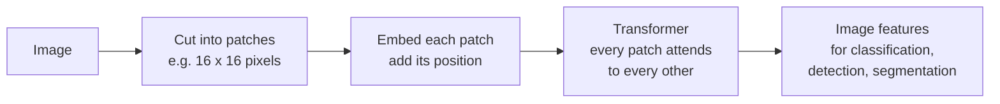
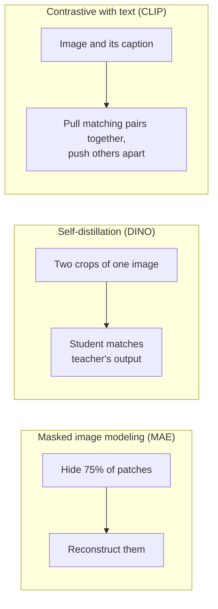

*By Gopi Krishna Tummala*

*How transformers came to vision by treating image patches as words, and how self-supervised learning lets them learn from images without labels.*

Module 3 of 8 in the [computer vision series](/posts/computer-vision/computer-vision-module-1-how-machines-see). Previous: [Convolutional Networks](/posts/computer-vision/computer-vision-module-2-convolutional-networks). Next: [Object Detection](/posts/computer-vision/computer-vision-module-4-object-detection).

---

Our checkout camera's CNN, fine-tuned on a few thousand store photos, recognizes the products it was trained on. Then the store adds a new brand of oat milk, and someone has to collect and label photos again. Two shifts in vision changed that picture. Transformers gave models a way to take in the whole image at once and to keep improving as they grew. Self-supervised learning let them learn from huge numbers of images without anyone labeling them. Together, they produce general-purpose visual features that adapt to new products with far less work.

## The idea in one picture

*A vision transformer treats an image like a sentence whose words are patches. Attention lets the corner of the image inform the center from the first layer.*

## Vision transformers: patches as words

The [Vision Transformer](https://arxiv.org/abs/2010.11929) (ViT, Google, 2020) did something almost naively simple. Cut the image into a grid of patches, 16×16 pixels each, flatten each patch into a vector, add a position embedding, and feed the sequence to a standard transformer encoder, the same architecture used for text (see [The Transformer](/posts/fundamentals/transformers-attention-mechanism)). No convolutions.

Where a CNN builds up a global view slowly through many layers, a transformer's attention connects every patch to every other from the first layer. The patch showing the oat milk carton's logo can directly inform the patch showing its cap.

The catch is the inductive bias from Module 2. A CNN assumes locality and treats every position the same way; a transformer assumes neither and has to learn them from data. Trained only on ImageNet's 1.2 million images, ViT did worse than comparable CNNs. Pretrained on hundreds of millions of images, it did better, and kept improving with scale. That trade, less built-in assumption and more learning from data, is the story of modern vision.

**Making transformers practical for vision.** Attention cost grows with the square of the number of patches, which is a problem for high-resolution images. [Swin Transformer](https://arxiv.org/abs/2103.14030) (2021) restricted attention to local windows that shift between layers and built a CNN-like hierarchy of resolutions, making transformers efficient enough to be general backbones for detection and segmentation. DeiT showed that strong data augmentation and distillation could train ViTs well on ImageNet alone.

## Learning without labels

Labels are the bottleneck. Self-supervised learning invents a task from the images themselves whose solution requires understanding them. Three ideas dominate:

*Three ways to learn from unlabeled data: fill in what's missing, agree with yourself across views, or match images to their captions.*

**Masked autoencoders.** [MAE](https://arxiv.org/abs/2111.06377) (Meta, 2021) hides most of an image's patches, 75 percent, and trains the model to reconstruct them. You can't fill in a hidden onion's missing half without understanding onions. Hiding so much makes the task hard enough to require real understanding and makes training cheap, since the encoder only processes the visible quarter.

**Self-distillation.** [DINO](https://arxiv.org/abs/2104.14294) (Meta, 2021) shows a student network and a teacher network different crops of the same image and trains the student to produce the same output as the teacher, whose weights are a slow-moving average of the student's. With no labels at all, its attention maps learned to outline objects. [DINOv2](https://arxiv.org/abs/2304.07193) scaled this up on a large, carefully curated image collection and produced features strong enough to use frozen, with only a small head trained on top, for classification, segmentation and depth estimation.

**Contrastive learning with text.** [CLIP](https://arxiv.org/abs/2103.00020) (OpenAI, 2021) trained an image encoder and a text encoder on about 400 million image-caption pairs from the web, pulling each image toward its own caption and away from others. The result is a shared space where images and descriptions can be compared. That enables **zero-shot classification**: to recognize the new oat milk, compare the image with the text "a carton of oat milk," with no new training. Module 8 builds on this.

## What this means for the checkout camera

With a self-supervised backbone like DINOv2, adding a new product can mean collecting a few dozen photos and training a tiny classifier on frozen features, rather than fine-tuning a whole network. With CLIP-style models, some new products can be recognized from their names alone. And features learned from hundreds of millions of varied images hold up far better under the store's odd lighting and angles than features learned from a few thousand.

The costs are real: vision transformers are larger and slower than efficient CNNs, and running one on the checkout's embedded chip may need a smaller distilled version.

## What I'd remember

- **Patches are words.** ViT applies a standard transformer to image patches.
- **Less built-in bias, more data.** Transformers lose to CNNs on small data and win at scale.
- **Self-supervision removes the label bottleneck.** Mask and reconstruct, match across views, or align with captions.
- **General features adapt cheaply.** Frozen DINOv2 features plus a small head; CLIP for zero-shot.
- **Efficiency still matters.** Hierarchical designs like Swin and distillation make them deployable.

## Where to go next

- [Module 4: Object Detection](/posts/computer-vision/computer-vision-module-4-object-detection), the next module.
- [When AI Sees and Speaks](/posts/computer-vision/vision-language-models-explained), for CLIP's role in vision-language models.
- Papers: [ViT](https://arxiv.org/abs/2010.11929), [MAE](https://arxiv.org/abs/2111.06377), [DINOv2](https://arxiv.org/abs/2304.07193), [CLIP](https://arxiv.org/abs/2103.00020).

Previous: [Convolutional Networks](/posts/computer-vision/computer-vision-module-2-convolutional-networks). Next: [Object Detection](/posts/computer-vision/computer-vision-module-4-object-detection).

**Questions to sit with**

1. Why does a vision transformer need more data than a CNN to reach the same accuracy?
2. Why does hiding 75 percent of an image make a better pretraining task than hiding 15 percent?
3. For a new product, when would you use zero-shot CLIP, and when a small head on frozen DINOv2 features?
