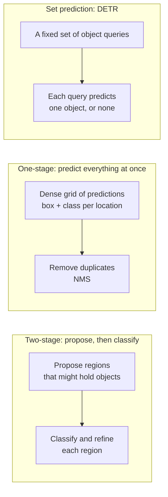
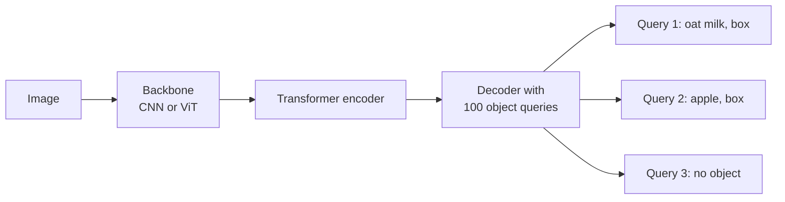

*By Gopi Krishna Tummala*

*Finding every object in an image and drawing a box around it: from two-stage detectors to YOLO to transformers that predict a set of objects directly.*

Module 4 of 8 in the [computer vision series](/posts/computer-vision/computer-vision-module-1-how-machines-see). Previous: [Vision Transformers](/posts/computer-vision/computer-vision-module-3-vision-transformers). Next: [Segmentation](/posts/computer-vision/computer-vision-module-5-segmentation).

---

A classifier answers "what is this image?" But the checkout camera rarely sees one item alone. A customer's basket might hold an onion, two apples, a carton of oat milk and a bag partly covering a loaf of bread. The camera needs to know what each item is *and where it is*, so it can check each against the scanned list and notice one that wasn't scanned.

That's object detection: output a box and a label for every object, however many there are. It's harder than classification in three ways. The number of objects varies. They come in very different sizes, from a lemon to a watermelon. And they overlap. The history of detection is a series of answers to those three problems.

## The idea in one picture

*Three generations. Two-stage detectors were accurate, one-stage detectors made detection real-time, and transformers removed the hand-designed duplicate removal.*

## Two-stage detectors: propose, then classify

The first deep detectors split the problem in two. [R-CNN](https://arxiv.org/abs/1311.2524) (2014) generated about two thousand candidate regions with a classical algorithm, ran a CNN on each one to classify it, and adjusted the box. It was accurate and very slow, since every region needed its own pass through the network.

Fast R-CNN ran the CNN once over the whole image and cut regions out of its feature map instead. [Faster R-CNN](https://arxiv.org/abs/1506.01497) (2015) replaced the classical proposal algorithm with a small learned **region proposal network** sharing the same features, so the whole detector became one trainable network. It set the standard for accuracy for years.

Two ideas from this family recur everywhere:

- **Anchors:** predefined boxes of several sizes and shapes at every location; the network predicts adjustments to them rather than boxes from nothing.
- **Feature pyramids:** use features from several depths of the network, fine ones for small objects like a lemon, coarse ones for big ones like a watermelon.

## One-stage detectors: everything at once

Two stages were too slow for video. [YOLO](https://arxiv.org/abs/1506.02640) ("You Only Look Once," 2016) predicted boxes and classes for every cell of a grid in a single pass, fast enough for real time, at some cost in accuracy, especially for small objects. SSD did similarly across several scales.

One-stage detectors had a specific accuracy problem: almost every location in an image is background, so the training signal was swamped by easy "nothing here" examples. [RetinaNet](https://arxiv.org/abs/1708.02002) (2017) fixed it with **focal loss**, which down-weights easy examples so the model concentrates on hard ones, letting a one-stage detector match two-stage accuracy. YOLO has since gone through many versions and remains the most widely deployed real-time detector family; recent versions drop anchors and predict object centers directly.

## Cleaning up: IoU and non-maximum suppression

Dense detectors produce many overlapping boxes for the same object: five slightly different boxes around the oat milk. Two tools handle this:

- **Intersection over union (IoU):** the overlap of two boxes divided by their combined area. 1 means identical, 0 means no overlap.
- **Non-maximum suppression (NMS):** keep the most confident box, delete others that overlap it above an IoU threshold, repeat.

NMS has a known weakness that matters at a checkout: two apples side by side, overlapping heavily in the image, can have one apple's box deleted as a "duplicate." Tuning the threshold trades missed objects against duplicates.

## DETR: detection as set prediction

[DETR](https://arxiv.org/abs/2005.12872) (Meta, 2020) rethought detection with a transformer. A fixed number of learned **object queries**, say 100, each attend to the image features and predict one box and class, or "no object." During training, predictions are matched one-to-one to the true objects (Hungarian matching), so each object is claimed by exactly one query. Duplicates are penalized in training, so no NMS and no anchors are needed.

*Each query is a slot that either claims one object or says "nothing." One-to-one matching in training removes duplicates without NMS.*

The original DETR trained slowly and struggled with small objects; follow-ups such as Deformable DETR and DINO (a DETR variant, unrelated to the self-supervised DINO in Module 3) fixed much of that, and transformer detectors now lead accuracy benchmarks, with real-time variants like RT-DETR competing with YOLO.

## Measuring detection

Detection is scored with **mean average precision (mAP)**. A predicted box counts as correct if its IoU with a true box exceeds a threshold. For each class, precision and recall are traded off across confidence levels and summarized as average precision; mAP averages over classes. The COCO benchmark averages over IoU thresholds from 0.5 to 0.95, rewarding tightly placed boxes, not just roughly right ones.

For the checkout, the summary number matters less than per-class results and specific failure cases: small items, items under bags, and similar-looking products side by side.

## Choosing a detector

- **Real-time on limited hardware:** a small YOLO variant or RT-DETR.
- **Highest accuracy, offline:** a modern transformer detector on a strong backbone.
- **Unknown or changing categories:** open-vocabulary detectors like Grounding DINO, covered in [Module 8](/posts/computer-vision/computer-vision-module-8-vision-foundation-models).
- **Exact shapes needed, not boxes:** segmentation, the next module.

## What I'd remember

- **Detection = what and where, for every object.** Variable counts, sizes and overlaps make it hard.
- **Two-stage, one-stage, set prediction.** Accurate, then fast, then free of hand-designed post-processing.
- **Anchors and feature pyramids** handle shapes and sizes; **focal loss** handles the flood of background.
- **NMS removes duplicates and can remove real neighbors.** DETR's matching avoids it.
- **mAP rewards tight boxes.** Check per-class and failure cases, not just the average.

## Where to go next

- [Module 5: Segmentation](/posts/computer-vision/computer-vision-module-5-segmentation), the next module.
- [Module 6: Perception](/posts/robotics/autonomous-stack-module-6-perception) in the autonomous driving series, for 3D detection.
- Papers: [Faster R-CNN](https://arxiv.org/abs/1506.01497), [YOLO](https://arxiv.org/abs/1506.02640), [RetinaNet](https://arxiv.org/abs/1708.02002), [DETR](https://arxiv.org/abs/2005.12872).

Previous: [Vision Transformers](/posts/computer-vision/computer-vision-module-3-vision-transformers). Next: [Segmentation](/posts/computer-vision/computer-vision-module-5-segmentation).

**Questions to sit with**

1. Why does almost-all-background hurt one-stage detectors, and how does focal loss help?
2. When would NMS delete a real object at the checkout, and how would you notice?
3. Why does one-to-one matching in training let DETR skip NMS?
