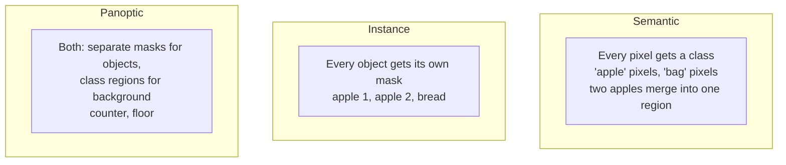
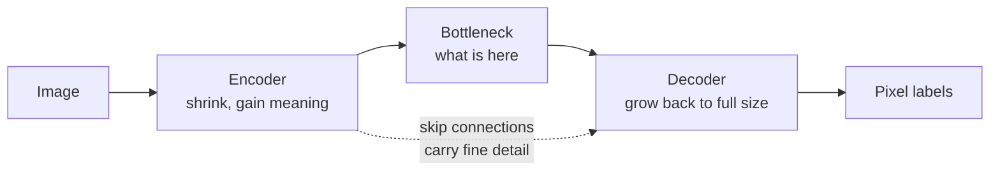

*By Gopi Krishna Tummala*

*Labeling images pixel by pixel: semantic, instance and panoptic segmentation, the encoder-decoder idea, and Segment Anything.*

Module 7 of 10 in the [computer vision series](/posts/computer-vision/computer-vision-module-1-how-machines-see). Previous: [Object Detection](/posts/computer-vision/computer-vision-module-6-object-detection). Next: [Video and Tracking](/posts/computer-vision/computer-vision-module-8-video-and-tracking).

---

A box around the loaf of bread says roughly where it is. But the bread is half under a plastic bag, and the box also contains the bag, part of a hand and a corner of the counter. To tell how much of the bread is visible, whether the bag hides something else, or exactly where the hand is grasping, the checkout camera needs to know which *pixels* belong to what.

That's segmentation: a label for every pixel. It's the most detailed of the 2D vision tasks, and it's what robots use to grasp objects, cars use to find drivable road, and photo apps use to cut out backgrounds.

## The idea in one picture

*Three questions about the same pixels: what kind, which one, or both.*

## Three kinds of segmentation

- **Semantic segmentation** assigns each pixel a class: apple, bread, bag, counter. Two touching apples become one "apple" region.
- **Instance segmentation** separates individual objects: apple 1 and apple 2 each get their own mask. Background stuff like the counter is ignored.
- **Panoptic segmentation** combines the two: individual masks for countable things, class regions for uncountable stuff like floor and sky.

The checkout needs instance segmentation: it has to count apples, not just find apple-colored pixels.

## The encoder-decoder idea

A classification CNN shrinks the image as it goes, trading spatial detail for meaning. By the deep layers it knows "there's an apple" but has lost exactly where its edges are. Segmentation needs both: meaning and pixel-level location.

*Shrink to understand, grow back to locate, with skip connections carrying the edges across.*

- **FCN** (2015) showed a classification network could be converted to output a label map by replacing its final layers with upsampling.
- **[U-Net](https://arxiv.org/abs/1505.04597)** (2015), designed for medical images with very little training data, added skip connections from each encoder level to the matching decoder level, so fine boundaries survive. Its shape is so effective it later became the backbone of diffusion models.
- **DeepLab** used dilated (atrous) convolutions, which widen a filter's view without shrinking the image, to capture context at several scales while keeping resolution.

## Instance masks: Mask R-CNN and mask transformers

[Mask R-CNN](https://arxiv.org/abs/1703.06870) (2017) extended the Faster R-CNN detector from Module 6 with one more small branch: for each detected box, predict a mask of which pixels inside belong to the object. Detect first, then segment each detection. It was simple, accurate and became the standard for instance segmentation.

Later, transformer models unified all three kinds. [Mask2Former](https://arxiv.org/abs/2112.01527) uses object queries, like DETR, where each query predicts one mask and its class, handling semantic, instance and panoptic segmentation with one architecture.

## Segment Anything

Every model above needs labeled masks for its categories, and pixel-accurate masks are among the most expensive labels in machine learning. Meta's [Segment Anything](https://arxiv.org/abs/2304.02643) (SAM, 2023) changed the approach.

SAM is **promptable**: give it a point, a box or a rough mask, and it returns the mask of whatever object is there, for objects of any kind, without being trained on their category. It was trained on SA-1B, a dataset of over a billion masks on 11 million images, built with a "data engine" in which the model helped annotators label, the improved model helped more, and eventually it labeled automatically. [SAM 2](https://arxiv.org/abs/2408.00714) (2024) extended this to video, following a selected object's mask across frames.

For the checkout, that means a new product needs no new mask labels: click it once, or prompt with its detection box, and SAM outlines it. SAM tells you *where* an object is, not *what* it is, so it's usually paired with a detector or a vision-language model (Module 10) that supplies the label.

## Measuring segmentation

- **Mean IoU (mIoU):** per class, the overlap between predicted and true pixels divided by their union, averaged over classes. The standard for semantic segmentation.
- **Mask AP:** like detection mAP, but using mask overlap instead of box overlap, for instance segmentation.
- **Panoptic quality (PQ):** combines recognition and mask quality for panoptic segmentation.
- **Dice score:** a close relative of IoU, common in medical imaging.

Boundary quality often matters more than these averages show: a mask that's right in the middle but ragged at the edges can still score well while failing a robot trying to grasp the object.

## What I'd remember

- **Semantic, instance, panoptic.** What kind, which one, or both.
- **Encoder-decoder with skip connections.** Shrink for meaning, grow back for location.
- **Mask R-CNN = detect, then mask each detection.** Mask transformers unify all three tasks.
- **SAM segments anything you point at.** Category-agnostic; pair it with something that names the object.
- **Masks are expensive labels.** Promptable models and data engines are how the field scaled.

## Where to go next

- [Module 8: Video and Tracking](/posts/computer-vision/computer-vision-module-8-video-and-tracking), the next module.
- [Image Diffusion: From U-Net to DiT](/posts/generative-ai/image-diffusion-models-unet-to-dit), for U-Net's second life in generative models.
- **Formal reading:** Georgia Tech CS 6476 lecture [13](https://faculty.cc.gatech.edu/~hays/compvision/lectures/13.pdf) on semantic segmentation, with Szeliski section 6.4 in [Computer Vision: Algorithms and Applications](https://szeliski.org/Book/). The course's fourth project builds a semantic segmentation network.
- Papers: [U-Net](https://arxiv.org/abs/1505.04597), [Mask R-CNN](https://arxiv.org/abs/1703.06870), [Segment Anything](https://arxiv.org/abs/2304.02643), [SAM 2](https://arxiv.org/abs/2408.00714).

Previous: [Object Detection](/posts/computer-vision/computer-vision-module-6-object-detection). Next: [Video and Tracking](/posts/computer-vision/computer-vision-module-8-video-and-tracking).

**Questions to sit with**

1. Why does the checkout need instance rather than semantic segmentation?
2. What do skip connections carry that the encoder's deep layers have lost?
3. How would you combine SAM with a detector to segment and name new products?
