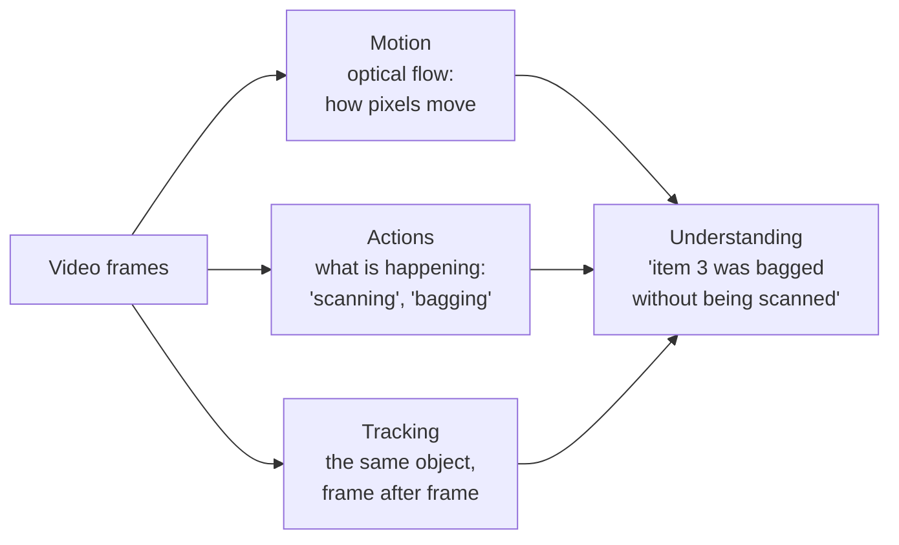
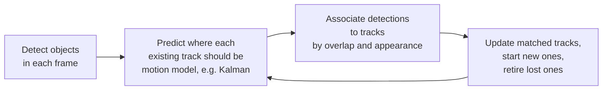

*By Gopi Krishna Tummala*

*What changes when images become video: motion, recognizing actions, and following the same object from frame to frame.*

Module 8 of 10 in the [computer vision series](/posts/computer-vision/computer-vision-module-1-how-machines-see). Previous: [Segmentation](/posts/computer-vision/computer-vision-module-7-segmentation). Next: [3D Vision](/posts/computer-vision/computer-vision-module-9-3d-vision).

---

Everything so far treated the checkout camera as taking still photos. In reality it records video, and some of its most important questions are only answerable over time. Did the customer pass the item over the scanner, or around it? Is this the same oat milk carton as two seconds ago, or a second one? Did a hand move something from the basket into a bag without scanning it?

Video adds a dimension, time, that brings both information (motion reveals what's happening) and cost (thirty frames a second is thirty times the computation). This module covers how vision handles motion, actions and identity over time.

## The idea in one picture

*Three ways to use time: how things move, what's happening, and which object is which across frames.*

## Motion: optical flow

Optical flow estimates, for each pixel, where it moved between two frames: a field of little arrows. It's the low-level signal of motion. Classical methods assumed brightness stays constant as things move and solved for the arrows; learned methods like [RAFT](https://arxiv.org/abs/2003.12039) (2020) iteratively refine the flow field with a neural network and became the standard.

Flow tells the checkout which regions are moving, separating the hand and item in motion from the static counter, and gives motion direction, like whether an item moved toward the scanner or around it.

## Recognizing actions

Some questions are about what's happening, not what's present: is the customer scanning, bagging, or putting an item back? A single frame can be ambiguous; a hand holding an item near the scanner could be either scanning or reaching past it. Action recognition models look at a short clip.

- **Two-stream networks** process the frames for appearance and optical flow for motion separately, then combine them.
- **3D convolutions** extend Module 4's filters into time, sliding over height, width and frames together. I3D (2017) "inflated" ImageNet-pretrained 2D filters into 3D, reusing image knowledge for video.
- **Video transformers** like TimeSformer treat a clip as patches in space and time, typically attending across space and time in separate steps to keep the cost manageable, the same trick video *generation* models use (see [Video Diffusion](/posts/generative-ai/video-diffusion-fundamentals)).

## Tracking: is this the same object?

Tracking gives each object a consistent identity across frames: oat milk carton #2 stays #2 as it moves, even when a hand briefly covers it. Without tracking, a detector running on each frame can't tell one carton seen ten times from ten cartons.

*Tracking by detection: predict, match, update. Most of the difficulty is in the matching step.*

The dominant approach is **tracking by detection**: run a detector on every frame, then link detections into tracks.

- **[SORT](https://arxiv.org/abs/1602.00763)** (2016) predicted each track's next position with a Kalman filter (the same tool used for vehicle localization, see [Module 4: Localization](/posts/robotics/autonomous-stack-module-4-localization)) and matched predictions to new detections by box overlap. Simple and fast, but it confused objects that crossed paths.
- **DeepSORT** added an appearance embedding, a learned fingerprint of each object's look, so two similar-shaped items crossing could still be told apart, and objects could be re-identified after a brief occlusion.
- **[ByteTrack](https://arxiv.org/abs/2110.06864)** (2021) noticed that partly hidden objects often get low detection confidence and were being thrown away. It also matches low-confidence detections to existing tracks, which keeps the track alive when the carton is half behind a hand.

Newer approaches track with transformers end to end or, like SAM 2 from Module 7, propagate a segmentation mask through a video using memory of earlier frames.

## The cost of video

Thirty frames a second makes everything expensive. Practical systems:

- Run heavy models on a few frames and lighter ones, or just tracking, on the rest.
- Process clips at lower resolution or frame rate where fine detail isn't needed.
- Compute only where motion is happening.

For the checkout, the camera can run a light detector and tracker continuously, and the heavier action recognition only when a hand enters the scanning area.

## Measuring video

- **Action recognition:** accuracy on clip-level labels (Kinetics is the standard benchmark).
- **Tracking:** MOTA (counts misses, false alarms and identity switches), IDF1 (how consistently identities are kept), and HOTA (balances detection and association). Identity switches, one object's track jumping to another, are the error that matters most for counting.

## What I'd remember

- **Time adds information and cost.** Motion reveals what's happening; frames multiply compute.
- **Optical flow is per-pixel motion.** The low-level signal everything else can use.
- **Actions need clips.** Two-stream, 3D convolutions, video transformers.
- **Tracking = detect, predict, associate, update.** Appearance features and low-confidence matches keep identities through occlusion.
- **Spend compute where things happen.** Light models always on, heavy ones on demand.

## Where to go next

- [Module 9: 3D Vision](/posts/computer-vision/computer-vision-module-9-3d-vision), the next module.
- [Module 7: Prediction](/posts/robotics/autonomous-stack-module-7-prediction) in the autonomous driving series, for predicting where tracked objects will go.
- **Formal reading:** Georgia Tech CS 6476 the [course schedule](https://faculty.cc.gatech.edu/~hays/compvision/) for the motion and video sessions, with Szeliski's chapter on motion estimation (optical flow) in [Computer Vision: Algorithms and Applications](https://szeliski.org/Book/).
- Papers: [RAFT](https://arxiv.org/abs/2003.12039), [SORT](https://arxiv.org/abs/1602.00763), [ByteTrack](https://arxiv.org/abs/2110.06864).

Previous: [Segmentation](/posts/computer-vision/computer-vision-module-7-segmentation). Next: [3D Vision](/posts/computer-vision/computer-vision-module-9-3d-vision).

**Questions to sit with**

1. Which checkout questions can only be answered with video, not single frames?
2. Why does throwing away low-confidence detections break tracks during occlusion?
3. How would you decide when to run the expensive action-recognition model?
