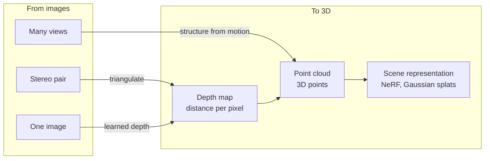
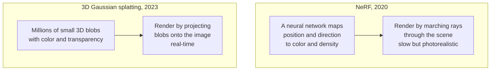

*By Gopi Krishna Tummala*

*Recovering the third dimension from images: depth, reconstruction, point clouds, and the scene representations that render real places from new viewpoints.*

Module 9 of 10 in the [computer vision series](/posts/computer-vision/computer-vision-module-1-how-machines-see). Previous: [Video and Tracking](/posts/computer-vision/computer-vision-module-8-video-and-tracking). Next: [Vision Foundation Models](/posts/computer-vision/computer-vision-module-10-vision-foundation-models).

---

The checkout camera sees two bottles of olive oil that look identical in the image: same label, same shape, same apparent size. One is a 250 ml bottle close to the camera; the other is a liter bottle further back. A flat image can't tell them apart, and the price difference is large. The camera needs to know how far away things are.

Every photo flattens the 3D world onto a 2D plane, and depth is what gets lost. 3D vision is about getting it back: how far, what shape, where in space. It powers robots that grasp objects, cars that measure distances, AR that places virtual objects on real tables, and digital copies of real places.

## The idea in one picture

*Different inputs, different routes, the same goal: put every pixel back where it is in space.*

## Cameras and geometry

A camera projects 3D points onto a 2D image according to its focal length and position. Knowing those parameters, from calibration, is what lets you go back from pixels to rays in space. [Module 3 of the driving series](/posts/robotics/autonomous-stack-module-3-calibration) covers calibration in detail. The key fact for depth: each pixel corresponds to a ray, and the point could be anywhere along it. A single image alone can't say where.

## Depth from two views

With two cameras a known distance apart, the same point appears in slightly different positions in each image. That shift, the **disparity**, is larger for near objects and smaller for far ones, just as your thumb jumps more than a distant tree when you alternate closing each eye. Matching pixels between the two images and measuring the shift gives depth by triangulation. Stereo is reliable where there's texture to match, and struggles on blank walls and shiny surfaces.

## Depth from a single image

People judge depth with one eye closed, using cues: known object sizes, perspective, occlusion, texture getting finer with distance. Neural networks learn the same cues. Monocular depth models like [Depth Anything](https://arxiv.org/abs/2401.10891) and its successor [Depth Anything V2](https://arxiv.org/abs/2406.09414), trained on large mixes of labeled and pseudo-labeled images, produce remarkably good depth maps from one photo.

The limitation: single-image depth is usually **relative**. It knows the near bottle is closer than the far one, but not by how many centimeters, because a small scene up close and a large scene far away can look identical. A known reference, like the checkout counter's known size or a few points from a depth sensor, fixes the scale.

## Structure from motion

With many photos of a scene from different positions, you can recover both the 3D structure and where each photo was taken. **Structure from motion** finds matching features across images, estimates the camera positions, and triangulates the matched points into a sparse 3D point cloud, refining everything together. Tools like COLMAP made this the standard way to reconstruct real places, and it's the starting point for NeRF and Gaussian splatting below. Recent learned approaches like DUSt3R predict 3D structure from image pairs directly, without the classical feature-matching pipeline.

## Point clouds

Depth sensors and lidar produce point clouds directly: sets of 3D points, unordered and unevenly spaced. Images are neat grids; point clouds aren't, so standard convolutions don't apply. [PointNet](https://arxiv.org/abs/1612.00593) (2017) processed points directly with an operation that doesn't care about their order. Others group points into voxels or vertical pillars to reuse grid-based networks, the approach common in self-driving perception ([Module 6: Perception](/posts/robotics/autonomous-stack-module-6-perception)).

## New scene representations: NeRF and Gaussian splatting

Given photos of a scene from many angles, can you render it from an angle nobody photographed?

*Both learn a scene from photos and render new viewpoints. NeRF stores the scene in a network; Gaussian splatting stores it as explicit blobs.*

- **[NeRF](https://arxiv.org/abs/2003.08934)** (2020) represents a scene as a neural network that, for any point in space and viewing direction, outputs color and density. Rendering an image means sending a ray through each pixel and accumulating color along it. Trained on the input photos by comparing rendered and real images, it produced startlingly realistic new views, but rendering was slow.
- **[3D Gaussian Splatting](https://arxiv.org/abs/2308.04079)** (2023) represents the scene explicitly as millions of small, fuzzy 3D Gaussians, each with position, shape, color and opacity, starting from a structure-from-motion point cloud. Rendering projects them onto the image, fast enough for real time at high resolution. It quickly became the preferred representation for capturing real places and is used for driving simulation, where real drives are reconstructed and replayed from new viewpoints.

## Measuring 3D

- **Depth:** absolute relative error, and the fraction of pixels within a ratio of the true depth.
- **Reconstruction:** distance between reconstructed and true geometry (Chamfer distance), completeness.
- **Novel views:** image quality of rendered views against held-out photos (PSNR, SSIM, LPIPS).

## What I'd remember

- **A pixel is a ray.** One image can't say where along it; more views or learned cues can.
- **Stereo triangulates; single-image depth infers.** Monocular depth is usually relative and needs a scale reference.
- **Structure from motion recovers cameras and points together.** The foundation for reconstructing real places.
- **Point clouds need their own networks.** Order-free (PointNet) or gridded (voxels, pillars).
- **NeRF learned scenes; Gaussian splatting made them real-time.** Now used for capture and simulation.

## Where to go next

- [Module 10: Vision Foundation Models](/posts/computer-vision/computer-vision-module-10-vision-foundation-models), the final module.
- [Module 3: Calibration](/posts/robotics/autonomous-stack-module-3-calibration) and [Module 6: Perception](/posts/robotics/autonomous-stack-module-6-perception) in the driving series.
- **Formal reading:** Georgia Tech CS 6476 lectures [16](https://faculty.cc.gatech.edu/~hays/compvision/lectures/16.pdf) and [21](https://faculty.cc.gatech.edu/~hays/compvision/lectures/21.pdf) on 3D point processing and NeRF, plus the course's sessions on Plenoxels and Gaussian splatting and on geometry in the deep learning era, with Szeliski sections 5.5.1 and 14.6 in [Computer Vision: Algorithms and Applications](https://szeliski.org/Book/). The fifth and sixth projects cover PointNet and NeRF.
- Papers: [Depth Anything V2](https://arxiv.org/abs/2406.09414), [NeRF](https://arxiv.org/abs/2003.08934), [3D Gaussian Splatting](https://arxiv.org/abs/2308.04079), [PointNet](https://arxiv.org/abs/1612.00593).

Previous: [Video and Tracking](/posts/computer-vision/computer-vision-module-8-video-and-tracking). Next: [Vision Foundation Models](/posts/computer-vision/computer-vision-module-10-vision-foundation-models).

**Questions to sit with**

1. How would the checkout camera tell the 250 ml bottle from the liter bottle, with one camera?
2. Why is depth from a single image usually only relative?
3. When would you choose Gaussian splatting over NeRF?
