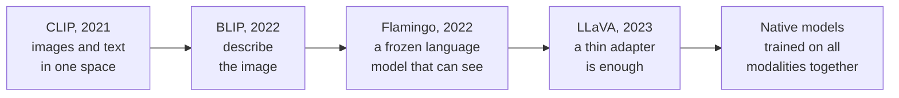

*By Gopi Krishna Tummala*

*How models learned to look at a picture and talk about it, told as a short sequence of ideas: CLIP's shared space, BLIP's captions, Flamingo's frozen language model, LLaVA's thin adapter, and natively multimodal models.*

---

You send an assistant a photo of your desk and ask, "What's wrong with this setup?" It replies, "The lamp is blocking part of your monitor, and the monitor sits too low for your eye line." That answer isn't memorized. It comes from what's in the pixels, combined with general knowledge about desks and posture.

For most of deep learning's history, no single model could do that. Vision models could label the objects in the photo but had nothing to say about them. Language models could discuss ergonomics fluently but couldn't see. A vision-language model (VLM) joins the two. This post walks through how the field got there, one idea at a time, using the desk photo to show what each step made possible.

## The idea in one picture

*Each step solved one problem: matching images to words, then describing them, then holding a conversation, then doing it cheaply with open models, then training everything together from the start.*

## First, images as tokens

Two things had to happen before any of this. Convolutional networks, starting around 2012, made image recognition work by looking at small neighborhoods of pixels and building up to objects. They were great at "this is a lamp" and weak at relationships across the whole image, like "the lamp is in front of the monitor."

Then transformers arrived for language in 2017, with attention that connects any word to any other. The [Vision Transformer](https://arxiv.org/abs/2010.11929) (2020) applied the same idea to images: cut the image into small patches, treat each patch like a word, and let attention connect them. Once images and text were both sequences of tokens, putting them in one model became a natural next step.

## CLIP: one space for images and words

[CLIP](https://arxiv.org/abs/2103.00020) (OpenAI, 2021) trained two encoders side by side, one for images and one for text, on about 400 million image-caption pairs from the web. The training goal was simple: make each image's vector land close to its own caption's vector and far from everyone else's.

The result was a shared space where a photo of a desk lamp and the words "a desk lamp" end up near each other, without anyone labeling categories. That made zero-shot recognition possible: to classify an image, compare it with text descriptions of each possible class. For the desk photo, CLIP could tell you it matches "a cluttered home office desk" better than "a kitchen counter." What it couldn't do was say anything new. It matches; it doesn't talk.

## BLIP: from matching to describing

[ALBEF](https://arxiv.org/abs/2107.07651) and then [BLIP](https://arxiv.org/abs/2201.12086) (Salesforce, 2021–2022) added a text decoder that could generate captions, trained on top of CLIP-style alignment. BLIP also improved its own training data: it generated captions for web images, filtered out the bad ones, and trained on the cleaner result. Now the model could say "a desk with a monitor, a lamp and a keyboard."

[BLIP-2](https://arxiv.org/abs/2301.12597) (2023) solved a practical problem. Large vision encoders and large language models were each expensive to train, so BLIP-2 kept both frozen and trained only a small bridge between them, the Q-Former: a few dozen learned queries that pull the most useful information out of the image and hand it to the language model as a short sequence of tokens.

## Flamingo: a language model that can see

DeepMind's [Flamingo](https://arxiv.org/abs/2204.14198) (2022) went after conversation. It started from a large, frozen language model, so it kept all its fluency and knowledge, and inserted new cross-attention layers that let the text look at image features. Each new layer has a learned gate that starts closed, so the model begins as the original language model and gradually learns how much visual information to let in.

Flamingo could follow interleaved sequences of images and text and learn new tasks from a few examples in the prompt. This is the first point where our desk question becomes answerable: the language model brings the knowledge about lamps, glare and posture, and the cross-attention brings the evidence from the photo.

## LLaVA: a thin adapter is enough

Open-source projects then asked how little you really need. [LLaVA](https://arxiv.org/abs/2304.08485) and [MiniGPT-4](https://arxiv.org/abs/2304.10592) (2023) took a pre-trained CLIP image encoder and an open language model, and connected them with just a small projection layer that maps image features into the language model's input space. LLaVA then fine-tuned on instruction-style conversations about images, which its authors generated with GPT-4 from existing image captions.

It worked far better than expected. A thin adapter, trained on the right conversations, was enough for useful visual chat. Most open VLMs today still follow this pattern: a vision encoder, a small connector, and a language model that reads image tokens alongside your question.

## Natively multimodal models

The latest step removes the seams. Instead of attaching vision to a finished language model, models like Google's Gemini are trained on text, images, audio and video together from the start. Their internals are mostly not public, but the direction is clear: one model that treats every modality as a first-class input.

## Where they still struggle

VLMs are impressive and still unreliable in specific ways:

- **Hallucination.** A model may describe a coffee mug on the desk because desks usually have one. Counting objects and reading small or blurry text are common failure points.
- **Benchmarks that don't need the image.** Some test questions can be answered from the text alone, which flatters models that rely on language priors.
- **Time.** Single images are much easier than video, where the model has to follow motion and cause and effect.
- **Data.** Web captions are noisy and biased, and licensing for scraped data is unsettled.

## What I'd remember

- **CLIP made a shared space.** Images and text that mean the same thing land near each other.
- **Generation came next.** BLIP described images; BLIP-2 did it with frozen parts and a small bridge.
- **Frozen language models can learn to see.** Flamingo added gated cross-attention without losing fluency.
- **A thin adapter goes a long way.** LLaVA showed a projection layer plus good instruction data is enough.
- **The newest models are multimodal from the start.** And hallucination is still the main weakness.

## Where to go next

- [The Multimodal Atlas](/posts/generative-ai/multimodal-foundation-models-end-to-end), for how today's VLMs and image and video generators are trained end to end.
- [An Introduction to Vision-Language Modeling](https://arxiv.org/abs/2405.17247), a long tutorial from Meta.
- The original papers linked above, especially CLIP and LLaVA, which are both readable.

**Questions to sit with**

1. CLIP can tell that the desk photo matches "home office" but can't describe it. What's missing?
2. Why did Flamingo's designers start its new layers with their gates closed?
3. How would you check whether a VLM is really using the image to answer a question?
