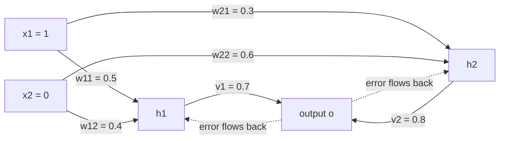

*By Gopi Krishna Tummala*

*Backpropagation answers one question: when a network's prediction is wrong, how much should each weight change? Here's the idea, the three equations that do the work, and a tiny network you can trace by hand.*

---

A network with millions of weights makes a prediction, and the prediction is wrong. To improve, every weight needs to move a little, some up and some down, some a lot and some barely. But the error only shows up at the very end. How does a weight three layers back know what it did?

That's the credit assignment problem, and backpropagation is the answer: start from the error at the output and pass responsibility backward, layer by layer, using the chain rule from calculus. Each weight ends up with a number saying how much the error would change if that weight changed. That number is its gradient.

This post builds the idea up on one small network with real numbers, so you can watch blame flow backward and see the prediction improve after one update.

## The idea in one picture

*The network we'll trace: two inputs, two hidden neurons, one output, sigmoid activations, no biases. Values flow forward along the solid arrows; responsibility for the error flows back along the dashed ones.*

## Forward: make a prediction

Each neuron takes a weighted sum of its inputs and passes it through an activation function, here the sigmoid $\sigma(z) = 1/(1+e^{-z})$, which squashes any number into the range 0 to 1.

With input $x = (1, 0)$:

- Hidden neuron 1: $0.5 \times 1 + 0.4 \times 0 = 0.5$, and $\sigma(0.5) = 0.6225$.
- Hidden neuron 2: $0.3 \times 1 + 0.6 \times 0 = 0.3$, and $\sigma(0.3) = 0.5744$.
- Output: $0.7 \times 0.6225 + 0.8 \times 0.5744 = 0.8953$, and $\sigma(0.8953) = 0.7101$.

The target is $y = 1$, so the prediction is too low. Using squared error, $E = \tfrac{1}{2}(y - o)^2 = 0.0420$.

## Backward: the three equations that do the work

Backpropagation needs one quantity per neuron, usually called delta ($\delta$): how much the error changes when that neuron's weighted sum changes. Once you have it, everything else is simple.

**1. The weight gradient is delta times the input that weight saw.**

$$\frac{\partial E}{\partial w_{ij}} = \delta_i \cdot a_j$$

A weight only matters as much as the signal flowing through it. If its input was zero, it gets no blame at all.

**2. At the output, delta is the error times the activation's slope.** For sigmoid with squared error:

$$\delta_{\text{out}} = (o - y)\, \sigma'(z) = (o - y)\, o\,(1 - o)$$

**3. At a hidden neuron, delta is the blame passed back from the layer above, weighted by how strongly this neuron fed into it, times its own slope.**

$$\delta_i = \sigma'(z_i) \sum_k w_{ki}\, \delta_k$$

That third equation is the "back" in backpropagation. Each layer's deltas are computed from the next layer's, so one pass from output to input gives every weight its gradient, at roughly the cost of one forward pass.

## Tracing the blame

Now apply the three equations to our network.

**Output delta:** $(0.7101 - 1) \times 0.7101 \times 0.2899 = -0.0596$. Negative means "the output should go up."

**Hidden deltas,** each the output delta passed back through its weight and scaled by the neuron's slope:

- $h_1$: $0.6225 \times 0.3775 \times 0.7 \times (-0.0596) = -0.0098$
- $h_2$: $0.5744 \times 0.4256 \times 0.8 \times (-0.0596) = -0.0117$

**Gradients,** each delta times the input its weight saw:

- Output weights: $\partial E/\partial v_1 = -0.0596 \times 0.6225 = -0.0371$, and $\partial E/\partial v_2 = -0.0596 \times 0.5744 = -0.0342$.
- Hidden weights from $x_1$: $-0.0098$ and $-0.0117$.
- Hidden weights from $x_2$: zero, because $x_2 = 0$. Those weights had no part in this mistake.

**Update** with learning rate 0.5, moving each weight against its gradient:

- $v_1$: 0.7 → 0.7186, $v_2$: 0.8 → 0.8171
- $w_{11}$: 0.5 → 0.5049, $w_{21}$: 0.3 → 0.3059

**Check:** run the forward pass again with the new weights and the output rises from 0.7101 to 0.7148, a little closer to the target of 1. Training is this step repeated many times over many examples.

## Why deep networks made this hard

Look at the deltas again: the hidden ones are about six times smaller than the output one. That's because each layer multiplies by the activation's slope, and the sigmoid's slope is at most 0.25. Stack ten sigmoid layers and the blame reaching the first layer is scaled by at most $0.25^{10}$, about one in a million. Early layers barely learn.

This is the vanishing gradient problem, and much of the history of deep learning is about getting around it: ReLU activations, whose slope is 1 for positive inputs; careful weight initialization; normalization layers; and residual connections, which give the gradient a shortcut path straight back through the network.

## What can go wrong in practice

- **Saturated activations.** If a sigmoid's input is far from zero, its slope is nearly zero and learning stalls. Modern networks mostly use ReLU-family activations in hidden layers for this reason.
- **The learning rate.** Too large and the loss oscillates or diverges; too small and training crawls. With the Adam optimizer, 0.001 is a common starting point, usually with a schedule that lowers it over time.
- **A buggy hand-written gradient.** If you implement backpropagation yourself, compare it with a numerical estimate, nudging one weight by a tiny amount up and down and measuring how the loss changes. The two should agree to many decimal places. Frameworks like PyTorch compute gradients automatically, which is the same algorithm applied to any graph of operations.

## What I'd remember

- **Backpropagation is the chain rule, applied from the output backward.** One backward pass gives every weight its gradient.
- **Each weight's gradient is its neuron's delta times the input it saw.** No input, no blame.
- **Hidden deltas are blame passed back through the weights, scaled by each neuron's slope.**
- **Small slopes multiply.** That's the vanishing gradient problem, and why ReLU and residual connections matter.
- **When you write gradients by hand, check them numerically.**

## Where to go next

- [The Transformer: How Machines Pay Attention](/posts/fundamentals/transformers-attention-mechanism), the architecture most backpropagation runs through today.
- [XGBoost: Boosting Trees with Second-Order Gradients](/posts/fundamentals/xgboost-second-order-gradient-boosting), a different way of using gradients.
- Rumelhart, Hinton and Williams, "Learning representations by back-propagating errors," *Nature*, 1986, the paper that popularized the method.
- Goodfellow, Bengio and Courville, [*Deep Learning*](https://www.deeplearningbook.org/), chapter 6.

**Questions to sit with**

1. Why did the weights from $x_2$ get zero gradient, and when would that change?
2. If the output used ReLU instead of sigmoid, what would change in the output delta?
3. Why does one backward pass cost about the same as one forward pass?
