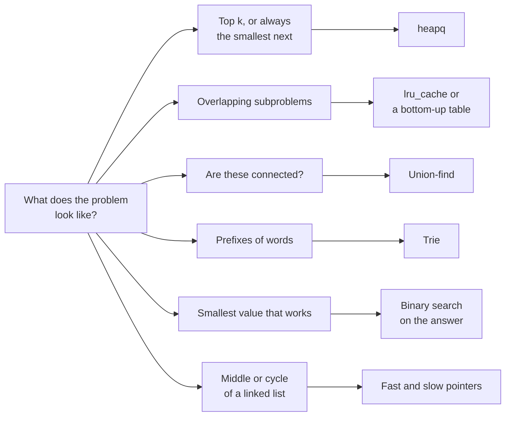

*By Gopi Krishna Tummala*

*A short map of the Python tools that show up again and again in coding interviews (heaps, memoization, union-find, tries, binary search) and the gotchas that cost people time, organized by the shape of the problem.*

---

Twenty minutes into an interview, you get: "Given a list of words, return the k most frequent, ties broken alphabetically." You know the idea immediately: count, then pick the top k. What decides how the next fifteen minutes go is whether you know Python's tools well enough to write it cleanly, without fighting the language.

```python
from collections import Counter
import heapq

def top_k_words(words: list[str], k: int) -> list[str]:
    counts = Counter(words)
    return [w for w, _ in heapq.nsmallest(k, counts.items(), key=lambda x: (-x[1], x[0]))]
```

Three tools did the work there: `Counter` for counting, a heap for picking the top k without sorting everything, and a sort key that handles the tie-break. This post is a map of tools like these, grouped by the shape of problem they solve, plus the traps that quietly cost time. It's meant as a refresher you read before an interview, not a textbook.

## The idea in one picture



*Most interview problems announce their tool through their shape. Recognizing the shape is half the solution.*

## Heaps: top k and "smallest next"

Python's `heapq` is a min-heap only. For a max-heap, push negated values and negate them again when you pop. When you push tuples, Python compares the first element, then the second, so `(priority, item)` works until two priorities tie and the items can't be compared, like two custom node objects. Adding a counter as a tie-breaker, `(priority, count, item)`, avoids that error.

For the k largest of a long stream, keep a min-heap of size k: the smallest of your current top k sits at the root, and anything bigger replaces it. That's O(n log k) instead of O(n log n) for a full sort, and it's worth saying out loud. For a one-off on a list that fits in memory, `heapq.nlargest(k, items)` does the same in one call, as in the opening example.

## Memoization: let Python remember

When a recursive solution recomputes the same subproblems (grid paths, edit distance, most "how many ways" questions), `functools.cache` (or `lru_cache(maxsize=None)`) turns it into dynamic programming with one decorator. Two practical notes. Deep recursion can hit Python's default limit of about 1,000 frames, so either raise it with `sys.setrecursionlimit` or rewrite bottom-up. And bottom-up tables can often shrink to one row: in the 0/1 knapsack, looping capacity from high to low over a single array keeps each item from being used twice.

```python
dp = [0] * (W + 1)
for weight, value in items:
    for w in range(W, weight - 1, -1):   # high to low: each item used at most once
        dp[w] = max(dp[w], dp[w - weight] + value)
```

## Union-find: "are these connected?"

For connectivity questions (number of groups, redundant edge, merging accounts), union-find answers "are these two in the same group?" in nearly constant time. Each element points to a parent; following parents leads to a group's root. Two tricks keep it fast: path compression, which points every visited element straight at the root, and union by rank, which attaches the shorter tree under the taller one.

```python
parent = list(range(n))

def find(x):
    if parent[x] != x:
        parent[x] = find(parent[x])   # path compression
    return parent[x]

def union(a, b):
    ra, rb = find(a), find(b)
    if ra == rb:
        return False                   # already connected: this edge is redundant
    parent[rb] = ra
    return True
```

*Simplified: union by rank omitted.*

## Tries: prefixes of words

For autocomplete, prefix counts or searching many words in a grid at once, a trie stores words character by character so shared prefixes are stored once. In an interview, nested dictionaries are often enough: each node is a dict from character to child, with a marker key for "a word ends here."

## Two pointers and binary search

Fast and slow pointers solve a family of linked-list questions. Move one pointer two steps and the other one step: when the fast one reaches the end, the slow one is in the middle, and if there's a cycle the two eventually meet.

```python
slow = fast = head
while fast and fast.next:
    slow, fast = slow.next, fast.next.next
    if slow is fast:
        return True      # cycle
return False
```

Binary search shows up in two forms. On a sorted list, `bisect.bisect_left` finds the first position where a value could go. The more powerful form is binary search on the answer: when the question is "what's the smallest capacity, speed or time that works?" and checking a candidate is easy, search over the candidates instead of over the data.

## Small tools that save minutes

- **`collections`:** `Counter` for counting, `defaultdict(list)` for grouping, `deque` for queues with O(1) pops from both ends.
- **`itertools`:** `combinations`, `permutations` and `product` for generating candidates; `groupby` for runs of equal values (on sorted or already grouped data).
- **Sort keys:** `key=lambda w: (-len(w), w)` sorts by length descending, then alphabetically.
- **Bit tricks:** `n & (n - 1) == 0` checks a power of two (for `n > 0`), `n & -n` isolates the lowest set bit, and XOR-ing all values finds the one that appears an odd number of times.
- **Integer math:** `-(-a // b)` or `(a + b - 1) // b` for ceiling division, `math.isclose` for floats, `math.gcd` and `math.lcm`.

## The traps

**Mutable default arguments.** A default like `def f(x, seen=[])` is created once, when the function is defined, so every call shares the same list. Use `None` as the default and create the list inside.

**Shared rows.** `[[0] * 3] * 3` creates three references to one row, so changing one cell changes a whole column. Use `[[0] * 3 for _ in range(3)]`.

**Accidentally quadratic code.** These look harmless and aren't:

| Slow | Fast | Why |
|---|---|---|
| `x in some_list` inside a loop | `x in some_set` | Each list lookup scans everything |
| `some_list.pop(0)` | `some_deque.popleft()` | Popping from the front of a list shifts every element |
| Building a string with `s += piece` in a loop | `"".join(pieces)` | Repeated concatenation can copy the whole string each time |

## What I'd remember

- **Name the shape before the tool.** Top k means a heap, overlapping subproblems mean memoization, connectivity means union-find.
- **State the complexity and why.** O(n log k) with a size-k heap beats O(n log n) for a full sort, and saying so is part of the answer.
- **Know the two classic traps.** Mutable defaults and shared rows cost more interview time than any algorithm.
- **Watch for hidden quadratic work.** List membership, front pops and string concatenation in loops.
- **Mention edge cases unprompted.** Empty input, one element, ties, duplicates.

## Where to go next

- [The 45-Minute Interview Flow](/posts/interview-prep/interview-problem-solving-flow), for a process to wrap around these tools.
- [Preparing for AI-Enabled Coding Interviews](/posts/interview-prep/ai-enabled-coding-interviews) and [Coding With AI Without Losing Your Edge](/posts/interview-prep/ai-assisted-coding-conscious-practice-and-interviews).
- The Python docs for [`heapq`](https://docs.python.org/3/library/heapq.html), [`collections`](https://docs.python.org/3/library/collections.html) and [`functools.cache`](https://docs.python.org/3/library/functools.html#functools.cache).

**Questions to sit with**

1. In the opening example, why does `nsmallest` with a negated count give the most frequent words?
2. When would you choose a bottom-up DP table over `@cache`?
3. What breaks in a tuple heap when two priorities tie, and how do you prevent it?
