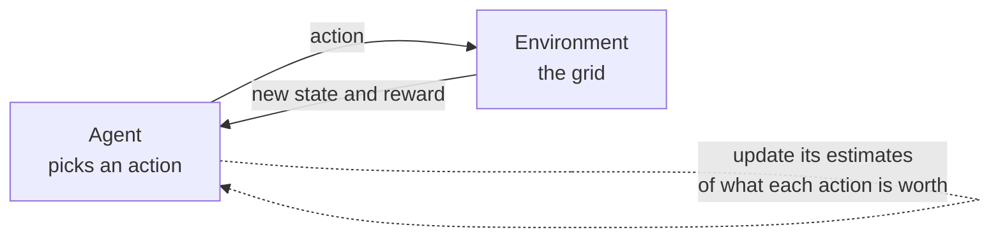

*By Gopi Krishna Tummala*

*Reinforcement learning is how an agent learns what to do now when the reward comes later. The core ideas (states, rewards, value, Q-learning and deep Q-networks), built up on one tiny grid world.*

---

Picture a robot on a 3×3 grid. It starts in the top-left square and can move up, down, left or right. The bottom-right square holds a charger: reaching it earns a reward of +1 and ends the episode. Every other move earns nothing. Nobody tells the robot the map or the rules. It just moves, and occasionally something good happens.

The hard part is the delay. When the robot finally reaches the charger, the move that earned the reward was the last one, but the moves that mattered most were the early ones that headed in the right direction. Figuring out which earlier decisions deserve credit for a later reward is the central problem of reinforcement learning (RL). This post builds up the main ideas on that grid, from the vocabulary to Q-learning, then shows how the same ideas scale to video games and to training language models.

## The idea in one picture

*An agent acts, the environment responds with a new state and a reward, and the agent updates its estimate of how good each action is. Repeat until the estimates are good enough to act on.*

## The vocabulary

RL problems are usually described with five pieces:

- **State:** where the robot is, here one of nine squares. The assumption is that the current state tells you everything useful; how you got there doesn't matter.
- **Action:** the four moves.
- **Transitions:** where each action takes you. On our grid it's deterministic, but in general an action can lead to different states with some probability.
- **Reward:** +1 for reaching the charger, 0 otherwise.
- **Discount:** a number $\gamma$ between 0 and 1 that says how much a reward one step later is worth compared with one now. We'll use $\gamma = 0.9$: a reward next step is worth 90% of the same reward now.

What the robot learns is a **policy**: a rule for which action to take in each state. The goal is the policy that collects the most discounted reward.

## Value: how good is it to be here?

Before choosing actions, it helps to know how good each square is. The value of a square is the total discounted reward you can expect from there if you act well.

On our grid you can work it out by hand, backward from the charger. From the square right next to the charger, the best move earns +1 immediately, so its value is 1. One step further away, the best you can do is move next to the charger and then collect, so the value is $0.9 \times 1 = 0.9$. Two steps further out it's 0.81. The starting corner is four moves from the charger, so the best first move from there is worth $0.9^3 \approx 0.73$.

That backward reasoning is the **Bellman equation** in words: the value of where you are equals the reward you get now plus the discounted value of where you end up next. Almost every RL algorithm is a way of finding values that satisfy that rule, without knowing the map in advance.

## Q-learning: learning by trying

Q-learning estimates a slightly more useful number: the value of taking a specific action in a specific state, written $Q(s, a)$. If you know Q for every action in a square, the policy is easy: take the action with the highest Q.

The robot starts with every Q at zero and wanders. After each move it nudges its estimate for the move it just made toward a better target:

$$Q(s, a) \leftarrow Q(s, a) + \alpha\left(r + \gamma \max_{a'} Q(s', a') - Q(s, a)\right)$$

In words: the target is the reward just received plus the discounted value of the best action available from the new square. The difference between that target and the old estimate is the surprise, called the temporal-difference error. The learning rate $\alpha$ decides how much of the surprise to absorb. If an estimate is 5, the target is 8 and $\alpha = 0.2$, the new estimate is $5 + 0.2 \times 3 = 5.6$.

On the grid, the first time the robot stumbles into the charger, only the last move gets credit. The next time it reaches the square before that, the update sees a nonzero Q for the next square and gives the earlier move credit too. Episode by episode, value flows backward from the charger until it matches the 1, 0.9, 0.81, 0.73 pattern above.

Two details make it work:

- **Exploration.** If the robot always picked its current best guess, it might never discover the charger. The simple fix, called ε-greedy, takes a random action some fraction ε of the time and lowers ε as estimates improve.
- **Learning about the best policy while exploring.** Because the target uses the best next action, not the random one the robot might actually take, Q-learning learns the value of acting optimally even while behaving randomly. Its sibling SARSA uses the action actually taken, which learns more cautious behavior when exploration is risky.

## When the grid becomes pixels: deep Q-networks

A table of Q values works for nine squares. It doesn't work when the state is a video game screen, where the number of possible screens is astronomical. DeepMind's [Deep Q-Network](https://www.nature.com/articles/nature14236) replaced the table with a neural network that takes the screen and outputs a Q value for each action, so it can generalize to screens it has never seen.

Training a network on its own shifting estimates is unstable, so DQN added two stabilizers:

- **Experience replay:** store past transitions and train on random samples of them, instead of on the last few moves in order. Consecutive moves are too similar to learn from well; shuffling them is like studying from shuffled flashcards instead of rereading the last page.
- **A target network:** compute the target using a copy of the network that's only updated every few thousand steps, so the network isn't chasing a goal that moves with every update.

With those, DQN learned dozens of Atari games directly from pixels, which showed that RL could scale with deep networks.

## Beyond Q-learning

Q-learning picks actions by comparing values, which works when there are a few discrete actions. When actions are continuous, like a steering angle, or when the action is a whole sentence, it's more practical to learn the policy directly. **Policy gradient** methods adjust the policy to make high-reward actions more likely, and **actor-critic** methods add a learned value estimate to reduce noise in those updates. PPO, the algorithm behind classic RLHF for language models, is one of these.

The newest step in that line is GRPO, which drops the learned critic and instead compares several attempts at the same problem with each other. It's widely used to train language models on tasks with checkable answers. The [Post-Training post](/posts/mlops/modern-post-training-peft-2026) shows it in action.

Deep RL is also notoriously finicky: it needs a lot of experience, and small changes to rewards or settings can change results dramatically. Most practical success comes from careful reward design and a lot of evaluation.

## What I'd remember

- **RL is learning from delayed reward.** The hard part is deciding which earlier actions deserve the credit.
- **Value is reward now plus discounted value next.** That's the Bellman equation, and most algorithms are ways of satisfying it.
- **Q-learning learns from surprise.** Each step nudges an estimate toward reward plus the best next value.
- **Explore, or you won't find the reward.** And learn from shuffled experience, not just the latest step.
- **The same ideas train language models.** Policy gradients, PPO and GRPO are descendants of these basics.

## Where to go next

- Sutton and Barto, [*Reinforcement Learning: An Introduction*](http://incompleteideas.net/book/the-book-2nd.html), free online and still the best foundation.
- OpenAI's [Spinning Up in Deep RL](https://spinningup.openai.com/en/latest/), hands-on with code.
- [Post-Training: SFT, LoRA, DPO and GRPO](/posts/mlops/modern-post-training-peft-2026), for RL applied to language models.

**Questions to sit with**

1. If the discount were 0.5 instead of 0.9, how would the values on the grid change, and what would that do to the robot's behavior?
2. Why can Q-learning learn the best policy while it's still taking random actions?
3. What would go wrong if DQN trained only on its most recent moves?
