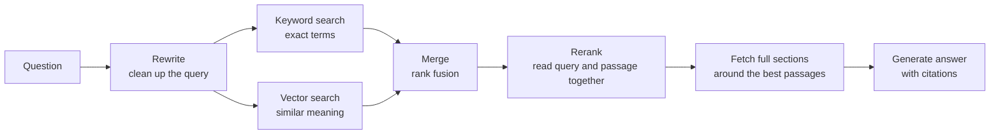

*By Gopi Krishna Tummala*

*Retrieval-augmented generation lets a model answer from your documents instead of its memory. A map of what it takes to make it work beyond a demo: hybrid search, reranking, chunking, video, freshness and how to measure it.*

---

A hardware company wants a support assistant. Its knowledge lives in thousands of PDF manuals, a parts catalog and a library of how-to videos. A customer types: "How do I replace the fan on the AX-452?"

A language model alone has never seen these manuals, so it will either decline or invent a plausible answer. Retrieval-augmented generation (RAG) fixes that by searching the company's documents first and giving the model the relevant passages to answer from. The demo version is easy: embed every chunk of every manual, find the five chunks closest to the question, paste them into the prompt.

The demo version also returns the fan replacement steps for the AX-450, misses the part number entirely, and ignores the video that shows exactly how to do it. This post follows the AX-452 question through the pieces that close that gap.

## The idea in one picture

*Retrieve broadly and cheaply, then narrow precisely and expensively, then give the model enough context to answer and cite.*

## Two kinds of search, together

Vector search embeds the question and every passage as vectors and finds the passages whose meaning is closest. It's good at concepts: "fan won't spin" finds passages about "cooling failure." It's bad at exact identifiers. To an embedding model, AX-452 and AX-450 look almost identical, which is exactly the wrong answer here.

Keyword search (usually BM25, a scoring method based on how often query words appear in a passage and how rare they are overall) is the opposite: excellent at "AX-452," useless at "fan won't spin" when the manual says "cooling failure."

So production systems run both and merge the two ranked lists. A common way is Reciprocal Rank Fusion: each passage scores the sum of $1/(k + \text{rank})$ across the lists it appears in, with $k$ around 60. Passages ranked well by both rise to the top, and a single list's odd ranking can't dominate. A small model can also rewrite the user's question first, expanding abbreviations or splitting a compound question, so both searches get a cleaner query.

## Choosing a vector index

Searching every vector exactly is too slow at scale, so vector databases use approximate indexes. The two main families trade memory for speed:

- **Graph indexes (HNSW):** a layered graph that lets search hop quickly toward the nearest neighbors. Very fast and accurate, but the vectors and the graph have to sit in memory. A hundred million 1,536-dimension float vectors are about 600 GB before the graph itself.
- **Cluster indexes (IVF):** group vectors into clusters and search only the clusters nearest the query. Much less memory, especially combined with compression of the vectors, at some cost in speed and recall.

For a few million passages, as in our support assistant, either works and the choice barely matters. It starts to matter at hundreds of millions.

## Reranking: read the question and the passage together

The first stage compares a question vector with passage vectors that were computed separately. That's fast enough to search millions, but shallow: the model never looked at the question and the passage at the same time. A reranker, usually a cross-encoder, reads the question and one candidate passage together and scores how well that passage answers that question. It catches that a passage about the AX-450 fan isn't the answer, even though it looks similar.

Cross-encoders are too slow to run over the whole collection, so they rerank only the top 50 or 100 candidates from the first stage. That adds tens to a hundred milliseconds, which is usually the best quality per millisecond in the whole pipeline.

## Chunk size and context

Small chunks (a few hundred tokens) are easier to match precisely. Large chunks give the model enough context to answer. A common compromise is to search small chunks but send the model the larger section around each match, often called parent-document retrieval. For the AX-452, the best match might be the sentence "Disconnect the fan connector J7," while the model needs the whole replacement procedure around it.

More context isn't always better, though. The [Lost in the Middle](https://arxiv.org/abs/2307.03172) study found language models use information at the start and end of a long prompt more reliably than information in the middle. Rerank, keep only what's relevant, and put the most important passages first.

## Video and fast-changing facts

The fan replacement is easiest to understand from the video. To make videos searchable, split them into short segments, embed a sampled frame or clip from each with an image-text model like CLIP, and also generate a text caption for each segment so keyword search works too. Store each segment with a pointer to its video and timestamp, so the assistant can answer "see 2:15 in the repair video." The [Multimodal Atlas](/posts/generative-ai/multimodal-foundation-models-end-to-end#how-a-model-learns-to-see-and-talk) covers the models behind that.

Some facts change too fast to index: stock levels, prices, order status. Don't put them in the search index at all. Retrieve the stable content (which part, which procedure) through search, then look up the live values from the system of record at answer time.

## Measuring it

Measure retrieval and generation separately, because they fail differently.

- **Retrieval:** recall@k (is the right passage in the top k at all?) and ranking measures like MRR and nDCG (how high is it?). Build a set of real questions with known correct passages; even a few hundred labeled examples will tell you a lot.
- **Generation:** faithfulness (does the answer only say what the passages support?) and answer relevance (does it answer the question?). These are usually scored by a strong language model checked against human judgments.

When the answer is wrong, the first question is always: was the right passage retrieved? If not, no prompt will fix it.

## What I'd remember

- **RAG answers from your documents, but only as well as it retrieves.** Most failures are retrieval failures.
- **Use keyword and vector search together.** One finds exact identifiers, the other finds meaning.
- **Retrieve broadly, then rerank.** A cross-encoder on the top candidates is the biggest quality gain per millisecond.
- **Search small, answer with context.** Match precise chunks, send the surrounding section.
- **Keep live facts out of the index.** Look them up at answer time.

## Where to go next

- [Beyond Parquet: Lance](/posts/mlops/lance-lancedb-data-layer-for-ml), for keeping text, vectors and media in one versioned table.
- [The Ray Field Guide](/posts/mlops/ray-field-guide-core-to-production#ray-data-streaming-the-pipeline), for computing embeddings over millions of documents.
- Liu et al., [Lost in the Middle: How Language Models Use Long Contexts](https://arxiv.org/abs/2307.03172).

**Questions to sit with**

1. For your own documents, what kinds of questions would vector search alone get wrong?
2. Where would you draw the line between content you index and facts you look up live?
3. How would you build the first hundred labeled questions to measure retrieval?
