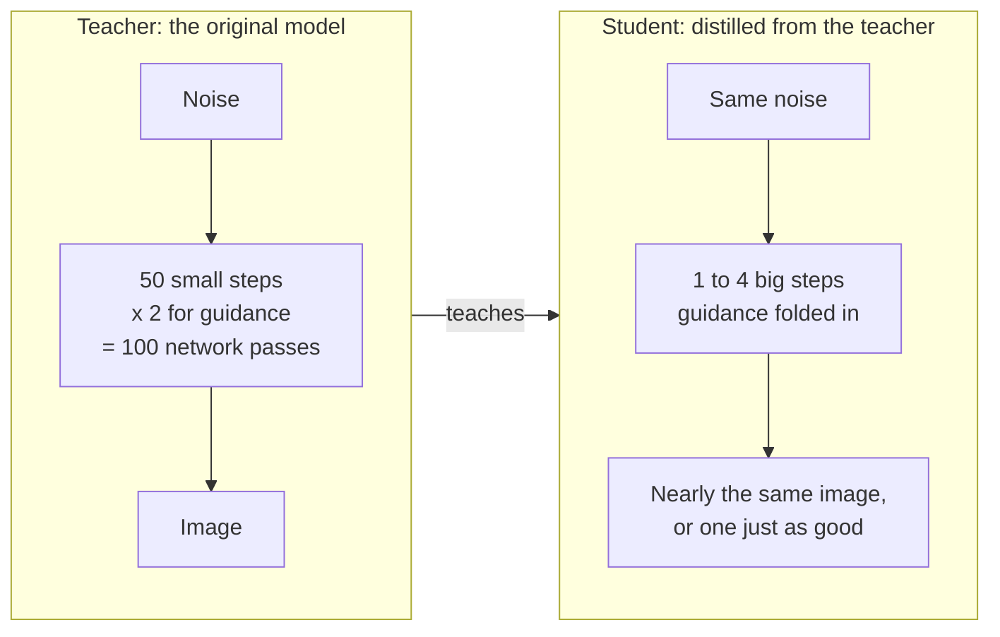
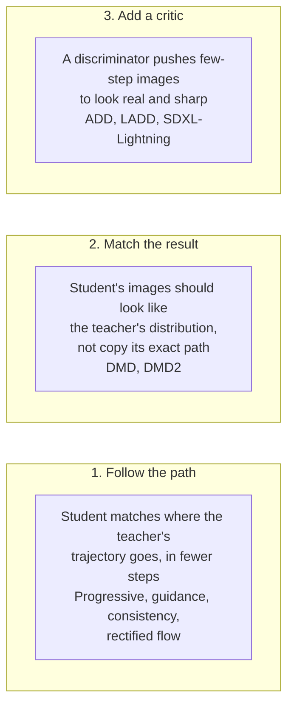

*By Gopi Krishna Tummala*

*A diffusion model paints by taking dozens of small steps, each a full pass through a large network. Distillation trains a student to get there in one to four. Why steps are the cost that matters, and the three families of tricks behind SDXL-Turbo, FLUX.1 schnell, DMD2 and real-time video.*

---

A product team adds "generate a lifestyle photo of this mug" to their shopping app. Their model is a strong open text-to-image diffusion model. It takes 50 denoising steps, and with classifier-free guidance each step runs the network twice, once with the prompt and once without. That's 100 passes through a multi-billion-parameter network for one image: several seconds on a good GPU, and a GPU bill that scales with every tap of the button.

They want two things the base model can't give them: a preview that updates as the user types, and a cost per image low enough to offer it to everyone. Both come down to one number, the count of network evaluations per image. Distillation is how that number goes from 100 to 4, or even 1.

This post explains why steps are the cost that matters, why you can't simply take bigger steps, and the three families of distillation methods that work, with the papers behind each. It assumes the basics of diffusion from [Diffusion: From Molecules to Machines](/posts/generative-ai/diffusion-from-molecules-to-machines) and of sampling and guidance from [Sampling and Guidance](/posts/generative-ai/sampling-guidance-diffusion-models).

## The idea in one picture

*Same network architecture, usually initialized from the teacher's weights. The student learns to cover in one jump what the teacher covers in dozens of small ones.*

## Why the number of steps is the cost

A diffusion model generates by starting from pure noise and repeatedly asking the network, "which way toward a clean image from here?", moving a little each time. Every step is a full forward pass. So latency and cost are roughly proportional to the number of steps, and guidance doubles it.

That cost compounds quickly:

- **Interactive use.** A preview that redraws while you type needs an image in well under a second. At 100 passes, that's out of reach.
- **Serving cost.** Fewer passes means proportionally fewer GPUs for the same traffic. [DMD2](https://arxiv.org/abs/2405.14867) reports matching or beating its teacher's image quality at a 500-fold reduction in inference cost.
- **Video.** Each step processes every frame together, so a video model's step is far more expensive than an image model's. The [Multimodal Atlas](/posts/generative-ai/multimodal-foundation-models-end-to-end#video-the-same-recipe-plus-time) shows how quickly video token counts grow. Few-step generation is what makes streaming video possible at all.

## Why not just take bigger steps?

The path from noise to image is curved. Early on, the model decides the layout; later, it adds detail, and the direction it wants to move changes along the way. A sampler that takes big steps follows the direction at its current point and overshoots the curve, landing somewhere blurry or wrong.

Better samplers help. Solvers designed for this kind of curve get from hundreds of steps down to a few dozen without retraining, which is what most production systems run. Below about ten steps, though, any fixed solver starts losing quality, because the information about the curve's shape just isn't available from a few samples of it. To go further, you need a network that has learned to take the big jump directly. That's what distillation trains.

## The teacher and the student

The setup is the same across nearly all methods:

- **The teacher** is the original, slow, high-quality model. It's frozen.
- **The student** is usually a copy of the teacher, same architecture, same starting weights, trained to produce good images in far fewer steps.
- **The training signal** comes mostly from the teacher itself: its outputs, its predicted directions, or its sense of what a good image looks like. Many methods need little or no new real data, which is a big part of their appeal.

What differs is what the student is asked to imitate. There are three answers.

*The families mix in practice. Many of the best results combine a path or distribution loss with an adversarial one.*

## Family 1: follow the teacher's path

**Progressive distillation** was the first method that worked at scale. [Salimans and Ho (2022)](https://arxiv.org/abs/2202.00512) trained a student to match two teacher steps with one, then made that student the new teacher and repeated, halving the step count each round. Starting from samplers that took as many as 8,192 steps, they got down to 4 "without losing much perceptual quality."

**Guidance distillation** removes the other multiplier. Classifier-free guidance runs the model with and without the prompt and extrapolates between them, so every step costs two passes. [Meng et al.](https://arxiv.org/abs/2210.03142) trained a single model to produce the guided output in one pass, then progressively distilled it, reaching 1 to 4 steps for latent text-to-image models. For our mug app, this alone halves the cost before any step reduction.

**Consistency models** change the question. Instead of "where do I go next?", a [consistency model](https://arxiv.org/abs/2303.01469) learns "where does this path end?" from any point along it. Every point on the same noise-to-image trajectory should map to the same final image:

$$f(x_t, t) = x_0 \quad \text{for every } t \text{ on the same path}$$

Train for that and one step is enough, with an optional second or third step to refine. [Latent Consistency Models](https://arxiv.org/abs/2310.04378) applied this to Stable Diffusion, producing a 2-to-4-step model with only 32 A100 GPU hours of training. OpenAI's [sCM](https://arxiv.org/abs/2410.11081) later stabilized the continuous-time version and scaled it to 1.5B parameters, generating with two steps at FID scores within 10 percent of the best diffusion models.

**Rectified flow** attacks the curve itself. If the path from noise to image were a straight line, one step would follow it exactly. [InstaFlow](https://arxiv.org/abs/2309.06380) used "reflow": generate noise and image pairs with the teacher, then train a new model to connect each pair with a straight line. After straightening, a one-step model produced images in 0.09 seconds. Modern flow-matching models are trained with straighter paths from the start, which is one reason they distill well.

## Family 2: match the result, not the path

Following the teacher's exact path is a strong constraint, and a student with only a step or two can't trace it precisely. Distribution matching relaxes it: the student doesn't need to produce the teacher's image for a given noise, only images that the teacher would consider likely.

[DMD](https://arxiv.org/abs/2311.18828) does this with two copies of a diffusion model acting as critics. One is the frozen teacher, which knows what real images look like. The other is continuously trained on the student's own outputs, so it knows what the student's images look like. The difference between their opinions tells the student which way to move each image to look more like the teacher's distribution. DMD produced a one-step generator running at 20 images per second.

[DMD2](https://arxiv.org/abs/2405.14867) removed DMD's need for a large set of teacher-generated reference images, added an adversarial loss on real images, and supported multi-step students. Its 4-step student distilled from SDXL scored an FID of 19.32 on COCO, against 19.36 for the teacher running 100 passes. Because the student is trained partly against real images rather than only against the teacher, it can match or exceed the teacher, which path-following methods can't.

## Family 3: add a critic

Few-step students tend to produce blurry images, an average of the plausible answers. A discriminator, the critic from GANs, fixes that by penalizing anything that doesn't look like a real image.

- **[Adversarial Diffusion Distillation](https://arxiv.org/abs/2311.17042)** (SDXL-Turbo) combines a score-distillation loss from the teacher with an adversarial loss. It generates in 1 to 4 steps, matched SDXL's quality in four, and was the first to make single-step, real-time generation work with a foundation model.
- **[Latent ADD](https://arxiv.org/abs/2403.12015)** moves the critic into the latent space, using features from a pretrained diffusion model instead of a separate image network. Applied to the 8B Stable Diffusion 3, it produced SD3-Turbo, matching leading generators with four steps and no guidance.
- **[SDXL-Lightning](https://arxiv.org/abs/2402.13929)** combines progressive and adversarial distillation: 128 steps to 32 with a simple loss, then 32 to 8 to 4 to 2 to 1, using the teacher's own encoder as the discriminator's backbone.
- **[FLUX.1 schnell](https://huggingface.co/black-forest-labs/FLUX.1-schnell)**, a widely used open model, is trained with latent adversarial diffusion distillation and generates in 1 to 4 steps, under the Apache 2.0 license.

For the mug app, any of these gives a 1-to-4-step model that can redraw a preview as the user types.

| Family | What the student imitates | Typical steps | Examples |
|---|---|---|---|
| Follow the path | The teacher's trajectory or its endpoint | 1 to 4 | Progressive, guidance distillation, LCM, sCM, InstaFlow |
| Match the result | The teacher's distribution of images | 1 to 4 | DMD, DMD2 |
| Add a critic | Real-looking images, via a discriminator | 1 to 4 | SDXL-Turbo, SD3-Turbo, SDXL-Lightning, FLUX.1 schnell |

## Video: from minutes to streaming

Video makes distillation a necessity rather than an optimization. A standard video diffusion model denoises all frames together, attending in both directions in time, so nothing can be shown until the whole clip is done.

[CausVid](https://arxiv.org/abs/2412.07772) distills such a model, a 50-step bidirectional teacher, into a 4-step student that generates frames in order, each looking only at earlier ones. Using DMD-style distribution matching and caching past frames, it streams video at 9.4 frames per second on a single GPU. [Self-Forcing](https://arxiv.org/abs/2506.08009) addresses the next problem: a student trained on perfect past frames drifts when it has to continue from its own imperfect ones. Training on its own rollouts closes that gap, and the authors report real-time generation at 17 frames per second with under a second of latency on one H100. Its authors frame it as post-training rather than distillation, but it builds directly on a 4-step distilled student.

## What you give up

Distillation isn't free, and the costs are worth knowing before shipping:

- **Variety.** Students, especially adversarial ones, can produce less varied images for the same prompt. Check diversity, not just quality.
- **Control.** Guidance strength is often baked in at training time, so the knob users relied on may disappear. Negative prompts and some editing techniques can behave differently.
- **Compatibility.** Style adapters (LoRAs) and fine-tunes made for the teacher may not transfer cleanly to the student.
- **A teacher-shaped ceiling.** Path-following students are bounded by their teacher; distribution and adversarial methods can exceed it but are harder to train stably.

A common production answer is to run both: the distilled student for fast previews, and the full teacher, or a few more student steps, for the final image the user keeps.

The idea isn't unique to images. Language models use the same teacher-student pattern, from the strong-to-weak distillation in [Qwen3-VL](/posts/generative-ai/vlm-moe-qwen-train-to-deploy#how-qwen3-vl-is-trained) to the small draft models in [Speculative Decoding](/posts/mlops/speculative-decoding-guess-and-verify). In every case, you pay once in training to save on every request.

## What I'd remember

- **Steps are the cost.** Each step is a full network pass, and guidance doubles it. Cutting 100 passes to 4 is a 25-fold saving.
- **Better samplers stop at a few dozen steps.** Going below about ten needs a network trained to jump.
- **Three families.** Follow the teacher's path, match the teacher's distribution, or add a critic for sharpness. The best methods combine them.
- **Video needs it most.** Distilled, causal students are what make streaming video generation possible.
- **Watch what you lose.** Variety, guidance control and adapter compatibility can all suffer.

## Where to go next

- [Sampling and Guidance](/posts/generative-ai/sampling-guidance-diffusion-models), for samplers and classifier-free guidance.
- [Behind the Generate Button](/posts/generative-ai/multi-stage-generation-pipelines), for where a distilled model sits in a production pipeline.
- [The Multimodal Atlas](/posts/generative-ai/multimodal-foundation-models-end-to-end#how-an-image-generator-learns-to-paint), for how image generators are trained before distillation.
- [A Survey on Pre-Trained Diffusion Model Distillations](https://arxiv.org/abs/2502.08364), for a broader map of methods.
- Papers: [Progressive Distillation](https://arxiv.org/abs/2202.00512), [Consistency Models](https://arxiv.org/abs/2303.01469), [DMD2](https://arxiv.org/abs/2405.14867), [ADD](https://arxiv.org/abs/2311.17042), [CausVid](https://arxiv.org/abs/2412.07772).

**Questions to sit with**

1. For your image workload, how many network passes does one image cost today, counting guidance?
2. Why can a distribution-matching student beat its teacher while a path-following one can't?
3. If users complain that distilled previews all look alike, what would you measure, and what would you change?
