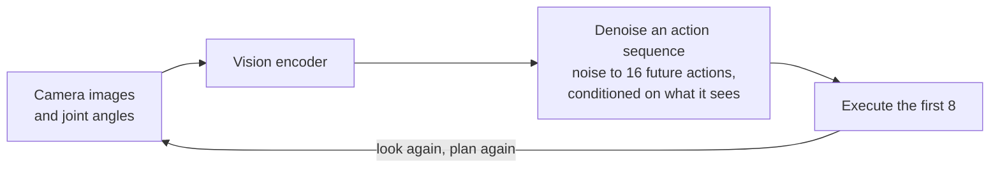
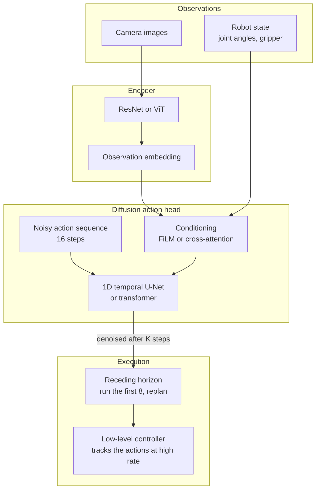

*By Gopi Krishna Tummala*

*The same denoising recipe that paints images can generate robot motions and driving trajectories. Why that handles "two good ways to do it" better than ordinary regression, how Diffusion Policy works, and where it leads.*

Part 6 of 8 in the [diffusion series](/posts/generative-ai/diffusion-from-molecules-to-machines). Previous: [The Training Lifecycle](/posts/generative-ai/pre-training-post-training-video-diffusion). Next: [Modern Video Models](/posts/generative-ai/modern-video-models-sora-veo-opensora).

---

A robot arm needs to pick up a cup from behind a vase. In the demonstrations it learned from, people reached around the left side about half the time and around the right side the other half. Both are fine. Train an ordinary network to predict the next motion with a squared-error loss, and it learns the average of the two answers: straight through the vase.

That failure is the reason diffusion moved into robotics. Averaging is what squared-error regression does when there's more than one right answer. A diffusion model doesn't predict the average; it learns the whole distribution of good motions and samples one of them, left or right, but never the broken middle. Everything from Parts [1](/posts/generative-ai/diffusion-from-molecules-to-machines) to [3](/posts/generative-ai/sampling-guidance-diffusion-models) carries over. Only the thing being denoised changes: a short sequence of actions instead of an image.

## The idea in one picture

*Generate a short plan, carry out part of it, observe, and plan again. The denoiser is the same kind of model that paints images.*

## Why regression averages, and diffusion doesn't

A squared-error loss is minimized by predicting the mean of the possible answers. When demonstrations contain one way to do something, the mean is fine. When they contain several, as human demonstrations nearly always do, the mean can be a motion nobody ever made. Older fixes, like predicting a mixture of a few Gaussians or splitting actions into bins, help but need the number of modes or bins chosen in advance.

Diffusion learns the distribution directly, however many modes it has. Starting from different random noise, the denoiser lands on different valid answers. For the cup, roughly half of the samples go left and half go right, matching the demonstrations.

## Diffusion Policy

[Diffusion Policy](https://arxiv.org/abs/2303.04137) (Chi et al., 2023) made this practical for visual robot control. Its ingredients:

- **Inputs:** recent camera images and the robot's own state (joint angles and gripper), encoded once per decision.
- **Output:** not one action but a short sequence, for example the next 16, denoised together. Predicting a sequence keeps motions smooth and consistent, since the whole chunk is generated as one coherent piece.
- **Receding horizon:** execute only the first part, say 8 actions, then observe again and generate a new sequence. The robot commits to a coherent motion but keeps reacting if the cup slides.
- **Training:** the standard noise-prediction loss from Part 1, applied to action sequences from teleoperated demonstrations, conditioned on the observations.

Across 12 tasks from four benchmarks, it improved on the previous best methods by an average of 46.9 percent.

*The action head is small: a 1D network over time, conditioned on the observation through FiLM layers or cross-attention. A fast low-level controller follows the plan between decisions.*

A closely related idea, action chunking, came from [ACT](https://arxiv.org/abs/2304.13705) (Zhao et al., 2023), which predicted chunks of actions with a transformer and averaged overlapping chunks over time ("temporal ensembling") for smoother motion. Chunking and receding horizons are now standard in learned robot control.

## Making it fast enough

Robots can't wait. Diffusion Policy sampled with about ten denoising steps using DDIM, around a tenth of a second per decision on a desktop GPU, which works for many tabletop tasks but is slow for dynamic ones. Two patterns help:

- **Split thinking from reflexes.** The policy produces a plan a few times a second; a simple low-level controller tracks it hundreds of times a second. The controller handles smoothness and stiffness; the policy handles decisions.
- **Use fewer steps.** The same distillation ideas from [Diffusion Distillation](/posts/generative-ai/diffusion-distillation-fewer-steps) apply. [Consistency Policy](https://arxiv.org/abs/2405.07503) distills a diffusion policy into one that needs one to a few steps, for much faster control with similar success rates.

## Planning, video and driving

The same idea shows up at several levels:

- **Planning by denoising.** [Diffuser](https://arxiv.org/abs/2205.09991) (Janner et al., 2022) generated whole trajectories and steered them toward high reward using guidance, the same mechanism as prompt guidance in [Part 3](/posts/generative-ai/sampling-guidance-diffusion-models#guidance-following-the-prompt-on-purpose). Constraints like "avoid this region" can be added the same way.
- **Planning in video.** [UniPi](https://arxiv.org/abs/2302.00111) used a text-conditioned video diffusion model to generate a video of the task being done, then inferred the actions that would produce it.
- **Driving.** Driving has the same multimodality problem: at a junction, both "go now" and "wait for the gap" can be right. [DiffusionDrive](https://arxiv.org/abs/2411.15139) generates planned trajectories with a truncated diffusion process that starts from a set of typical driving paths rather than pure noise, needing only two denoising steps and running in real time.
- **VLA action experts.** The robot foundation models in [Vision-Language-Action Models](/posts/robotics/vla-models-data-architecture-evaluation#architecture-three-ways-to-make-a-language-model-act), like π0, attach a flow-matching action expert to a vision-language model: Diffusion Policy's idea at foundation-model scale, with the language model supplying the understanding of the scene.

## Measuring a policy

- **Success rate** over many real trials is the measure that counts, and it's slow to collect. Simulated benchmarks are faster but don't always predict real results.
- **Smoothness**, often measured by jerk (the rate of change of acceleration), matters for wear on the hardware and for how safe and natural the motion feels.
- **Coverage of the modes:** if demonstrations reached both left and right around the vase, does the policy produce both? A policy that always picks one side can still succeed, but it has lost information that would help it when one side is blocked.

## What I'd remember

- **Squared-error regression averages; diffusion samples.** That's the whole reason diffusion suits actions with several valid answers.
- **Predict a chunk, execute part of it, replan.** Smooth motion with continuous reaction.
- **Speed comes from splitting and distilling.** A fast controller tracks the plan; distillation cuts the denoising steps.
- **The idea scales up.** Diffusion planners for driving and flow-matching action experts in VLA models are the same recipe.

## Where to go next

- [Modern Video Models](/posts/generative-ai/modern-video-models-sora-veo-opensora), the next part.
- [Vision-Language-Action Models](/posts/robotics/vla-models-data-architecture-evaluation), for diffusion action heads in robot and driving foundation models.
- Papers: [Diffusion Policy](https://arxiv.org/abs/2303.04137), [ACT](https://arxiv.org/abs/2304.13705), [Diffuser](https://arxiv.org/abs/2205.09991), [DiffusionDrive](https://arxiv.org/abs/2411.15139).

Previous: [The Training Lifecycle](/posts/generative-ai/pre-training-post-training-video-diffusion). Next: [Modern Video Models](/posts/generative-ai/modern-video-models-sora-veo-opensora).

**Questions to sit with**

1. For a task you know, where would demonstrations contain more than one good way to do it?
2. Why execute only part of a predicted action sequence before replanning?
3. What would you check before trusting a policy that always goes around the vase on the left?
