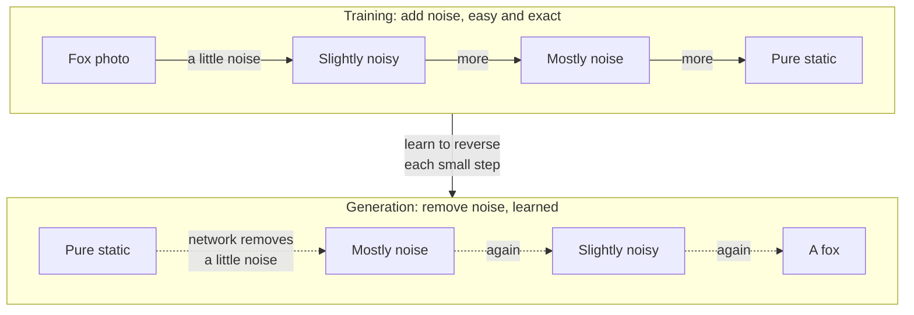
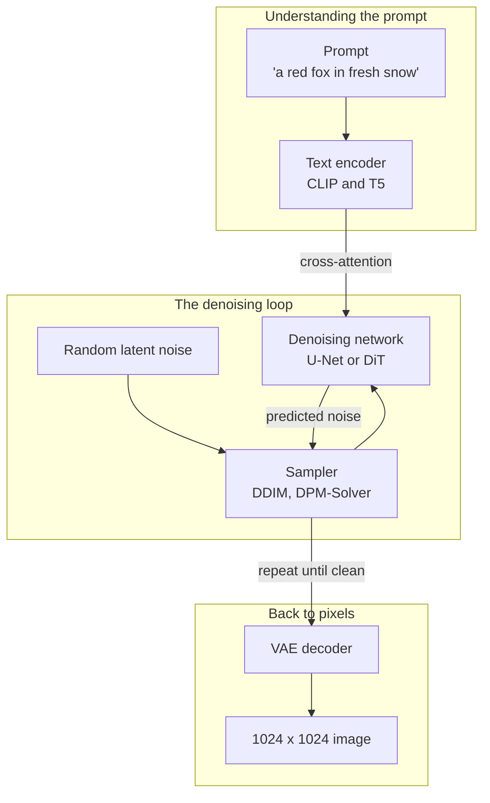

*By Gopi Krishna Tummala*

*The core idea behind Stable Diffusion, FLUX, Veo and robot policies: destroy data with noise in small steps, then train a network to undo one step at a time. Explained through one image.*

Part 1 of 8 in the diffusion series. Next: [Image Diffusion: From U-Net to DiT](/posts/generative-ai/image-diffusion-models-unet-to-dit).

---

Ask an image model for "a red fox standing in fresh snow" and it starts from a canvas of pure random static, the kind an old television shows between channels. A few seconds later there's a fox. Nothing in the network ever drew a fox in one go. It removed a little noise, looked again, removed a little more, dozens of times, and the fox emerged.

That's diffusion, and the same idea now generates images, video, audio, protein structures and robot motions. This post covers the foundations the rest of the series builds on: how noise is added, what the network learns, how an image is generated, and the two changes, latent diffusion and flow matching, that made today's models practical.

## The idea in one picture

*Training uses the solid arrows: noise is easy to add, so we always know the right answer. Generation uses the dashed ones: the network learned to reverse each small step.*

## The forward process: destroying an image on purpose

Drop ink into water and it spreads until the glass is uniformly tinted; the structure is gone. The forward process does the same to an image with Gaussian noise. Over many small steps, the fox fades into static, and after enough steps nothing of it remains.

The useful mathematical fact is that you don't have to simulate every step. Because each step adds Gaussian noise, the noisy image at any step $t$ can be produced directly from the original in one shot:

$$x_t = \sqrt{\bar{\alpha}_t}\, x_0 + \sqrt{1 - \bar{\alpha}_t}\, \epsilon, \qquad \epsilon \sim \mathcal{N}(0, I)$$

Here $x_0$ is the clean fox, $\epsilon$ is random noise, and $\bar{\alpha}_t$ is a number that starts near 1 (all image) and falls toward 0 (all noise) according to a chosen noise schedule. Training can pick any step at random and create its training example instantly. That's what makes diffusion training cheap and stable.

The idea goes back to [Sohl-Dickstein et al. (2015)](https://arxiv.org/abs/1503.03585), who borrowed it from non-equilibrium thermodynamics. It became practical with [DDPM](https://arxiv.org/abs/2006.11239) (Ho et al., 2020), which showed it could produce high-quality images.

## What the network learns

If you know exactly how much noise was added, you can learn to take it away. DDPM trains a network $\epsilon_\theta$ that looks at the noisy image $x_t$ and the step $t$, and predicts the noise:

$$\mathcal{L} = \mathbb{E}_{x_0,\, \epsilon,\, t}\Big[\big\lVert \epsilon - \epsilon_\theta(x_t, t) \big\rVert^2\Big]$$

That's the whole training objective: a squared error between the noise that was added and the noise the network thinks was added. No adversary, no complicated likelihood. It's a large part of why diffusion displaced GANs: the training is boring in the best way.

There are three equivalent ways to describe what the network predicts, and papers switch between them:

- **The noise** that was added, as above.
- **The clean image** it thinks is underneath. Given the noise prediction and the formula, the two determine each other.
- **The score:** the direction in which the image becomes more likely, a compass pointing toward "more fox, less static." [Song et al. (2021)](https://arxiv.org/abs/2011.13456) unified diffusion with score-based models this way, describing generation as solving a differential equation backward in time.

For our fox, at a very noisy step the network can only say "something bright in the lower half, darker above." At a nearly clean step it's deciding the texture of individual hairs. Different noise levels teach different skills, layout first, detail last.

## Generating: walking back from static

To generate, start from pure noise and repeatedly apply the network: predict the noise, remove some of it, add back a little fresh noise, and repeat. DDPM used 1,000 steps. [DDIM](https://arxiv.org/abs/2010.02502) (Song et al., 2021) showed the same trained network can be sampled deterministically in far fewer, around 50, with little loss. Every step is a full pass through the network, so the number of steps is the main cost of generation. [Part 3](/posts/generative-ai/sampling-guidance-diffusion-models) covers samplers and guidance in depth, and [Diffusion Distillation](/posts/generative-ai/diffusion-distillation-fewer-steps) covers getting down to one to four steps.

## The noise schedule matters more than it looks

How quickly $\bar{\alpha}_t$ falls decides which noise levels the model practices most. Spend too little time at high noise and the model is weak at overall composition; too little at low noise and details suffer.

One schedule bug is worth knowing because it was in widely used models. [Lin et al. (2024)](https://arxiv.org/abs/2305.08891) found that common schedules never reached pure noise at the last step, so a faint trace of the original image always survived training. At generation time, though, sampling starts from pure noise, a situation the model never saw. The symptom: models that couldn't produce truly dark or truly bright images, everything drifting toward medium brightness. A fox at night came out gray. Rescaling the schedule so the last step is pure noise fixed it.

## Latent diffusion: don't denoise every pixel

A 512×512 color image has about 786,000 numbers. Running a large network over all of them at every step is expensive, and most of those numbers describe fine detail a network can reconstruct later.

[Latent diffusion](https://arxiv.org/abs/2112.10752) (Rombach et al., 2022), the method behind Stable Diffusion, first trains an autoencoder (a [VAE](/posts/fundamentals/variational-autoencoders-from-compression-to-creation)) to compress the image into a much smaller grid, 64×64×4 for a 512×512 image, about 48 times fewer numbers. Diffusion runs entirely in that compressed space, and the decoder turns the final result back into pixels. Here's the full pipeline:

*The text encoder runs once; the network runs once per step; the decoder runs once at the end. Nearly all the cost is in the loop.*

The text reaches the network through cross-attention, where image positions look up the parts of the prompt relevant to them. [Part 2](/posts/generative-ai/image-diffusion-models-unet-to-dit) covers the networks inside the loop.

## Flow matching: straighter paths

Most recent image and video models, including Stable Diffusion 3, FLUX and many video models, train with flow matching ([Lipman et al., 2023](https://arxiv.org/abs/2210.02747)) or the closely related rectified flow ([Liu et al., 2023](https://arxiv.org/abs/2209.03003)). Instead of a curved noising process, they connect each clean image and its noise with a straight line and train the network to predict the direction along it, a velocity. Training looks almost the same, a squared error, but the paths are straighter, so sampling needs fewer steps and the models distill well. The [Multimodal Atlas](/posts/generative-ai/multimodal-foundation-models-end-to-end#how-an-image-generator-learns-to-paint) shows how this fits into training a full image generator.

## Measuring quality

Two numbers appear in almost every paper:

- **FID** (Fréchet Inception Distance) compares statistics of generated images with real ones, using features from a pretrained image network. Lower is better. It measures realism and variety together but not whether the image matches the prompt, and scores aren't comparable across datasets or resolutions.
- **CLIP score** measures how well an image matches its prompt, using CLIP's shared image-text space.

Both are coarse. Most labs now rely heavily on human preference comparisons and automated judges as well, covered in [Part 5](/posts/generative-ai/pre-training-post-training-video-diffusion).

## Beyond images

Nothing in the recipe is specific to pictures. Anything you can add noise to, you can learn to denoise. Video adds a time axis ([Part 4](/posts/generative-ai/video-diffusion-fundamentals)). Robot policies denoise sequences of actions ([Part 6](/posts/generative-ai/diffusion-for-action-trajectories-policy)). In biology, [RFdiffusion](https://www.nature.com/articles/s41586-023-06415-8) designs new protein structures by denoising 3D backbones, which is where the series title, from molecules to machines, comes from.

## What I'd remember

- **Add noise, learn to remove it.** Training is a squared error on predicted noise at a random step.
- **Noise, clean image and score are three views of one prediction.** Papers switch between them freely.
- **Steps are the cost.** Every step is a full network pass; samplers and distillation cut them.
- **Work in a compressed space.** Latent diffusion runs on a grid about 48 times smaller than the pixels.
- **Straight paths are the modern default.** Flow matching makes sampling and distillation easier.

## Where to go next

The series, in order:

1. Diffusion Foundations (this post)
2. [Image Diffusion: From U-Net to DiT](/posts/generative-ai/image-diffusion-models-unet-to-dit)
3. [Sampling and Guidance](/posts/generative-ai/sampling-guidance-diffusion-models)
4. [Video Diffusion](/posts/generative-ai/video-diffusion-fundamentals)
5. [The Training Lifecycle](/posts/generative-ai/pre-training-post-training-video-diffusion)
6. [Diffusion for Action](/posts/generative-ai/diffusion-for-action-trajectories-policy)
7. [Modern Video Models](/posts/generative-ai/modern-video-models-sora-veo-opensora)
8. [Physics-Aware Video Diffusion](/posts/generative-ai/physics-aware-video-diffusion-models)

Related: [Diffusion Distillation](/posts/generative-ai/diffusion-distillation-fewer-steps) and [Behind the Generate Button](/posts/generative-ai/multi-stage-generation-pipelines). For a longer treatment, Lilian Weng's [What are Diffusion Models?](https://lilianweng.github.io/posts/2021-07-11-diffusion-models/) and MIT's [6.S184 course on flow matching and diffusion](https://diffusion.csail.mit.edu/2026/index.html).

Next: [Image Diffusion: From U-Net to DiT](/posts/generative-ai/image-diffusion-models-unet-to-dit).

**Questions to sit with**

1. Why can training pick a random noise level for every example instead of simulating the whole chain?
2. What would a model trained only on low-noise steps be bad at?
3. Why does working in a compressed latent space barely hurt image quality?
