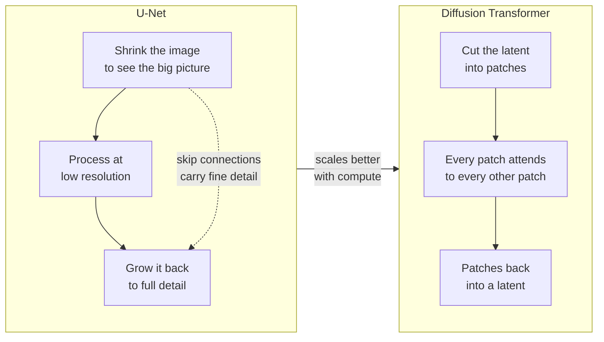
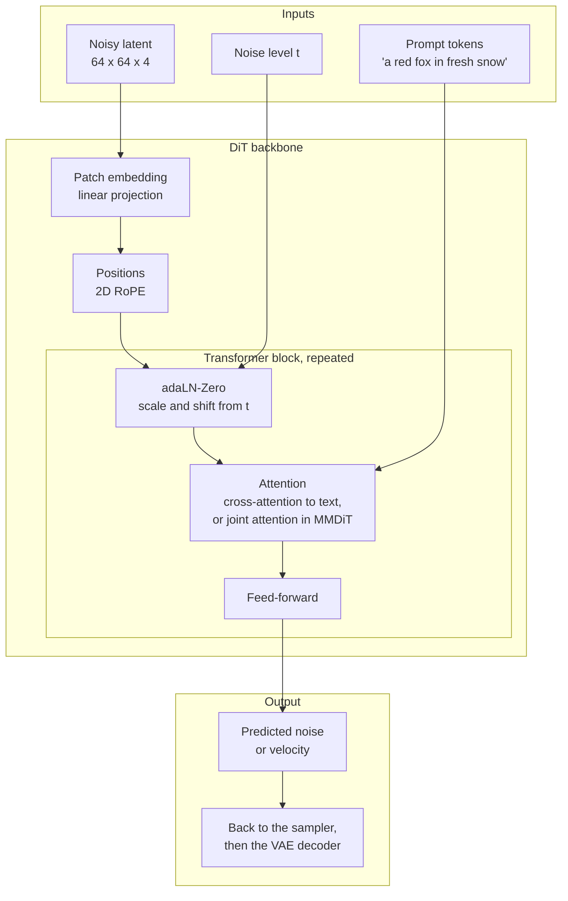

*By Gopi Krishna Tummala*

*The network inside the denoising loop. Why diffusion started with convolutional U-Nets, why it moved to Diffusion Transformers, and how a transformer is told the noise level, the prompt and where each patch sits.*

Part 2 of 8 in the [diffusion series](/posts/generative-ai/diffusion-from-molecules-to-machines). Previous: [Diffusion Foundations](/posts/generative-ai/diffusion-from-molecules-to-machines). Next: [Sampling and Guidance](/posts/generative-ai/sampling-guidance-diffusion-models).

---

In [Part 1](/posts/generative-ai/diffusion-from-molecules-to-machines), a network looked at a noisy picture of a red fox in snow and predicted the noise to remove, dozens of times. This post is about that network. Its job is unusual: at a very noisy step it has to decide the overall layout, fox on the left, horizon a third of the way up, and at a nearly clean step it has to get individual hairs right. And it has to do both while following the prompt.

Two designs have done this job. Convolutional U-Nets powered the first wave, including Stable Diffusion 1 and 2 and SDXL. Diffusion Transformers (DiTs) power nearly everything since, including Stable Diffusion 3, FLUX, and the large video models.

## The idea in one picture

*A U-Net builds global understanding by shrinking the image. A transformer gets it directly, because every patch can look at every other patch.*

## The U-Net: an hourglass with shortcuts

The U-Net was designed in 2015 for segmenting medical images and turned out to suit denoising well. It has an hourglass shape:

- **The encoder** repeatedly downsamples, so later layers see larger regions. By the bottom of the hourglass, each position summarizes a big chunk of the image: "fox here, snow there."
- **The decoder** upsamples back to full resolution, adding detail.
- **Skip connections** pass the encoder's high-resolution features straight across to the decoder, so fine detail isn't lost on the way through the narrow middle.

Convolutions have a built-in bias toward local patterns, which makes U-Nets data-efficient and good at texture. DDPM's U-Net added self-attention layers at low resolutions for global context. Stable Diffusion added cross-attention layers, where image positions look up the relevant words of the prompt, which is how "red" ends up on the fox and not the snow.

The limits showed at scale. Global reasoning only happens where the image is small enough for attention, and growing a U-Net means many hand-tuned decisions about channels, resolutions and where attention goes.

## The Diffusion Transformer: images as sequences

[DiT](https://arxiv.org/abs/2212.09748) (Peebles and Xie, 2023) replaced the U-Net with a plain vision transformer working on the latent from [latent diffusion](/posts/generative-ai/diffusion-from-molecules-to-machines#latent-diffusion-dont-denoise-every-pixel). The latent grid is cut into small patches, 2×2 latent cells in the best DiT models, each turned into a token. A 256×256 image becomes a 32×32 latent, which becomes 256 tokens. Every token can attend to every other, so the patch with the fox's tail and the patch with its head can coordinate at every layer, not just at the bottom of an hourglass.

The main finding was about scaling. DiT's image quality improved steadily as compute per image grew, whether from a bigger model or more, smaller patches, the same kind of predictable scaling language models show. Its largest model reached an FID of 2.27 on class-conditional ImageNet at 256×256, the best result at the time. Predictable scaling is what made labs willing to train much larger versions.

The cost is attention's quadratic growth. Doubling an image's width and height quadruples the tokens and multiplies attention cost by about sixteen. That's why diffusion transformers work in compressed latents, and why efficient attention kernels matter so much for high-resolution images and video (see [Custom Kernels](/posts/mlops/custom-kernel-craze#flashattention-tiling-applied-to-attention)).

## Telling the transformer what it needs to know

A diffusion network needs three things besides the noisy image: the noise level, the prompt, and the position of each patch.

*The noise level steers every layer through adaLN-Zero; the prompt enters through attention; positions come from rotary embeddings.*

**The noise level, through adaLN-Zero.** DiT compared several ways to inject the timestep and found the best was to let it control each layer's normalization: an embedding of $t$ produces a scale and a shift for every block. "Zero" means each block is initialized to do nothing at first, which made very deep models train stably. In effect the noise level tells every layer whether to think about layout or about fur.

**The prompt, through attention.** The original DiT handled only class labels. Text-to-image transformers add the prompt one of two ways. Cross-attention, used by models like [PixArt-α](https://arxiv.org/abs/2310.00426), adds layers where image tokens look up text tokens, as in the U-Net. Stable Diffusion 3's [MMDiT](https://arxiv.org/abs/2403.03206) instead puts text and image tokens into one shared attention, with separate weights for each, so information flows both ways: the image tokens read the prompt, and the prompt's representation adapts to the image. FLUX builds on the same joint-attention design.

**Positions, through rotary embeddings.** Rotary position embeddings (RoPE), extended to two dimensions, encode where each patch sits by relative position. Combined with training on images grouped by aspect ratio ("bucketing"), this lets one model generate tall, wide and square images. Without it, models trained on squares tend to repeat content at unfamiliar shapes, the classic two-headed person in a wide image.

## What the network predicts

Part 1 described predicting the noise. Modern models often predict something else, and the names get confused:

- **Noise ($\epsilon$-prediction):** DDPM's original target.
- **v-prediction:** a blend of noise and clean image, introduced by [Salimans and Ho](https://arxiv.org/abs/2202.00512) in their distillation work. It stays well-behaved at the very noisiest steps, where predicting noise tells you almost nothing about the image.
- **Velocity, in flow matching:** the direction from noise to image along a straight path, used by Stable Diffusion 3, FLUX and most recent models. It looks similar to v-prediction but comes from a different formulation.

All three are trained with a squared error, and each can be converted to the others. The choice mostly affects training stability and how many sampling steps work well.

## When a U-Net is still the right call

DiTs win at large scale, but the U-Net's local bias is an advantage when data is limited or exact pixel alignment matters more than global composition: medical imaging, satellite imagery, and super-resolution stages that only add detail. Many diffusion systems for those domains still use U-Nets.

## What I'd remember

- **The network has two jobs.** Layout at high noise, detail at low noise, with the prompt throughout.
- **U-Nets shrink to see globally; transformers attend globally.** Transformers scale more predictably.
- **DiT works on latent patches.** Small patches, many tokens, and attention cost that grows with the square of the token count.
- **Three inputs, three mechanisms.** adaLN-Zero for the noise level, attention for the prompt, 2D RoPE for position.
- **Noise, v and velocity are different targets.** All squared errors; the choice affects stability and step count.

## Where to go next

- [Sampling and Guidance](/posts/generative-ai/sampling-guidance-diffusion-models), the next part: how this network is used to generate.
- [The Multimodal Atlas](/posts/generative-ai/multimodal-foundation-models-end-to-end#how-an-image-generator-learns-to-paint), for how MMDiT-style models are trained end to end.
- Papers: [DiT](https://arxiv.org/abs/2212.09748), [Stable Diffusion 3 (MMDiT)](https://arxiv.org/abs/2403.03206), [Latent Diffusion](https://arxiv.org/abs/2112.10752).

Previous: [Diffusion Foundations](/posts/generative-ai/diffusion-from-molecules-to-machines). Next: [Sampling and Guidance](/posts/generative-ai/sampling-guidance-diffusion-models).

**Questions to sit with**

1. If you double the resolution of the fox image, how many more tokens does a DiT process, and how much more attention compute?
2. Why might joint attention follow a complicated prompt better than cross-attention?
3. Why is predicting noise a poor target at the very noisiest step?
