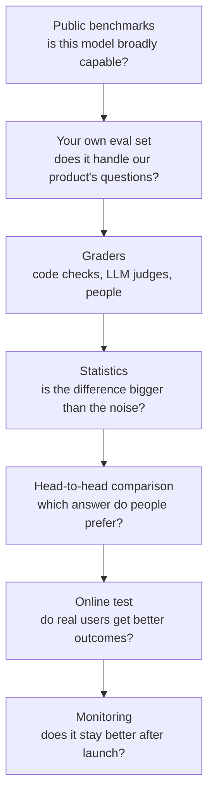
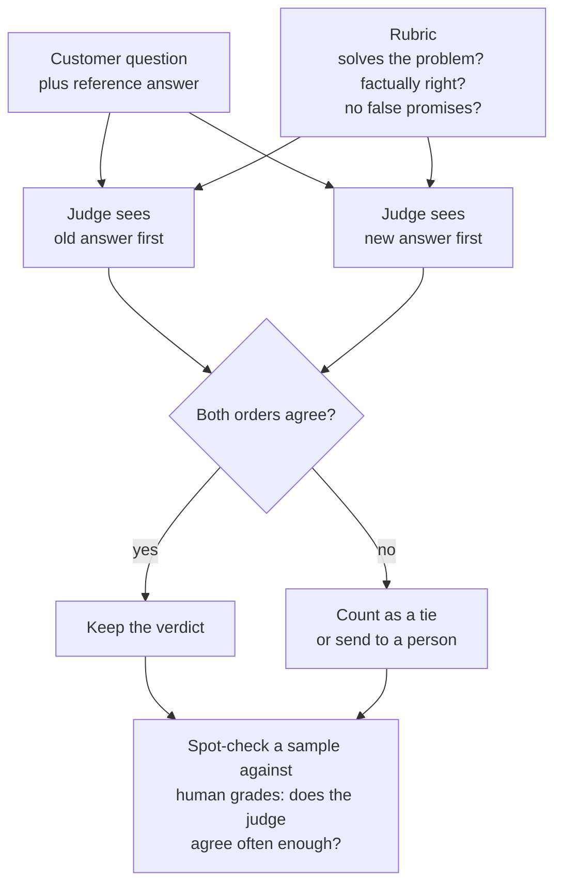
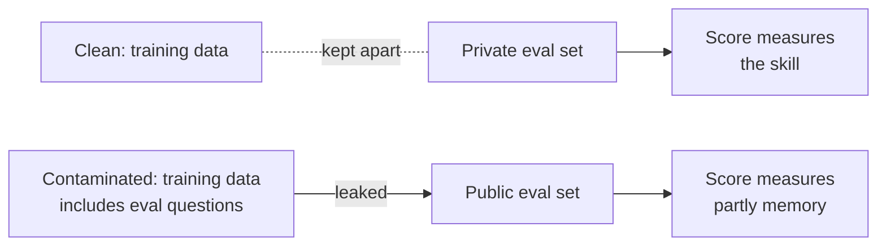
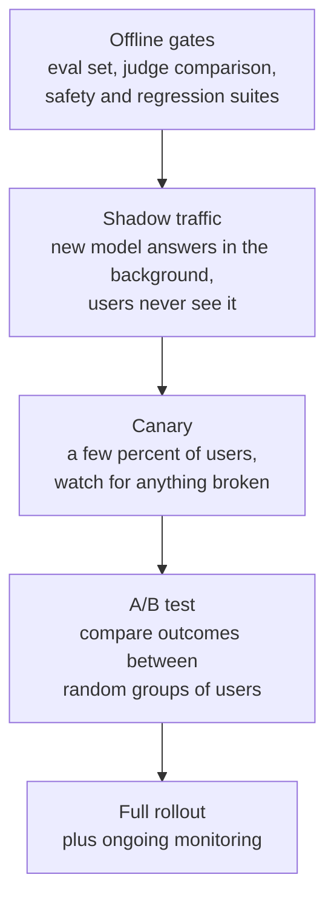

*By Gopi Krishna Tummala*

*How to decide, with evidence, whether a new model is better: your own eval set, graders you can trust, error bars, head-to-head comparisons, contamination checks and real users.*

---

The number that decides most model launches is also the one people are least sure how to read.

A team runs a customer-support assistant for a software company. They fine-tune a new version on three months of fresh support conversations and run their eval: 500 real customer questions, each answer graded pass or fail. The old model passes 71 percent. The new one passes 74 percent. The release review is tomorrow.

Is the new model better? Maybe. Three points on 500 questions might be noise. The grader might prefer the new model's longer answers. Some eval questions might have slipped into the fine-tuning data. And even a real offline win doesn't promise that customers will get their problems solved more often.

This post covers how to answer the question properly: building an eval that reflects the product, grading at scale, reading the number with error bars, comparing models head to head, catching contamination, and confirming the win with users. We'll follow the support team through each step. The team and its numbers are illustrative; the research results are cited.

## The idea in one picture

*Each step answers a narrower, more honest question. Public benchmarks pick candidates; only the later steps tell you whether to ship.*

## Start with your own eval set

Public benchmarks such as MMLU, GPQA and SWE-bench answer "is this model generally capable?" They're good for shortlisting models and bad at predicting your product. Many are also saturated: when every frontier model scores in the high 80s, a 1-point difference says little.

What decides launches is a **product eval set**: a few hundred to a few thousand examples drawn from real traffic, each with a way to judge the answer. For the support team, that means real customer tickets with the resolution a senior agent wrote. A good set has a few properties:

- **It looks like production.** Sample from real traffic, including the boring common cases, not only the clever ones someone remembers.
- **It over-represents what hurts.** Add every past failure that caused an escalation or a complaint. These become the regression tests.
- **It's sliced.** Tag examples by type (billing, outages, API errors, angry customers) so a 3-point average gain can't hide a 10-point drop on billing.
- **It's versioned and kept private.** Once examples leak into training data, they stop measuring anything (more on this below).

The honest limit: an eval set is a snapshot. As the product and its users change, it slowly drifts out of date, so refresh it from recent traffic every few months.

## Grading: code, judges and people

Every example needs a grade. There are three kinds of grader, and a mature eval uses all three.

- **Code checks** work when the answer can be verified: the API call has the right arguments, the generated SQL returns the right rows, the unit tests pass, the extracted date matches. They're cheap, fast and consistent, so use them wherever possible.
- **LLM judges** handle open-ended answers. A strong model reads the question, a reference answer and a rubric ("Does the answer solve the customer's problem? Is anything factually wrong? Does it promise anything the company can't do?") and returns a grade.
- **People** are the ground truth for subjective quality and the final word on borderline cases, but they're slow and expensive. Their main job at scale is checking the judge.

The judge idea was put on a solid footing by [Zheng and colleagues (2023)](https://arxiv.org/abs/2306.05685). They found GPT-4's judgments agreed with human experts over 80 percent of the time, about as often as two humans agree with each other. They also documented the biases that every judge setup has to work around:

- **Position bias:** judges tend to prefer whichever answer they read first, or second.
- **Verbosity bias:** longer answers look more thorough, even when they aren't better.
- **Self-preference:** a judge can favor answers that sound like its own writing.

*A judge is a measuring instrument. Run it both ways round, give it a rubric, and calibrate it against people before trusting it.*

For the support team, the check that mattered was verbosity. The fine-tuned model writes about 40 percent longer answers. When they added "a longer answer is not better unless the extra content helps the customer" to the rubric and re-graded, part of the gain disappeared. The honest limit of judges is that they inherit every blind spot of the model doing the judging, so a judge can't reliably grade a model much stronger than itself on hard questions.

## Is 3 points real? Put error bars on it

Every eval score is an estimate. If the model's true pass rate is around 72 percent and you test it on 500 questions, the score you see will wobble around that from sample to sample. The size of the wobble is the standard error:

$$
\text{SE} = \sqrt{\frac{p\,(1-p)}{n}}
$$

In words: the spread shrinks with the square root of the number of questions. With p = 0.72 and n = 500, the standard error is about 2 points, so the 95 percent range is roughly plus or minus 4 points. A 3-point gain sits well inside that range. On its own, the team's headline result could easily be noise.

Two refinements, both from Anthropic's [Adding Error Bars to Evals](https://arxiv.org/abs/2411.00640) (Evan Miller, 2024), make the picture sharper:

- **Compare paired results, not two averages.** Both models answered the same 500 questions. Look at each question: did the new model flip a fail into a pass, or a pass into a fail? Hard questions are hard for both models, so pairing removes that shared difficulty and leaves only the real difference. This often makes the comparison much more precise, for free.
- **Watch for clustered questions.** If the eval has 50 tickets from one outage, those answers rise and fall together, so you have fewer independent data points than it looks. Accounting for this (clustered standard errors) can make the error bars several times wider.

There's also noise from the model itself. Sampled at nonzero temperature, the same model gives different answers on different runs. Grading several samples per question, or fixing the sampling settings across both models, keeps that from masquerading as a difference.

For the support team, the paired view was the turning point. The new model flipped 41 fails into passes and 26 passes into fails, a net gain of 15 on 500, and the paired test said that was unlikely to be chance. But 19 of the 26 new failures were billing questions. The average gain was real, and so was a regression on billing.

## Head to head: preferences and ratings

Absolute grades are hard to keep consistent. "Is this answer a 7 or an 8?" drifts between graders and over time. "Which of these two answers is better?" is a much easier question, for people and for judges. That's why many evaluations are **pairwise**: show two answers to the same prompt and record which one wins.

Pairwise results turn into ratings with the same math used for chess. The best-known example is [Chatbot Arena](https://arxiv.org/abs/2403.04132) (now LMArena), where people chat with two anonymous models and vote for the better answer. It fits a Bradley-Terry model, a close relative of Elo, to millions of votes. The intuition fits in one line: a 100-point rating gap means the higher-rated model wins about 64 percent of head-to-head comparisons.

Arena-style ratings capture something benchmarks miss: what real people prefer on real prompts. But they come with their own limits:

- **Style sways votes.** Longer answers and heavy formatting win votes, so the Arena added style control to separate content from presentation.
- **The process can be gamed.** [The Leaderboard Illusion](https://arxiv.org/abs/2504.20879) (2025) reported that some providers privately tested many variants before release (27 for one model family before a launch) and published only the best. Picking the best of many noisy scores inflates the result.
- **The crowd isn't your users.** Arena prompts skew toward what curious volunteers ask. A support assistant's users ask different things.

The support team ran their own small arena: a judge compared old and new answers on all 500 questions in both orders. The new model won 54 percent of decisive comparisons, a small but real edge, mostly on technical troubleshooting.

## Contamination: when the test leaked into training

A model can score well on a test because it learned the skill, or because it saw the questions. Benchmarks published on the web end up in web-scale training data, and fine-tuning sets scraped from logs can contain the very examples used for evaluation.

The clearest demonstration is [GSM1k](https://arxiv.org/abs/2405.00332) (Scale AI, 2024). The authors wrote about 1,250 new grade-school math problems in the same style and difficulty as the popular GSM8K benchmark and tested models on both. Some model families scored up to 13 points lower on the fresh problems, a sign they had partly memorized the old benchmark. The strongest frontier models showed little gap.

*If eval examples reach the training data, the score stops measuring the skill and starts measuring memory.*

The defenses are mostly hygiene:

- **Keep the important eval sets private** and never train on them.
- **Deduplicate** training data against eval sets, including near-duplicates and paraphrases.
- **Refresh with new questions.** Benchmarks such as LiveBench and LiveCodeBench keep adding questions written after models' training cutoffs.
- **Compare old and fresh sets**, GSM1k style. A big gap between them is a warning sign.

The support team found exactly this problem. Their fine-tuning data came from three months of conversations, and 31 of the 500 eval tickets, or close paraphrases of them, were in it. Re-scored on the remaining 469 tickets, the new model's gain shrank further. Behind all of this is Goodhart's law: once a score becomes the target, it stops being a good measure.

## Online: what users actually experience

Offline evaluation tells you the new model isn't worse on what you already know to test. Only real traffic tells you whether users are better off. The usual path to launch is staged:

*Each stage risks a bit more of real traffic only after the previous stage looks safe.*

The metric to watch is the outcome the product exists for, not a proxy for it. For the support assistant, that's "the customer's issue was resolved without escalating to a human agent." Behind it sit **guardrail metrics** that must not get worse: latency, cost per conversation, complaint rate, safety incidents. User signals like thumbs-up, regenerate clicks and follow-up questions help, but read them carefully: few users click thumbs at all, and the ones who do aren't typical.

After launch, evaluation doesn't stop. Sample production conversations every week, grade them with the same judge, and watch the slices. Quality problems often arrive gradually: a new product feature the model doesn't know about, a shift in who your users are.

## How the support team's story ended

The 3-point headline turned out to be a mix of real gain, verbosity bias, contamination and a billing regression. After fixing the rubric, removing contaminated tickets and adding more billing examples to the fine-tuning data, the new model's paired win held up on a fresh set of 500 tickets. A two-week A/B test showed a modest rise in issues resolved without escalation, with no change in latency or complaints. That result, not the 74 percent, is what shipped the model.

## What I'd remember

- **Benchmarks shortlist, your eval set decides.** Build it from real traffic, over-sample past failures, slice it, and keep it private.
- **A judge is an instrument to calibrate.** Use a rubric and both answer orders, watch for length bias, and check it against human grades.
- **Put error bars on every number.** Compare models question by question; a few points on a few hundred questions is often noise.
- **Assume contamination until you've checked.** Deduplicate against your eval sets and keep some questions fresh.
- **Ship on user outcomes.** Offline wins earn an online test; the online test earns the launch.

## Where to go next

- [Modern Post-Training](/posts/mlops/modern-post-training-peft-2026), for preference tuning and rewards you can check, where evaluation becomes a training signal.
- [Agentic AI, Part 4](/posts/agentic-ai/agentic-ai-design-patterns-part-4) and [Agent Harnesses](/posts/agentic-ai/agent-harness-engineering), for evaluating multi-step agents.
- [Vision-Language-Action Models](/posts/robotics/vla-models-data-architecture-evaluation#evaluation-the-hard-part), for why evaluation is even harder when the model acts in the physical world.
- Papers: [Judging LLM-as-a-Judge](https://arxiv.org/abs/2306.05685), [Chatbot Arena](https://arxiv.org/abs/2403.04132), [Adding Error Bars to Evals](https://arxiv.org/abs/2411.00640), [GSM1k](https://arxiv.org/abs/2405.00332), [The Leaderboard Illusion](https://arxiv.org/abs/2504.20879).
- Tools: EleutherAI's [lm-evaluation-harness](https://github.com/EleutherAI/lm-evaluation-harness) for public benchmarks, and the UK AI Security Institute's [Inspect](https://inspect.aisi.org.uk/) for writing your own evals.

**Questions to sit with**

1. Your eval set has 300 questions and the new model gains 2 points. What would you check before calling it a win?
2. How would you tell whether your LLM judge prefers the new model because its answers are better or because they're longer?
3. Which single online metric would you use to decide the support assistant's launch, and which guardrail metrics would you put beside it?
