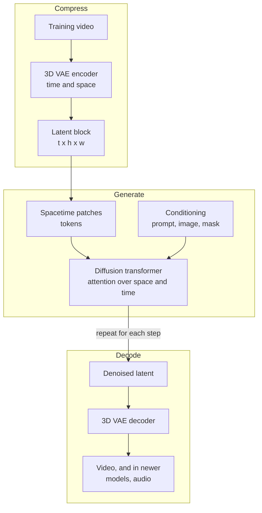

*By Gopi Krishna Tummala*

*A tour of the video generators that defined the field and what each one revealed: Sora's spacetime patches, Movie Gen's fully published recipe, Veo's native audio, and the open models that brought the recipe to anyone with GPUs.*

Part 7 of 8 in the [diffusion series](/posts/generative-ai/diffusion-from-molecules-to-machines). Previous: [Diffusion for Action](/posts/generative-ai/diffusion-for-action-trajectories-policy). Next: [Physics-Aware Video Diffusion](/posts/generative-ai/physics-aware-video-diffusion-models).

---

[Part 4](/posts/generative-ai/video-diffusion-fundamentals) explained how video diffusion works in general: a video VAE that compresses time, a transformer attending across space and time, and the whole clip denoised together. This part looks at the specific systems, because each major release taught the field something different, and the details they chose to publish, or not, shape what everyone else builds.

Give each of them the same prompt, the red fox leaping into a snowbank from earlier parts, and they'd all produce something plausible. The differences are in what's underneath: how big the model is, what it was trained on, whether it makes sound, and whether you can download it.

## The idea in one picture

*Every system in this post follows this shape. They differ in scale, data, conditioning and what they release.*

## Sora: video as patches, and the "world simulator" claim

OpenAI's Sora report in February 2024, [Video generation models as world simulators](https://openai.com/index/video-generation-models-as-world-simulators/), was short on numbers but set the template. Its main ideas:

- **Spacetime patches.** Compress video into a latent and cut it into patches that span space and time, the video equivalent of text tokens. A transformer handles them as one sequence.
- **Train on video as it comes.** Rather than cropping everything to one size, train on varied durations, resolutions and aspect ratios, which improved framing and let one model produce widescreen and vertical video.
- **Re-caption the data.** Apply the DALL·E 3 approach of detailed synthetic captions to video, which improved how well generated video follows the prompt.

The report argued that scaling video models is a path toward general-purpose simulators of the physical world, because generating consistent video requires modeling 3D space, object permanence and simple interactions. It also listed failures, such as glass that doesn't shatter correctly. That gap between looking right and being physically right is the subject of [Part 8](/posts/generative-ai/physics-aware-video-diffusion-models).

## Movie Gen: the recipe, published in full

Meta's [Movie Gen](https://arxiv.org/abs/2410.13720) (October 2024) is the most detailed public account of a frontier video model, which makes it the best one to learn from. Its largest video model is a 30B-parameter transformer that generates up to 16 seconds at 16 frames per second, with a context of up to 73,000 video tokens. The paper describes the whole lifecycle: data curation, training on images first and then video at rising resolution, a separate upsampler for higher resolution, and post-training.

It also went beyond plain generation. A separate 13B-parameter Movie Gen Audio model generates sound and music to match a video, and the system supports instruction-based editing ("make the fox's coat silver") and personalized video from a photo of a person. For anyone designing a video model, the paper is the closest thing to a manual.

## Veo: sound becomes part of the video

Google DeepMind's [Veo](https://deepmind.google/models/veo/) models are known mostly through product releases rather than full papers. Their notable step was generating audio natively with the video, so the fox's landing comes with the crunch of snow, rather than adding sound in a separate pass. Veo 3 and its successor Veo 3.1 generate the audio natively alongside the frames. Every Veo video is marked with Google's SynthID watermark, part of the provenance stage described in [Behind the Generate Button](/posts/generative-ai/multi-stage-generation-pipelines#stage-5-mark-where-it-came-from).

## The open models: the recipe spreads

The most important change since Sora is that strong video models became downloadable:

- **[HunyuanVideo](https://arxiv.org/abs/2412.03603)** (Tencent, December 2024) released code and weights for a model with over 13 billion parameters. Its transformer processes video and text tokens separately in early layers ("dual-stream") and together in later ones ("single-stream"), a design similar to FLUX's. It also ships a prompt rewrite model.
- **[CogVideoX](https://arxiv.org/abs/2408.06072)** (Zhipu AI and Tsinghua) combines a 3D VAE with an "expert transformer" that uses separate adaptive normalization for text and video, and generates 10-second videos at 16 frames per second and 768×1360 resolution.
- **[Wan](https://arxiv.org/abs/2503.20314)** (Alibaba, 2025) released 1.3B and 14B models under Apache 2.0. The 1.3B model needs only about 8 GB of GPU memory, putting video generation on consumer GPUs. [Wan 2.2](https://github.com/Wan-Video/Wan2.2) introduced a mixture of experts split by noise level: a high-noise expert for early steps that set layout and motion, and a low-noise expert for later steps that refine detail. Each is about 14B parameters, 27B in total, but only one runs at each step.
- **[Open-Sora 2.0](https://arxiv.org/abs/2503.09642)** reported a model comparable to HunyuanVideo and Runway Gen-3 Alpha in its evaluations, trained for about $200,000 in rented GPU time, an estimated five to ten times less than comparable models.

| Model | Open weights | Notable for |
|---|---|---|
| Sora | No | Spacetime patches, varied sizes, re-captioned video |
| Movie Gen | No | 30B, fully documented recipe, audio and editing |
| Veo 3 / 3.1 | No | Native audio, SynthID watermarking |
| HunyuanVideo | Yes | 13B, dual- to single-stream transformer |
| CogVideoX | Yes | 3D VAE, expert transformer, 10 s at 768×1360 |
| Wan 2.1 / 2.2 | Yes, Apache 2.0 | 1.3B on consumer GPUs; noise-level experts |
| Open-Sora 2.0 | Yes | Competitive quality for about $200K of training |

## Where the field is heading

Across these releases, a few directions are clear:

- **Sound with picture.** Native audio is becoming expected rather than special.
- **Control beyond text.** Image-to-video, editing, camera control and personalization matter more to real users than pure text-to-video.
- **Longer and faster.** Distilled, causal models stream video in real time ([Diffusion Distillation](/posts/generative-ai/diffusion-distillation-fewer-steps#video-from-minutes-to-streaming)), and extension techniques push past the length of a single clip.
- **Systems, not models.** Products wrap these models in prompt rewriting, safety checks and agentic shot planning ([Behind the Generate Button](/posts/generative-ai/multi-stage-generation-pipelines)).
- **Physics is still the weak point.** Fluids, collisions and objects that persist when hidden remain unreliable, as Sora's own report admitted.

## What I'd remember

- **One recipe, many variations.** 3D VAE, spacetime patches, a diffusion transformer, re-captioned data.
- **Sora set the template; Movie Gen published the manual.** Read Movie Gen to learn how it's actually done.
- **Audio is joining video.** Veo 3 made native sound a baseline.
- **Open models closed much of the gap.** HunyuanVideo, Wan and Open-Sora put strong video generation on downloadable weights.
- **Physics is the frontier.** Plausible-looking isn't the same as physically right.

## Where to go next

- [Physics-Aware Video Diffusion](/posts/generative-ai/physics-aware-video-diffusion-models), the final part.
- [The Multimodal Atlas](/posts/generative-ai/multimodal-foundation-models-end-to-end#video-the-same-recipe-plus-time), for the shared video training recipe.
- Papers and repos: [Movie Gen](https://arxiv.org/abs/2410.13720), [HunyuanVideo](https://arxiv.org/abs/2412.03603), [Wan](https://arxiv.org/abs/2503.20314), [Open-Sora 2.0](https://arxiv.org/abs/2503.09642).

Previous: [Diffusion for Action](/posts/generative-ai/diffusion-for-action-trajectories-policy). Next: [Physics-Aware Video Diffusion](/posts/generative-ai/physics-aware-video-diffusion-models).

**Questions to sit with**

1. Why does training on varied durations and aspect ratios, rather than cropping, improve generated video?
2. What does Wan 2.2 gain by splitting experts by noise level rather than by topic?
3. Which would you choose for a product, a closed model with native audio or an open model you can fine-tune, and why?
