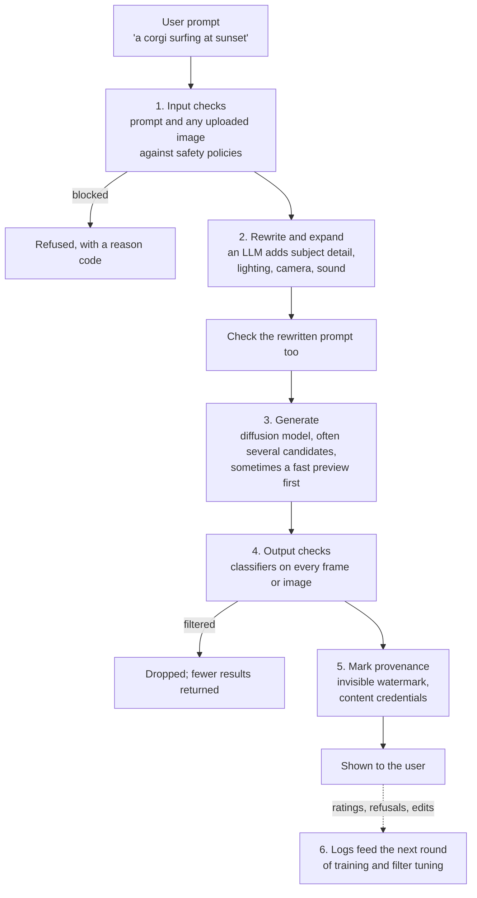
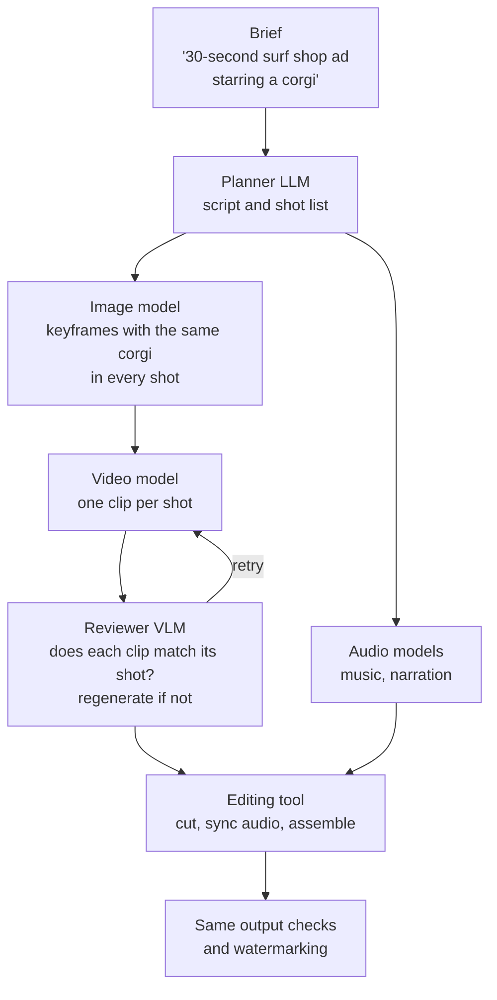

*By Gopi Krishna Tummala*

*When you type a prompt into an image or video generator, the model is only one stage. A map of what surrounds it: input safety checks, prompt rewriting, generation, output safety checks and watermarking, and the newer agentic pipelines that plan shots and call several models.*

---

You type "a corgi surfing at sunset" into a video generator and get back eight seconds of a corgi on a longboard, low golden light, spray catching the sun, the camera tracking alongside, with the sound of waves. Your five words didn't say any of that. Something between your prompt and the model filled it in, and several other somethings checked both what you asked for and what came back before you saw it.

Production generators are pipelines, not models. The core diffusion model, covered elsewhere on this site, is one stage of perhaps six. The others decide whether the request is allowed, what the model is actually asked to make, whether the result can be shown, and how it's marked as AI-generated. The newest systems go further and put an agent in charge: it plans a sequence of shots and calls several models to make them.

This post walks the corgi through each stage, using sources that document how real systems do it: Google's Vertex AI documentation for Imagen and Veo, the open-source Wan2.1 and HunyuanVideo releases, and Google DeepMind's SynthID.

## The idea in one picture

*The model is stage 3. Most of what makes a generator usable and safe happens in the stages around it.*

## Stage 1: check the request

Before anything expensive runs, the request is screened. Google's [Imagen documentation](https://docs.cloud.google.com/vertex-ai/generative-ai/docs/image/responsible-ai-imagen) says text prompts and input images "are assessed against a list of safety filters," and [Veo's](https://docs.cloud.google.com/vertex-ai/generative-ai/docs/video/responsible-ai-and-usage-guidelines) applies the same to text, image and video inputs. A blocked Imagen request returns an error, not an image, with a message that the prompt "contains sensitive words that violate Google's Responsible AI practices," and a support code identifying the category: child safety, celebrities, sexual content, violence, personal information and so on.

Two design details are worth copying:

- **Settings that callers control within limits.** Imagen exposes a `safetySetting` that controls "how aggressively to filter," and a `personGeneration` setting for whether people, faces and children may appear at all.
- **Reason codes instead of silence.** A specific code lets the application tell the user why, and lets the operator measure which filters fire most.

Checking early matters for cost as well as safety. A refused prompt costs a classifier call; a refused video costs a full generation.

## Stage 2: rewrite and expand the prompt

Our five-word prompt is a poor match for what the model was trained on. As the [Multimodal Atlas](/posts/generative-ai/multimodal-foundation-models-end-to-end#most-of-the-work-is-data) explains, modern generators are trained on long, detailed captions written by captioning models, because detailed captions produce models that follow prompts better. OpenAI's [DALL·E 3 report](https://cdn.openai.com/papers/dall-e-3.pdf) made that point in 2023, and also its consequence: if the model was trained on long captions, short user prompts should be expanded to look like them before generation.

So production pipelines put a language model in front of the generator. Google's Vertex AI calls it the prompt rewriter. Its [documentation for Imagen](https://docs.cloud.google.com/vertex-ai/generative-ai/docs/image/use-prompt-rewriter) describes an "LLM-based prompt rewriting tool" that adds detail to improve image quality, enabled by default on recent models and controlled by an `enhancePrompt` parameter. When the original prompt is under 30 words, the rewritten version is returned in the response, so you can see what was actually generated. Veo has an [equivalent rewriter](https://docs.cloud.google.com/vertex-ai/generative-ai/docs/video/turn-the-prompt-rewriter-off) that can be switched off, with the documented warning that quality may suffer.

The open-source video models ship the same stage, which makes it easy to see:

- **[Wan2.1](https://github.com/Wan-Video/Wan2.1)** from Alibaba recommends "enabling prompt extension" and runs it with a Qwen language model, locally (Qwen2.5 Instruct for text-to-video, Qwen2.5-VL when the input includes an image) or through Alibaba's API. Its README notes that larger extension models give better results.
- **[HunyuanVideo](https://github.com/Tencent/HunyuanVideo)** from Tencent fine-tunes its own large language model as a dedicated prompt rewrite model, with two modes. Normal mode clarifies what the user meant; Master mode adds composition, lighting and camera movement for higher visual quality. The README is candid about the trade-off: Master mode "may occasionally result in the loss of some semantic details."

For the corgi, the rewrite might read: "A corgi with a red harness balances on a longboard, riding a gentle wave at sunset. Warm golden backlight, spray catching the sun. Tracking shot from the side at board height. Sound of waves and wind."

That trade-off is the central design question of this stage. The rewriter improves quality by making decisions the user didn't make, and occasionally by dropping one they did. Good pipelines keep it switchable, show the rewritten prompt, and, because a rewriter can introduce content the user never asked for, run the rewritten prompt back through the input checks.

## Stage 3: generate

Now the model runs, and even this stage is usually several steps:

- **Several candidates.** Generating two to four options per request lets the output checks drop one without failing the whole request, and lets the user choose.
- **A fast preview, then the final.** A distilled few-step model, described in [Diffusion Distillation](/posts/generative-ai/diffusion-distillation-fewer-steps), can produce a quick draft while the full model works on the final.
- **Low resolution, then upscaling.** Many systems generate at a lower resolution and add detail with a separate upsampling stage, because generating every pixel of a long, high-resolution video directly is far more expensive.

The model's own training already includes safety work. The [Imagen 3 paper](https://arxiv.org/abs/2408.07009) describes a multi-stage filter on training data that removes unsafe, violent and low-quality images, removes AI-generated images, and strips unsafe captions and personal information. Output filtering in stage 4 catches what training didn't prevent.

## Stage 4: check what came out

Every generated image or video is classified before it's returned. In Google's documentation, a filtered Imagen output is simply left out of the response, and with an extra flag the response explains, for example, that the current "safety filter threshold filtered out 2 generated images," and that blocked images aren't billed. Veo's documentation says that if fewer videos come back than were requested, some were blocked by output filters.

That's why stage 3 generates spares. If one of four candidates trips a filter, the user still gets three.

## Stage 5: mark where it came from

The last step before the user is provenance. Two complementary approaches are in use:

- **Invisible watermarks.** Google DeepMind's [SynthID](https://deepmind.google/science/synthid/) embeds a watermark directly into generated images, video, audio and text, designed to survive edits like cropping and filters, with a detector that can check whether content came from Google's models. The text version is [open source](https://github.com/google-deepmind/synthid-text) as a research reference implementation under Apache 2.0.
- **Content credentials.** The [C2PA](https://c2pa.org/) standard attaches signed metadata describing how a piece of content was made and edited. It's readable by anyone, but it can be stripped, which is why it pairs well with a watermark that can't easily be removed.

## Stage 6: learn from what happened

Every stage produces data: which prompts were refused and why, how prompts were rewritten, which outputs were filtered, which candidate the user picked, what they regenerated or edited. That record tunes filter thresholds, provides preference pairs for post-training (see [The Training Lifecycle](/posts/generative-ai/pre-training-post-training-video-diffusion)), and shows where the rewriter is changing meaning.

## From a pipeline to an agent

Everything so far is a fixed sequence. The newer systems wrap it in an agent that plans. Ask for "a 30-second ad for a surf shop starring a corgi," and no single model call can produce that. An agent breaks it into shots, writes a detailed prompt for each, generates keyframes with an image model so the corgi looks the same in every shot, animates each shot with a video model, adds music and narration, and assembles the result.

*An agentic pipeline calls the single-request pipeline many times. Each model call still goes through its own input and output checks.*

Google has released an open-source reference for exactly this: [GenMedia Creative Studio](https://github.com/GoogleCloudPlatform/vertex-ai-creative-studio), an Apache 2.0 demo application for Vertex AI's media models, with MCP servers that expose Veo, Imagen, speech generation and an audio and video compositing tool to agents, plus a sample agent built with Google's Agent Development Kit. Its maintainers describe it as a demonstration rather than a supported product, but it shows the architecture clearly: the media models become tools, and an LLM agent decides which to call and in what order. If the agent patterns are new, [Agentic AI Design Patterns](/posts/agentic-ai/agentic-ai-design-patterns) covers planning, tool use and reflection, and [Agentic MLOps](/posts/mlops/beyond-inference-agentic-mlops-mcp) covers running tools through MCP safely.

Two things change when an agent is in charge. Cost and latency multiply, since one brief can become dozens of generation calls, so cheap previews and a reviewer that catches bad clips early matter much more. And consistency becomes the hard problem: the corgi needs the same face, harness and board in every shot, which is why keyframe images and reference images carry so much weight.

## What I'd remember

- **The model is one stage of six.** Input checks, rewriting, generation, output checks, provenance and logging surround it.
- **Rewriting bridges short prompts and long training captions.** It improves quality but makes decisions for the user; keep it visible, switchable and re-checked.
- **Check before and after.** Input filters save compute; output filters catch what training didn't. Generate spares so a filtered result doesn't fail the request.
- **Mark provenance twice.** A hard-to-remove watermark plus readable content credentials.
- **Agents call the pipeline many times.** Planning, keyframes for consistency, and a reviewer loop turn single generations into finished pieces.

## Where to go next

- [Diffusion Distillation](/posts/generative-ai/diffusion-distillation-fewer-steps), for the fast models behind previews and agent loops.
- [The Multimodal Atlas](/posts/generative-ai/multimodal-foundation-models-end-to-end), for how the generation models themselves are trained.
- [Modern Video Models](/posts/generative-ai/modern-video-models-sora-veo-opensora), for the architectures inside stage 3.
- Google's docs on the [Imagen prompt rewriter](https://docs.cloud.google.com/vertex-ai/generative-ai/docs/image/use-prompt-rewriter) and [Imagen safety filters](https://docs.cloud.google.com/vertex-ai/generative-ai/docs/image/responsible-ai-imagen), and the [Wan2.1](https://github.com/Wan-Video/Wan2.1) and [HunyuanVideo](https://github.com/Tencent/HunyuanVideo) READMEs.

**Questions to sit with**

1. If your rewriter turns "a person at a desk" into a specific age, gender and ethnicity, is that a quality improvement or a problem, and how would you measure it?
2. Why check the rewritten prompt, when the original already passed?
3. In an agentic ad pipeline, where would you spend a fixed GPU budget: more candidates per shot, a stronger reviewer, or a slower, better model?
