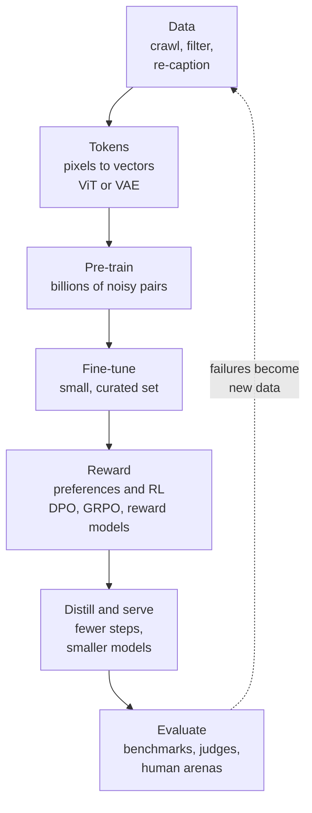
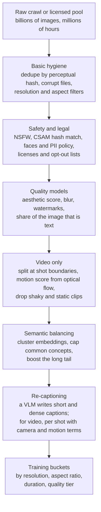
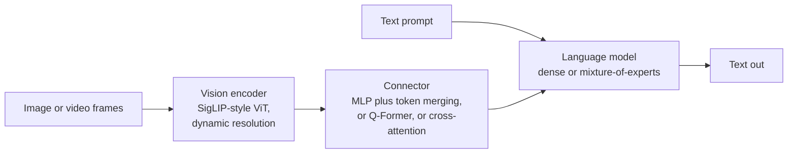
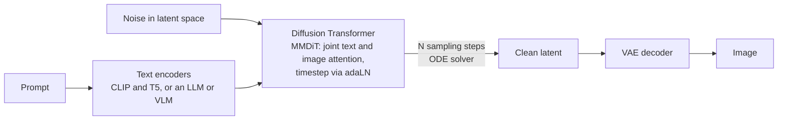
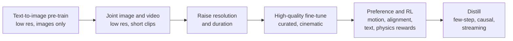

*By Gopi Krishna Tummala*

*A map of how vision-language models, image generators and video generators are built: the data, the two kinds of visual tokens, the training stages and how they're evaluated, with links out for depth.*

---

Take one scene: a dog leaping to catch a frisbee on a beach. Three different kinds of model can work with it.

A **vision-language model** (VLM, also called a multimodal LLM) looks at a photo of the scene and answers questions: "What breed is the dog? Did it catch the frisbee?" An **image generator** takes the sentence and paints the scene. A **video generator** has the hardest job: five seconds of the dog running, jumping and catching, with the frisbee flying in a believable arc and the dog keeping four legs the whole time.

These look like three different fields, and the papers use three different vocabularies. Underneath, they're built the same way: collect and clean a lot of image-text data, turn pixels into tokens, pre-train on noisy data at huge scale, then fine-tune and reward the model on a small amount of carefully chosen data, and finally argue about how to measure the result. This post walks through that shared recipe using the frisbee scene, and points to deeper posts for each part.

## The idea in one picture

*All three kinds of model follow this loop. The dotted arrow, turning evaluation failures into new data, is where most of the real work happens.*

## Two kinds of visual tokens

Transformers work on sequences of vectors. Text is easy to turn into tokens. An image is millions of numbers, so every multimodal model first has to decide how to turn pixels into a manageable number of tokens. There are two very different answers, and which one a model uses tells you most of what you need to know about it.

**Tokens for understanding** come from an encoder like CLIP or SigLIP, trained to make an image's embedding land near its caption's embedding. These tokens keep meaning and throw away detail: they know "dog, frisbee, beach, mid-air," not the exact texture of the sand. That's what a VLM wants, because it needs to talk about the picture, not redraw it.

**Tokens for generation** come from a VAE (variational autoencoder), trained to compress an image and then rebuild it as faithfully as possible. These tokens keep detail, every grain of sand, but don't organize it by meaning. That's what a generator wants, because at the end it has to turn its tokens back into pixels.

One way to hold the difference: the first kind is a librarian's summary of the photo, the second is a photocopy shrunk onto a small card.

Video adds a cost that shapes everything else. A 1024×1024 image becomes about 4,000 tokens after compression. Five seconds of 720p video at 24 frames per second becomes roughly 110,000 tokens, even after a video VAE squeezes time by 4× and space by 8× in each direction. Attention cost grows with the square of the sequence length, so the video costs hundreds of times more per layer than the image. That one fact explains why video models compress so aggressively, train at low resolution first and need distillation to be usable.

## Most of the work is data

Read the technical reports for Qwen-VL, Movie Gen or Wan side by side and you'll notice the architecture sections are short and the data sections are long. Architectures have largely converged. Data hasn't.

The raw material is web images with alt-text, interleaved web documents, rendered documents and charts, video clips, and increasingly synthetic data. The raw material is also mostly bad. A photo of our dog on the beach might carry the alt-text "IMG_4032" or "summer vibes!!", which teaches a model nothing about dogs or frisbees.

Two practices fix most of that:

- **Filtering in stages:** remove duplicates, unsafe content and low-quality images, then (for video) split clips at scene cuts and drop clips with no motion. For video it's normal to keep only a small fraction of the raw footage.
- **Re-captioning:** use a captioning model to write a detailed description of every image or clip ("a golden retriever leaps to catch a red frisbee, wet sand, low sun behind it"). OpenAI's [DALL·E 3 report](https://cdn.openai.com/papers/dall-e-3.pdf) showed that training on detailed synthetic captions made image models follow prompts much better, and nearly every serious model since has done some version of it, usually mixing short and long captions so the model still handles lazy prompts.

The full funnel, which every large pipeline follows in some form:

*Each stage throws data away. The ones near the bottom, balancing and re-captioning, are where a team's data quality really comes from.*

The [Molmo and PixMo](https://arxiv.org/abs/2409.17146) work makes the same point from the other direction. Its authors wanted a strong open VLM without copying outputs from closed models, and the main thing that worked was better human data: annotators *spoke* detailed descriptions of images, because people say far more than they type. If a capability isn't in the data, no training trick will find it.

## How a model learns to see and talk

Most VLMs are three parts glued together: a vision encoder that produces understanding tokens, a small connector that translates them into the language model's embedding space, and a language model that reads those tokens alongside your question. A few designs instead let the language model look at the image through cross-attention layers, and some newer models are trained on images and text together from the start.

*The three parts of almost every VLM. The connector is small, but it's the piece trained first.*

Training happens in stages, and the order matters. [Qwen3-VL's report](https://arxiv.org/abs/2511.21631) is a good recent example. First only the connector is trained, with the vision encoder and language model frozen, because a randomly initialized connector would otherwise send noisy updates into two expensive pre-trained models. Then everything is trained together on about a trillion tokens of mixed image, video and text data. Later stages extend the context so the model can handle long documents and hour-long video. Text-only data stays in the mix throughout; without it, the language model gets noticeably worse at plain reasoning.

After pre-training comes post-training, which shapes behavior:

- **Instruction tuning** on examples of questions and good answers about images.
- **Preference tuning** that targets the classic VLM failure, hallucination: describing a frisbee that isn't in the picture because the language prior expects one at the beach.
- **Reinforcement learning with checkable rewards.** The model answers the same question several times, each answer is scored automatically (exact match for a math answer, box overlap for "point to the frisbee," edit distance for reading text), and the model is pushed toward its better-than-average answers. This approach, called GRPO, comes from the [DeepSeekMath paper](https://arxiv.org/abs/2402.03300).

One honest caution: some recent work suggests part of the "visual reasoning" gain from RL comes from better answer patterns rather than better looking, because models trained with the images hidden recover a surprising share of it. Testing a model with the image removed is a cheap way to keep yourself honest.

## How an image generator learns to paint

Modern image generators start from pure noise and turn it into an image step by step. The network doing the work is usually a Diffusion Transformer, which treats patches of the compressed image as tokens and lets them attend to the text prompt. Most current models train it with **flow matching**: draw a straight line from a clean image to random noise,

$$x_t = (1-t)\,x_0 + t\,\epsilon,$$

and teach the network to predict which way along that line to move at any point. At generation time you start from noise and follow those predictions back to an image. Straighter paths need fewer steps. The [Sampling and Guidance](/posts/generative-ai/sampling-guidance-diffusion-models) post covers the step-by-step side, including classifier-free guidance, the dial that trades variety for prompt-following.

*A modern text-to-image model. The prompt is encoded once; the transformer runs once per sampling step; the VAE decoder turns the final latent into pixels.*

Pre-training happens at low resolution first (where the model learns what a dog is and where frisbees go) and then at higher resolutions (where it learns fur and sand). Post-training then improves how the images look and how well they follow prompts:

- **Quality tuning** on a few thousand hand-picked images. Meta's [Emu paper](https://arxiv.org/abs/2309.15807) showed this small step noticeably improves visual appeal.
- **Preference tuning** on pairs of images people ranked for the same prompt.
- **Reinforcement learning against checkers.** An object detector can check whether the image really contains one dog and one red frisbee. Using checks like that as rewards, [Flow-GRPO](https://arxiv.org/abs/2505.05470) raised Stable Diffusion 3.5 Medium's score on the GenEval compositional benchmark from 63% to 95%.
- **Distillation**, which teaches a student model to produce in 1–8 steps what the original needed 30–50 for.

The risk with rewards is reward hacking: optimize a single aesthetic score and every image comes out oversaturated and similar. Multiple rewards, staying close to the original model and human spot checks keep it in bounds.

## Video: the same recipe, plus time

A video generator is an image generator that also has to understand motion. The frisbee must follow an arc, the dog must stay the same dog across frames, and nothing should pass through anything else.

Three choices shape most video models:

- **Compress time as well as space.** A causal video VAE encodes the first frame on its own and then every four frames together, so a single image is just a one-frame video and the same model can train on both.
- **Learn appearance from images first.** Meta's [Movie Gen](https://arxiv.org/abs/2410.13720) starts training on images only, then mixes in short, low-resolution clips, then longer and sharper ones. Images are cheap tokens for learning what things look like; expensive video tokens are saved for learning how things move.
- **Split the work by noise level.** Wan 2.2 uses two expert networks: one for the early, very noisy steps that set layout and motion, and one for the late steps that add detail. Each step only runs one of them.

The standard training curriculum for a video model, end to end:

*Wan, HunyuanVideo, Seedance and others follow this skeleton with their own twists.*

Video models still struggle with physics, objects that disappear when hidden, and keeping a face consistent over a minute. The [Physics-Aware Video Diffusion](/posts/generative-ai/physics-aware-video-diffusion-models) post goes into that.

## The whole lifecycle side by side

| Stage | Vision-language model | Image generator | Video generator |
|---|---|---|---|
| Visual tokens | Meaning-preserving encoder (SigLIP-style) | Image VAE | Video VAE, time and space |
| Core model | Language model plus connector | Diffusion Transformer | Diffusion Transformer with attention across frames |
| Pre-training objective | Predict the next text token | Flow matching | Flow matching, images and video together |
| Curriculum | Connector only, then everything, then long context | Low resolution, then high | Images, then short clips, then longer and sharper |
| Post-training | Instruction tuning, preference tuning, RL with checkable rewards | Quality tuning, preference tuning, RL with detectors and judges | The same, with motion and consistency rewards |
| Main failure | Hallucinating objects | Miscounting, mangled text | Physics, flicker, identity drift |

## Measuring what you built

Evaluation is the weakest part of the whole field, and the part most worth being skeptical about.

For VLMs, benchmarks like [MMMU](https://arxiv.org/abs/2311.16502) test expert knowledge with images, and [MMStar](https://arxiv.org/abs/2403.20330) was built specifically from questions that can't be answered without looking. That second point matters: on many older benchmarks, a model with the image removed still scores surprisingly well. For generators, the classic metric (FID) compares image statistics without looking at the prompt at all, so it can improve while prompt-following gets worse. Checkers like [GenEval](https://arxiv.org/abs/2310.11513) for images and [VBench](https://arxiv.org/abs/2311.17982) for video test specific abilities such as counting, spatial relations and motion.

In practice, teams use automated metrics to catch regressions on every checkpoint, a fixed set of prompts that represent their own users judged by a strong model, and side-by-side human comparisons to make launch decisions. The most useful output of evaluation isn't a score. It's a list of specific failures (hands holding objects, counts above five, text in a particular script), which becomes the next round of data collection.

## Where this is heading

The model that understands and the model that paints are starting to merge. If a model can tell that the frisbee is above the dog, it should be better at drawing that, and image editing ("make the frisbee blue") needs both skills at once. Current approaches range from one transformer trained with both a text loss and an image loss ([Transfusion](https://arxiv.org/abs/2408.11039)) to designs that keep separate visual tokenizers for understanding and generation inside one model ([Janus](https://arxiv.org/abs/2410.13848), [BAGEL](https://arxiv.org/abs/2505.14683)). The tension is the one from the start of this post: understanding wants meaning tokens and generation wants detail tokens, and forcing one representation to do both tends to shortchange one of them.

## What I'd remember

- **One recipe, three machines.** Data, tokens, large-scale pre-training, small careful fine-tuning, rewards, evaluation.
- **Understanding and generation want different tokens.** Meaning for the first, detail for the second. Most architecture choices follow from that.
- **Data is the moat.** Filtering and detailed re-captioning matter more than most architecture tweaks.
- **Video is expensive because of tokens.** Five seconds is more than 25 times as many tokens as an image, and attention cost grows with the square of that.
- **Distrust single numbers.** Test VLMs with the image removed, don't judge generators on FID alone, and let human comparisons make the final call.

## Where to go next

On this site:

- The diffusion series, starting with [Diffusion: From Molecules to Machines](/posts/generative-ai/diffusion-from-molecules-to-machines) and [Image Diffusion: From U-Net to DiT](/posts/generative-ai/image-diffusion-models-unet-to-dit).
- [Video Diffusion: The Fourth Dimension](/posts/generative-ai/video-diffusion-fundamentals) and [The Training Lifecycle](/posts/generative-ai/pre-training-post-training-video-diffusion).
- [Post-Training Playbook](/posts/mlops/modern-post-training-peft-2026) for SFT, DPO and GRPO in text models.
- [When AI Sees and Speaks](/posts/computer-vision/vision-language-models-explained), a gentler introduction to VLMs.

Courses and tutorials:

- [MIT 6.S184: Introduction to Flow Matching and Diffusion Models](https://diffusion.csail.mit.edu/2026/index.html), lecture notes, slides and labs.
- [An Introduction to Vision-Language Modeling](https://arxiv.org/abs/2405.17247), a long tutorial paper from Meta.
- [CVPR 2025 tutorial: Recent Advances in Vision Foundation Models](https://vlp-tutorial.github.io/), slides for each talk.
- [Stanford CS231n](https://cs231n.stanford.edu/schedule.html) lectures on vision and language and on generative models.
- Lilian Weng's [What are Diffusion Models?](https://lilianweng.github.io/posts/2021-07-11-diffusion-models/) and [Diffusion Models for Video Generation](https://lilianweng.github.io/posts/2024-04-12-diffusion-video/).
- Nathan Lambert's free [RLHF Book](https://rlhfbook.com/) for the post-training side.

**Questions to sit with**

1. If you had to describe the frisbee scene with only meaning tokens, what would a generator be unable to reproduce?
2. Why would a VLM score well on a benchmark with the image removed, and what does that tell you about the benchmark?
3. Where in your own work does the dotted arrow, failures turning into new data, actually happen?
