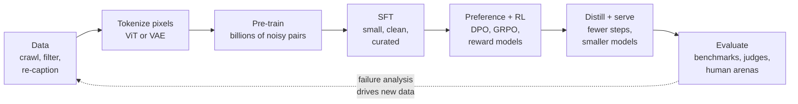
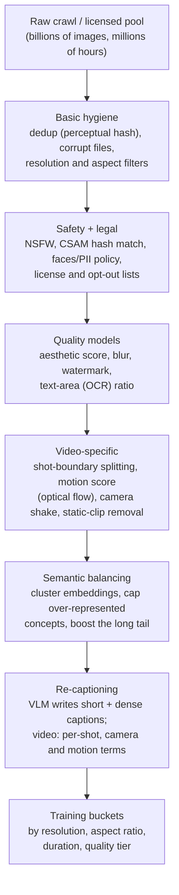
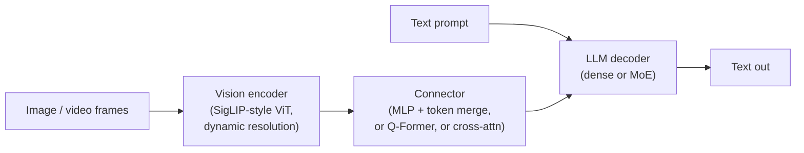
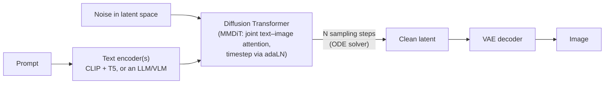
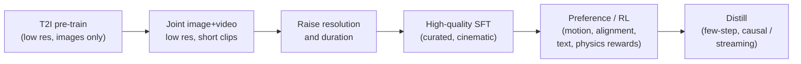

*By Gopi Krishna Tummala*

---

> **How to read this.** This is the map, not the territory. Each Act could be (and in a few cases already is) its own post on this site; I link to those deep dives as we go. The goal here is that after one sitting you can look at *any* multimodal model card or tech report and immediately place every paragraph of it into one mental picture.

---

## TL;DR

- Three families dominate multimodal AI: **MLLMs** (pixels in, text out), **text-to-image** (text in, pixels out) and **text-to-video** (text in, moving pixels out). Increasingly, **unified models** do all of it in one network.
- They all follow the **same lifecycle**: curate data → turn pixels into tokens → pre-train on huge, noisy pairs → post-train on small, clean data → sharpen with rewards (RL) → evaluate, mostly with humans and model judges.
- The single most important idea: **there are two kinds of visual tokens.** *Understanding* tokens (from contrastive encoders like CLIP/SigLIP) keep meaning and throw away detail. *Generation* tokens (from VAEs) keep detail so you can rebuild pixels. MLLMs eat the first kind; diffusion models predict the second kind.
- **Data is the moat.** Every serious tech report spends more pages on filtering and **re-captioning** than on architecture. Alt-text from the web is too noisy; synthetic dense captions changed everything.
- **MLLMs** are mostly *vision encoder + connector + LLM*, trained in stages (connector-only alignment → full pre-training → long context), then SFT, preference tuning and, since 2025, **RL with verifiable rewards** (GRPO-style) for reasoning and grounding.
- **Image and video generators** are now mostly **Diffusion Transformers trained with flow matching** in a VAE latent space, pre-trained with progressive resolution, then aesthetically fine-tuned, preference-tuned, RL-tuned (Flow-GRPO, DanceGRPO) and **distilled** for few-step sampling.
- **Video is image generation times time**, and time is expensive: a 5-second 720p clip is on the order of 100K tokens. That fact drives the VAE design, the attention design and the whole infrastructure.
- **Evaluation is the weakest link.** FID, CLIPScore and multiple-choice benchmarks are useful smoke tests; decisions are made on human preference arenas, compositional checkers (GenEval, VBench) and your own golden sets.
- **Interview one-liner:** *"Every multimodal model is a tokenizer, a sequence model and a training curriculum. MLLMs use semantic tokens and next-token loss; generators use VAE latents and flow-matching loss. Both pre-train on billions of re-captioned pairs, post-train with SFT and preference/RL rewards, and are judged mostly by humans and VLM judges."*

---

## Act 0: Multimodal Models in Plain English

Imagine you run a small art studio and you hire three people.

1. **The Critic (the MLLM).** You hand the Critic a photo and ask, *"What's going on here, and is that a stop sign or a yield sign?"* The Critic looks and *talks*. The Critic never draws.
2. **The Painter (text-to-image).** You describe a scene in words, and the Painter produces a picture. The Painter doesn't explain anything; it just paints.
3. **The Filmmaker (text-to-video).** Same as the Painter, but every picture has to flow into the next one for five seconds without the cat suddenly growing a sixth leg. The Filmmaker has to understand not just *what things look like* but *how things move*.

Now here's the trick: **all three were trained the same way.**

- First, they spent years in a giant, messy library of the internet: billions of pictures with bad, half-true captions underneath. They learned *a lot*, but they also learned bad habits. This is **pre-training**.
- Then they went to a small finishing school, where a few teachers showed them thousands of *excellent* examples. Same knowledge, much better manners. This is **supervised fine-tuning (SFT)**.
- Then they practiced in front of judges. They tried many answers or many paintings, the judges scored them, and they learned to do more of what scored well. This is **preference tuning and reinforcement learning (RL)**.
- Finally, someone had to decide *who is actually good*. That's surprisingly hard, and it's **evaluation**.

One more thing before we go. The Critic and the Painter need very different *eyes*. The Critic needs to know "this is a golden retriever catching a frisbee" and doesn't care about every blade of grass. The Painter needs every blade of grass, because it has to put them back. Hold on to that distinction; it explains half of the architecture decisions in this field.

That loop, especially the dotted arrow back to data, is the whole job.

---

## Act I: The Shared Foundation, Turning Pixels into Tokens

Transformers eat sequences of vectors. Text is easy: a tokenizer chops it into ~100K possible pieces. Pixels are not: a single 1024×1024 RGB image is three million numbers. Every multimodal model starts by answering *"how do I turn this into a reasonable number of tokens?"* There are two very different answers.

### 1.1 Understanding tokens: the librarian's summary

A **contrastive vision encoder** (CLIP, SigLIP, SigLIP 2) is trained on image-caption pairs with one job: make the embedding of an image close to the embedding of *its* caption, and far from everybody else's.

For a batch of $N$ pairs with image embeddings $u_i$ and text embeddings $v_j$, CLIP uses a softmax over the batch (InfoNCE):

$$
\mathcal{L}_{\text{CLIP}} = -\frac{1}{2N}\sum_{i=1}^{N}\left[\log\frac{e^{\langle u_i, v_i\rangle/\tau}}{\sum_j e^{\langle u_i, v_j\rangle/\tau}} + \log\frac{e^{\langle u_i, v_i\rangle/\tau}}{\sum_j e^{\langle u_j, v_i\rangle/\tau}}\right]
$$

SigLIP replaces the batch-wide softmax with an independent **sigmoid** per pair ("is this pair a match, yes or no?"), which removes the all-to-all normalization and scales better to huge batches.

**The Feynman version:** the encoder is a librarian who reads a picture and writes a one-paragraph summary in a language the LLM can read. Great summaries. But you can't rebuild the photo from the summary. That's exactly what an MLLM wants: it needs *meaning*, not pixels.

A Vision Transformer chops the image into patches (say 14×14 or 16×16 pixels), so a 448×448 image becomes $32 \times 32 = 1024$ patch tokens. Many MLLMs then **merge** neighboring tokens (e.g., 2×2 → 1) in the connector so the LLM sees 256 tokens instead of 1024.

### 1.2 Generation tokens: the photocopier

A **VAE (variational autoencoder)** is trained for a different job: compress the image and then *reconstruct it as faithfully as possible*. Its loss is reconstruction (L1/L2) plus perceptual (LPIPS) plus usually an adversarial term, plus a small KL term to keep the latent space well-behaved.

**The Feynman version:** the VAE is a photocopier that shrinks the picture onto a tiny card and can blow it back up nearly perfectly. The card doesn't *mean* anything to a human, but every detail is preserved. That's what a generator wants: it will *predict* cards, and the decoder will turn them back into pixels.

Typical image VAEs downsample 8× in each spatial direction with 4 to 16 (newer: 16 to 64) channels. Video VAEs add **temporal** compression, typically 4×, and newer ones push spatial compression to 16×.

### 1.3 Token arithmetic: why video is the hard one

Let's do the math a senior engineer should be able to do on a whiteboard.

| Input | Latent (VAE) | After 2×2 patchify | Tokens |
|---|---|---|---|
| Image 1024×1024 | 8× spatial → 128×128 | 64×64 | **4,096** |
| Video 5 s, 24 fps, 1280×720 (121 frames) | 4× temporal, 8× spatial → 31 × 90 × 160 | 31 × 45 × 80 | **~111,600** |
| Same video, 4×16×16 VAE, no transformer patchify | 4× temporal, 16× spatial → 31 × 45 × 80 | (VAE already did it) | **~111,600**, but the VAE, not the transformer, did the compression |

(The "121 frames → 31 latent frames" comes from causal video VAEs that encode the **first frame on its own** and then compress every 4 frames: $1 + 120/4 = 31$. That design lets the same VAE encode a single image as a one-frame video.)

Self-attention costs $O(L^2)$. Going from 4K to 110K tokens is ~27× longer, which is **~750× more attention compute** per layer. That one number explains: aggressive video VAEs, sequence/context parallelism in training, why video models train in low resolution first, and why everyone is obsessed with distillation for inference.

### 1.4 Discrete tokens: the third option

You can also quantize latents into a codebook (VQ-VAE, VQGAN, and newer lookup-free quantizers). Then an image is literally a sequence of integer IDs, and you can train it with the **same next-token loss** as text. This is how DALL·E 1, Parti, Chameleon and Emu3 work, and it's one road to unified models (Act VIII). The trade-off: quantization loses detail, so continuous-latent diffusion has generally won on raw image quality.

> **Takeaway for Act I:** *Understanding wants semantic tokens. Generation wants reconstructive tokens.* Most of the architecture zoo is people choosing one, the other, or trying to have both.

---

## Act II: Data, the Real Moat

If you read the Qwen-VL, Movie Gen, Wan or Seedance reports side by side, you'll notice something: **architecture sections are short; data sections are long.** The architectures have converged. Data has not.

### 2.1 Where multimodal data comes from

| Source | Examples | What it teaches | Problem |
|---|---|---|---|
| Web image–alt-text pairs | LAION-5B, COYO-700M, DataComp | Broad concepts, names, styles | Captions are short, wrong or SEO spam |
| Interleaved web documents | MMC4, OBELICS | Multi-image reasoning, in-context learning | Loose image–text alignment |
| Documents, OCR, charts, UIs | PDFs, rendered pages, screenshots | Reading text, tables, layouts | Needs synthetic rendering to scale |
| Grounding / detection | boxes, points, referring expressions | *Where* things are | Expensive labels |
| Video clips + captions | stock video, licensed footage, web video | Motion, physics, temporal order | Scene cuts, static clips, watermarks |
| Synthetic | captions from a VLM, rendered math, generated QA | Density, coverage, reasoning | Inherits teacher's errors and biases |
| Human-written dense data | PixMo (Molmo) spoken-then-transcribed captions | Accuracy, detail | Cost |

### 2.2 The curation funnel

Every large pipeline is some version of this, and for video the funnel is brutal; it's common to keep only a small fraction of raw footage.

Three ideas in that funnel are worth slowing down for.

**Re-captioning is the biggest single lever.** OpenAI's DALL·E 3 report made this explicit: web alt-text describes *why the image was posted*, not *what is in it*. They trained a captioner, re-captioned the training set with dense descriptions, and trained on a mix that was overwhelmingly synthetic captions (with some original text kept so the model can still handle short, lazy prompts). Prompt-following jumped. Every serious T2I and T2V model since does some version of this, often producing **multiple captions per sample** at different lengths. For video, captions add camera language ("slow dolly-in, shallow depth of field") and motion verbs, because that's what users will type.

**Quality tiers, not a single dataset.** You don't filter once; you build *tiers*. Pre-training uses the big, mediocre tier for coverage. Later stages use smaller, stricter tiers. The final "aesthetic" or "SFT" tier might be only thousands of hand-picked samples. Meta's Emu paper called this **quality-tuning**: a few thousand exceptional images, used after pre-training, dramatically improved visual appeal without hurting concept coverage.

**Balancing the concept distribution.** The web is 30% product shots and selfies. If you don't rebalance (cluster embeddings and cap the head, upsample the tail), the model becomes excellent at sneakers and terrible at, say, medical diagrams or anything outside the head of the distribution.

### 2.3 The Molmo lesson

Most strong open VLMs of 2024 were trained heavily on synthetic data *from proprietary VLMs*, which is effectively distillation. The Molmo/PixMo work asked whether you could build a top model without that. Their answer was yes, and the key wasn't architecture: it was **new human data**, especially very detailed image descriptions collected by having annotators *speak* about images for a minute or so (people say far more than they type), plus a 2D pointing dataset for grounding. The general lesson: *the capability you want has to exist in the data, in density, before any training trick can find it.*

> **Infra note.** At this scale curation is a distributed batch inference problem: run a VLM captioner, an aesthetic model, an OCR model, an optical-flow model and a shot detector over petabytes. This is exactly the CPU-decode → GPU-model streaming pattern from my [Ray field guide](/posts/mlops/ray-field-guide-core-to-production) and the storage problem in the [Lance post](/posts/mlops/lance-lancedb-data-layer-for-ml): you keep adding *columns* (new captions, new scores) to the same rows, over and over.

---

## Act III: The MLLM Machine (Pixels In, Text Out)

### 3.1 The three-part anatomy

Almost every production MLLM is:

The interesting design choices are in *how vision enters the LLM*. Sebastian Raschka's framing is a good one to remember:

**Method A, unified embedding-decoder (LLaVA style).** Project visual tokens into the LLM's embedding space with a small MLP and simply *put them in the sequence*, next to the text. The LLM is unmodified. Simple, scales with the LLM, and is what most open models (LLaVA, Qwen-VL, InternVL, Molmo) do. Cost: visual tokens consume context.

**Method B, cross-attention (Flamingo / Llama 3.2 Vision style).** Keep the text sequence as it is; insert cross-attention layers so text tokens can *look at* image features. Visual tokens don't consume context, and you can freeze the original LLM to protect its text skills. Cost: more architectural surgery, and the fusion is shallower.

**Compression variants (BLIP-2's Q-Former, Perceiver resamplers).** A small set of learned queries attends to the image and outputs a *fixed* number of tokens (e.g., 32 or 64). Efficient, but it throws away detail, which hurts OCR and documents; the field mostly moved back toward "more tokens, smarter merging."

**Native / early fusion.** Train one model on interleaved text and image tokens from the beginning (Chameleon with discrete tokens; frontier proprietary models are described as natively multimodal). This is where unified models come from (Act VIII).

### 3.2 Details that separate good from great

- **Resolution is everything for OCR and documents.** Early models resized everything to 224 or 336 pixels; a receipt became mush. Two fixes: **AnyRes/tiling** (cut a large image into tiles plus a thumbnail) and **native dynamic resolution** (NaViT-style: patchify at the native aspect ratio and pack variable-length sequences). Qwen2-VL onwards uses the latter.
- **Positional encoding in 2D and 3D.** Text RoPE is 1D. Qwen2-VL introduced **M-RoPE**, splitting rotary dimensions across time, height and width. Qwen3-VL's report describes an **interleaved MRoPE** for better spatial-temporal modeling, plus **text-based timestamps** for video so the model can say *"at 01:23 the car turns left."*
- **Multi-level visual features.** The last ViT layer is very semantic and loses fine detail. Qwen3-VL's **DeepStack** injects features from *several* ViT layers into the LLM.
- **Video = frames + time.** Sample frames (fixed fps or adaptive), encode each, merge tokens aggressively across time, and add time information. Long video is mostly a token-budget problem.
- **Audio** typically comes through a Whisper-style encoder and the same connector trick; "omni" models add speech output with a separate speech decoder.

### 3.3 Pre-training an MLLM: a curriculum, not a single run

The Qwen3-VL report is a clean modern example (sizes from 2B dense up to a 235B-A22B MoE, 256K native context):

| Stage | What's trainable | Data | Context | Purpose |
|---|---|---|---|---|
| 0. Alignment | **Connector only** (ViT + LLM frozen) | ~67B tokens: captions, visual knowledge, OCR | 8K | Teach the projector to "translate" vision into LLM space without damaging either |
| 1. Multimodal pre-training | **Everything** | ~1T tokens of mixed multimodal + text | 8K | Real joint learning |
| 2. Long-context | Everything | ~1T tokens, more long text, video, agent data | 32K | Long documents and video |
| 3. Ultra-long | Everything | ~100B tokens | 256K | Hour-long video, book-length docs |

Why the stages?

- **Stage 0 exists to protect investments.** Both the ViT and the LLM are expensive pre-trained models. A randomly initialized connector sends garbage gradients; if you train everything from step zero, you damage both. So you warm up the bridge first.
- **Always mix in text-only data.** Without it, the LLM's language and reasoning ability degrades (catastrophic forgetting). Good reports claim their VL model *matches or beats* its own text-only backbone on text tasks; that's the test of a healthy mix.
- **Loss is next-token prediction on text tokens only.** Image tokens are inputs; you mask them out of the loss.

> **Infra note.** MLLM pre-training has a load-balancing problem LLMs don't: some samples are 90% visual tokens (the ViT does most of the work), some are pure text (the ViT is idle). Packing variable-resolution images into fixed-length sequences, and balancing ViT vs LLM compute across pipeline stages and data-parallel ranks, is a big part of achieved MFU.

### 3.4 Post-training an MLLM

**SFT (instruction tuning).** Millions of (image, instruction, response) examples: VQA, captioning, OCR, charts, grounding ("give the box for the red car"), multi-turn chat, and, increasingly, **long chain-of-thought** traces as a "cold start" for reasoning. LLaVA showed in 2023 that GPT-generated instruction data could bootstrap this; today the recipes are curated mixtures of human, synthetic and distilled data, and Qwen3-VL also lists explicit **distillation** from stronger teachers into smaller models.

**Preference tuning.** MLLMs have a signature failure: **hallucination**, confidently describing objects that aren't there, because the language prior is stronger than the visual evidence. DPO-style preference data where the "rejected" answer contains a hallucination (RLHF-V, and many follow-ups) directly targets this.

**RL with verifiable rewards (the 2025–2026 wave).** After DeepSeek-R1 showed that RL on checkable answers creates long, self-correcting reasoning in text models, the same recipe moved to vision. The workhorse is **GRPO**: for each prompt, sample a *group* of $G$ answers, score them, and use the group itself as the baseline instead of a learned value model:

$$
\hat{A}_i = \frac{r_i - \operatorname{mean}(r_1,\dots,r_G)}{\operatorname{std}(r_1,\dots,r_G)}
$$

$$
\mathcal{J}(\theta)=\mathbb{E}\left[\frac{1}{G}\sum_{i=1}^{G}\frac{1}{|o_i|}\sum_{t}\min\Big(\rho_{i,t}\hat{A}_i,\ \operatorname{clip}(\rho_{i,t},1-\epsilon,1+\epsilon)\hat{A}_i\Big)\right]-\beta\, D_{\text{KL}}\big(\pi_\theta\,\|\,\pi_{\text{ref}}\big)
$$

where $\rho_{i,t}$ is the token-level probability ratio between the new and old policy.

**The Feynman version:** ask the student the same question eight times, grade all eight, and tell them "do more of what your above-average answers did, less of what your below-average answers did." No separate critic network needed.

What makes it *multimodal* is the reward design:

| Task | Verifiable reward |
|---|---|
| Visual math / science (MathVista-style) | Exact final answer match |
| Grounding / detection | IoU between predicted and true box |
| OCR / document reading | Edit distance to the ground truth |
| Counting, charts | Numeric match within tolerance |
| Format | Did it think inside `<think>` tags, then answer? |
| Open-ended | Reward model or VLM judge (not verifiable, so hackable) |

Two findings worth knowing, because they'll come up in any serious discussion:

- RL seems to improve *perception*, not only reasoning. A 2025 study ("RL makes MLLMs see better than SFT") found RL beats SFT on vision-heavy VQA and actually reshapes the vision encoder's representations.
- But be skeptical about *what* RL is teaching. Recent preprints show models trained **without the images** recover a large share of the "visual reasoning" gains on some benchmarks: the model learned answer priors and reasoning templates, not better looking. Work like Faithful-GRPO and perception-specific rewards is a response to exactly this.

**"Thinking with images."** The frontier pattern is agentic: during reasoning, the model calls tools on the image (crop, zoom, rotate, draw a box, run OCR) and looks again, trained with RL so it learns *when* to zoom. GUI agents (click this button on this screenshot) are the same machinery with a different action space.

> For the general post-training toolbox (LoRA, DPO, GRPO and friends), see [Modern Post-Training & PEFT](/posts/mlops/modern-post-training-peft-2026).

---

## Act IV: The Painter (Text-to-Image)

### 4.1 Five years of lineage in one paragraph

GANs made sharp faces but couldn't follow prompts. **DALL·E 1** (2021) treated images as discrete tokens and ran a GPT over them. **GLIDE/Imagen** showed diffusion in pixel space plus a strong text encoder wins on prompt-following. **Latent Diffusion / Stable Diffusion** (2022) moved diffusion into a VAE latent space, making it 10–50× cheaper; a convolutional **U-Net** did the denoising. **DiT** (2023) replaced the U-Net with a plain Transformer over latent patches, and it scaled like LLMs do. **SD3's MMDiT** and **FLUX** (2024) let text and image tokens attend to each other jointly, and switched the objective to **rectified flow / flow matching**. In 2025, natively multimodal autoregressive models (GPT-4o image generation, and open unified models) showed that an LLM-centered design can be excellent at prompt-following, text rendering and editing.

> Deep dives: [Diffusion Foundations](/posts/generative-ai/diffusion-from-molecules-to-machines), [From U-Net to DiT](/posts/generative-ai/image-diffusion-models-unet-to-dit), [Sampling & Guidance](/posts/generative-ai/sampling-guidance-diffusion-models).

### 4.2 Anatomy of a modern T2I model

- **Text encoder.** Prompt understanding is bounded by it. CLIP's text tower is short-context and bag-of-words-ish; T5-XXL reads long, compositional prompts; the trend is toward using a decoder LLM or VLM as the text encoder.
- **Denoiser.** MMDiT-style blocks keep separate weights for text and image streams but run **joint attention** over the concatenated sequence. Timestep (noise level) enters via adaptive LayerNorm.
- **VAE.** More latent channels (4 → 16 and beyond) were a quiet but large quality jump: fine text and small faces need the capacity.

### 4.3 The training objective: flow matching in one picture

Pick a clean latent $x_0$ and pure noise $\epsilon \sim \mathcal{N}(0, I)$. Draw a straight line between them:

$$
x_t = (1-t)\,x_0 + t\,\epsilon, \qquad t\in[0,1]
$$

The velocity along that line is constant: $v = \epsilon - x_0$. Train the network to predict it:

$$
\mathcal{L}_{\text{FM}} = \mathbb{E}_{x_0,\epsilon,t}\,\big\|\,v_\theta(x_t, t, c) - (\epsilon - x_0)\,\big\|^2
$$

At sampling time, start at noise and integrate the predicted velocity backward to $t=0$ with an ODE solver.

**The Feynman version:** classic diffusion taught the model to remove a little fog at a time along a curvy path. Flow matching says: *draw a straight road from fog to photo and learn the speedometer.* Straighter paths need fewer steps, and the loss is simpler and more stable.

Two practical knobs from the SD3 paper that everyone copied: **which $t$ you train on matters** (sample the middle timesteps more, e.g. logit-normal, because that's where the hard decisions are made), and **shift the schedule toward more noise at higher resolutions** (bigger images keep more signal at the same noise level).

**Classifier-free guidance** is how prompt adherence is dialed up at inference. During training, drop the caption ~10% of the time so the model learns both conditional and unconditional predictions. At sampling time, extrapolate:

$$
\tilde{v} = v_\theta(x_t, \varnothing) + w\,\big(v_\theta(x_t, c) - v_\theta(x_t, \varnothing)\big)
$$

Higher $w$ means more prompt-following and more saturated, less diverse images.

### 4.4 Pre-training recipe

1. **Precompute latents and text embeddings offline.** The VAE encoder and the T5 encoder are frozen; running them inside the training loop wastes GPU. This turns the dataset into a big table of tensors (another reason columnar, appendable formats matter).
2. **Progressive resolution.** Train most steps at 256², then 512², then 1024². Low resolution is where concepts and composition are learned cheaply; high resolution adds detail.
3. **Aspect-ratio bucketing.** Group images by aspect ratio so batches share a shape; never center-crop away the subject.
4. **Caption mixing.** Short and long synthetic captions plus some original alt-text; caption dropout for CFG.
5. **EMA weights.** Keep an exponential moving average of the weights; it's usually what you ship.

### 4.5 Post-training: from "knows everything" to "looks great and listens"

| Stage | Data | Objective | What it fixes |
|---|---|---|---|
| Aesthetic / quality SFT | Thousands of hand-picked images | Same flow loss | Visual appeal, composition, lighting |
| Preference tuning | Pairs of images for the same prompt, human-ranked | Diffusion-DPO | Human preference without a reward model |
| Online RL | Prompts + reward functions | Flow-GRPO, DanceGRPO | Counting, spatial relations, text rendering |
| Distillation | Teacher model samples | Consistency / adversarial / distribution matching | 30–50 steps → 1–8 steps |

**RL for flow models deserves a closer look**, because the naive version doesn't work. GRPO needs *randomness* to explore: you want 8 different images for the same prompt and their relative scores. But a flow-matching sampler is a deterministic ODE. **Flow-GRPO**'s key move is converting the ODE into an equivalent **SDE** with the same marginal distributions, so each step becomes a Gaussian policy with a log-probability you can compute, and it also trains on fewer denoising steps to save cost. Their headline result: Stable Diffusion 3.5 Medium on **GenEval** went from **63% → 95%**, and visual text rendering from **59% → 92%**, with little sign of reward hacking. DanceGRPO applied the same family of ideas across image and video generators. Since then this has become a standard post-training stage, including for video models (the Wan and HunyuanVideo ecosystems).

**Rewards** come in three kinds: **rule-based checkers** (an object detector verifies "three red apples left of a cup" — this is what GenEval does), **learned preference models** (HPSv2, PickScore, ImageReward, trained on human comparisons) and **VLM judges** (ask a strong MLLM whether the image matches the prompt). This is where Act III and Act IV meet: *the Critic grades the Painter.*

**Reward hacking** is the constant risk: optimize a single aesthetic score and you get oversaturated, same-looking images; optimize OCR and you get text slapped everywhere. Mitigations: KL to the reference model, multiple rewards, held-out human evals, and early stopping.

---

## Act V: The Filmmaker (Text-to-Video)

Text-to-video is text-to-image plus a time axis, and the time axis changes everything about cost, data and failure modes.

> Deep dives: [Video Diffusion Fundamentals](/posts/generative-ai/video-diffusion-fundamentals), [Training Lifecycle of Video Diffusion](/posts/generative-ai/pre-training-post-training-video-diffusion), [Sora, Veo and Open-Sora](/posts/generative-ai/modern-video-models-sora-veo-opensora), [Physics-Aware Video Models](/posts/generative-ai/physics-aware-video-diffusion-models).

### 5.1 What's different about the architecture

- **3D causal VAE.** Compresses time (typically 4×) and space (8× or 16×). "Causal" means each latent frame only depends on current and past frames, and the first frame is encoded alone, so **images are just 1-frame videos** and one model can train on both.
- **Spacetime patches.** Sora's report popularized the phrase: chop the latent video into small 3D cubes and treat each as a token. Variable duration, resolution and aspect ratio are just variable sequence lengths.
- **Full 3D attention.** Early video models factorized attention (spatial within a frame, then temporal across frames) to save compute. Modern large models mostly use **full spatiotemporal attention**, because factorized attention produces flicker and weak long-range motion. This is why video training is a long-context problem.
- **Mixture of experts by noise level.** Wan 2.2 splits its denoiser into a **high-noise expert** (early steps: global layout and motion) and a **low-noise expert** (late steps: textures and detail), each ~14B parameters, switched by signal-to-noise ratio; ~27B total, ~14B active per step. It's a neat idea: the job at $t=0.9$ and the job at $t=0.1$ really are different jobs.
- **Joint audio.** Meta's Movie Gen paired a video model with a separate audio model; Google's Veo 3 popularized generating synchronized audio and dialogue together with video. Audio is becoming part of "video" by default.

### 5.2 A reference point: Movie Gen

Meta's Movie Gen paper (2024) remains one of the most detailed public recipes:

- A **30B-parameter Transformer** trained with flow matching, maximum context **73K video tokens**, enough for **16 seconds at 16 fps**.
- Pre-training data on the order of **100M video–text pairs and 1B image–text pairs**, with multi-stage filtering for visual quality, motion and content, and LLM-based re-captioning.
- A curriculum that starts with **text-to-image only**, then moves to **joint image + video**, at increasing resolution, followed by fine-tuning on a small, very high-quality video set.

Wan, HunyuanVideo, Seedance, LongCat-Video and others follow the same skeleton with their own twists.

### 5.3 The standard T2V training curriculum

Why start with images? Images are cheap tokens and teach *what things look like*. Video tokens are expensive and should be spent teaching *how things move*. You also keep mixing images in later so concept coverage doesn't collapse to what's in the (smaller) video set.

**RL for video** borrows from Act IV (Flow-GRPO, DanceGRPO) with video rewards: VLM judges for prompt alignment, motion-quality and temporal-consistency scorers, text-in-video OCR, and physics plausibility checks. The LongCat-Video report is a nice public example of the full chain: flow-matching pre-training → GRPO-based RLHF → distillation.

**Distillation is not optional for video.** 50 steps × 110K tokens × a 14B model is minutes per clip. Few-step distillation, and **causal / autoregressive distillation** that turns a bidirectional video model into one that streams frames chunk by chunk, are what make video products and interactive "world models" possible.

### 5.4 Where video models still fail

Physics (objects passing through each other, liquids, hands), object permanence (things vanish when occluded), counting over time, long-range consistency (a character's face drifting across a minute), and fine text. These are the failure modes the newer benchmarks (Act VI) and the "physics-aware" line of work target.

> **Infra note.** Video training is where infra and research are inseparable: **sequence/context parallelism** (Ulysses, ring attention) to split 100K-token sequences across GPUs, activation checkpointing, VAE tiling, **precomputed latents** (decoding video is a CPU bottleneck you never want in the training loop), and bucketing by duration × resolution so batches are shape-stable. See [Datasets & Dataloaders](/posts/mlops/datasets-and-dataloaders) for why decode belongs off the GPU nodes.

---

## Act VI: Evaluation, the Hardest Part

A Feynman-style warning first: *a metric is a question you've decided to ask cheaply.* Every metric below is useful, and every one of them can be gamed or misread.

### 6.1 MLLM evaluation

| Benchmark family | Examples | What it measures |
|---|---|---|
| Broad expert knowledge | MMMU | College-level multi-discipline questions with images |
| General perception | MMBench, MME, RealWorldQA | Recognition, attributes, spatial relations |
| Vision-indispensable | MMStar | Questions that *can't* be answered from text alone |
| Visual math | MathVista, MathVision | Diagrams, plots, geometry + reasoning |
| Documents, OCR, charts | DocVQA, ChartQA, OCRBench, TextVQA | Reading and reasoning over text in images |
| Hallucination | POPE, HallusionBench | Saying "no" when the object isn't there |
| Video | Video-MME, MLVU | Short to hour-long video understanding |
| Grounding and agents | RefCOCO, ScreenSpot, OSWorld-style | Boxes, points, clicking on UIs |

Pitfalls every senior engineer should call out:

- **Blind baselines.** Run the model with the image removed. If the score barely drops, the benchmark (or your RL gains) is measuring language priors. MMStar was created precisely because many questions in earlier benchmarks were answerable without looking.
- **Contamination.** Benchmarks are on the web; the web is the training set.
- **Prompt and parsing sensitivity.** Multiple-choice extraction, CoT on/off and answer-format quirks can move scores by several points. Compare only under identical harnesses.
- **LLM/VLM judges** for open-ended answers are biased toward length, style and their own model family. Calibrate them against humans.

### 6.2 Image generation evaluation

| Metric | How it works | Watch out for |
|---|---|---|
| **FID** | Distance between Inception-feature Gaussians of real vs generated sets | Ignores the prompt; Inception features are dated; sensitive to sample size and preprocessing |
| **CLIPScore** | Cosine similarity of image and prompt embeddings | Bag-of-words: weak on counting, relations, negation |
| **GenEval** | Object detector checks objects, counts, colors, positions | Only what the detector can see; it's also an RL reward now, so it saturates |
| **T2I-CompBench, DPG-Bench** | Compositional and dense-prompt alignment | Judge-model dependence |
| **Preference models** (HPSv2, PickScore, ImageReward) | Predict human preference | Easily hacked when used as RL rewards |
| **Human arenas / side-by-side** | Pairwise votes → Elo or Bradley–Terry ratings | Expensive, prompt-set dependent, but the closest thing to truth |

### 6.3 Video generation evaluation

- **FVD** (Fréchet Video Distance) is the video version of FID, with the same blind spots, plus a known bias toward per-frame quality over motion.
- **VBench** decomposes quality into many dimensions (subject consistency, motion smoothness, dynamic degree, aesthetic and imaging quality, prompt alignment...).
- **VBench-2.0** targets *intrinsic faithfulness*: 18 fine-grained capabilities grouped into **Human Fidelity, Controllability, Creativity, Physics and Commonsense**, scored with a mix of VLM/LLM judges and specialist detectors, validated against human annotations.
- **Human side-by-side** on a fixed prompt set (Movie Gen published its prompt benchmark for this reason) remains the decision-maker.

### 6.4 How teams actually decide

In practice: automated metrics gate every checkpoint (catch regressions fast), a **golden prompt set** that represents *your* users gets judged by a calibrated VLM judge nightly, and **human side-by-side** decides launches. And the most valuable artifact isn't a score; it's the **failure taxonomy** ("fails on hands holding objects", "counts above five", "Hindi text") that turns into the next round of data collection. That's the dotted arrow in the Act 0 diagram.

---

## Act VII: The End-to-End Picture

Here's the whole field on one table. If you remember one thing from this post, make it this.

| Stage | MLLM (Critic) | Text-to-Image (Painter) | Text-to-Video (Filmmaker) |
|---|---|---|---|
| **Visual tokens** | Semantic: SigLIP-style ViT, dynamic res, token merge | Reconstructive: image VAE (8×, 16+ ch) | Reconstructive: 3D causal VAE (4× time, 8–16× space) |
| **Core model** | LLM decoder (dense/MoE) + connector | DiT / MMDiT | DiT with full 3D attention (sometimes MoE by noise level) |
| **Pre-train objective** | Next-token prediction on text | Flow matching (velocity prediction) | Flow matching, joint with images |
| **Pre-train data** | Captions, interleaved docs, OCR, grounding, video, *plus text-only* | Billions of re-captioned image–text pairs | ~100M-scale filtered clips + images, re-captioned with motion/camera language |
| **Curriculum** | Connector-only → full → long context | 256 → 512 → 1024, aspect buckets | Images → short low-res video → longer, higher res |
| **SFT** | Instruction + long-CoT data, distillation | Aesthetic quality-tuning on thousands of images | Cinematic, high-quality curated clips |
| **Preference / RL** | DPO for hallucination; GRPO with verifiable rewards | Diffusion-DPO; Flow-GRPO/DanceGRPO with detectors, preference models, VLM judges | Same family with motion, alignment, physics rewards |
| **Make it fast** | Quantization, token pruning, speculative decoding | Few-step distillation | Few-step + causal/streaming distillation |
| **Evaluation** | MMMU, MMStar, DocVQA, Video-MME, POPE, blind baselines | FID, CLIPScore, GenEval, arenas | FVD, VBench / VBench-2.0, human side-by-side |
| **Infra pain** | ViT/LLM load balance, packing variable-res images | Precomputing latents, high-res memory | 100K-token sequences, context parallelism, video decode |

---

## Act VIII: The Convergence, Unified Models

The Critic and the Painter are moving into the same body. Why? Because a model that *understands* "a red cube on top of a blue sphere" should be better at *drawing* it, and editing ("now make the cube green") needs both at once.

The design space, in the language of Act I:

- **All-discrete, all-autoregressive** (Chameleon, Emu3): images become codebook tokens; one next-token loss for everything. Simple, but quantization limits fidelity.
- **One transformer, two losses** (Transfusion): next-token loss on text, diffusion/flow loss on continuous image patches, same weights.
- **Decoupled eyes** (Janus): a semantic encoder for understanding and a separate VAE-style tokenizer for generation, sharing the transformer, because the two jobs want different tokens (the librarian vs the photocopier, again).
- **Mixture-of-transformers** (BAGEL): separate expert weights for understanding and generation inside a shared attention space, pre-trained on huge interleaved data; it shows emergent editing and "world-navigation" style abilities.
- **LLM + external diffusion head**: an MLLM plans and produces conditioning; a diffusion decoder paints.

The honest status as of late 2026: unified models are improving fast and GPT-4o-style native generation proved the product value (especially for text rendering and multi-turn editing), but benchmarks like MME-Unify still show significant gaps, and recent work finds that forcing both objectives through exactly the same computation path can make one dominate the other. Expect the separate-tokens-shared-trunk designs to keep winning for a while.

---

## Check Yourself

<strong>Why can't you use a CLIP/SigLIP encoder as the latent space for an image generator?</strong>

Contrastive encoders are trained to keep information that distinguishes captions (semantics) and throw away the rest (exact texture, layout details). You can't reconstruct pixels from them faithfully. Generators need a reconstructive latent (a VAE), which preserves detail but is not semantically organized. That's the "two kinds of tokens" problem, and it's why unified models often use two tokenizers.

<strong>Why does MLLM pre-training start by training only the connector?</strong>

The ViT and LLM are expensive pre-trained models; a randomly initialized connector sends noisy gradients that would damage both. Training only the connector first aligns the vision features to the LLM's embedding space cheaply and safely; then everything is unfrozen.

<strong>Your VL model got worse at pure-text reasoning after multimodal training. What happened and how do you fix it?</strong>

Catastrophic forgetting from a data mix with too little high-quality text. Fix: include a meaningful share of text-only data (including reasoning and code) in every stage, monitor text benchmarks as a first-class regression gate, and consider lower LLM learning rates during early multimodal stages.

<strong>How does GRPO avoid a value model, and what's the multimodal-specific part?</strong>

It samples a group of answers per prompt and uses the group's mean and standard deviation to normalize rewards into advantages. The multimodal part is the rewards: exact match for visual math, IoU for grounding, edit distance for OCR, numeric tolerance for charts, plus format rewards. Open-ended tasks need reward models or VLM judges, which are hackable.

<strong>How would you check whether RL actually improved visual perception?</strong>

Run blind baselines (no image or a blank image) before and after RL; evaluate on vision-indispensable benchmarks like MMStar; test grounding with IoU-scored tasks; and inspect attention or use perturbation tests (mask the relevant region and check the answer changes).

<strong>Explain flow matching to a new hire in two sentences.</strong>

Draw a straight line from a clean image latent to pure noise, and train the network to predict the velocity along that line at any point. At inference, start from noise and follow the predicted velocities back to an image with an ODE solver; straighter paths mean fewer steps.

<strong>Why can't you apply GRPO directly to a flow-matching image model, and how does Flow-GRPO fix it?</strong>

The standard sampler is a deterministic ODE, so there's no stochastic policy with log-probabilities to optimize and limited exploration. Flow-GRPO converts the ODE into an SDE with the same marginals, making each step a Gaussian policy whose log-probability is computable, and trains on fewer denoising steps to cut cost.

<strong>Estimate the token count of a 5-second 720p video and explain what it implies.</strong>

121 frames → 31 latent frames with a 4× causal temporal VAE; 720×1280 → 90×160 with 8× spatial; 2×2 patches → 45×80 = 3,600 per latent frame; ×31 ≈ 111K tokens. Attention is quadratic, so this is roughly 750× the attention cost of a 1024² image. Implications: aggressive VAEs, context parallelism, low-resolution-first curricula and mandatory distillation for inference.

<strong>Why train video models on images first, and keep mixing images in later?</strong>

Images are cheap and teach appearance and concepts; video tokens are expensive and should be spent on motion. Mixing images throughout preserves concept coverage, since the curated video set is far smaller and less diverse than the image set. A causal VAE makes this natural because an image is a one-frame video.

<strong>What's wrong with FID as your main metric for a text-to-image model?</strong>

It ignores the prompt entirely, uses dated Inception features that don't match human perception of modern images, depends on sample size and preprocessing, and can improve while prompt adherence gets worse. Use it as a sanity check alongside compositional checkers (GenEval), preference models and human side-by-side evaluations.

<strong>Why is re-captioning so important, and what can go wrong?</strong>

Web alt-text describes context, not content, so the model never learns to follow detailed prompts. Dense synthetic captions teach exact attributes, counts, relations, camera and motion language. Risks: inheriting the captioner's hallucinations and biases, losing the ability to handle short user prompts (fix by mixing caption lengths), and homogenized "captioner style" language.

<strong>Name three approaches to unified understanding + generation models and the core tension between them.</strong>

All-discrete autoregressive (Chameleon/Emu3), one transformer with next-token + diffusion losses (Transfusion), and decoupled tokenizers or experts sharing attention (Janus, BAGEL). The tension: understanding wants semantic tokens and generation wants reconstructive tokens, and forcing both through identical computation tends to let one objective dominate.

---

## Where to Go Next on This Site

- **Generation deep dives:** [Diffusion Foundations](/posts/generative-ai/diffusion-from-molecules-to-machines) → [U-Net to DiT](/posts/generative-ai/image-diffusion-models-unet-to-dit) → [Sampling & Guidance](/posts/generative-ai/sampling-guidance-diffusion-models) → [Video Diffusion](/posts/generative-ai/video-diffusion-fundamentals) → [Video Training Lifecycle](/posts/generative-ai/pre-training-post-training-video-diffusion) → [The Frontier](/posts/generative-ai/modern-video-models-sora-veo-opensora).
- **Post-training:** [Modern Post-Training & PEFT](/posts/mlops/modern-post-training-peft-2026).
- **The infrastructure underneath:** [Ray Field Guide](/posts/mlops/ray-field-guide-core-to-production), [Datasets & Dataloaders](/posts/mlops/datasets-and-dataloaders), [Lance & LanceDB](/posts/mlops/lance-lancedb-data-layer-for-ml), [vLLM Trilogy](/posts/mlops/vllm-trilogy-of-modern-llm-scaling).

---

## References and Further Reading

**Surveys and courses**
- Raschka, [Understanding Multimodal LLMs](https://magazine.sebastianraschka.com/p/understanding-multimodal-llms) (the Method A / Method B framing).
- Yin et al., [A Survey on Multimodal Large Language Models](https://arxiv.org/abs/2306.13549).
- [A Survey of State of the Art Large Vision Language Models: Alignment, Benchmark, Evaluations and Challenges](https://arxiv.org/abs/2501.02189).
- CMU 11-777 Multimodal Machine Learning (Morency et al.): representation, alignment, fusion and co-learning foundations.

**Vision encoders and MLLMs**
- Radford et al., [CLIP](https://arxiv.org/abs/2103.00020); Zhai et al., [SigLIP](https://arxiv.org/abs/2303.15343).
- Alayrac et al., [Flamingo](https://arxiv.org/abs/2204.14198); Li et al., [BLIP-2](https://arxiv.org/abs/2301.12597); Liu et al., [LLaVA](https://arxiv.org/abs/2304.08485).
- Wang et al., [Qwen2-VL](https://arxiv.org/abs/2409.12191) (M-RoPE, dynamic resolution); [Qwen3-VL Technical Report](https://arxiv.org/abs/2511.21631).
- Deitke et al., [Molmo and PixMo](https://arxiv.org/abs/2409.17146).
- Shao et al., [DeepSeekMath](https://arxiv.org/abs/2402.03300) (GRPO).
- [RL makes MLLMs see better than SFT](https://arxiv.org/abs/2510.16333).

**Image generation**
- Rombach et al., [Latent Diffusion](https://arxiv.org/abs/2112.10752); Peebles & Xie, [DiT](https://arxiv.org/abs/2212.09748).
- Lipman et al., [Flow Matching](https://arxiv.org/abs/2210.02747); Liu et al., [Rectified Flow](https://arxiv.org/abs/2209.03003); Esser et al., [SD3 / Scaling Rectified Flow Transformers](https://arxiv.org/abs/2403.03206).
- Betker et al., [Improving Image Generation with Better Captions (DALL·E 3)](https://cdn.openai.com/papers/dall-e-3.pdf).
- Dai et al., [Emu: quality-tuning](https://arxiv.org/abs/2309.15807); Wallace et al., [Diffusion-DPO](https://arxiv.org/abs/2311.12908).
- Liu et al., [Flow-GRPO](https://arxiv.org/abs/2505.05470); Xue et al., [DanceGRPO](https://arxiv.org/abs/2505.07818).

**Video generation**
- Polyak et al., [Movie Gen](https://arxiv.org/abs/2410.13720); Kong et al., [HunyuanVideo](https://arxiv.org/abs/2412.03603); [Wan](https://arxiv.org/abs/2503.20314); [Seedance 1.0](https://arxiv.org/abs/2506.09113); [LongCat-Video](https://arxiv.org/abs/2510.22200).

**Unified models**
- [Chameleon](https://arxiv.org/abs/2405.09818); Zhou et al., [Transfusion](https://arxiv.org/abs/2408.11039); [Janus](https://arxiv.org/abs/2410.13848); [BAGEL](https://arxiv.org/abs/2505.14683).

**Evaluation**
- Yue et al., [MMMU](https://arxiv.org/abs/2311.16502); Chen et al., [MMStar](https://arxiv.org/abs/2403.20330); Ghosh et al., [GenEval](https://arxiv.org/abs/2310.11513); Huang et al., [VBench](https://arxiv.org/abs/2311.17982); [VBench-2.0](https://arxiv.org/abs/2503.21755); [A Survey on Evaluation of MLLMs](https://arxiv.org/abs/2408.15769).
