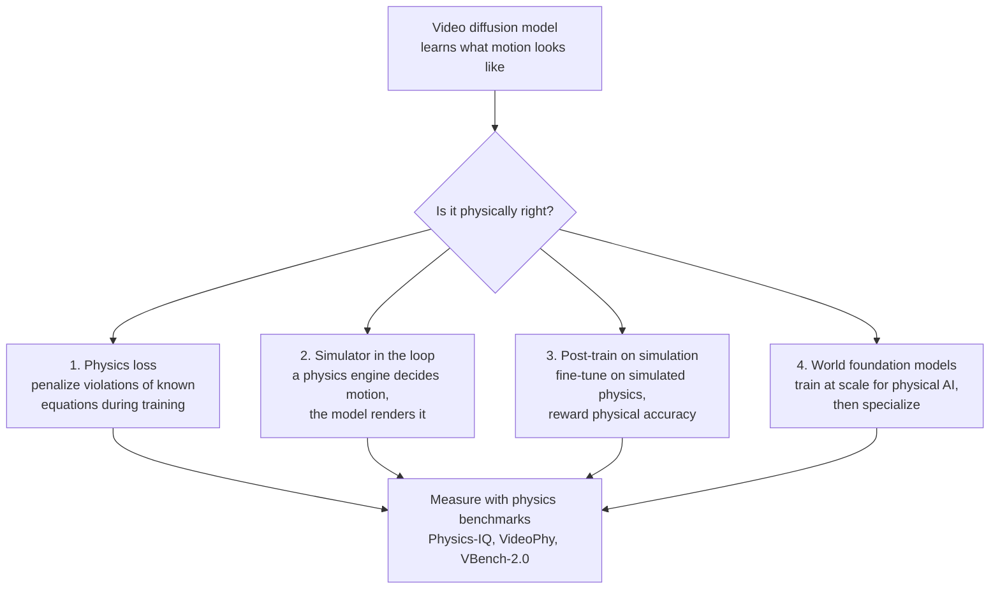
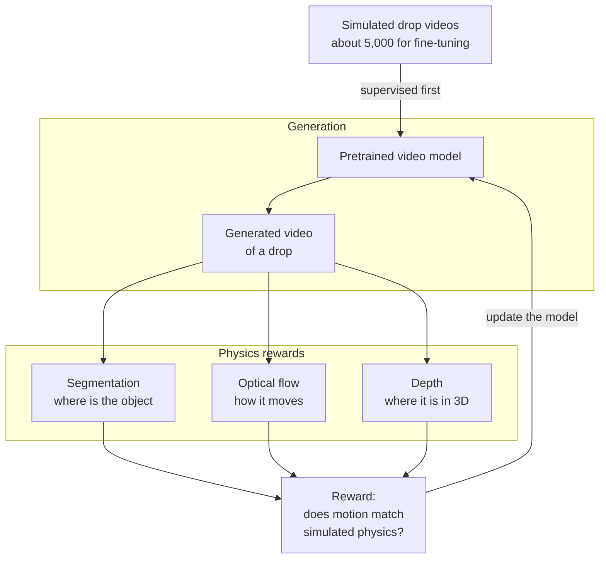

*By Gopi Krishna Tummala*

*Video models produce motion that looks right far more often than motion that is physically right. What the research shows about how much physics they learn, the four ways people are adding it, and how physical plausibility is measured.*

Part 8 of 8 in the [diffusion series](/posts/generative-ai/diffusion-from-molecules-to-machines). Previous: [Modern Video Models](/posts/generative-ai/modern-video-models-sora-veo-opensora).

---

Watch the fox from the earlier parts leap into the snowbank and it looks convincing. Look closer and things may be off: the arc of the jump flattens halfway through as if the fox briefly hovered, the snow barely moves where it lands, and a pine cone it brushed past is gone when the camera pans back. None of these break the illusion at a glance. All of them would matter if you wanted to use the video for anything other than watching.

That's the difference this post is about. A video model learns what motion usually looks like in its training data. Physics is a stricter standard: falling things accelerate, mass doesn't appear or vanish, hidden objects still exist. For entertainment, looking right is often enough. For training robots or testing self-driving software in generated scenes, a model that gets physics wrong teaches the wrong lessons.

## The idea in one picture

*Four approaches, from most explicit (write the equations in) to most implicit (learn from much more of the right data). Every one needs a benchmark to tell whether it worked.*

## How much physics do video models learn?

Less than their visual quality suggests, according to several careful studies.

- **[Physics-IQ](https://arxiv.org/abs/2501.09038)** (Motamed et al., 2025) tested models including Sora, Runway, Pika, Lumiere and Stable Video Diffusion on scenarios covering fluids, optics, solid mechanics, magnetism and heat. Its conclusion: physical understanding is "severely limited, and unrelated to visual realism." A model can produce beautiful video and still get the physics badly wrong.
- **[Kang et al. (2024)](https://arxiv.org/abs/2411.02385)** trained diffusion models on a simple 2D simulator of moving and colliding objects, where the true laws are known. Within the range of situations seen in training, the models generalized almost without error. Outside it, they failed. Rather than learning the laws, they showed "case-based" behavior, imitating the most similar training example, and they matched on surface features in a revealing order: color first, then size, then velocity, then shape. Their conclusion was that scaling alone isn't enough.
- **[VideoPhy](https://arxiv.org/abs/2406.03520)** asked people to judge whether generated videos of everyday activities followed the prompt and physical commonsense. The best model at the time, CogVideoX-5B, did both in only 39.6 percent of cases.

For our fox, case-based generalization explains the hovering arc. The model has seen many animals jumping, but not this particular jump, so it blends the nearest examples it knows rather than computing a trajectory.

## Approach 1: put the physics in the loss

If you know the equations, you can penalize violations of them during training. [Physics-informed diffusion models](https://arxiv.org/abs/2403.14404) (Bastek, Sun and Kochmann) add a loss term that measures how far a generated sample is from satisfying the governing equations, reducing that error by up to two orders of magnitude in their experiments.

The catch is scope. Their test cases were a fluid-flow problem and structural design, scientific fields where the equations are known and the data is the physical quantity itself. Natural video is different: you don't directly observe velocity, mass or force in pixels, and no single equation describes a fox landing in snow. This approach is strong for scientific and engineering generation and hard to apply to everyday video.

## Approach 2: let a simulator decide the motion

Another option is not to ask the video model to get physics right at all. Let a physics engine compute the motion, and let the generative model make it look real.

[PhysGen](https://arxiv.org/abs/2409.18964) does this for single images: it estimates the objects and their properties in a photo, runs a rigid-body simulation given an applied force, and uses a diffusion model to render and refine the resulting video. The motion is physically correct by construction.

A lighter version gives the model a physically meaningful control signal instead of a full simulation. [InterDyn](https://arxiv.org/abs/2412.11785) fine-tunes Stable Video Diffusion to take a mask showing how a driving object, usually a hand, moves. Notably, the object being pushed gets no control signal at all; the model has to infer how it responds, which tests and uses the physics it has absorbed. The trade-off across this family is generality: simulators cover the physics they implement, rigid bodies in PhysGen's case, and nothing else.

## Approach 3: post-train on simulated physics

The third approach treats physics like any other skill: show the model correct examples and reward accuracy. [PISA](https://arxiv.org/abs/2503.09595) studied the simplest possible case, objects dropping. Pretrained video models consistently failed at it, often leaving objects static or even moving them upward. Fine-tuning Open-Sora on a relatively small set of simulated drop videos, about 5,000 samples, was enough to produce realistic falling. The authors then added Object Reward Optimization, rewards computed from segmentation, optical flow and depth that score whether objects move as they should.

*Fine-tune on simulated examples, then refine with rewards that measure object motion. The same post-training pattern as aesthetics and prompt-following, applied to physics.*

The limits match Kang et al.'s findings: the model improved inside the kind of scenarios it was trained on and degraded outside them. It's the same reinforcement learning pattern described in [The Training Lifecycle](/posts/generative-ai/pre-training-post-training-video-diffusion#post-training-from-capable-to-good), with physics as the reward.

## Approach 4: world foundation models

The broadest approach is to build models specifically for physical AI and train them on far more relevant video. NVIDIA's [Cosmos](https://arxiv.org/abs/2501.03575) platform curated about 100 million clips from roughly 20 million hours of raw video, and trained both diffusion and autoregressive world models on them. They're meant as starting points: pre-trained on general physical scenes, then post-trained for specific uses such as camera control, robotic manipulation and autonomous driving.

This is where physics-aware video meets robotics and driving. A world model that predicts what the camera will see next, given an action, can generate rare training scenarios or let a planner imagine consequences before acting, as described in [Module 9](/posts/robotics/autonomous-stack-module-9-foundation-models#imagining-the-future-before-acting) and the closed-loop simulation section of [Vision-Language-Action Models](/posts/robotics/vla-models-data-architecture-evaluation#evaluation-the-hard-part). The bar there is high. A driving simulator whose generated pedestrians move implausibly will train and test the car on the wrong world.

## Measuring physical plausibility

Physics needs its own benchmarks, because standard video metrics reward appearance:

- **[Physics-IQ](https://arxiv.org/abs/2501.09038)** compares generated continuations with real recorded outcomes across physical principles.
- **[VideoPhy](https://arxiv.org/abs/2406.03520)** uses human judgments of physical commonsense in everyday activities, with an automatic evaluator trained to approximate them.
- **[VBench-2.0](https://arxiv.org/abs/2503.21755)** extends the VBench suite from Part 4 with dimensions for physics and commonsense, alongside human fidelity, controllability and creativity.

Each is partial. The most reliable test is still the one closest to the use: if the video will train a robot, measure whether the robot trained on it works.

## Where the series ends

Across eight parts, the same idea, add noise and learn to remove it, went from painting a fox to filming it, to moving a robot arm, to simulating the world. The last step is the least finished. Diffusion models are excellent at looking right. Making them reliably right about physics is an open problem, and the four approaches here are best seen as complementary: equations where they're known, simulators where they're cheap, post-training where data can be generated, and scale for everything else.

## What I'd remember

- **Looking right isn't being right.** Visual realism and physical understanding are largely unrelated in current models.
- **Models generalize by case, not by law.** Inside the training distribution they're accurate; outside, they imitate the nearest example.
- **Four ways to add physics.** Physics losses, simulators in the loop, post-training with physics rewards, and world foundation models.
- **Small amounts of simulated data help.** PISA needed about 5,000 simulated drops to fix falling objects.
- **Measure physics directly, ideally by downstream use.** Appearance metrics won't catch it.

## Where to go next

- [Diffusion Foundations](/posts/generative-ai/diffusion-from-molecules-to-machines), the start of the series, with the full list of parts.
- [Vision-Language-Action Models](/posts/robotics/vla-models-data-architecture-evaluation), for where world models and closed-loop simulation meet robot and driving policies.
- Papers: [Physics-IQ](https://arxiv.org/abs/2501.09038), [How Far is Video Generation from World Model](https://arxiv.org/abs/2411.02385), [PISA](https://arxiv.org/abs/2503.09595), [Cosmos](https://arxiv.org/abs/2501.03575).

Previous: [Modern Video Models](/posts/generative-ai/modern-video-models-sora-veo-opensora). Back to the start: [Diffusion Foundations](/posts/generative-ai/diffusion-from-molecules-to-machines).

**Questions to sit with**

1. If a video model reproduces training scenarios accurately but fails on new ones, how would you tell whether it learned physics?
2. When is a simulator in the loop worth giving up generality?
3. For a driving simulator built on a world model, what physical errors would worry you most, and how would you test for them?
