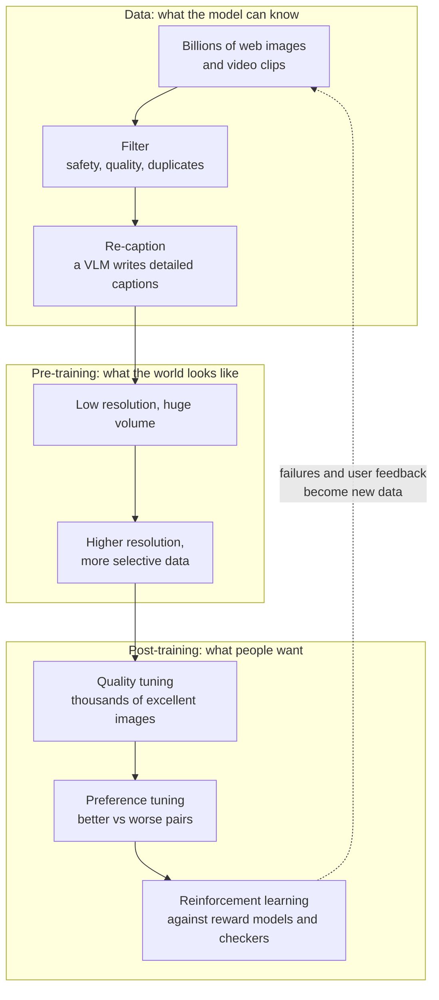

*By Gopi Krishna Tummala*

*How an image or video diffusion model goes from raw web data to a product: curating and re-captioning data, pre-training from low to high resolution, then quality tuning, preference tuning and reinforcement learning.*

Part 5 of 8 in the [diffusion series](/posts/generative-ai/diffusion-from-molecules-to-machines). Previous: [Video Diffusion](/posts/generative-ai/video-diffusion-fundamentals). Next: [Diffusion for Action](/posts/generative-ai/diffusion-for-action-trajectories-policy).

---

The first four parts explained what a diffusion model is and how it generates. None of that produces a good fox picture without the right training. A model trained only on raw web images with their raw captions can draw a fox, but it may not put it in snow when asked, may make it look like a stock photo from 2009, and may fail entirely at "at night."

Training happens in three phases that improve different things. **Data preparation** decides what the model can know. **Pre-training** teaches it what the world looks like. **Post-training** teaches it what people want. This post walks through each, with the techniques that labs have published.

## The idea in one picture

*Each phase uses less data than the one before and changes the model less, but post-training is often what users notice most.*

## Data: most of the work

Image models were first trained on web-scale image-text pairs. [LAION-5B](https://arxiv.org/abs/2210.08402), with 5.85 billion pairs scraped from the web, made open models like Stable Diffusion possible. It also showed the risks of scale: in December 2023 it was taken offline after researchers found links to child sexual abuse material, and it was re-released in 2024 as a cleaned version, Re-LAION-5B. Filtering isn't a nicety.

Two practices now define a good data pipeline.

**Filtering in stages.** Remove unsafe content, duplicates, tiny or corrupt images, and low-quality ones using learned aesthetic and quality scores. Google's [Imagen 3 paper](https://arxiv.org/abs/2408.07009) also removes AI-generated images, so the model doesn't learn their artifacts. For video, add scene-cut splitting, motion scoring and removal of static clips; [Stable Video Diffusion](https://arxiv.org/abs/2311.15127) showed that a carefully curated video set beat simply using more video.

**Re-captioning.** Web captions are short, wrong or empty: a fox photo might be labeled "IMG_4521.jpg." OpenAI's [DALL·E 3 report](https://cdn.openai.com/papers/dall-e-3.pdf) showed that replacing them with detailed synthetic captions from a captioning model sharply improved how well the model follows prompts. Now nearly every lab uses a vision-language model to write a detailed caption, often several of different lengths, for every training image or clip. That's also why production systems [rewrite short user prompts](/posts/generative-ai/multi-stage-generation-pipelines#stage-2-rewrite-and-expand-the-prompt) before generation: to match the long captions the model was trained on.

The [Multimodal Atlas](/posts/generative-ai/multimodal-foundation-models-end-to-end#most-of-the-work-is-data) covers these data pipelines in more detail.

## Pre-training: low resolution first

Pre-training is where the model learns what foxes, snow and night look like, and how text maps to them. Two choices shape it.

**A resolution curriculum.** Training starts at low resolution, often 256×256, which has a sixteenth of the pixels of 1024×1024 and so is far cheaper per image. Composition and concepts are learned there, on huge volumes of data. Later stages raise the resolution on smaller, more selective data, where the model learns fur and snow texture. Video models add a step before that: train on images first, then mix in short low-resolution clips, then longer and sharper ones, as Meta's [Movie Gen](https://arxiv.org/abs/2410.13720) describes.

**Weighting noise levels.** Every training example uses a randomly chosen noise level, and how those levels are weighted matters. Very noisy steps are nearly impossible to learn from, and nearly clean ones are trivially easy; the middle carries most of the useful signal. [Min-SNR weighting](https://arxiv.org/abs/2303.09556) (Hang et al., 2023) caps how much the easy, low-noise steps can dominate the loss, which they found made training converge several times faster. Stable Diffusion 3's [rectified flow work](https://arxiv.org/abs/2403.03206) similarly samples middle noise levels more often. A related fix from [Part 1](/posts/generative-ai/diffusion-from-molecules-to-machines#the-noise-schedule-matters-more-than-it-looks) ensures the last step is pure noise, so the model can make a fox truly at night.

Large runs also use the infrastructure covered in the MLOps series: sharded training ([Training Frameworks](/posts/mlops/hidden-engine-of-ai)), streaming data pipelines ([Ray Data](/posts/mlops/ray-field-guide-core-to-production#ray-data-streaming-the-pipeline) is common for video curation), and frequent checkpoints.

## Post-training: from capable to good

A pre-trained model knows a lot but has no particular taste. Post-training typically has three steps.

**Quality tuning.** Fine-tune on a small set of exceptional images. Meta's [Emu](https://arxiv.org/abs/2309.15807) found that a few thousand carefully selected, highly aesthetic images noticeably improved visual appeal while keeping the model's range. It's the diffusion equivalent of supervised fine-tuning: a little very good data goes a long way.

**Preference tuning.** People find it easier to say which of two images is better than to describe a perfect one. [Diffusion-DPO](https://arxiv.org/abs/2311.12908) (Wallace et al., 2023) adapted Direct Preference Optimization, from language models, to diffusion. It trains on pairs of images for the same prompt where people preferred one, without a separate reward model. It used the Pick-a-Pic dataset of human preferences, and fine-tuning SDXL with it improved both visual appeal and prompt-following in human evaluations.

**Reinforcement learning against rewards.** When a quality can be scored automatically, the model can optimize it directly. [DDPO](https://arxiv.org/abs/2305.13301) (Black et al., 2023) treated each denoising step as an action and optimized rewards like aesthetic scores and prompt alignment. [Flow-GRPO](https://arxiv.org/abs/2505.05470) applied the group-relative approach from language models, explained in [Post-Training](/posts/mlops/modern-post-training-peft-2026#reinforcement-learning-with-rewards-you-can-check), to flow-matching models, using checkers like object detectors that can verify "one fox, in snow." Reward models trained on human ratings, such as [ImageReward](https://arxiv.org/abs/2304.05977), are common signals.

The danger in this last step is reward hacking. Optimize a single aesthetic score and every fox comes out oversaturated and glossy. Teams use several rewards at once, keep the model close to where it started, and check samples by eye.

## Watching training health

A few signals catch most problems early:

- **Loss and gradient norm.** A sudden spike usually means instability. Gradient clipping, a learning-rate warmup and lower learning rates are the standard responses.
- **EMA weights.** Most diffusion models generate from an exponential moving average of the weights rather than the latest weights, which gives smoother, better samples. Evaluate the EMA model, not the raw one.
- **Fixed-prompt samples.** Generate the same prompts and seeds at regular checkpoints and look at them. Automated metrics like FID move slowly; a sudden shift in color or composition is visible immediately.

## What I'd remember

- **Data decides what's possible.** Filter hard, and re-caption everything with a VLM.
- **Pre-train cheap, then sharp.** Low resolution and huge volume first, then higher resolution on better data; images before video.
- **Weight the useful noise levels.** Min-SNR and middle-heavy sampling speed up training.
- **Post-train in three steps.** Quality tuning, preference tuning, then reinforcement learning against rewards.
- **Beware reward hacking.** Several rewards, a leash to the original model, and human spot checks.

## Where to go next

- [Diffusion for Action](/posts/generative-ai/diffusion-for-action-trajectories-policy), the next part: the same recipe applied to robot motion.
- [The Multimodal Atlas](/posts/generative-ai/multimodal-foundation-models-end-to-end#the-whole-lifecycle-side-by-side), for this lifecycle next to those of vision-language and video models.
- Papers: [Emu](https://arxiv.org/abs/2309.15807), [Diffusion-DPO](https://arxiv.org/abs/2311.12908), [DDPO](https://arxiv.org/abs/2305.13301), [Min-SNR](https://arxiv.org/abs/2303.09556).

Previous: [Video Diffusion](/posts/generative-ai/video-diffusion-fundamentals). Next: [Diffusion for Action](/posts/generative-ai/diffusion-for-action-trajectories-policy).

**Questions to sit with**

1. Why does re-captioning training data change what a user's prompt needs to look like?
2. Why might a few thousand curated images change a model more visibly than a billion more web images?
3. If every image starts looking glossy and oversaturated after RL, what went wrong, and what would you change?
