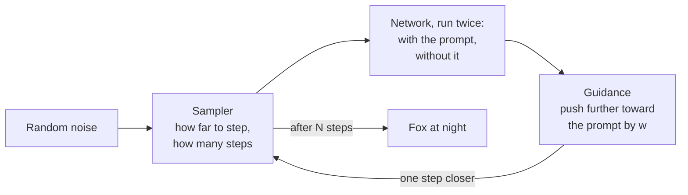
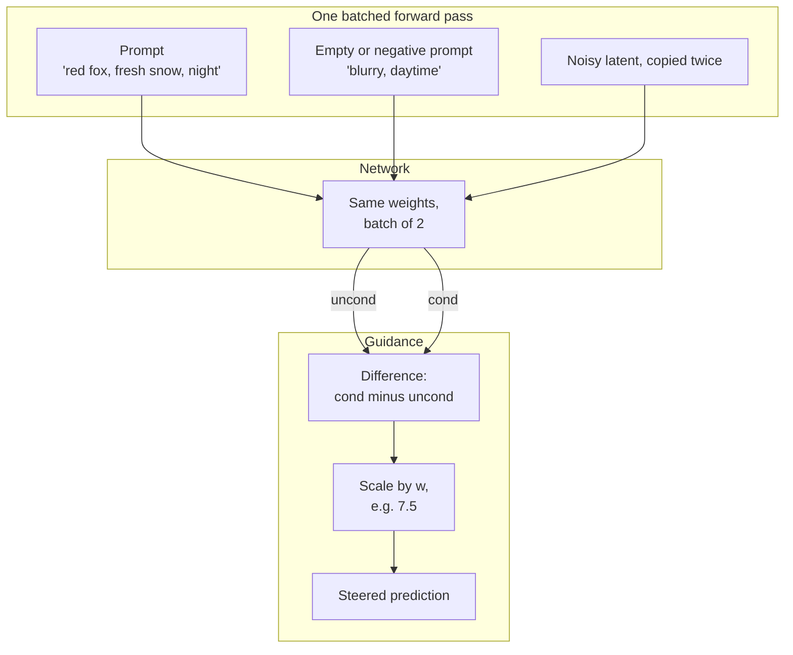

*By Gopi Krishna Tummala*

*A trained diffusion model is a direction-finder, not an image generator. Samplers decide how to walk from noise to an image, and guidance decides how hard to steer toward the prompt.*

Part 3 of 8 in the [diffusion series](/posts/generative-ai/diffusion-from-molecules-to-machines). Previous: [Image Diffusion: From U-Net to DiT](/posts/generative-ai/image-diffusion-models-unet-to-dit). Next: [Video Diffusion](/posts/generative-ai/video-diffusion-fundamentals).

---

Our model from Parts [1](/posts/generative-ai/diffusion-from-molecules-to-machines) and [2](/posts/generative-ai/image-diffusion-models-unet-to-dit) is trained. Give it a noisy latent and the prompt "a red fox in fresh snow, at night," and it says which way the noise lies. That's all it does. Turning that into a finished image involves two separate decisions, and they explain most of the knobs in any image generator's settings.

The first is the **sampler**: how big a step to take each time, how many steps, and whether to add fresh randomness along the way. The second is **guidance**: how strongly to push toward the prompt rather than toward any plausible image. Get the sampler wrong and the fox is blurry or noisy. Get guidance wrong and it's either a generic snowy scene or an oversaturated cartoon.

## The idea in one picture

*Every step: ask the network, steer with guidance, move. The sampler sets the number and size of steps; guidance sets the direction's emphasis.*

## Samplers: from 1,000 steps to a few dozen

**DDPM sampling** follows the training process backward literally. At each step it removes the predicted noise and adds a bit of fresh random noise, a process called ancestral sampling. It works, but [DDPM](https://arxiv.org/abs/2006.11239) used 1,000 steps, run one after another; each depends on the last, so they can't be parallelized.

**DDIM** ([Song et al., 2021](https://arxiv.org/abs/2010.02502)) showed that the same trained model admits a deterministic sampler that adds no fresh noise. That allows skipping: 50 steps instead of 1,000, with little loss in quality. Being deterministic has a useful side effect: the same starting noise always gives the same image, and you can run the process in reverse to find the noise that produces a given real photo. That "inversion" is the basis of many image-editing techniques.

**Viewing generation as a differential equation** made the next jump possible. [Song et al.](https://arxiv.org/abs/2011.13456) showed that sampling is equivalent to solving an ordinary differential equation from noise to data, so decades of numerical methods apply. Higher-order solvers like [DPM-Solver](https://arxiv.org/abs/2206.00927) and [DPM-Solver++](https://arxiv.org/abs/2211.01095) look at how the direction is changing, not just where it points, and produce good images in roughly 10 to 25 steps. [Karras et al. (2022)](https://arxiv.org/abs/2206.00364) mapped out the design choices, step-size schedules and solver order among them, and showed how much quality depended on them.

**Deterministic or stochastic?** Deterministic samplers are faster and reproducible. Adding a little noise back each step can correct accumulated errors and sometimes gives better detail at higher step counts. For our fox, a deterministic solver at 20 to 30 steps is the usual choice, and the step count is the main latency lever. Fewer steps save time but tend to show up as smeared fur or grainy skies. Going below about ten steps needs a [distilled model](/posts/generative-ai/diffusion-distillation-fewer-steps).

Flow-matching models (Part 1) change this picture somewhat: their paths are straighter by construction, so simple solvers like Euler's method go further with fewer steps.

## Guidance: following the prompt, on purpose

A conditional model trained on captioned images learns to generate images *plausible* for a caption. Left alone, "a red fox in fresh snow, at night" often produces something reasonable but generic: maybe dusk instead of night, maybe the fox is small and off to the side. Guidance sharpens the result toward what's distinctive about the prompt.

**Classifier guidance** came first. [Dhariwal and Nichol (2021)](https://arxiv.org/abs/2105.05233), in the paper that showed diffusion beating GANs, trained a separate classifier on noisy images and used its gradient to push samples toward a class. It worked, but needed an extra noise-aware classifier.

**Classifier-free guidance** ([Ho and Salimans, 2022](https://arxiv.org/abs/2207.12598)) removed the classifier. During training, the prompt is randomly dropped some of the time, so a single model learns both the conditional prediction (with the prompt) and the unconditional one (without it). At sampling time, run both and extrapolate past the conditional prediction, away from the unconditional one:

$$\hat{\epsilon} = \epsilon_{\text{uncond}} + w\,(\epsilon_{\text{cond}} - \epsilon_{\text{uncond}})$$

The difference between the two predictions is "what the prompt adds." Scaling it by $w$ greater than 1 exaggerates it. (The original paper writes this with $1 + w$ in place of $w$; it's the same rule with the scale shifted by one, so check which convention a codebase uses.)

*Running both predictions as a batch of two hides most of the latency, but it still doubles the compute per step, which is why guidance distillation exists.*

Three practical consequences:

- **Negative prompts** replace the empty, unconditional prompt with one describing what you don't want, "blurry, daytime." The extrapolation then pushes away from those features specifically.
- **The scale trades variety for adherence.** Low $w$ gives diverse, sometimes off-prompt images. Higher values follow the prompt closely but narrow the variety, and very high values oversaturate colors and over-sharpen. Stable Diffusion's common default of 7.5 sits in the middle. If every "fox in snow" looks the same, lower the scale before blaming the model.
- **Guidance doesn't have to apply everywhere.** Fixes for oversaturation include rescaling the guided prediction ([Lin et al., 2024](https://arxiv.org/abs/2305.08891)) and applying guidance only in the middle range of noise levels, which [Kynkäänniemi et al. (2024)](https://arxiv.org/abs/2404.07724) found improves both quality and variety.

Guidance costs a second network pass every step. [Diffusion Distillation](/posts/generative-ai/diffusion-distillation-fewer-steps#family-1-follow-the-teachers-path) explains how guidance distillation folds both passes into one, and the loss it uses.

## What I'd remember

- **The model gives directions; the sampler walks.** Step count and step rule are inference choices, not training ones.
- **Deterministic samplers enable fewer steps and inversion.** DDIM opened the door; ODE solvers took it to 10 to 25 steps.
- **Classifier-free guidance extrapolates from unconditional to conditional.** One model, trained with the prompt sometimes dropped.
- **Guidance scale trades variety for prompt-following.** Too high oversaturates; rescaling and limiting where guidance applies help.
- **Guidance doubles the cost per step.** Batching hides latency, not compute.

## Where to go next

- [Video Diffusion](/posts/generative-ai/video-diffusion-fundamentals), the next part.
- [Diffusion Distillation](/posts/generative-ai/diffusion-distillation-fewer-steps), for going from dozens of steps to a few.
- Papers: [DDIM](https://arxiv.org/abs/2010.02502), [Classifier-Free Guidance](https://arxiv.org/abs/2207.12598), [DPM-Solver](https://arxiv.org/abs/2206.00927), [Elucidating the Design Space (EDM)](https://arxiv.org/abs/2206.00364).

Previous: [Image Diffusion: From U-Net to DiT](/posts/generative-ai/image-diffusion-models-unet-to-dit). Next: [Video Diffusion](/posts/generative-ai/video-diffusion-fundamentals).

**Questions to sit with**

1. Why does a deterministic sampler make image editing by inversion possible?
2. What happens to the variety of fox images as the guidance scale rises, and why?
3. If guidance is batched into one forward pass, why is it still expensive?
