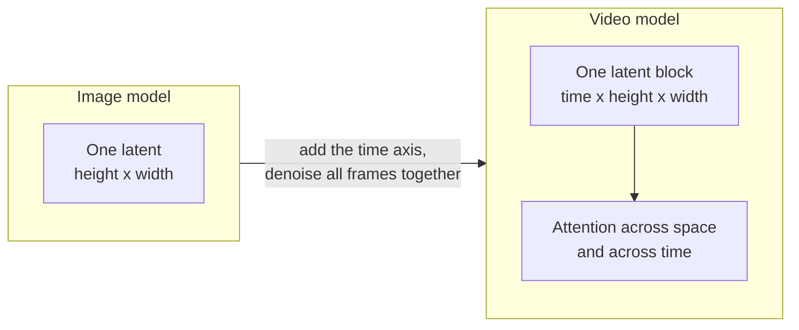
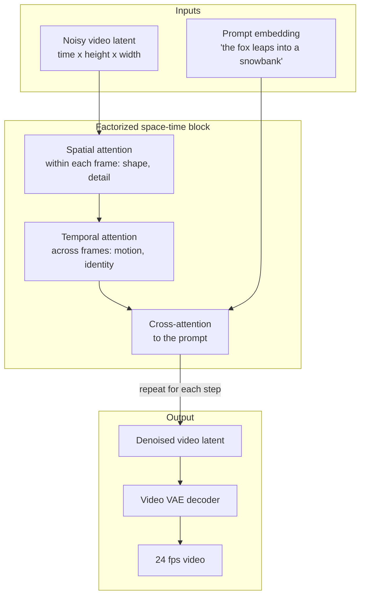

*By Gopi Krishna Tummala*

*A video model is an image model that also has to keep things consistent and moving plausibly over time, at many times the cost. How video diffusion grew from image models with temporal layers to full space-time transformers.*

Part 4 of 8 in the [diffusion series](/posts/generative-ai/diffusion-from-molecules-to-machines). Previous: [Sampling and Guidance](/posts/generative-ai/sampling-guidance-diffusion-models). Next: [The Training Lifecycle](/posts/generative-ai/pre-training-post-training-video-diffusion).

---

The image model from the first three parts can paint a red fox in fresh snow. Now ask for five seconds of the fox leaping into a snowbank. Generate 120 separate images and play them in order, and you get a flipbook from a nervous artist: the fox's coat changes shade from frame to frame, the trees in the background shift, and the leap doesn't follow any arc.

Video diffusion solves three problems at once. **Consistency:** the same fox, the same trees, in every frame. **Motion:** the leap has to look physically plausible. **Cost:** five seconds of video is over a hundred images, and the model has to reason about all of them together. This post covers how models handle each.

## The idea in one picture

*The key move: denoise the whole clip as one block, so every frame can see the others while it's being made.*

## Why video is expensive

Start with token counts. A video VAE typically compresses time by 4 and each spatial side by 8, and a transformer then groups latent cells into patches. As the [Multimodal Atlas](/posts/generative-ai/multimodal-foundation-models-end-to-end#two-kinds-of-visual-tokens) works out, five seconds of 720p video at 24 frames per second still comes to roughly 110,000 tokens, against about 4,000 for one 1024×1024 image. Attention cost grows with the square of the token count, so the jump from image to video is far more than a hundredfold in compute, at every sampling step.

Almost every design choice in video diffusion is a way to spend that compute where it matters.

## First approach: teach an image model to move

The earliest successful video models didn't start from scratch. They took a trained text-to-image model and added layers that operate across time:

- **[Make-A-Video](https://arxiv.org/abs/2209.14792)** (Meta, 2022) extended an image model with temporal layers trained on unlabeled video, learning what the world looks like from image-text pairs and how it moves from video alone.
- **[AnimateDiff](https://arxiv.org/abs/2307.04725)** (2023) trained a plug-in motion module that could be added to existing personalized Stable Diffusion models, animating them without retraining.
- **[Stable Video Diffusion](https://arxiv.org/abs/2311.15127)** (Stability AI, 2023) inserted temporal convolution and attention layers into a Stable Diffusion U-Net, and its report made data curation the main story: training on a carefully filtered video set mattered more than architecture tweaks.

The appeal is reuse: the image model already knows what foxes and snow look like, so the new layers only have to learn motion. The weakness is that motion is bolted on, and long-range consistency is limited.

## Attention across space and time

Inside a video model, two kinds of attention do different jobs. Spatial attention relates positions within a frame: the fox's head to its tail. Temporal attention relates the same region across frames: the fox's head now to its head a moment later. That's what keeps the coat the same color and makes the leap follow a path.

*Factorized attention runs space and time separately. Newer models replace both with one full attention over every space-time token.*

There are two ways to arrange them:

- **Factorized:** attend within each frame, then across frames at each position, as in the diagram. With $T$ frames of $S$ tokens each, the cost is about $T \cdot S^2 + S \cdot T^2$ instead of $(T \cdot S)^2$. That's a large saving, at the price of never letting a token in one frame directly attend to a different position in another frame.
- **Full space-time attention:** treat every token in the clip as one sequence. OpenAI's [Sora report](https://openai.com/index/video-generation-models-as-world-simulators/) described video as "spacetime patches," and open models like [CogVideoX](https://arxiv.org/abs/2408.06072) and [HunyuanVideo](https://arxiv.org/abs/2412.03603) use full 3D attention. It's the most expensive option and the most capable, because a fox moving across the frame is a different position in every frame, exactly what factorized attention handles poorly.

With efficient attention kernels and large clusters, the field has largely moved to full attention for its best models.

## Compressing time in the VAE

An image VAE applied to each frame separately produces flicker, because nothing ties neighboring frames together, and it doesn't reduce the number of frames at all. Modern video models use a 3D VAE that compresses time as well as space, typically four frames into one latent frame. Most are causal: the first frame is encoded on its own and later frames only look backward. That lets the same VAE, and the same diffusion model, handle a single image as a one-frame video, so models can train on images and video together.

## Whole clips, keyframes and long videos

How much of the video is generated at once is another trade-off.

**Keyframes, then fill in.** Earlier systems generated a few distant keyframes and then filled in the frames between them with separate temporal super-resolution models. Google's [Lumiere](https://arxiv.org/abs/2401.12945) argued this makes globally coherent motion hard, since no single model sees the whole movement, and generated the full duration of the clip in one pass instead.

**Whole clips** are now standard for the length a model can handle, typically several seconds. The fox's entire leap is denoised together, so the arc is coherent.

**Longer videos** need extension. Common approaches generate overlapping chunks and condition each new chunk on the end of the last, or generate frames in order with causal attention. The second approach is what makes real-time streaming possible, and it depends on distillation to run fast: see [Diffusion Distillation](/posts/generative-ai/diffusion-distillation-fewer-steps#video-from-minutes-to-streaming). Both struggle with things that leave the frame and come back, because the model's memory of earlier frames is limited. A rock the fox jumps past can be gone when the camera returns.

## Measuring video

- **FVD** (Fréchet Video Distance, [Unterthiner et al.](https://arxiv.org/abs/1812.01717)) extends FID to video, comparing generated and real clips using features from a network trained on video. It's the standard single number, and it's coarse.
- **[VBench](https://arxiv.org/abs/2311.17982)** breaks quality into many separate dimensions, including subject consistency, background consistency, motion smoothness, how much motion there is at all, and prompt alignment. That separation matters, because a model can score well by barely moving.
- **Human preference** comparisons remain the deciding measure for frontier models.

## What I'd remember

- **Video is images plus consistency, motion and cost.** Token counts grow a hundredfold; attention cost grows faster.
- **Early models added temporal layers to image models.** Reuse what the model knows about appearance; learn only motion.
- **Factorized attention is cheap; full space-time attention is better.** The best current models use full attention.
- **Video VAEs compress time too.** Causal ones let images and video share one model.
- **Measure many dimensions.** FVD alone can reward videos that barely move.

## Where to go next

- [The Training Lifecycle](/posts/generative-ai/pre-training-post-training-video-diffusion), the next part: how video models are trained.
- [The Multimodal Atlas](/posts/generative-ai/multimodal-foundation-models-end-to-end#video-the-same-recipe-plus-time), for the video training curriculum.
- Papers: [Stable Video Diffusion](https://arxiv.org/abs/2311.15127), [Lumiere](https://arxiv.org/abs/2401.12945), [CogVideoX](https://arxiv.org/abs/2408.06072), [VBench](https://arxiv.org/abs/2311.17982).

Previous: [Sampling and Guidance](/posts/generative-ai/sampling-guidance-diffusion-models). Next: [The Training Lifecycle](/posts/generative-ai/pre-training-post-training-video-diffusion).

**Questions to sit with**

1. Why does factorized attention struggle with an object moving across the frame?
2. What does a causal video VAE make possible that a per-frame image VAE doesn't?
3. How could a video model score well on frame quality while being a poor video model?
