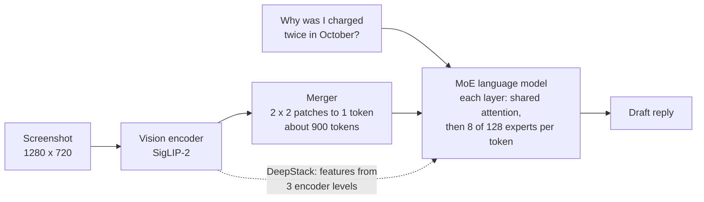
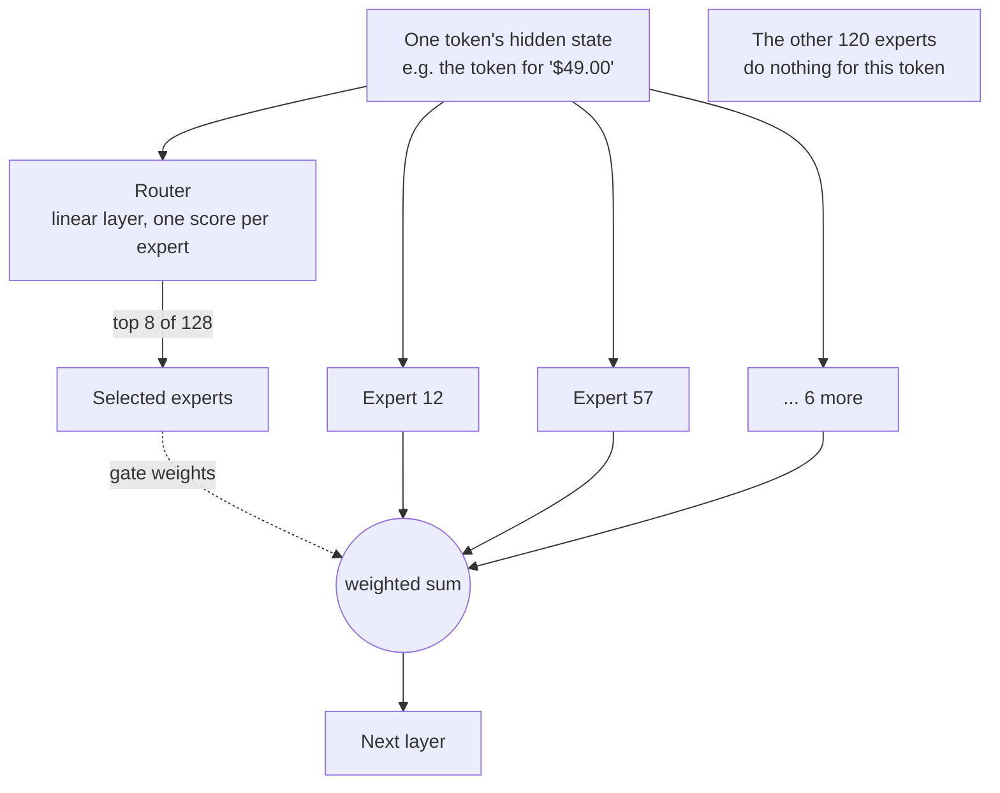
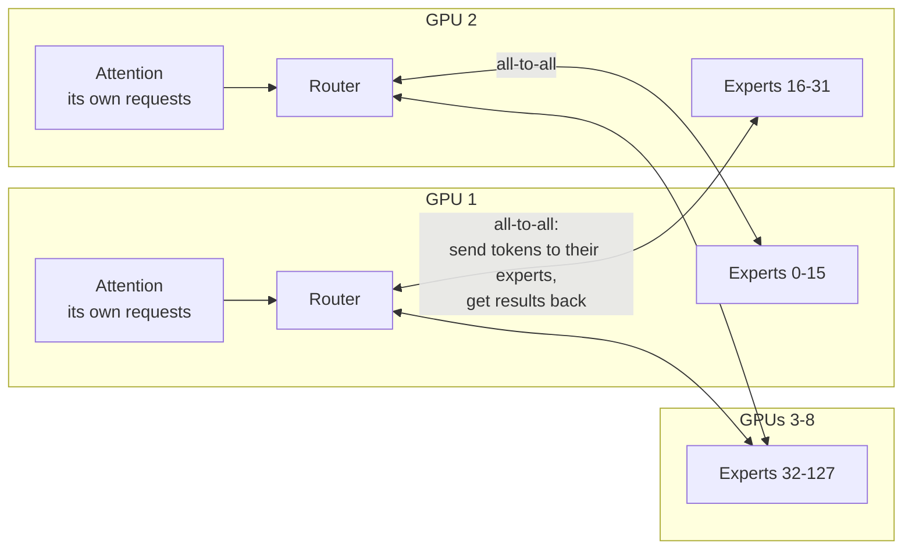

*By Gopi Krishna Tummala*

*How a Qwen-style vision-language model reads an image, how a mixture-of-experts layer sends each token to a few experts, how the router and experts are trained without collapsing, and what changes when you deploy it. Told through one support team and one screenshot.*

---

A customer attaches a screenshot of their billing dashboard to a support ticket and writes, "Why was I charged twice in October?" The support team wants a model that reads the screenshot, finds the two charges, notices that one is a pending authorization rather than a real charge, and drafts a reply. They want to run it on their own GPUs, because the screenshots contain customer data.

They pick Qwen3-VL-30B-A3B. The name already tells most of the story. It's a vision-language model (VL) with about 30 billion parameters, but only about 3 billion of them are used for any given token (A3B, "3B active"). That's possible because its language model is a mixture of experts (MoE): most layers contain many small networks, and a router picks a few of them for each token.

This post follows the screenshot through the model, then how it's trained, focusing on how the router learns and how experts come to differ, and ends with deployment. For the broader history of VLMs, see [When AI Sees and Speaks](/posts/computer-vision/vision-language-models-explained); for how VLMs, image and video models are trained in general, see [the Multimodal Atlas](/posts/generative-ai/multimodal-foundation-models-end-to-end).

## The idea in one picture



*Two ideas stacked together. The vision side turns pixels into a manageable number of tokens. The language side has 30B parameters of capacity but spends only about 3B on each token.*

## How a Qwen-style VLM reads the screenshot

Qwen3-VL follows the three-part shape most open VLMs use: a vision encoder, a small connector, and a language model ([Qwen3-VL report](https://arxiv.org/abs/2511.21631)).

**The vision encoder** is a SigLIP-2 vision transformer that the Qwen team kept training at dynamic resolution. It cuts the screenshot into 16×16-pixel patches at close to its native size instead of squashing it into a fixed square. That matters here: the amounts are small text that a 448×448 thumbnail would lose.

**The merger** is a two-layer MLP that folds each 2×2 group of patch features into one token, the same design as [Qwen2.5-VL](https://arxiv.org/abs/2502.13923). So each visual token covers a 32×32-pixel square, and our 1280×720 screenshot becomes roughly 900 tokens. That number is the main cost lever at serving time, and we'll come back to it.

Three newer details are worth knowing by name:

- **DeepStack:** features from three different depths of the vision encoder are added straight into the first three layers of the language model. Early encoder layers keep fine detail like edges and small glyphs; later ones keep meaning. This gives the language model both without adding any tokens.
- **Interleaved MRoPE:** position encodings carry three coordinates per visual token (time, height, width). Qwen3-VL spreads all three across the full range of rotation frequencies instead of giving each its own block, which helps with long videos.
- **Text timestamps:** for video, each group of frames is preceded by a plain-text time like `<3.0 seconds>`, so the model can answer "when does the error dialog appear?" in the same units people use.

The mixture-of-experts part lives entirely inside the language model.

## What a mixture-of-experts layer is

A transformer block has two halves: attention, where tokens look at each other, and a feed-forward network (FFN), where each token is processed on its own. The FFN holds most of a model's parameters. (If attention is new to you, [the transformer post](/posts/fundamentals/transformers-attention-mechanism) covers it.)

An MoE layer replaces that one FFN with many smaller FFNs, called experts, plus a router. Attention stays shared. For each token, the router, which is just a small linear layer, produces a score for every expert. The layer keeps the top few, runs the token through only those, and adds their outputs weighted by the router's scores:

$$y = \sum_{i \in \text{top-}k} g_i(x)\, E_i(x)$$

Here $E_i$ is expert $i$ and $g_i$ is its gate weight, the router's normalized score. In both Qwen3 MoE models each layer has 128 experts and picks 8 for every token ([Qwen3 report](https://arxiv.org/abs/2505.09388)).



*Every token picks its own experts, at every layer. The token for "$49.00" and the token for "October" may take entirely different paths through the model.*

The payoff is that capacity and cost come apart. The model stores 30B parameters of knowledge, but each token's compute is closer to that of a 3B model. The same split shows up across the field: [Mixtral 8x7B](https://arxiv.org/abs/2401.04088) has about 47B parameters with 13B active (2 of 8 experts per token), and [DeepSeek-V3](https://arxiv.org/abs/2412.19437) has 671B with 37B active.

The catch is memory. All 30B parameters have to sit in GPU memory, because you don't know in advance which experts the next token will want. MoE saves compute, not storage.

## How the router and experts learn

At the start of training, the experts are interchangeable and the router is random. Specialization has to emerge from gradients, and the way it can go wrong explains almost every design choice in modern MoE models.

**What gets trained.** Only the chosen experts receive gradients for a given token, since the others didn't touch it. The router learns through the gate weights: if expert 57 helped reduce the loss for this token, the gradient raises the router's score for expert 57 on tokens like it. Over billions of tokens, each expert gets better at the tokens it receives, and the router gets better at sending it those tokens.

**The failure mode is collapse.** That loop is a rich-get-richer system. An expert that happens to be slightly better early gets more tokens, so it improves faster, so it gets even more tokens. Left alone, a handful of experts take all the work, the rest never train, and you've paid for 128 experts to get the quality of a few. It's also a hardware problem: the GPU holding a popular expert becomes everyone's bottleneck.

The fixes have evolved over several generations of models:

- **An auxiliary balance loss.** The classic fix, from the [Switch Transformer](https://arxiv.org/abs/2101.03961), adds a small penalty that is lowest when tokens are spread evenly. For each expert it multiplies the fraction of tokens actually sent to it, $f_i$, by the router's average probability for it, $P_i$:

  $$\mathcal{L}_{\text{balance}} = \alpha \, N \sum_{i=1}^{N} f_i \, P_i$$

  With $N$ experts and a small weight $\alpha$, this pushes the router away from favorites. The trade-off is that it also fights the router when uneven routing is actually correct.
- **Capacity limits.** Early systems ([GShard](https://arxiv.org/abs/2006.16668), Switch) gave each expert a fixed number of slots per batch and dropped tokens that overflowed, passing them through unchanged. Newer models like DeepSeek-V3 drop no tokens at all.
- **A router z-loss.** [ST-MoE](https://arxiv.org/abs/2202.08906) added a penalty on very large router scores, which made big MoE runs much less prone to sudden loss spikes.
- **Balancing without a loss.** DeepSeek-V3 adds a per-expert bias to the router's scores, used only to pick the top experts and never in the gate weights. After each step, overloaded experts get their bias lowered slightly and idle ones get it raised. Balance is enforced by nudging selection, not by adding a competing objective to the loss.
- **Balancing over the whole batch.** The Qwen team found that measuring balance inside each small micro-batch was too strict. A micro-batch might be all code, and forcing even routing within it spreads code tokens across every expert, preventing any from specializing. Computing the balance loss over the global batch fixed that and improved both quality and specialization ([Qiu et al., 2025](https://arxiv.org/abs/2501.11873)). Qwen3's MoE models use it.

Two structural choices also shape what experts learn. **Fine-grained experts** use many small experts instead of a few big ones, so a token's 8 choices can combine in far more ways. **Shared experts**, from [DeepSeekMoE](https://arxiv.org/abs/2401.06066), are one or more experts every token always uses, to hold common knowledge so routed experts don't each have to relearn it. DeepSeek-V3 has one shared expert; Qwen2.5-MoE used them; Qwen3 dropped them.

**What do experts actually specialize in?** Less than the name suggests. When the Mixtral team looked at routing, they found no clear assignment of topics like biology or math to experts; routing followed syntax and token types more than subject. For our screenshot there's no "billing expert," just experts that tend to handle numbers, currency symbols and dates.

Training at this scale adds one more piece: **expert parallelism**. Experts are spread across GPUs, and after the router decides, every GPU sends each token's hidden state to whichever GPUs hold its experts and gets the results back, two all-to-all exchanges per MoE layer. DeepSeek-V3 limits each token to experts on at most 4 servers to keep that traffic bounded. The [Training Frameworks post](/posts/mlops/hidden-engine-of-ai#splitting-the-model-itself-tensor-and-pipeline-parallelism) covers the other ways of splitting a model.

## How Qwen3-VL is trained

The language model starts from a Qwen3 checkpoint, MoE layers and all, so the routing above has already been learned on text. The VLM training then adds vision in stages ([Qwen3-VL report](https://arxiv.org/abs/2511.21631)):

| Stage | What's trained | Data | Sequence length |
|---|---|---|---|
| 0. Alignment | Only the merger | 67B tokens of captions, visual knowledge, OCR | 8K |
| 1. Multimodal pre-training | Everything | About 1T tokens | 8K |
| 2. Long context | Everything | About 1T tokens | 32K |
| 3. Ultra-long context | Everything | 100B tokens, long video and documents | 256K |

Stage 0 is the important habit. A fresh merger produces garbage, and garbage gradients would damage the trained language model, so the merger trains alone first.

Post-training then shapes behavior, in three steps:

- **Supervised fine-tuning,** about 1.2 million examples, first at 32K context and then extended to 256K, with separate data formats for the Instruct models and for the Thinking models that reason step by step before answering.
- **Strong-to-weak distillation:** a stronger teacher model's outputs on text-only data are used to fine-tune the language model, which transfers reasoning ability cheaply.
- **Reinforcement learning** with rewards that can be checked automatically, such as exact answers to math questions. The broader ideas are in [Post-Training](/posts/mlops/modern-post-training-peft-2026#reinforcement-learning-with-rewards-you-can-check) and [the reinforcement learning post](/posts/fundamentals/reinforcement-learning-intuition-to-algorithms).

For our support team, the lesson is about their own fine-tuning. When adapting a model like this with LoRA on their tickets, a cautious default is to leave the router alone. A small, narrow dataset can easily push routing toward a few experts, which is exactly the collapse the pre-training recipe worked hard to avoid.

## Deploying it

The team starts with one GPU and [vLLM](/posts/mlops/vllm-trilogy-of-modern-llm-scaling):

```bash
vllm serve Qwen/Qwen3-VL-30B-A3B-Instruct --max-model-len 32768
```

*Simplified; check the vLLM docs for your version's flags.*

Then they meet the things the model card doesn't emphasize.

**Memory goes by total parameters, speed goes by active ones.** At 16 bits, 30B parameters are about 60 GB. On an 80 GB GPU that leaves little room for the KV cache, so the team either uses an 8-bit (FP8) version at about 30 GB or splits the model across two GPUs. Once loaded, though, generation feels like a much smaller model. As the [Life of a Request post](/posts/mlops/life-of-a-tensor-production-inference#on-the-gpu-two-very-different-phases) explains, decoding is limited by how many bytes of weights each step reads, and a single request only reads its 8 experts per layer. With a large batch the picture changes: different requests hit different experts, so each step ends up reading most of them, but it also serves many tokens at once.

**Images are the hidden prefill cost.** Our screenshot is about 900 tokens before the question is even read, and a phone screenshot at full resolution can be several thousand. Every image token goes through prefill, which sets the time to the first word. Capping the image size in the processor at what the task actually needs is usually the single biggest latency win. For billing dashboards, the team keeps enough resolution to read amounts and no more.

**Very large MoE models need expert parallelism to serve.** For a model like Qwen3-VL-235B-A22B, or DeepSeek-V3, the experts are spread across many GPUs, just as in training:



*Expert parallelism for serving. Each GPU runs attention for its own share of requests, then exchanges tokens with the GPUs that hold the experts they picked.*

In vLLM this is the `--enable-expert-parallel` option, usually combined with data parallelism for attention, so each GPU keeps its own requests' KV cache while the experts are shared out ([vLLM expert-parallel guide](https://docs.vllm.ai/en/latest/serving/expert_parallel_deployment.html)). DeepSeek's own deployment shows how far this goes: prefill runs on units of 32 GPUs, and decode on units of 320 GPUs where most GPUs hold just one expert.

**Load balance becomes a serving problem too.** Real traffic isn't uniform. If most of the day's tickets are billing screenshots full of numbers, the experts that handle numbers run hot, and the GPUs holding them set the pace for everyone. Serving systems answer with redundant copies of popular experts: DeepSeek-V3 adds 32 extra expert copies in prefill and re-picks which experts to duplicate every few minutes from observed load, and vLLM has an expert-parallel load balancer that does the same. The all-to-all exchanges are also exactly the kind of data movement the [Custom Kernels post](/posts/mlops/custom-kernel-craze#math-is-cheap-memory-is-expensive) is about, which is why MoE dispatch kernels are a hot area.

For our support team, one or two GPUs are plenty; expert parallelism matters when the model or the traffic is ten times bigger.

## What I'd remember

- **A VLM is an encoder, a merger and a language model.** The merger's 2×2 folding sets how many tokens an image costs, roughly one per 32×32 pixels in Qwen3-VL.
- **MoE separates capacity from compute.** The router picks a few experts per token; all experts must still fit in memory.
- **Routing wants to collapse.** Balance losses, capacity limits, bias nudges and global-batch balancing all exist to keep every expert in use.
- **Experts aren't departments.** They specialize in kinds of tokens more than topics.
- **Train vision in stages.** Align the merger alone, then unfreeze everything, then extend context.
- **At serving time, watch image tokens and hot experts.** Cap resolution to what the task needs; spread and duplicate experts when scaling out.

## Where to go next

- [When AI Sees and Speaks](/posts/computer-vision/vision-language-models-explained), for how VLMs got here, from CLIP to LLaVA.
- [The Multimodal Atlas](/posts/generative-ai/multimodal-foundation-models-end-to-end#how-a-model-learns-to-see-and-talk), for VLM data and training alongside image and video generators.
- [LLM Serving with vLLM](/posts/mlops/vllm-trilogy-of-modern-llm-scaling) and [Life of a Request](/posts/mlops/life-of-a-tensor-production-inference), for the serving side.
- Papers: [Qwen3-VL](https://arxiv.org/abs/2511.21631), [Qwen3](https://arxiv.org/abs/2505.09388), [Switch Transformer](https://arxiv.org/abs/2101.03961), [DeepSeek-V3](https://arxiv.org/abs/2412.19437), and the Qwen team's [global-batch balancing](https://arxiv.org/abs/2501.11873).

**Questions to sit with**

1. Why can't an MoE model load only the experts it needs for the next token?
2. If you fine-tuned on a narrow dataset and the router started sending most tokens to three experts, what would you change?
3. For your own image workload, what's the smallest resolution that still gets the answer right, and how many tokens does it save?
