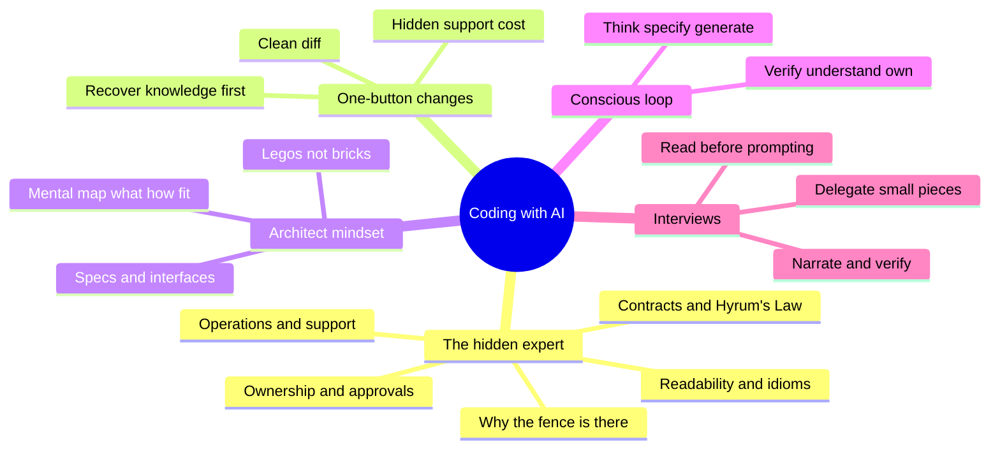
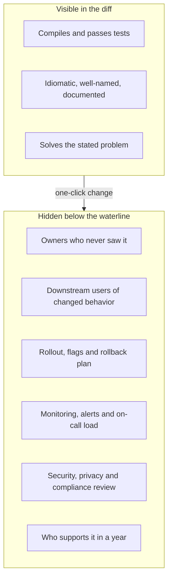
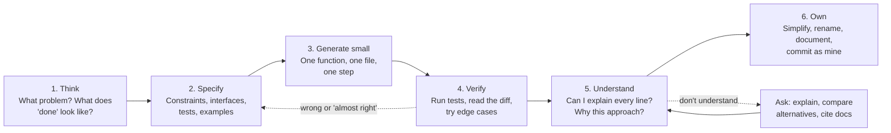
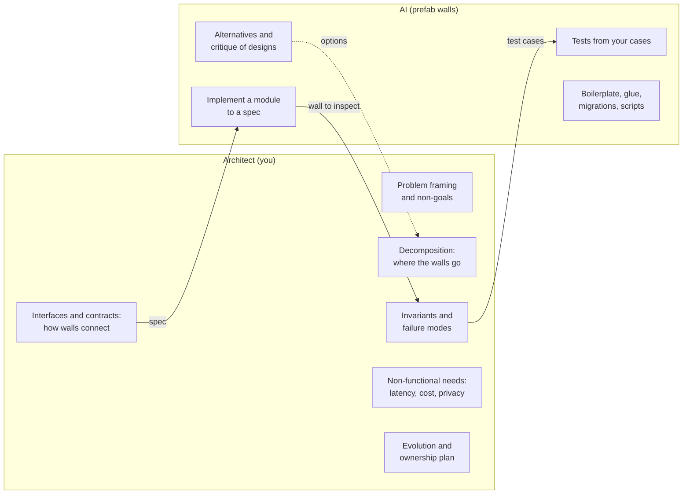
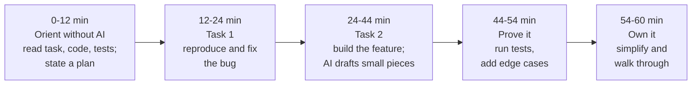

*By Gopi Krishna Tummala*

---

> **Who this is for.** Engineers who already use Copilot, Cursor, Claude Code or ChatGPT every day and have a nagging feeling: *"Am I getting better, or just getting faster at producing code I don't fully understand?"* And anyone preparing for the new generation of coding interviews where an AI assistant sits in the editor next to you.

**Quick jump:** [The hidden expert](#act-05-the-hidden-expert-how-software-engineering-actually-works) · [The evidence](#act-i-what-the-research-actually-says) · [The conscious loop](#act-ii-the-conscious-loop) · [Legos, not bricks](#act-ii5-legos-not-bricks-thinking-like-an-architect) · [Daily workflow](#act-iii-a-workflow-that-keeps-you-in-charge) · [Getting better, not worse](#act-iv-using-ai-to-get-better-not-worse) · [Mistakes](#act-v-the-mistakes-that-quietly-cost-you) · [AI-enabled interviews](#act-vi-the-ai-enabled-coding-interview) · [4-week prep plan](#act-vii-a-four-week-preparation-plan) · [ML-specific traps](#act-viii-for-ml-engineers-the-silent-bug-problem) · [Checklists](#checklists) · [Self-check](#check-yourself)

## Table of contents

---

## TL;DR

- **Software engineering is programming integrated over time.** Most of what makes a change safe lives *outside* the diff: who owns the code, which behaviors others depend on, why the odd-looking line is there, how it's rolled out and who gets paged. That knowledge accumulated as stories and lives in a few "hidden experts."
- **AI made a technically solid change one button away, but not the knowledge around it.** The cost moved from *writing* code to *reviewing, integrating and supporting* it. A clean diff can still break a contract, bypass an owner or land a pager on someone else.
- **Always build a mental map first:** what it does, roughly how, and how the pieces fit. Use AI to *recover* tribal knowledge (history, callers, contracts), then confirm it with the owners.
- **Think in Legos, not bricks.** Given a wall and a spec, AI will build the wall. Deciding where the walls go, which ones are load-bearing and how they connect is architecture, and it's still your job.
- **AI is an amplifier, not an equalizer.** Google's DORA 2025 report found that AI magnifies the strengths of good teams *and* the dysfunctions of struggling ones. The same is true for individuals: strong engineers get stronger; engineers who outsource their thinking get weaker.
- **Feeling faster is not being faster.** In METR's 2025 randomized trial, experienced open-source developers were **19% slower** with AI tools on their own repos, yet *believed* they were ~20% faster. Newer tools may well change the number; the perception gap is the lesson.
- **Delegating code can cost you the skill.** Anthropic's 2026 randomized study found developers learning a new library with AI scored **~17 percentage points lower** on a follow-up quiz, with the biggest gap in **debugging**. But how people used AI mattered: those who asked *conceptual* questions or asked for *explanations* scored far better than those who just delegated.
- **"Almost right" is the core failure mode.** In Stack Overflow's 2025 survey, 84% of developers use or plan to use AI, but more distrust its accuracy (46%) than trust it (33%), and the top frustration (66%) is solutions that are *almost right, but not quite*.
- **AI code needs a security and supply-chain review.** Veracode found vulnerabilities in **45%** of AI-generated code samples across 80 tasks; a USENIX Security 2025 study found models invent non-existent package names (5.2% for commercial models, 21.7% for open models), and attackers register those names.
- **The conscious loop:** *Think → Specify → Generate small → Verify → Understand → Own.* You own the problem framing, the design, the verification and the final judgment. AI accelerates everything in between.
- **Interviews changed.** Meta replaced one onsite coding round with a **60-minute AI-enabled round** in CoderPad on a multi-file codebase; other companies allow AI in some rounds, and many still ban it. AI-enabled rounds grade **judgment, verification, communication and ownership**, not prompt magic.
- **Interview one-liner:** *"I use AI like a fast junior pair: I frame the problem and the plan, delegate small well-specified pieces, verify everything with tests and reading, and I never ship code I can't explain."*

---

## The Post in One Picture



---

## Act 0: AI Coding in Plain English

Think about GPS.

Before GPS, you had to *build a map in your head*. You knew that the river is east, the highway runs north, and if you miss the exit you can loop back through downtown. GPS made driving dramatically easier. But people who follow turn-by-turn directions for years often can't navigate their own city without it. And when GPS is confidently wrong ("turn left into the lake"), the driver who never built a mental map just... turns left.

AI coding tools are GPS for code.

- Used **consciously**, they're a superpower: you still know where you're going and why; the tool handles the tedious turns.
- Used **unconsciously**, they slowly erase your mental map of your own system. The code works until the day it doesn't, and then you're debugging something you never understood.

There's a second analogy I like even more: **a brilliant, fast, overconfident junior engineer** who has read every Stack Overflow answer ever written, never gets tired, never says "I don't know," and has never seen *your* codebase, *your* users or *your* production incidents. You would never let that person merge to `main` without review. You'd give them clear tasks, check their work and teach them your conventions. That's exactly the relationship to build with AI.

Keep both pictures in mind. Everything below is about keeping your mental map while still letting the GPS drive the boring parts.

---

## Act 0.5: The Hidden Expert (How Software Engineering Actually Works)

Before talking about AI, we need to be honest about what software engineering *is*, because AI changed one part of it dramatically and left the rest exactly where it was.

### Programming vs. software engineering

The authors of *Software Engineering at Google* put it in one line: software engineering is **programming integrated over time**. Programming is getting the computer to do the thing. Engineering is everything required to keep it doing the thing for years, while dozens of people change it, thousands of systems depend on it, and the people who wrote it move on.

A useful way to feel the difference: code is written once, read many times, and *supported* for its entire life. Most of the cost lives in the reading and the supporting.

### The knowledge that isn't in the code

Open any mature codebase and you'll find that the code is only the visible part. Around it is a large body of knowledge that rarely gets written down in one place:

| Kind of knowledge | What it sounds like | Where it usually lives |
|---|---|---|
| **Ownership** | "That directory belongs to the payments team; they must approve any change." | `OWNERS` / `CODEOWNERS` files, on-call rotations, team charters |
| **Contracts** | "Don't rename that field; two mobile app versions in the wild still read it." | API docs (sometimes), schema registries, the memory of whoever got paged last time |
| **What can change** | "The order of that list isn't documented, but a downstream job depends on it." | Nowhere. This is **Hyrum's Law** |
| **Why it's like this** | "That `sleep(2)` papers over a race in the vendor SDK; removing it caused the 2023 outage." | Postmortems, old code review threads, one senior engineer's head |
| **Language and codebase idioms** | "We never use exceptions for control flow here; we return status objects." | Style guides, readability reviews, code review comments |
| **Interfaces and boundaries** | "The scheduler must never call the billing service directly; go through the event bus." | Design docs, API reviews, architecture diagrams |
| **Operations** | "Roll this out behind a flag, region by region, and watch this dashboard." | Runbooks, launch checklists, SLOs |

Two laws explain why this knowledge matters so much:

- **Hyrum's Law:** *"With a sufficient number of users of an API, it does not matter what you promise in the contract: all observable behaviors of your system will be depended on by somebody."* The real contract of your code is everything it observably does, not what the docstring says.
- **Chesterton's fence:** if you find a fence across a road and can't see why it's there, don't remove it until you find out. Every "weird" line in an old codebase is a fence. Some are pointless; many are load-bearing.

### How this knowledge was passed on: stories and the hidden expert

Very little of it was taught in documents. It was transmitted through **stories**: a code review comment that said "we tried that in 2021, here's what happened," a postmortem everyone on the team read, a design review where someone asked "who pages when this queue backs up?", a hallway conversation that ended with "ask Priya, she wrote the original scheduler."

Every team has these **hidden experts**: people whose value isn't the code they write but the map they carry. Big engineering organizations built institutions to spread that map:

- **Code review with owner approval:** a change touching a directory needs someone who owns it to approve, so the person with the context sees every change.
- **Readability:** at Google, "readability" is a certification in a specific language; every change needs approval from someone who holds it, so idioms and style are taught one review at a time. It's mentorship disguised as process.
- **Design docs and API reviews**, so interface decisions get argued about *before* code exists.
- **Postmortems**, so the story of each failure becomes shared knowledge.

The computer scientist Peter Naur described the deeper point back in 1985 in *Programming as Theory Building*: the real product of programming is not the code but the **theory** in the developers' heads, meaning their understanding of how the program maps to the world, why each part is the way it is, and how it could change. The code is a lossy shadow of that theory. When the team that holds the theory leaves, the program starts to "die," even though it still compiles and runs.

### What changed: a technically solid change is one button away

AI coding tools changed the economics of exactly one part of this picture. Producing a **clean, idiomatic, compiling, tested diff** used to take hours of a skilled engineer's time. Now it takes a prompt. The diff often looks *better* than what a hurried human would write.

But the knowledge around the diff didn't come along. The model sees the code you show it. It doesn't see the pager, the mobile client two versions behind, the 2023 outage or the team that will be woken up at 3 a.m.



Some realistic ways a technically solid change goes wrong:

- **The tidy rename.** The AI renames `user_id` to `userId` in an API response "for consistency." Every test passes. An older mobile app version that still parses `user_id` breaks for a slice of users.
- **The flaky-test fix.** Asked to fix a flaky test, the model raises a timeout. The test goes green; the race condition it was catching ships.
- **The helpful retry.** A retry loop with no backoff or jitter is added around a downstream call. During the next partial outage, every client retries at once and turns a blip into an incident.
- **The new cache.** Latency drops. Now someone owns cache invalidation, memory growth and stale-data bugs, and it isn't the person who clicked "accept."
- **The sprawling change.** An 800-line change touches three teams' directories. It's technically correct, and it lands a review burden on three sets of owners and an on-call burden on whoever runs those services.

None of these are coding mistakes. They are **missing-knowledge mistakes**. The cost of software moved from *writing* to *reviewing, integrating and supporting*, and the hidden expert's map matters more than ever because changes now arrive faster than any human can carry context for them.

### What to do about it: recover the knowledge before you change the code

AI is also very good at *recovering* tribal knowledge, if you ask it to. Before any non-trivial change, map the territory:

1. **Who owns this?** Read the owners files and recent reviewers. Plan to involve them early, not at approval time.
2. **Who depends on it?** Find callers, consumers of the API, jobs that read the table, clients that parse the payload.
3. **What's the real contract?** Documented behavior *and* observable behavior others may rely on (ordering, timing, error formats, default values).
4. **Why is it like this?** Read the history: commits, linked bugs, design docs, postmortems.
5. **How does it ship and how do we undo it?** Flags, staged rollout, migrations, rollback.
6. **Who supports it afterward?** Dashboards, alerts, runbook updates, on-call handoff.

Prompts that turn the assistant into an archaeologist instead of a bricklayer:

```text
Before changing anything: summarize the git history of src/scheduler/retry.py.
Which commits changed behavior, what bugs or incidents do they reference,
and what invariants do they seem to protect? Quote the commit messages.
```

```text
List every caller of PaymentClient.charge() across the repo, grouped by
service and owner (use the OWNERS/CODEOWNERS files). For each, note which
fields of the response it reads.
```

```text
I want to rename this response field. List everything that could observe
the change: serializers, clients, tests, docs, dashboards, logs, schemas.
Then propose a backward-compatible migration plan.
```

Then do the human part: **confirm the story with the owner.** The model can find the fence; only the people who built it can tell you whether it's load-bearing.

---

## Act I: What the Research Actually Says

There is a lot of hype in both directions. Here is what careful studies found, with the caveats that matter.

| Study | What they did | Finding | Caveat |
|---|---|---|---|
| **METR RCT (2025)** | 16 experienced open-source devs, 246 real tasks on repos they'd maintained ~5 years | **19% slower** with AI (mostly Cursor + Claude 3.5/3.7 Sonnet), while *estimating* a ~20% speedup | Small sample, early-2025 tools, very familiar codebases. METR's 2026 follow-up showed signs of speedups but with measurement problems |
| **Google internal RCT** | 96 Google engineers on an enterprise task | ~21% faster with AI | Wide confidence interval |
| **Anthropic skill-formation RCT (2026)** | 52 mostly junior engineers learning the Trio async library, then a quiz | AI group **~17 points lower** on the quiz (≈50% vs 67%), biggest gap on debugging; time savings not significant | Small sample; immediate comprehension only; chat sidebar, not an agent |
| **Stack Overflow Dev Survey (2025)** | ~49,000 developers | 84% use or plan to use AI; 46% distrust accuracy vs 33% trust; 66% cite "almost right" answers | Self-reported |
| **DORA 2025 (Google Cloud)** | ~5,000 professionals | 90% use AI, >80% feel more productive, ~30% have little or no confidence in AI code; **AI amplifies** existing strengths and dysfunctions | Survey + qualitative |
| **Veracode GenAI Code Security (2025)** | 100+ LLMs, 80 coding tasks | **45%** of cases introduced an OWASP Top 10 vulnerability; XSS and log injection failed most of the time; bigger models weren't meaningfully more secure | Synthetic tasks |
| **Package hallucination (USENIX Security 2025)** | 16 models, 576K code samples | 5.2% (commercial) / 21.7% (open) of suggested packages **don't exist**; 43% of hallucinated names reappear on reruns | Attackers can pre-register them ("slopsquatting") |
| **GitClear code quality (2025)** | 211M changed lines, 2020–2024 | Duplicated 5+ line blocks rose ~8× in 2024; "moved" (refactored) code fell from ~25% to under 10% of changes | Correlational |

### What I take from this

1. **The perception gap is real.** You *feel* fast because typing disappears. But time moves to reading, reviewing, re-prompting and debugging "almost right" code. Measure your own outcomes (cycle time, bugs, rework), not your vibes.
2. **Learning is the hidden cost.** The Anthropic study is the most important one for anyone early in a domain. The *way* you use AI decides whether you learn. More on this in Act IV.
3. **The danger is not dramatic failures, it's quiet ones.** Duplicated code, insecure defaults, hallucinated dependencies and code nobody on the team can explain. None of them fail a demo.
4. **Context matters enormously.** AI helps most on unfamiliar boilerplate and well-specified tasks, and least on deep, familiar, highly-constrained codebases where you already know the answer faster than you can explain it.

---

## Act II: The Conscious Loop

Here is the mental model I use. Six steps; the AI only drives one of them.



**Who owns what:**

| You own (never delegate) | AI accelerates (delegate freely) |
|---|---|
| Problem framing: what are we actually solving? | Boilerplate, glue code, config, scripts |
| Architecture and interfaces | First drafts of well-specified functions |
| Choosing *which* tests prove correctness | Drafting test cases (which you then review) |
| Security, data and privacy decisions | Explaining unfamiliar code, APIs, error messages |
| Reading and accepting every line | Searching a large codebase, summarizing history |
| The final "this is correct" judgment | Refactors with a clear spec and tests as a safety net |

### The delegation matrix

A simple way to decide how much to hand off: **how risky is the code** × **how well do I understand the domain**.

| | **I know this domain well** | **This is new to me** |
|---|---|---|
| **Low risk** (scripts, tests, internal tools) | Delegate generously; skim and run | Delegate, but ask for explanations; this is a cheap place to learn |
| **High risk** (auth, payments, data pipelines, concurrency, infra) | Write the core yourself or delegate tiny pieces; review line by line | **Slow down.** Learn first (docs + conceptual questions), write it yourself, use AI as a reviewer |

The bottom-right box is where people get hurt: high-risk code in an unfamiliar domain, generated fast, accepted because it looks plausible.

---

## Act II.5: Legos, Not Bricks (Thinking Like an Architect)

Here's the shift in one picture. For most of software history, engineers built houses **brick by brick**: every line of code placed by hand. Your attention was on mortar and alignment.

With AI, you increasingly build with **Lego pieces and prefabricated walls**. Hand the tool a wall's dimensions and a spec ("a wall with a door here, rated for this load, wired for these outlets") and it hands you back a finished wall, often a good one.

That doesn't make you less important. It changes which part of you matters:

- Someone still has to decide **where the walls go** (decomposition into modules and services).
- Someone has to know **which walls are load-bearing** (the invariants and contracts that must never break).
- Someone has to design **how walls connect**: the doors, the plumbing, the wiring (interfaces, data flow, failure handling).
- Someone has to satisfy the **building code and the inspector** (security, privacy, reliability, cost, operability).

That someone is the architect. The AI can sketch floor plans and critique yours, and it's a good sparring partner, but it doesn't live in the house, doesn't know the family, and won't be there when the roof leaks.

### Always build the mental map: what, how, how it fits

Before accepting any non-trivial AI-built piece, you should be able to answer three questions at three altitudes:

| Altitude | Question | Example answer |
|---|---|---|
| **What** | What does this piece do, in one sentence, and what's its contract? | "Deduplicates events by `(user, event_id)` within a 10-minute window; input and output are the same schema." |
| **How (roughly)** | What's the core mechanism and state? | "A Redis set per minute bucket with TTL; checks membership, then adds." |
| **How it fits** | What calls it, what does it call, and what happens when those fail? | "Called by the ingest consumer; if Redis is down we fail open and log, so downstream must tolerate duplicates." |

You don't need to know every line by heart. You do need the map, because the map is what lets you review, debug at 3 a.m., explain it in a design review and change it safely later. This is Naur's "theory" again: **if AI writes the code and nobody holds the theory, the program is born already dying.**

Ask the AI to draw the map, then check the map against the code:

```text
Give me a map of this module: its responsibilities, its public interface,
the modules it depends on, the modules that depend on it, the state it
owns, and the failure modes at each boundary. Keep it to one page.
Cite file and function names so I can verify each claim.
```

### What the architect owns, and what the AI can build



### Interfaces are the studs on the Lego

Lego pieces snap together because every stud is the same size. Software pieces fit together because of **interfaces**. This is why interface design matters *more* in the AI era, not less:

- **Small, explicit, typed interfaces** let you swap an AI-built implementation in and out safely. A vague interface means every generated piece fits a little differently.
- **Contracts belong in tests at the boundary.** Tests on the interface are the building inspection. They keep checking that each wall still fits after the next round of AI edits.
- **Keep implementations replaceable.** If a module is hard to regenerate from its spec and tests, the spec is incomplete.
- **When the AI is itself a component** (an LLM call inside your product), the same rules apply: define the input and output schema, validation, fallbacks when the model fails or times out, and an eval suite that acts as its contract test.

### What a good "wall spec" looks like

```text
Goal:        Rate-limit outbound calls to the email provider per tenant.
Interface:   class TenantRateLimiter: allow(tenant_id: str) -> bool
Contract:    At most N calls per tenant per rolling 60 s (N from config).
             Thread-safe. Never raises; on internal error, returns True
             and increments the `ratelimiter_errors` counter.
Constraints: Use the existing Redis client in infra/redis.py. No new deps.
             p99 under 2 ms.
Non-goals:   Global (cross-tenant) limits. Persisting counts across restarts.
Tests:       burst of N+1 calls -> last denied; window rolls over -> allowed;
             Redis down -> allowed + counter incremented; 50 threads concurrently.
Owners:      @platform-infra must review; update runbook RB-142.
```

Notice what that spec contains that the code never will: the non-goals, the failure policy, the owners and the runbook. That's the architect's contribution. The AI can write the class in a minute; it could not have invented "fail open and count it" or "the platform team must review."

### The new definition of seniority

Junior engineers used to be limited by how fast they could lay bricks. Now everyone can lay bricks at the same speed, so the differentiators are the things that were always senior skills:

- holding a **mental map** of a system you didn't write;
- knowing the **stories**: who owns what, what broke before, what others depend on;
- designing **interfaces** that make pieces composable and replaceable;
- predicting the **support cost** of a change before it lands;
- writing specs and tests that let anyone, human or AI, build the right wall.

That's also exactly what AI-enabled interviews are starting to measure (Act VI).

---

## Act III: A Workflow That Keeps You in Charge

These practices come from my own work and line up closely with the [Claude Code best practices](https://code.claude.com/docs/en/best-practices) guide. They apply to any assistant.

### 1. Explore, then plan, then code

Don't let the assistant start typing immediately. First have it **read** the relevant code and answer questions ("how do we handle sessions today? where are secrets loaded?"). Then ask for a **plan**: which files change, the data flow, the edge cases. Edit the plan yourself. Only then implement. If you could describe the change in one sentence, skip the plan.

### 2. Give it a way to verify its own work

The single biggest upgrade. Instead of *"write a function that validates emails"*, say *"write `validate_email`; these should pass: `a@b.co` → True, `a@.com` → False, `''` → False; run the tests after implementing."* A test suite, a type checker, a build or a script that diffs output against a fixture turns "looks done" into "is done." **If you can't verify it, don't ship it.**

### 3. Be specific: scope, sources, patterns, symptoms

| Vague | Specific |
|---|---|
| "add tests for foo.py" | "test foo.py for the logged-out user case; no mocks" |
| "fix the login bug" | "login fails after session timeout; check token refresh in `src/auth/`; write a failing test that reproduces it, then fix" |
| "add a widget" | "follow the pattern in `HotDogWidget`; no new libraries" |
| "the build is failing" | "build fails with [error]; fix the root cause, don't suppress the error" |

### 4. Work in small, reviewable steps

Ask for one function or one file at a time. A 600-line AI diff is unreviewable; you'll skim it and approve it, and that's exactly how bugs and duplicated code slip in.

### 5. Course-correct early; reset when polluted

If you've corrected the same mistake twice, the conversation is full of failed attempts and the model is anchored on them. Start a fresh session with a better prompt that includes what you learned. Long, meandering sessions degrade quality.

### 6. Separate the writer from the reviewer

Have one session write the code and a *fresh* session (or a different model, or a human) review it against the spec: edge cases, race conditions, consistency with the codebase. A model reviewing code it just wrote is biased toward it, just like we are.

### 7. Make your conventions persistent

Keep a short project instructions file (`CLAUDE.md`, `.cursorrules`, Copilot instructions): build and test commands, code-style rules that differ from defaults, architecture decisions, gotchas. Keep it short; long files get ignored. Things that must happen *every* time (lint, format, block edits to migrations) belong in hooks or CI, not in prose.

### 8. Prompts I actually use

```text
Before writing code: restate the problem, list assumptions, and ask me
anything ambiguous. Then propose 2 approaches with trade-offs. Don't code yet.
```

```text
Implement only step 2 of the plan. Keep the public interface unchanged.
Add tests for: empty input, duplicates, and a 1e6-element input.
Run them and show me the output.
```

```text
Review this diff as a skeptical senior engineer. Report only issues that
affect correctness, security, or the stated requirements: line, problem, fix.
No style nits.
```

```text
Explain this function line by line as if I'm new to asyncio. What would
break if I removed the lock on line 14?
```

---

## Act IV: Using AI to Get Better, Not Worse

This is the part most people skip. The Anthropic study is worth re-reading here, because it identified **interaction patterns** that predicted who learned:

| Pattern | What they did | Quiz score |
|---|---|---|
| **AI delegation** | Had AI write all the code | Low (<40%), even though fastest |
| **Progressive reliance** | Started asking questions, then handed everything over | Low |
| **Iterative AI debugging** | Asked AI to fix each error instead of understanding it | Low, and slowest |
| **Generation then comprehension** | Generated code, then asked follow-up questions to understand it | High (~86%) |
| **Hybrid code + explanation** | Asked for code *with* explanations | High (~68%) |
| **Conceptual inquiry** | Asked only conceptual questions, fixed errors themselves | High (~65%), and second-fastest |

(Small groups; association, not causation. But the direction is consistent with everything we know about learning.)

**The Feynman version:** you learn what you *struggle* with. If the AI does the struggling, the AI learns nothing (it's frozen) and you learn nothing either.

### Habits that keep you sharp

1. **Attempt first, then compare.** Give yourself 10–15 minutes on a problem before asking. Then compare your approach to the AI's and ask *why* they differ.
2. **Ask for hints, not answers.** *"Don't give me code. What concept am I missing? Give me a hint toward the next step."*
3. **Explain it back.** After accepting code, explain it out loud (or in the PR description) without looking. If you can't, you don't own it yet.
4. **Predict, then run.** Before running AI code, predict what it will print or which test will fail. Wrong predictions are where the learning is.
5. **Debug it yourself first.** The biggest gap in the Anthropic study was debugging. When a test fails, form a hypothesis and check it before pasting the stack trace into a chat.
6. **Read the docs it cites.** Ask *"which documentation supports this?"* and open it. It's also how you catch hallucinated APIs.
7. **Keep unplugged reps.** A few times a week, solve a problem with AI fully off. This is your "can I still navigate without GPS?" test, and it's exactly what traditional interview rounds still measure.
8. **Keep a mistakes log.** Every time AI code was wrong in a way you almost missed, write down the pattern. That log becomes your personal review checklist.
9. **Use learning modes.** Several assistants now have explanatory or learning modes that explain as they go or leave pieces for you to write. Use them when you're in a new domain.

---

## Act V: The Mistakes That Quietly Cost You

| Mistake | What it looks like | Why it hurts | Do this instead |
|---|---|---|---|
| **Accept without reading** | Tab-tab-tab, merge | "Almost right" code ships; you lose your mental map | Read every line; small diffs only |
| **Vibe coding into production** | Prototype grown by prompting until it "works" | No design, no tests, nobody understands it | Vibe-code to explore; rewrite deliberately for prod |
| **Trusting imports** | `pip install` whatever the model suggests | Hallucinated or typo-squatted packages ("slopsquatting") | Verify every new dependency exists, is maintained and is the one you meant; pin and lock |
| **Insecure defaults** | String-built SQL, unescaped HTML, permissive CORS, logging user input | 45% vulnerability rate in Veracode's tests | Security checklist + SAST in CI; ask explicitly for secure patterns |
| **Tests that test nothing** | AI writes code *and* tests; tests mirror the implementation or mock the thing under test | Green CI, broken behavior | Write or specify the test cases yourself; check that a test fails when you break the code |
| **Symptom suppression** | "Fix the error" → wrapped in `try/except: pass`, test skipped, type ignored | Bug hidden, not fixed | Ask for the root cause; forbid suppression in the prompt |
| **Copy-paste sprawl** | Five near-identical helpers in five files | Duplication up, refactoring down (GitClear) | Ask "does this already exist in the codebase?"; refactor as you go |
| **Over-engineering** | Abstract factories for a 20-line script; defensive code for impossible cases | Complexity you must maintain | Ask for the simplest solution; delete aggressively |
| **Context pollution** | One endless chat for five unrelated tasks | Quality drops; old mistakes leak into new code | One task per session; reset after repeated corrections |
| **Secrets and data leakage** | Pasting `.env`, customer data or proprietary code into an unapproved tool | Security and compliance incidents | Follow your org's approved tools; redact; use enterprise settings |
| **Debugging by slot machine** | Paste error → paste fix → new error → repeat | Slow, and you learn nothing | Form a hypothesis; reproduce with a failing test first |
| **Outsourcing design** | "Build me a scalable system for X" | Generic architecture that ignores your constraints | You design; AI critiques and fills in |
| **Measuring by feel** | "I'm so much faster now" | METR's perception gap | Track cycle time, review rework, escaped bugs |
| **Knowledge-blind changes** | A clean diff that renames a field, changes ordering or adds a retry | Breaks contracts others relied on (Hyrum's Law); support lands on someone else | Map owners, callers and the real contract before changing behavior |
| **Bypassing the owners** | Large AI change across several teams' code, sent for approval at the end | Review overload, missed context, eroded trust | Involve owners at design time; split changes by ownership boundary |
| **Theory-less code** | Nobody on the team can explain how the new module works | Every future change and incident is slower and riskier | Write the one-page map (what, how, how it fits) before merging |

---

## Act VI: The AI-Enabled Coding Interview

### The landscape (as of late 2026)

- **Meta** started piloting an **AI-enabled coding round** in October 2025: 60 minutes in a CoderPad environment with a built-in AI chat assistant, replacing one of the onsite coding rounds. Instead of two algorithm puzzles, you get a **multi-file codebase** with partially implemented features, failing tests and bugs, and you work through a sequence of tasks (debug this, then extend that). Reports say you can switch between several frontier models, the assistant can't edit your code directly (you write or paste), and senior candidates may see it as their only coding round. Official guidance reportedly says AI use is optional.
- **Other companies** vary a lot: some (reportedly Canva and Shopify, among others) allow or expect AI in some rounds or take-homes and explicitly grade how you verify AI output; many large companies still run classic algorithm rounds with AI disabled; CoderPad's 2026 data suggests about a third of hiring teams still ban AI entirely.
- **Always ask your recruiter** which rounds allow AI, which tools and models, and whether you can use your own IDE. Policies change quickly and vary by team.

### What's actually being evaluated

Across the published guidance and prep material, the rubric converges on:

1. **Problem understanding before prompting.** Do you read the code, the tests and the task first?
2. **Judgment about delegation.** Do you hand off well-defined subtasks and keep design decisions?
3. **Verification.** Do you test, read the output critically and catch the AI's mistakes?
4. **Communication.** Can you narrate what you asked, what you kept, what you changed and why?
5. **Ownership.** Can you explain and defend every line of the final code?

Notice what's *not* on the list: clever prompts. Notice also that items 1, 2 and 5 are the hidden-expert and architect skills from Acts 0.5 and II.5, compressed into an hour: read the territory first, decide the structure yourself, and own the result. The AI is the same for every candidate. **The differentiator is you.**

### A 60-minute game plan



**Minutes 0–12: Orient without AI.** Read the task, skim the file structure, run the existing tests to see what fails. Say out loud what you think the code does. You can ask the AI to *summarize* an unfamiliar file, but form your own picture first. Then state a plan.

**Minutes 12–44: Build in small, verified steps.**
- For debugging: reproduce first (which test fails, what's the actual vs expected). Form a hypothesis. Use the AI to check a hypothesis or explain an API, not to "fix it."
- For features: you decide the design and interfaces; delegate well-defined pieces ("write a function that parses this log line format into this dataclass; here are three example lines").
- Read every line before you paste it. Say what you're changing ("it used a list; I'm switching to a set because we check membership in a loop").

**Minutes 44–60: Prove it and own it.** Run the full test suite. Add edge cases (empty input, duplicates, large input, invalid input). Ask the AI to *suggest* more edge cases, and evaluate them. Simplify anything convoluted. Finish with a short walkthrough: what you built, trade-offs, what you'd do with more time.

### What good narration sounds like

> "Before I prompt anything, let me run the tests... two failures, both in `inventory.py`. My guess is the off-by-one in the window logic. I'll confirm with a print... yes. I'll fix this one by hand since it's one line."

> "For the CSV export I know exactly what I want, so I'll have the assistant draft it. I'm giving it the dataclass and the expected header row... It used `csv.writer` but didn't handle commas inside fields. Let me switch to `QUOTE_MINIMAL`... and add a test for that."

> "The assistant suggested a caching layer here. That's more than we need for this task; I'll keep it simple and mention caching as a follow-up."

### Red flags interviewers notice

- Prompting before reading anything; asking the AI to "solve the whole problem."
- Pasting code you haven't read; being unable to explain a line when asked.
- Long prompt-tweaking loops for trivial things you could type in 20 seconds.
- No tests run, or only the tests that were already there.
- Blaming the AI ("it gave me bad code") instead of fixing the prompt or the code.
- The opposite failure: refusing to use AI at all and running out of time on boilerplate. The round is designed to reward using it *well*.

### Don't forget the classic rounds

Many loops still include traditional algorithm rounds with AI disabled, and even the AI round assumes you can recognize a correct algorithm when you see one. **You can only verify what you could have written.** Keep your pattern fluency: see [The 45-Minute Interview Flow](/posts/interview-prep/interview-problem-solving-flow) and [Python Interview Hacks 2026](/posts/fundamentals/python-interview-hacks-2026).

---

## Act VII: A Four-Week Preparation Plan

### Week 1: Baseline and fundamentals (AI off)

- Solve 8–10 medium problems **without AI** using a structured flow (clarify → examples → approach → complexity → code → test).
- Time yourself. Write down where you get stuck: that's your learning list.
- Read one unfamiliar open-source module per day and explain it in five sentences, without AI. This is the "reading code" muscle the AI round depends on.

### Week 2: The verification drills

- **Spot-the-bug drill.** Ask an AI to solve a problem *and deliberately include one subtle bug* (off-by-one, wrong boundary, mutation of input, wrong complexity). Find it without running the code first, then confirm with tests.
- **Test-first drill.** For each problem, write the test cases *before* asking the AI for an implementation. Check whether the AI's code passes your tests, and whether your tests would catch a broken version.
- **Review drill.** Take an AI-generated 100-line solution and do a written review: correctness, edge cases, complexity, readability. Compare with a second model's review.

### Week 3: Multi-file, codebase-style practice (AI on)

- Clone a small real project (a CLI tool, a tiny web service, a data-processing script). Break a few things on purpose, or have a friend do it.
- Practice the Meta-style flow: read → run tests → fix a bug → add a feature across files → add tests, **in 60 minutes**, narrating out loud. Record yourself.
- Use the AI only through chat (no inline autocomplete) to match the interview setup, and paste code yourself.

### Week 4: Full mocks

- Two or three timed mock interviews with a friend (or a mock-interview service) in an AI-enabled environment. Ask them to grade on the five rubric dimensions above.
- One or two classic algorithm mocks with AI off.
- Refine your narration: what you ask the AI, why, and what you change.

### Using AI as a practice partner (without cheating yourself)

```text
Act as a Meta-style interviewer for an AI-enabled coding round. Give me a
small multi-file Python project (3-4 files) with one failing test, one bug,
and a feature request. Do NOT give hints unless I ask. After I finish,
grade me on: problem understanding, delegation judgment, verification,
communication, and ownership, with specific examples.
```

```text
I'm practicing. Here's my solution. Don't rewrite it. Ask me three questions
an interviewer would ask about its correctness, complexity, and edge cases.
```

### A self-scoring rubric

| Dimension | 1 (weak) | 3 (solid) | 5 (strong) |
|---|---|---|---|
| Understanding | Prompted immediately | Read the task and code first | Ran tests, stated hypotheses, clarified ambiguity |
| Delegation | Asked AI to solve it all | Delegated pieces | Delegated the right pieces with precise specs; kept design |
| Verification | No tests | Ran given tests | Added edge-case tests; caught and fixed AI mistakes |
| Communication | Silent | Explained occasionally | Narrated decisions and trade-offs throughout |
| Ownership | Couldn't explain code | Explained most | Simplified AI code; defended every line |

---

## Act VIII: For ML Engineers, the Silent-Bug Problem

ML code is especially dangerous to generate unconsciously, because most ML bugs **don't crash**; they just make the model quietly worse.

| Silent bug | How AI code often introduces it | How to catch it |
|---|---|---|
| Broadcasting mistakes | `(B,1) - (B,)` silently becomes `(B,B)` | Assert shapes at every boundary |
| Data leakage | Fitting the scaler or tokenizer on train+test; random split on time series | Review the split and fit order explicitly |
| Wrong loss reduction | `mean` vs `sum` across padded tokens; forgetting the padding mask | Overfit a single batch; check loss on a hand-computed example |
| Eval on the wrong mode | Missing `model.eval()` / `torch.no_grad()`; dropout on during eval | Run eval twice; results must match |
| Off-by-one in sequence shifts | Labels not shifted for next-token prediction | Print one decoded example of (input, target) |
| Distributed subtleties | Metrics averaged on rank 0 only; samplers not re-seeded per epoch | Compare 1-GPU vs N-GPU results on a small run |
| Silent dtype issues | bf16 accumulation, integer division, NaNs masked by `nan_to_num` | Assert finite values; track loss scale |

The ML version of "give it a way to verify" is **invariants**: shape assertions, overfit-one-batch tests, golden examples with hand-computed losses, and 1-GPU vs multi-GPU parity checks. These are also great things to say out loud in an ML coding interview. (For the infrastructure side of these pipelines, see [Datasets & Dataloaders](/posts/mlops/datasets-and-dataloaders) and [the Ray Field Guide](/posts/mlops/ray-field-guide-core-to-production).)

---

## Checklists

### Before you change behavior (the hidden-expert check)

- [ ] I know who owns this code and have involved them.
- [ ] I've found the callers and consumers, and what they rely on (including undocumented behavior).
- [ ] I've read the history of the lines I'm changing and know why they're there.
- [ ] There's a rollout and rollback plan, and monitoring that would show a problem.
- [ ] I know who supports this afterward, and the runbook or docs are updated.

### Before you accept AI code

- [ ] I can explain what it does, roughly how, and how it fits with its neighbors (the mental map).
- [ ] I can explain what every line does and why it's there.
- [ ] Tests exist that would **fail** if this code were wrong (I checked by breaking it).
- [ ] Edge cases covered: empty, null, duplicates, large inputs, invalid input, concurrency if relevant.
- [ ] Every new dependency exists, is the intended package and is pinned.
- [ ] No secrets, unsafe string-built queries, unescaped output or overly broad permissions.
- [ ] No suppressed errors, skipped tests or blanket `except`.
- [ ] It reuses existing helpers instead of duplicating them.
- [ ] It's the simplest version that meets the requirements.

### Weekly "am I still growing?" check

- [ ] Did I solve at least a few problems with AI off this week?
- [ ] Did I learn one new concept deeply (not just use it)?
- [ ] What did AI get wrong this week that I almost missed? (Add it to the mistakes log.)
- [ ] Are my PRs smaller and better-tested, or just bigger?

---

## Check Yourself

<details>
<summary><strong>What does "software engineering is programming integrated over time" mean for AI-generated code?</strong></summary>

Writing the code is a small part of its lifetime cost; reading, changing, operating and supporting it dominate. AI collapses the writing cost, so the remaining costs (review, integration, contracts, on-call) become the main thing to manage.

</details>

<details>
<summary><strong>Explain Hyrum's Law and give an example of an AI change that violates it.</strong></summary>

With enough users, all observable behavior of a system is depended on by somebody, regardless of the documented contract. Example: an AI "cleanup" that changes the order of a returned list, renames a JSON field or changes an error message format. Tests pass, and a downstream consumer that relied on the old behavior breaks.

</details>

<details>
<summary><strong>What is the "hidden expert," and how can AI help recover their knowledge?</strong></summary>

The person whose value is the map in their head: owners, history, contracts, past incidents. AI can summarize commit history and linked bugs, find callers and consumers, and surface design docs, which recovers much of the story. You still confirm with the owners, because the model can find the fence but not tell you for sure whether it's load-bearing.

</details>

<details>
<summary><strong>In the Lego analogy, what is the architect responsible for that the AI is not?</strong></summary>

Where the walls go (decomposition), which are load-bearing (invariants and contracts), how they connect (interfaces and failure handling), the building code (security, reliability, cost) and who maintains the house (ownership and support). The AI can build walls to a spec and critique plans.

</details>

<details>
<summary><strong>Why might an experienced developer be slower with AI on their own codebase?</strong></summary>

They already have a strong mental model, so typing was never the bottleneck. Time shifts to writing prompts, waiting, reading and reviewing plausible-but-wrong output, and re-prompting. On large, highly-constrained codebases with implicit conventions, the model lacks context the developer has, so its suggestions need more correction. Meanwhile, the removal of typing makes the work *feel* faster.

</details>

<details>
<summary><strong>What usage patterns preserved learning in Anthropic's study?</strong></summary>

Conceptual inquiry (asking only conceptual questions and fixing errors yourself), asking for code together with explanations, and generating code then asking follow-up questions to understand it. Full delegation, progressive reliance and having the AI fix every error were associated with low comprehension scores.

</details>

<details>
<summary><strong>What is slopsquatting and how do you defend against it?</strong></summary>

LLMs sometimes recommend packages that don't exist, and often the same fake names repeatedly. Attackers register those names with malicious code. Defend by verifying every new dependency (exists, maintained, expected publisher), pinning and locking versions, using private mirrors or allowlists, and scanning dependencies in CI.

</details>

<details>
<summary><strong>How do you make sure AI-written tests actually test something?</strong></summary>

Specify the test cases yourself (inputs and expected outputs from the requirements, not from the implementation), avoid mocking the unit under test, and do a quick mutation check: break the code on purpose and confirm the tests fail.

</details>

<details>
<summary><strong>In an AI-enabled interview, what do you do in the first 10 minutes?</strong></summary>

Read the task and the code, run the existing tests to see what fails, form hypotheses, and state a plan out loud. Use the AI at most to summarize unfamiliar files. Don't ask it to solve the problem.

</details>

<details>
<summary><strong>What would you do if the AI gives you a solution you don't fully understand during the interview?</strong></summary>

Don't paste it. Ask it to explain the approach and the tricky lines, check it against a small example by hand, simplify it, or write a simpler version yourself. Say this out loud: it's exactly the judgment the round is testing.

</details>

<details>
<summary><strong>When should you write code yourself even though AI is available?</strong></summary>

When it's faster to type than to specify (one-liners, small fixes), when it's high-risk code in a domain you're still learning, when you're deliberately practicing a skill, and when the design decision *is* the work.

</details>

<details>
<summary><strong>Name three silent ML bugs AI code can introduce, and the invariant that catches each.</strong></summary>

Broadcasting errors (shape assertions), data leakage from fitting preprocessing on test data (review split/fit order; time-based splits), and missing `model.eval()` (deterministic eval: two runs must match). Others: loss reduction over padding (hand-computed golden example) and metric aggregation across ranks (1-GPU vs N-GPU parity).

</details>

---

## References and Further Reading

**Research**
- METR, [Measuring the Impact of Early-2025 AI on Experienced Open-Source Developer Productivity](https://metr.org/blog/2025-07-10-early-2025-ai-experienced-os-dev-study/) (and coverage in [eWeek](https://eweek.com/news/news-ai-tools-slow-developer-productivity-study)).
- Anthropic, [How AI assistance impacts the formation of coding skills](https://www.anthropic.com/research/AI-assistance-coding-skills) (2026).
- [Stack Overflow Developer Survey 2025: AI](https://survey.stackoverflow.co/2025/ai).
- Google Cloud, [DORA 2025: State of AI-assisted Software Development](https://www.dora.dev/research/ai) ([announcement](https://cloud.google.com/blog/products/ai-machine-learning/announcing-the-2025-dora-report)).
- Veracode, [2025 GenAI Code Security Report](https://www.veracode.com/blog/genai-code-security-report).
- Spracklen et al., package hallucinations at USENIX Security 2025, summarized by [Dark Reading](https://www.darkreading.com/application-security/ai-code-tools-widely-hallucinate-packages) and [TechRepublic](https://www.techrepublic.com/article/news-slopsquatting-vibe-coding-ai-cybersecurity-risk/).
- GitClear, AI Copilot Code Quality 2025, summarized by [DevClass](https://devclass.com/2025/02/20/ai-is-eroding-code-quality-states-new-in-depth-report/).

**Software engineering foundations**
- Winters, Manshreck and Wright, [*Software Engineering at Google*](https://abseil.io/resources/swe-book) (free online): "programming integrated over time," knowledge sharing, readability and code review with ownership.
- [Hyrum's Law](https://www.hyrumslaw.com/).
- Peter Naur, *Programming as Theory Building* (1985).
- G. K. Chesterton's fence, from *The Thing* (1929).
- Melvin Conway, *How Do Committees Invent?* (1968): systems mirror the communication structure of the organizations that build them.

**Workflow guides**
- Anthropic, [Best practices for Claude Code](https://code.claude.com/docs/en/best-practices).

**AI-enabled interviews**
- interviewing.io, [How to use AI in Meta's AI-assisted coding interview](https://interviewing.io/blog/how-to-use-ai-in-meta-s-ai-assisted-coding-interview-with-real-prompts-and-examples).
- [Inside Meta's New AI-Enabled Coding Round](https://dglearning.substack.com/p/inside-metas-new-ai-enabled-coding).
- [AI Tool Policy Tracker: Which Tech Companies Allow AI in Interviews (2026)](https://www.techinterview.org/post/3233474911/ai-tool-policy-tracker-tech-companies-2026/) (third-party; confirm with recruiters).
- formation.dev, [AI-assisted coding interviews](https://formation.dev/blog/ai-assisted-coding-interviews).

**On this site**
- [The 45-Minute Interview Flow](/posts/interview-prep/interview-problem-solving-flow) · [Python Interview Hacks 2026](/posts/fundamentals/python-interview-hacks-2026) · [Agentic AI Design Patterns](/posts/agentic-ai/agentic-ai-design-patterns) · [Agentic MLOps & MCP](/posts/mlops/beyond-inference-agentic-mlops-mcp).
