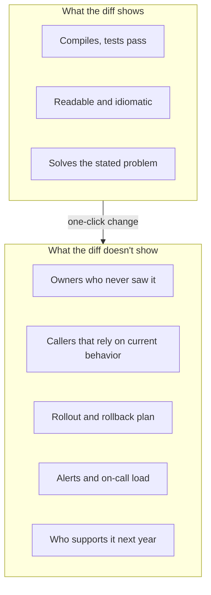

*By Gopi Krishna Tummala*

*AI can now write a clean, tested change in seconds. This post is about the part it can't see: who owns the code, who depends on it, and how to stay the person who understands the system.*

---

Here's a change most of us have seen some version of. The checkout service calls the payments service to charge a card, and once in a while that call times out. Someone asks an AI assistant to "add retries to the payments call." A minute later there's a tidy diff: exponential backoff, a configurable retry count, a unit test and a docstring. It compiles, the tests pass, and it reads better than what most of us would write by hand at the end of a long day.

It can also charge a customer twice.

Whether it does depends on things that aren't in the diff. Is the charge endpoint idempotent, meaning safe to call twice with the same request? Does the client send an idempotency key? Who owns the payments service, and do they know a new caller is about to retry against it during their next outage? None of these are coding questions, and all of them decide whether the change is safe.

This post follows that one retry change to explain how I think about writing software with AI: what software engineering actually consists of, what AI changed and what it didn't, how to keep a mental map of a system you didn't type, and the mistakes that cost the most. A companion post covers [AI-enabled coding interviews](/posts/interview-prep/ai-enabled-coding-interviews).

## The idea in one picture



*The diff is the visible part of a change. Most of the risk, and most of the cost over the change's life, sits below it.*

## Software engineering is mostly what isn't in the code

The authors of [*Software Engineering at Google*](https://abseil.io/resources/swe-book) describe software engineering as programming integrated over time. Programming gets the computer to do something. Engineering keeps it doing that for years while many people change it, other systems come to depend on it, and the original authors move on. Code is written once, read many times and supported for its whole life, and most of the cost is in the reading and the supporting.

Around every mature codebase there's a body of knowledge that rarely lives in one place. For the retry change, it looks like this:

- **Ownership:** the payments team owns the client library and must approve changes to how it's called. That's usually written in an `OWNERS` or `CODEOWNERS` file.
- **Contracts:** the charge endpoint is only safe to retry if each request carries an idempotency key. That may or may not be in the API docs.
- **History:** there may be no retry today on purpose. Maybe a retry storm once took payments down during a regional outage, and the fix was to fail fast.
- **Idioms:** the codebase may already have a shared retry helper with a retry budget, and reviewers expect you to use it.
- **Operations:** a change in call volume shows up on the payments team's dashboards and pages their on-call, not yours.

Two old ideas explain why this matters so much. [Hyrum's Law](https://www.hyrumslaw.com/) says that with enough users, every observable behavior of a system is depended on by somebody, whatever the documentation promises. And Chesterton's fence says that if you find a fence across a road and don't know why it's there, you find out before you tear it down. "This call has no retry" is a fence.

Very little of this knowledge was ever taught from documents. It traveled as stories: a review comment that said "we tried that in 2021," a postmortem everyone read, a design review where someone asked who gets paged. Large engineering organizations built processes around those stories, like owner approval on every change and Google's readability reviews, where an expert in a language approves code and teaches its idioms one review at a time. Most teams also have a hidden expert, the person whose value is less the code they write than the map they carry.

Peter Naur made the deeper point in 1985 in *Programming as Theory Building*: the real product of programming is the theory in the developers' heads, meaning their understanding of why each part is the way it is and how it could change. The code is a lossy shadow of that theory. When the people who hold it leave, the program starts to decay even though it still runs.

Not every change needs this much care. Adding a log line doesn't. Changing how one service calls another usually does.

## What AI changed, and what it didn't

AI made the diff cheap. A clean, compiling, tested change that used to take a skilled engineer an afternoon now takes a prompt, and it often looks better than a rushed human version.

The knowledge around the diff didn't come with it. The model sees the files you show it. It doesn't see the payments dashboard, the 2021 outage or the on-call rotation. So the cost of a change moved from writing it to reviewing, integrating and supporting it.

The research so far fits that picture. In [METR's 2025 randomized trial](https://metr.org/blog/2025-07-10-early-2025-ai-experienced-os-dev-study/), experienced open-source developers working in their own repositories were 19% slower with early-2025 AI tools while believing they were about 20% faster; METR has since cautioned that newer tools may change the number, but the gap between feeling and measurement is the lesson. In the [2025 Stack Overflow survey](https://survey.stackoverflow.co/2025/ai), the most common frustration was answers that are "almost right, but not quite." Veracode's [2025 report](https://www.veracode.com/blog/genai-code-security-report) found security flaws in 45% of AI-generated samples on its test tasks. And Google's [DORA 2025 report](https://www.dora.dev/research/ai) describes AI as an amplifier: it makes strong teams stronger and struggling teams' problems bigger.

## Recover the knowledge before you change the code

Before a change that alters behavior, I try to answer six questions. For the retry change:

1. **Who owns this?** The payments team. Involve them now, not at approval time.
2. **Who depends on it?** Every caller of the charge client, and the payments service itself, which will see more traffic during failures.
3. **What's the real contract?** Is charge idempotent, and under what conditions?
4. **Why is it like this?** Read the history of the call site and the client.
5. **How does it ship and how do we undo it?** A flag, a staged rollout and a quick way back.
6. **Who supports it afterward?** Which dashboards and alerts change, and which runbook needs a line.

AI is very good at the archaeology here if you ask for it instead of asking for code. Two prompts I use:

```text
Summarize the git history of payments/client.py and checkout/charge.py.
Which commits changed retry or timeout behavior, what bugs or incidents do
they reference, and what do they seem to protect against? Quote the messages.

List every caller of PaymentsClient.charge() in the repo, grouped by service
and owner (from OWNERS/CODEOWNERS), and say whether each passes an
idempotency key.
```

Then do the part the model can't: confirm the story with the owner. The model can find the fence. Only the people who built it can tell you whether it's load-bearing. And sometimes the history is thin and the answer is "nobody knows," which is itself worth knowing before you ship.

## Keep a mental map: what, how, and how it fits

Before I accept any non-trivial piece of AI-written code, I want three answers:

- **What it does,** in one sentence, including its contract: "Retries a charge up to three times on timeouts and 5xx errors, always with the same idempotency key."
- **How it does it,** roughly: "Exponential backoff with jitter, using the shared retry helper and its per-service budget."
- **How it fits:** "Called from checkout only. If payments is down, we stop retrying once the budget is spent and show the user a clear error."

I don't need to know every line by heart. I do need the map, because the map is what lets me review the change, debug it at 3 a.m. and explain it in a design review. That's Naur's theory again. If AI writes the code and nobody holds the theory, the code starts out already decaying.

Asking the assistant for the map is a good habit, as long as you check it: "Give me a one-page map of this module: its responsibilities, public interface, dependencies in both directions, the state it owns and how it fails at each boundary. Cite files and functions so I can verify each claim."

## Build with walls, not bricks

For most of software's history we laid bricks: every line placed by hand. With AI, it's more like working with prefabricated walls. Give the tool a wall's dimensions and a spec, and it hands you back a finished wall, often a good one.

That makes the architect's work more visible, not less. Someone still decides where the walls go, which ones are load-bearing, how they connect and whether the house meets code. The AI can sketch floor plans and critique yours, but it doesn't live in the house.

Interfaces are what let walls fit together, much as studs let Lego pieces snap. A small, explicit interface with tests at the boundary lets you swap an AI-built implementation in and out safely. A vague one means every generated piece fits a little differently.

Here's what a spec for the retry wall looks like once the knowledge has been recovered:

```text
Goal:        Retry transient failures when checkout charges a card.
Interface:   charge(order_id, amount) -> ChargeResult (unchanged)
Contract:    Every attempt sends the same idempotency key (derived from order_id).
             Retry only on timeouts and 5xx; never on 4xx or declines.
             At most 3 attempts, exponential backoff with jitter.
Constraints: Use the shared retry helper and its per-service retry budget.
Non-goals:   Retrying refunds. Changing payment provider timeouts.
Tests:       duplicate attempts produce one charge; 4xx not retried;
             budget exhausted -> clear error; jitter within bounds.
Owners:      @payments must review. Update the checkout runbook.
```

Most of that spec is knowledge the code will never contain: the idempotency rule, the non-goals, the owners and the runbook. That's the architect's contribution. The AI can write the function in a minute. It couldn't have known that refunds must never be retried, or that the payments team needs to sign off.

## A loop that keeps you in charge

The working loop I use has six steps, and the AI drives one of them:

1. **Think:** what problem am I solving, and what does done look like?
2. **Specify:** the interface, constraints and test cases, like the spec above.
3. **Generate small:** one function or one file at a time, so every diff is reviewable.
4. **Verify:** give the assistant a check it can run (tests, a build, a script) and read the diff yourself.
5. **Understand:** can I explain each part and why it's there?
6. **Own:** simplify, rename, document and commit it as mine.

How much to hand off depends on two things: how risky the code is and how well I know the domain. Low-risk code in a familiar area (scripts, test scaffolding) I delegate freely. High-risk code in an unfamiliar area (auth, payments, concurrency, data pipelines) is where I slow down, learn first and write the core myself, using the AI as a reviewer. The retry change is high-risk, which is why the spec came before the code.

## Using AI without getting worse at your job

There's a quieter cost too. In a [2026 randomized study by Anthropic](https://www.anthropic.com/research/AI-assistance-coding-skills), mostly junior developers learning a new Python library with an AI assistant scored about 17 percentage points lower on a follow-up quiz than those who coded by hand, with the biggest gap in debugging. How people used the assistant mattered: those who asked conceptual questions, or asked for explanations alongside code, did far better than those who handed over the whole task. The sample was small and covered one library, but the direction matches what we know about learning: you learn what you struggle with.

The habits that keep me sharp:

- Try the problem for ten or fifteen minutes before asking, then compare approaches.
- Ask for hints and concepts instead of answers when I'm learning something new.
- Predict what code will do before running it. Wrong predictions are where the learning happens.
- Debug a failure myself before pasting the stack trace into a chat.
- Do some work with the assistant off each week, the same way you'd check you can still navigate without GPS.

## The mistakes that cost the most

| Mistake | What it looks like | Instead |
|---|---|---|
| Knowledge-blind change | A clean diff that adds a retry, renames a field or reorders a list | Find owners, callers and the real contract first |
| Accepting without reading | A 600-line diff approved after a skim | Small diffs, every line read |
| Tests that test nothing | The AI writes the code and tests that mirror it | Write the test cases yourself; break the code to confirm they fail |
| Hiding the symptom | "Fix the error" becomes a skipped test or a blanket `except` | Ask for the root cause and forbid suppression |
| Trusting new dependencies | Installing whatever package the model suggests | Check it exists, is maintained and is the one you meant ([models do invent package names](https://www.darkreading.com/application-security/ai-code-tools-widely-hallucinate-packages)) |
| Code nobody can explain | A merged module with no one who holds its map | Write the one-page map before merging |

## What I'd remember

- **The diff is the small part.** Ownership, contracts, history and support decide whether a change is safe, and none of them are in the code.
- **AI made writing cheap, so reviewing and supporting became the job.** Plan for that cost instead of being surprised by it.
- **Recover the story before you change behavior.** Use the assistant as an archaeologist, then confirm with the owner.
- **Hold the map yourself.** What it does, roughly how, and how it fits. If nobody holds it, the code starts out decaying.
- **Be the architect.** AI builds good walls to a spec. Deciding where the walls go and which are load-bearing is still your job.

## Where to go next

- [Preparing for AI-enabled coding interviews](/posts/interview-prep/ai-enabled-coding-interviews), the companion post.
- [*Software Engineering at Google*](https://abseil.io/resources/swe-book), free online, especially the chapters on knowledge sharing and code review.
- Anthropic's [best practices for Claude Code](https://code.claude.com/docs/en/best-practices), for the plan-first and verify-everything workflow in practice.
- [The 45-Minute Interview Flow](/posts/interview-prep/interview-problem-solving-flow), for the problem-solving habits AI doesn't replace.

**Questions to sit with**

1. Pick a change you merged recently. Who besides you would be paged if it broke?
2. Which "fence" in your codebase do you not understand yet, and who would know?
3. Could you write the one-page map of the last module an AI wrote for you?
