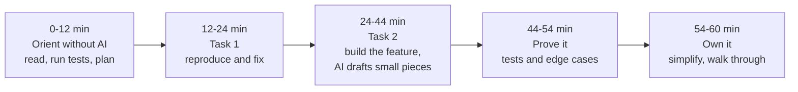

*By Gopi Krishna Tummala*

*Some coding interviews now put an AI assistant next to you. Here's what those rounds actually grade, how to spend the hour, and a four-week plan to prepare.*

---

The classic coding interview gives you a blank editor and one or two algorithm puzzles. A newer format looks more like a normal workday. You get a small codebase you've never seen, a failing test, a feature to add, and an AI assistant in a chat panel beside the editor. The assistant is the same for every candidate, so it isn't what's being measured. You are.

This post covers what those rounds look like as of late 2026, what interviewers are looking for, how to spend the hour, and how to prepare. It assumes you've read, or at least skimmed, [Coding With AI Without Losing Your Edge](/posts/interview-prep/ai-assisted-coding-conscious-practice-and-interviews), because the round is that post's habits compressed into sixty minutes.

To keep it concrete, we'll follow one practice round: a three-file inventory service where one test fails because of an off-by-one bug in a reporting window, and the feature request is to export low-stock items as CSV.

## What the round looks like

The clearest public example is Meta's. In October 2025 it began piloting a 60-minute AI-enabled round in CoderPad that replaces one of the onsite coding rounds. According to [candidate-prep write-ups](https://interviewing.io/blog/how-to-use-ai-in-meta-s-ai-assisted-coding-interview-with-real-prompts-and-examples), the round uses a multi-file project with partially built features, failing tests and bugs, worked through as a sequence of tasks. You can switch between several models, and the assistant talks to you in chat rather than editing your code directly. Prep material reportedly describes using the AI as optional.

Elsewhere the picture is mixed. Some companies allow AI in some rounds or take-homes and explicitly grade how you check its output. Many large companies still run classic algorithm rounds with AI disabled. Policies change quickly and vary by team, so the most useful thing you can do is ask your recruiter which rounds allow AI, which tools, and whether you can use your own editor. The details above come from third-party prep sources, not official recruiting material.

## What's actually being graded

Across the published guidance, the rubric comes down to five things:

- **Understanding:** do you read the task, the code and the tests before you prompt?
- **Delegation:** do you hand off small, well-defined pieces and keep the design decisions?
- **Verification:** do you run tests, read the output and catch the assistant's mistakes?
- **Communication:** can you say what you asked for, what you kept and what you changed?
- **Ownership:** can you explain and defend every line you submit?

Clever prompts aren't on the list. The round rewards the same judgment that makes AI-assisted work safe on a real team.

## The idea in one picture



*One way to spend the hour. The first twelve minutes and the last sixteen are where strong candidates separate themselves, and neither is about prompting.*

## How to spend the hour

**Orient without the assistant.** Read the task. Skim the files. Run the test suite and note what fails. In our practice round, `test_weekly_report` fails in `inventory.py`. Say what you think each file does and how they connect. It's fine to ask the assistant to summarize an unfamiliar file, but form your own picture first, then state a plan out loud.

**Fix the bug by reproducing it.** Read the failing assertion: the report includes eight days instead of seven. Form a hypothesis (the window uses `<=` where it should use `<`), confirm it with a print or a quick check, and fix it by hand if it's one line. Something like "I'll fix this directly, it's faster than describing it" is a good thing to say.

**Build the feature in small, specified pieces.** For the CSV export, you decide the shape: a function that takes the low-stock items and returns CSV text, and a route or command that calls it. Then delegate a well-defined piece: "Write `to_csv(items: list[Item]) -> str` with header `sku,name,quantity`; here are two example rows." Read what comes back before you paste it. If it builds rows with string joins, notice that a comma in an item name will break the file, switch to the `csv` module, and say why.

**Prove it.** Run the whole suite. Add the edge cases yourself: no low-stock items, a name containing a comma, a very large quantity. You can ask the assistant to suggest more edge cases and judge which matter.

**Own it.** Simplify anything convoluted, then give a short walkthrough: what you changed, what you'd do with more time, and any trade-offs. If the assistant suggested something bigger, like adding a caching layer, this is where you say you left it out on purpose.

## What interviewers notice going wrong

Most weak rounds fail in one of a few ways: prompting before reading anything, asking the assistant to solve the whole task, pasting code without reading it, being unable to explain a line when asked, and running no tests beyond the ones already there. The opposite mistake also shows up. Refusing to use the assistant at all can leave you typing boilerplate when the clock runs out. The round is designed to reward using it well, not avoiding it.

## A four-week plan

**Week 1, fundamentals with AI off.** Solve eight to ten medium problems with a structured flow: clarify, examples, approach, complexity, code, test. Read one unfamiliar open-source module a day and explain it in five sentences. Reading code quickly is the skill the AI round leans on most.

**Week 2, verification drills.** Ask an assistant to solve a problem with one subtle bug hidden in it, then find the bug before running anything. Write your test cases before asking for an implementation, and check that your tests catch a broken version. Do a written review of a 100-line AI solution.

**Week 3, codebase practice with AI on.** Take a small real project, break a few things or have a friend do it, and practice the full flow in 60 minutes: read, run tests, fix, add a feature across files, add tests. Use chat only and paste code yourself to match the real setup. Record yourself and listen to how you narrate.

**Week 4, mocks.** Two or three timed mocks in an AI-enabled setup, graded on the five dimensions above, plus one or two classic algorithm mocks with AI off.

You can also use an assistant as a practice partner without letting it do the work for you:

```text
Act as an interviewer for an AI-enabled coding round. Give me a small
multi-file Python project with one failing test, one bug and a feature
request. Don't give hints unless I ask. When I'm done, grade me on
understanding, delegation, verification, communication and ownership,
with specific examples.
```

## Grade yourself

| Dimension | Weak | Strong |
|---|---|---|
| Understanding | Prompted before reading anything | Ran tests first, stated hypotheses, asked about ambiguity |
| Delegation | Asked the AI to solve it all | Delegated specified pieces, kept the design |
| Verification | Ran only the existing tests | Added edge cases and caught the AI's mistakes |
| Communication | Worked silently | Explained decisions and trade-offs throughout |
| Ownership | Couldn't explain parts of the code | Simplified the AI's code and defended every line |

## Don't drop the classic rounds

Many interview loops still include algorithm rounds with AI off, and even the AI round assumes you can recognize a correct solution when you see one. You can only verify what you could have written yourself, so keep your pattern practice going. [The 45-Minute Interview Flow](/posts/interview-prep/interview-problem-solving-flow) and [Python Interview Hacks 2026](/posts/fundamentals/python-interview-hacks-2026) cover that side.

## What I'd remember

- **The assistant is the same for everyone.** The grade is your judgment: what you read, what you delegate, what you check.
- **Spend the first twelve minutes without it.** Reading and running the tests is what makes everything after it faster.
- **Delegate pieces you could specify in one sentence,** and read every line before it goes in.
- **Say what you're doing.** Narration is how the interviewer sees your judgment.
- **Ask your recruiter about the format.** It varies by company and team and changes quickly.

## Where to go next

- [Coding With AI Without Losing Your Edge](/posts/interview-prep/ai-assisted-coding-conscious-practice-and-interviews), the habits this round tests.
- interviewing.io's [walkthrough of Meta's AI-assisted round](https://interviewing.io/blog/how-to-use-ai-in-meta-s-ai-assisted-coding-interview-with-real-prompts-and-examples), with example prompts.
- [The 45-Minute Interview Flow](/posts/interview-prep/interview-problem-solving-flow) for classic rounds.

**Questions to sit with**

1. In your last practice round, how many minutes passed before your first prompt?
2. Could you explain every line you submitted without looking at the assistant's messages?
3. Which piece of the task did you delegate that you should have written yourself, or the other way around?
