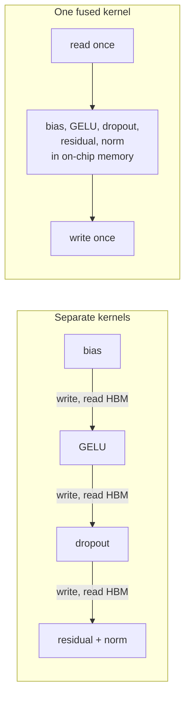
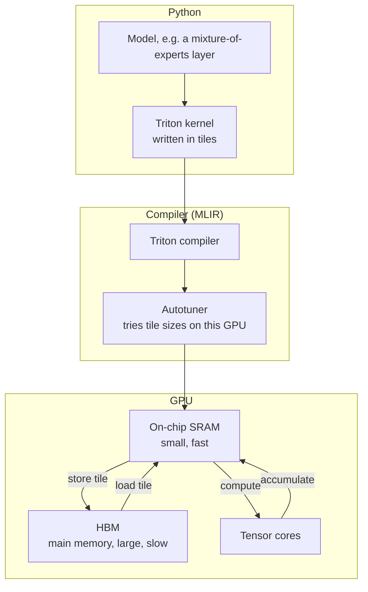
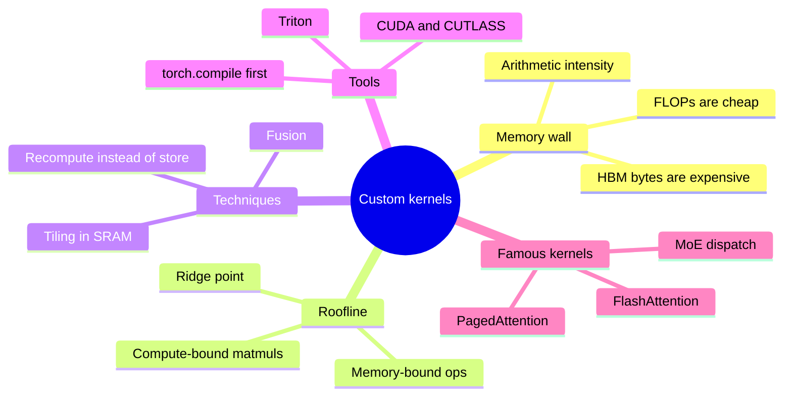

*By Gopi Krishna Tummala*

*On a modern GPU, arithmetic is cheap and moving data is expensive. A map of why that's true, how fusion and tiling fix it, how FlashAttention works, and when it's worth writing your own kernel.*

Part 6 of [the MLOps map](/posts/mlops/infrastructure-first-mlops-roadmap). Previous: [Life of a Request](/posts/mlops/life-of-a-tensor-production-inference). Next: [Agentic MLOps](/posts/mlops/beyond-inference-agentic-mlops-mcp).

---

You profile one layer of a transformer during training. The big matrix multiplications, which do almost all of the arithmetic, finish quickly. Then comes a string of small operations: add a bias, apply GELU, apply dropout, add the residual, normalize. Each does very little math, yet together they take a surprisingly large share of the layer's time.

That pattern is the whole reason custom GPU kernels exist. A kernel is a single function that runs on the GPU. Each of those small operations is its own kernel, and each one reads its input from the GPU's main memory and writes its output back, only for the next kernel to read it again. The GPU spends its time waiting on memory, not computing. This post explains why, and what fusion, tiling, FlashAttention and tools like Triton do about it.

## The idea in one picture

*Unfused, every step makes a round trip through main memory. Fused, the data is read once, transformed on-chip and written once. Same math, a fraction of the memory traffic.*

## Math is cheap, memory is expensive

An H100 GPU can do roughly 1,000 trillion 16-bit floating-point operations per second on its tensor cores, but it can only move about 3.35 TB per second between its main memory (called HBM) and the chips that compute. Divide one by the other and you get about 300: an operation needs to do roughly 300 floating-point operations for every byte it reads or writes just to keep the compute units busy.

That ratio is called arithmetic intensity, and plotting it against achieved speed gives the roofline model. Large matrix multiplications reuse each number many times, so they easily clear the bar and are compute-bound. Elementwise operations like adding a bias or applying GELU do one or two operations per number, so they're far below it and memory-bound. For them, a faster GPU barely helps; only moving fewer bytes does.

A quick sanity check: adding two vectors of a billion 16-bit numbers reads 4 GB and writes 2 GB, about 6 GB in total, for a billion additions. That's about 0.17 operations per byte. On an H100 the math would take about a microsecond, and moving the data takes about 1.8 milliseconds.

## Fusion and tiling

**Fusion** combines several operations into one kernel so intermediate results never go back to main memory. In our layer, a fused kernel reads the matmul output once, applies bias, GELU, dropout, the residual add and normalization while the data sits in fast on-chip memory, and writes the result once. The arithmetic is identical; the memory traffic drops several-fold.

**Tiling** is how kernels make on-chip memory go further. On-chip memory (registers and shared memory, often called SRAM) is tiny compared with HBM but much faster. So a kernel processes data in tiles small enough to fit, loads each tile once, does as much work on it as possible, and moves on. Matrix multiplication libraries have done this for decades; the newer idea is applying it to whole chains of operations.

## FlashAttention: tiling applied to attention

Standard attention computes a score for every pair of tokens, writes that full N×N score matrix to HBM, reads it back to apply softmax, writes the result, and reads it again to multiply by the values. For long sequences, that matrix is huge and the traffic dominates.

[FlashAttention](https://arxiv.org/abs/2205.14135) never writes the N×N matrix at all. It processes queries, keys and values in tiles that fit on-chip and uses an online softmax, a way of computing softmax in pieces by keeping a running maximum and running sum and rescaling as new tiles arrive. In the backward pass it recomputes small pieces of attention instead of storing them. The result is exact attention, with memory that grows linearly with sequence length instead of quadratically, and in the original paper wall-clock speedups of 2–4×. [FlashAttention-3](https://arxiv.org/abs/2407.08608) adapts the same idea to newer Hopper GPUs. You rarely call it directly: PyTorch's `scaled_dot_product_attention` uses it when it can.

## When should you write a kernel?

Most of the time you shouldn't, at least not first. A reasonable order:

1. **Use the libraries.** cuBLAS for matrix multiplications, PyTorch's built-in fused attention, fused optimizers.
2. **Try `torch.compile`.** It traces your model and generates fused kernels for chains of elementwise and reduction operations automatically. For our layer's bias-GELU-dropout-residual-norm chain, this alone often recovers most of the lost time.
3. **Write a [Triton](https://triton-lang.org/main/getting-started/tutorials/index.html) kernel** for the specific hot spot a profiler points to: a custom attention variant, a fused routing step for mixture-of-experts models, a matrix multiply with an unusual quantization format. Triton lets you write kernels in Python at the level of tiles, and its compiler handles the thread-level details.
4. **Drop to CUDA** (often through NVIDIA's CUTLASS library) when you need hardware features or performance that Triton can't reach. It takes much longer to write and maintain.

Always start from a profile. Nsight Systems shows where time goes across kernels; Nsight Compute shows whether a kernel is limited by memory or compute. And remember that tuning is hardware-specific: tile sizes that are ideal on an A100 may be wrong on an H100, which is why Triton kernels usually include an autotuner that tries several configurations on the actual GPU.

Here's what that path looks like for a Triton kernel, from Python down to the silicon:

*You write the tile-level logic; the compiler and autotuner decide how tiles map onto this particular GPU. The loop at the bottom is the whole game: load once, compute a lot, store once.*

## What I'd remember

- **Arithmetic is cheap; moving bytes is expensive.** Judge every operation by how much math it does per byte.
- **Elementwise operations are memory-bound.** Fusing them so data stays on-chip is the biggest easy win.
- **FlashAttention is tiling plus an online softmax.** Exact attention without ever storing the full score matrix.
- **Climb the ladder.** Libraries, then `torch.compile`, then Triton, then CUDA, guided by a profiler.
- **Tune per GPU.** What's fast on one generation can be slow on the next.

The whole module on one page:

## Where to go next

- The [FlashAttention paper](https://arxiv.org/abs/2205.14135), which is unusually readable.
- [Triton tutorials](https://triton-lang.org/main/getting-started/tutorials/index.html), starting with vector addition and fused softmax.
- The GPU MODE lecture series and community, for kernel-writing in practice.

Previous: [Life of a Request](/posts/mlops/life-of-a-tensor-production-inference). Next: [Agentic MLOps](/posts/mlops/beyond-inference-agentic-mlops-mcp).

**Questions to sit with**

1. In your own training job, which operations would you expect to be memory-bound?
2. Why does FlashAttention speed things up even though it does extra computation in the backward pass?
3. What would you check before deciding a custom kernel is worth writing?
