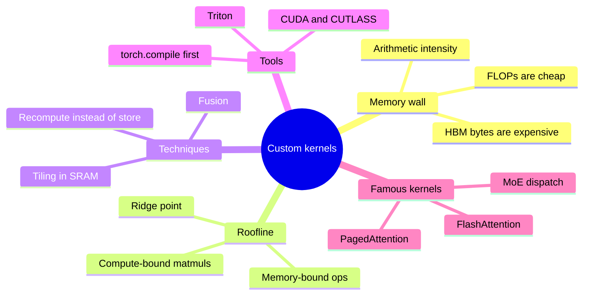
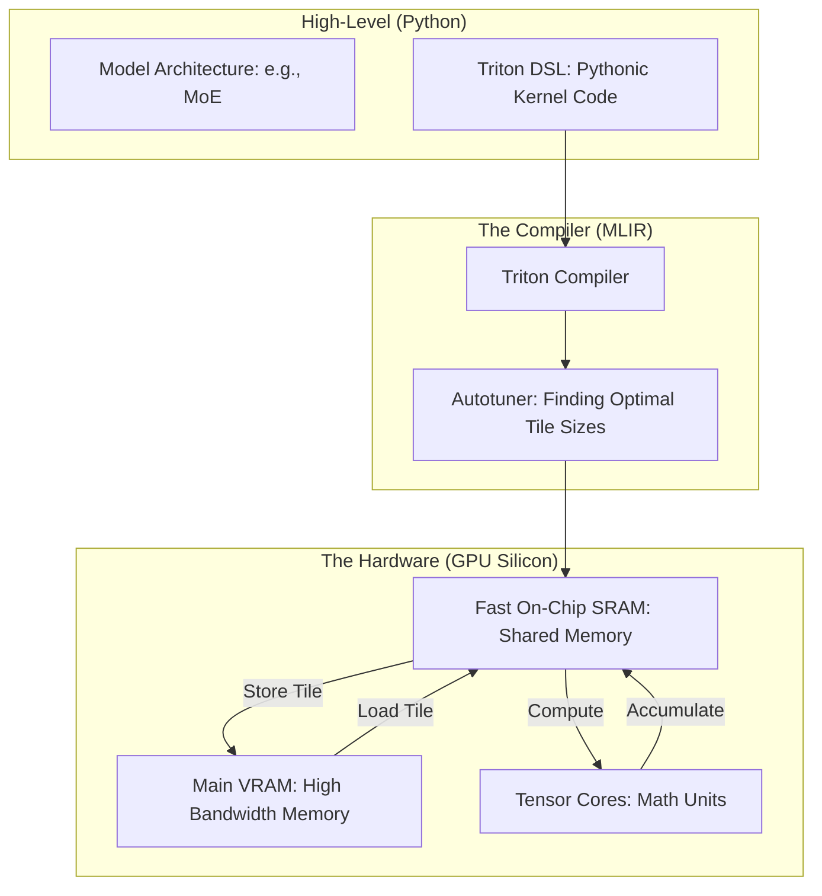

*By Gopi Krishna Tummala*

---

  
Infrastructure-First MLOps — Building the Engine of AI

  

    <a href="/posts/mlops/parquet-arrow-quest-for-analytic-speed" style="background: rgba(255,255,255,0.1); padding: 0.5rem 1rem; border-radius: 6px; text-decoration: none; color: white; opacity: 0.9;">Module 1: Data DNA</a>
    <a href="/posts/mlops/datasets-and-dataloaders" style="background: rgba(255,255,255,0.1); padding: 0.5rem 1rem; border-radius: 6px; text-decoration: none; color: white; opacity: 0.9;">Module 2: Dataloaders</a>
    <a href="/posts/mlops/hidden-engine-of-ai" style="background: rgba(255,255,255,0.1); padding: 0.5rem 1rem; border-radius: 6px; text-decoration: none; color: white; opacity: 0.9;">Module 3: Training</a>
    <a href="/posts/mlops/modern-post-training-peft-2026" style="background: rgba(255,255,255,0.1); padding: 0.5rem 1rem; border-radius: 6px; text-decoration: none; color: white; opacity: 0.9;">Module 4: Post-Training</a>
    <a href="/posts/mlops/vllm-trilogy-of-modern-llm-scaling" style="background: rgba(255,255,255,0.1); padding: 0.5rem 1rem; border-radius: 6px; text-decoration: none; color: white; opacity: 0.9;">Module 5: Serving</a>
    <a href="/posts/mlops/custom-kernel-craze" style="background: rgba(255,255,255,0.25); padding: 0.5rem 1rem; border-radius: 6px; text-decoration: none; color: white; font-weight: 600; border: 2px solid rgba(255,255,255,0.5);">Module 6: Kernels</a>
    <a href="/posts/mlops/beyond-inference-agentic-mlops-mcp" style="background: rgba(255,255,255,0.1); padding: 0.5rem 1rem; border-radius: 6px; text-decoration: none; color: white; opacity: 0.9;">Module 7: Agentic AI</a>
    <a href="/posts/mlops/ml-pipeline-orchestration-layers" style="background: rgba(255,255,255,0.1); padding: 0.5rem 1rem; border-radius: 6px; text-decoration: none; color: white; opacity: 0.9;">Module 8: Orchestration</a>
  

  
📖 You are reading <strong>Module 6: Custom Kernels</strong> — Handcrafting GPU Speed

---

### Act 0: Custom Kernels in Plain English

Imagine you are a master carpenter (The GPU). You have a standard toolbox (PyTorch) with a hammer, a saw, and a screwdriver. For 90% of jobs, these tools are perfect.

But one day, you are asked to build a spiral staircase made of solid diamond. Your standard saw breaks. Your hammer is too clumsy. To finish the job, you have to go into your forge and **hand-grind a custom diamond-tipped blade** designed specifically for this one task.

**A GPU Kernel** is a single "math recipe" that runs on the GPU.
**A Custom Kernel** is a hand-written recipe that bypasses the standard tools to do something faster, smarter, or more memory-efficient.

The "Craze" is because modern AI models (like Transformers) are doing math that standard tools weren't built for. **If you want to win the AI race, you have to build your own tools.**

---

## Table of contents

---

## The Module in One Picture

---

### Act I: The Memory Wall (The Silent Killer)

In AI, math is cheap, but **moving data is expensive**.

A modern H100 GPU can do roughly 1,000 trillion BF16 math operations per second (about 1 PFLOP/s dense). But it can only move about 3.35 TB/s from its "Main Memory" (HBM) to its "Calculation Cores." Divide the two and you get the **ridge point**: an operation needs roughly **300 FLOPs per byte** it touches to keep the Tensor Cores busy.

*   **The Problem:** Big matrix multiplications clear that bar easily, but most of the *other* operations in a model (activations, LayerNorm, softmax, residual adds, dropout, and LLM decode in general) do only a handful of FLOPs per byte. For them, the cores sit idle waiting for data. This is the **Memory Wall**, and in many training and serving workloads those memory-bound ops eat a large share of the time.
*   **The Solution:** **Kernel Fusion.** Instead of reading data, doing Step A, writing it back, then reading it again for Step B... we do Step A and Step B in one single "Kernel." We never let the data leave the fast on-chip memory (SRAM).

---

#### Act I.V: Mature Architecture — The Kernel Fusion Stack

The "Gold Standard" has shifted from writing complex C++ (CUDA) to using **OpenAI Triton**, a Python-based language that compiles to high-performance GPU code.

**The Custom Kernel Pipeline (Mature Architecture):**

##### 1. Tiling: The Key to Speed
We don't process a 10,000 x 10,000 matrix all at once. We break it into "Tiles" (e.g., 128x128). We load one tile into the tiny but lightning-fast **SRAM**, do all the math there, and then write the result back to the slow **HBM**.

##### 2. Trade-offs & Reasoning
*   **CUDA C++ vs. Triton:** Writing CUDA is like writing assembly—you manage threads, shared memory, synchronization and memory coalescing yourself. *Trade-off:* hand-tuned CUDA (often via CUTLASS) can squeeze out the last bit of performance and use every new hardware feature first, but takes far longer to write and maintain. Triton works at the level of **blocks (tiles)** and handles thread-level plumbing automatically, letting engineers focus on the **data flow**; for many kernels it gets close to hand-written performance.
*   **FlashAttention:** The most famous custom kernel. Standard attention writes the full N×N score matrix to HBM and reads it back for softmax. FlashAttention tiles Q, K and V through SRAM and uses an **online softmax**, so the N×N matrix is never materialized: memory becomes linear in sequence length and HBM traffic drops sharply, giving 2–4× wall-clock speedups in the original paper (more on longer sequences) with *exact* results.

##### 3. The Ladder: When Should You Actually Write a Kernel?

1.  **Use the library first.** cuBLAS/cuDNN matmuls, PyTorch's `scaled_dot_product_attention` (which dispatches to FlashAttention), fused optimizers.
2.  **Then `torch.compile`.** It traces your model and automatically generates fused Triton kernels for chains of elementwise and reduction ops. This alone often captures most of the fusion benefit.
3.  **Then Triton** for the specific hot spot the profiler shows (a custom attention variant, a fused MoE routing step, a quantized matmul).
4.  **Only then CUDA/CUTLASS**, when you need hardware features or performance Triton can't reach.

Always start from a profile (PyTorch profiler, Nsight Systems, Nsight Compute), never from a hunch.
*   **Citations:** *Triton: An Intermediate Language and Compiler for GPU Computing (MAPL 2019)* and *FlashAttention: Fast and Memory-Efficient Exact Attention with IO-Awareness (NeurIPS 2022)*.

---

### Act II: System Design & Interview Scenarios

#### Scenario 1: Bandwidth vs. Compute Bound
*   **Question:** "Your GPU utilization is 100%, but training is slow. Your Roofline Analysis shows you are 'Bandwidth Bound.' What does that mean?"
*   **Answer:** It means your operations' arithmetic intensity sits left of the ridge point: the Tensor Cores are mostly idle because the memory bus can't feed them fast enough. (And "GPU utilization 100%" only means a kernel was always running, not that the cores were busy.) **The Fix:** reduce bytes moved. Try `torch.compile` first, then **Kernel Fusion** by hand (e.g., fusing bias + activation + LayerNorm) so intermediates stay in registers/SRAM instead of round-tripping through HBM; use lower precision (BF16/FP8) to move fewer bytes; and increase batch size where that raises reuse.

#### Scenario 2: The Triton Autotuner
*   **Question:** "You wrote a Triton kernel that is fast on an A100 but slow on an H100. Why?"
*   **Answer:** Hardware has different SRAM sizes, SM counts and instructions. The "Tile Size" (e.g., 64x64) and number of pipeline stages that worked on the A100 might be wrong for the H100, and peak H100 performance also depends on Hopper-specific features (TMA async copies, warp-group matrix instructions) that a kernel tuned for A100 may not use. **The Fix:** Use `@triton.autotune` to sweep tile sizes, warps and stages for each GPU, and check whether your Triton version emits the Hopper fast paths.

#### Scenario 3: Mixture of Experts (MoE) Routing
*   **Question:** "In an MoE model, tokens are scattered to 8 different 'Experts' (GPUs). This 'All-to-All' communication is killing performance. How do you optimize this?"
*   **Answer:** Discuss **Custom Communication Kernels** and overlap. Generic all-to-all collectives in NCCL don't know about the MoE structure. Specialized dispatch/combine kernels (DeepSeek's open-source DeepEP is one example) pack tokens per destination expert, use NVLink within a node and RDMA across nodes, and **overlap** communication with computation (start sending the next micro-batch's tokens while the current one is in the expert MLPs). Also reduce the traffic itself: a load-balancing loss or bias so experts get even work, capacity limits, and expert placement that keeps popular experts' tokens on the same node.

---

### Graduate Assignment: The Roofline Challenge

**Task:**
You are writing a kernel for a simple vector addition: $C = A + B$.
1.  **The Math:** If $A$ and $B$ are $10^9$ elements (FP16, 2 bytes each), how many math operations are performed?
2.  **The Memory:** How many bytes must be moved across the memory bus (Read A, Read B, Write C)?
3.  **The Ratio:** Calculate the **Arithmetic Intensity** (Math / Memory). On an H100 (3TB/s bandwidth), is this kernel bound by math speed or memory speed?

<strong>Show the answers</strong>

1.  **Math:** one add per element = **10⁹ FLOPs**.
2.  **Memory:** read A (2 GB) + read B (2 GB) + write C (2 GB) = **6 × 10⁹ bytes**.
3.  **Arithmetic intensity:** 10⁹ / (6 × 10⁹) ≈ **0.17 FLOPs per byte**. The H100's ridge point is roughly 990 TFLOP/s ÷ 3.35 TB/s ≈ 300 FLOPs/byte, so this kernel is **massively memory-bound**: its runtime is about 6 GB ÷ 3.35 TB/s ≈ **1.8 ms**, and the math would take about a microsecond. The only ways to speed it up are to move fewer bytes (lower precision) or fuse it into a neighboring kernel so C never round-trips through HBM.

## Remember This

- **Compute is cheap; moving bytes is expensive.** Judge every op by its arithmetic intensity against the ridge point (~300 FLOPs/byte on H100).
- **Fusion and tiling are the two core moves.** Keep intermediates in registers and SRAM; never write what you're about to read back.
- **FlashAttention = tiling + online softmax + recomputation.** Exact attention without materializing the N×N matrix.
- **Climb the ladder:** library kernels → `torch.compile` → Triton → CUDA/CUTLASS, guided by a profiler.
- **Tuning is hardware-specific.** Autotune per GPU generation.

<strong>Self-check</strong>

1. What is the ridge point of a GPU, and how do you compute it?
2. Why is LayerNorm memory-bound while a large matmul is compute-bound?
3. How does FlashAttention avoid storing the N×N attention matrix and still compute an exact softmax?
4. What would you try before writing a custom Triton kernel?
5. Why might a kernel tuned on an A100 underperform on an H100?

---

**Further Reading:**
*   [Triton documentation and tutorials](https://triton-lang.org/main/getting-started/tutorials/index.html): Python for GPU programming.
*   [FlashAttention (NeurIPS 2022)](https://arxiv.org/abs/2205.14135) and [FlashAttention-3 for Hopper GPUs (2024)](https://arxiv.org/abs/2407.08608).
*   GPU MODE (formerly CUDA MODE): the community lecture series and Discord for kernel hackers.

---

**Previous:** [Module 5 — LLM Serving (vLLM)](/posts/mlops/vllm-trilogy-of-modern-llm-scaling)

**Next:** [Module 7 — Agentic MLOps: Beyond Inference](/posts/mlops/beyond-inference-agentic-mlops-mcp)
