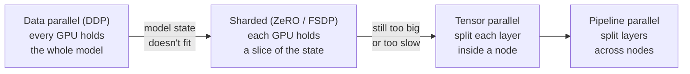

*By Gopi Krishna Tummala*

*A model that doesn't fit on one GPU has to be split across many. A map of where training memory goes, how DDP, ZeRO and FSDP divide it, when to add tensor and pipeline parallelism, and how big runs survive failures.*

Part 3 of [the MLOps map](/posts/mlops/infrastructure-first-mlops-roadmap). Previous: [Datasets and Dataloaders](/posts/mlops/datasets-and-dataloaders). Next: [Post-Training](/posts/mlops/modern-post-training-peft-2026).

---

Your team wants to fully fine-tune a 7B-parameter model. In 16-bit precision the weights are 14 GB, and an H100 has 80 GB, so it should fit easily. It doesn't. The first training step runs out of memory.

The weights are the smallest part of training memory. Gradients, optimizer state and the intermediate values kept for the backward pass take far more. Later the same team wants to train a 70B model, which no single GPU comes close to holding, and suddenly the questions are about splitting a model across hundreds of GPUs and keeping a month-long run alive when hardware fails every few hours. This post follows that team from one GPU to many.

## The idea in one picture

*Start with the simplest strategy that fits, and add a new kind of splitting only when you have to.*

## Where training memory goes

With the usual mixed-precision setup and the Adam optimizer, each parameter costs about 16 bytes:

| What | Bytes per parameter | For 7B parameters |
|---|---|---|
| Weights (16-bit) | 2 | 14 GB |
| Gradients (16-bit) | 2 | 14 GB |
| 32-bit master copy of weights | 4 | 28 GB |
| Adam's two running averages (32-bit) | 8 | 56 GB |
| **Total** | **16** | **about 112 GB** |

That's before activations, the intermediate results of the forward pass kept for computing gradients, which grow with batch size and sequence length and can add tens of gigabytes more. So our 7B fine-tune needs well over 112 GB, more than one 80 GB GPU, even though the weights alone are 14 GB. The optimizer state, not the model, is the biggest line.

Two standard tricks shrink this. **Mixed precision** does the math in 16-bit (bfloat16, which has the same range as 32-bit and rarely needs special handling) while keeping the master weights and optimizer state in 32-bit for stability; that's already included above. **Activation checkpointing** throws away most intermediate values during the forward pass and recomputes them during the backward pass, trading roughly a third more compute for a large cut in activation memory.

## Data parallelism: copy the model, split the data

The simplest way to use more GPUs is PyTorch's DDP (distributed data parallel). Every GPU holds a full copy of the model and processes a different slice of each batch. After the backward pass, the GPUs average their gradients with an all-reduce, so every copy takes the same step. DDP overlaps that communication with the rest of the backward pass, so it's often nearly free.

DDP speeds training up but doesn't save memory: each GPU still needs all 112 GB. For our 7B model, it doesn't help at all.

## ZeRO and FSDP: split the state instead of copying it

The insight behind [ZeRO](https://arxiv.org/abs/1910.02054) is that DDP stores the same optimizer state, gradients and weights on every GPU. With eight GPUs, seven of those copies are redundant. ZeRO splits them:

- **Stage 1** splits the optimizer state across GPUs.
- **Stage 2** also splits the gradients.
- **Stage 3** also splits the weights themselves. Each GPU gathers a layer's weights from the others just before using it, then drops them again.

PyTorch's FSDP (fully sharded data parallel) is the native implementation of stage 3; DeepSpeed is the other common one, with more options for spilling state to CPU memory or disk. For our 7B model on eight GPUs, full sharding cuts the 112 GB of state to about 14 GB per GPU, plus activations, which fits comfortably. The price is extra communication: weights are gathered for the forward pass, gathered again for the backward pass, and gradients are scattered back, roughly 1.5 times DDP's traffic. Fast links between GPUs hide most of it.

## Splitting the model itself: tensor and pipeline parallelism

For a 70B model on hundreds of GPUs, sharding alone runs into communication limits, so large runs add two more ways to split work:

- **Tensor parallelism** splits each large matrix multiplication across several GPUs. It needs communication inside every layer, so it only works over the very fast links within a single server, such as NVLink.
- **Pipeline parallelism** puts different layers on different servers: the first quarter of the layers on one, the next quarter on another. Data flows through like an assembly line, split into micro-batches to keep every stage busy. The idle time at the start and end, called the pipeline bubble, shrinks as you use more micro-batches.

A typical layout for our 70B model on 256 GPUs: 8-way tensor parallelism inside each 8-GPU server, 4-way pipeline parallelism across four servers, and 8 copies of that arrangement doing data parallelism. Combining all three is usually called 3D parallelism. The rule behind the layout is to put the most communication-hungry split on the fastest links.

## Staying alive: failures and stragglers

At this scale, hardware failures are routine. Meta's [Llama 3 paper](https://arxiv.org/abs/2407.21783) reported 419 unexpected interruptions over a 54-day window of training on 16,000 GPUs, about one every three hours, mostly GPU and memory faults.

So big runs checkpoint often, and how they checkpoint matters. A full training checkpoint for a 70B model, with optimizer state, is over a terabyte. Writing it from a single GPU can take long enough to waste a large share of the run. Instead, every GPU writes its own shard in parallel, and PyTorch's distributed checkpointing can copy the state to CPU memory and upload it in the background while training continues.

The other quiet problem is stragglers. In synchronous training, every step waits for the slowest GPU. One overheating card or flaky network link can slow the entire cluster. Logging step time per GPU and watching for one that's consistently slower is the cheapest way to catch it.

## What I'd remember

- **Training memory is about 16 bytes per parameter before activations.** The optimizer state, not the weights, is the biggest part.
- **DDP copies, ZeRO and FSDP shard.** Sharding the state across GPUs is what makes large models fit.
- **Put communication-heavy splits on fast links.** Tensor parallelism inside a server, pipeline parallelism across servers.
- **Recompute instead of storing.** Activation checkpointing trades some compute for a lot of memory.
- **Plan for failure.** Checkpoint in parallel and in the background, and watch for slow GPUs.

## Where to go next

- [Post-Training](/posts/mlops/modern-post-training-peft-2026), the next module: changing a model's behavior cheaply with LoRA.
- The [ZeRO paper](https://arxiv.org/abs/1910.02054) and PyTorch's [FSDP documentation](https://pytorch.org/docs/stable/fsdp.html).
- The infrastructure sections of the [Llama 3 paper](https://arxiv.org/abs/2407.21783), a rare public account of a very large training run.

Previous: [Datasets and Dataloaders](/posts/mlops/datasets-and-dataloaders). Next: [Post-Training](/posts/mlops/modern-post-training-peft-2026).

**Questions to sit with**

1. How much memory would full fine-tuning of a 13B model need per GPU with FSDP on 16 GPUs, before activations?
2. Why does tensor parallelism stay inside a server while pipeline parallelism spans servers?
3. If your step time slowly rises during a long run, what would you check first?
