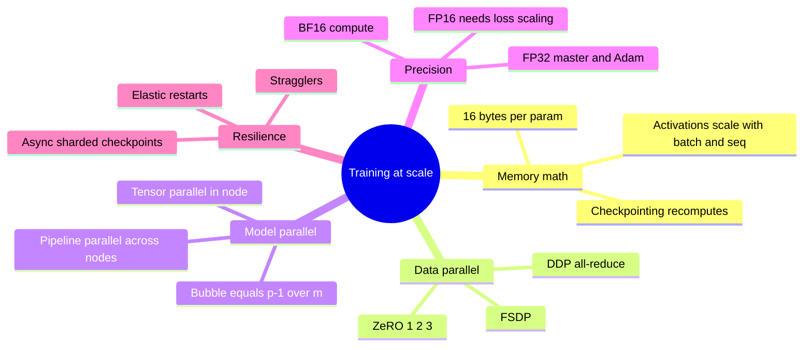
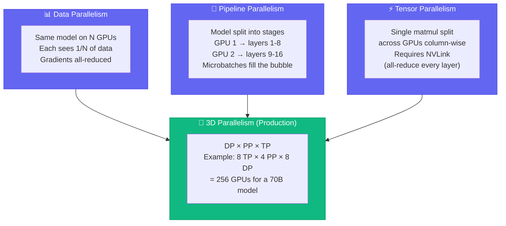
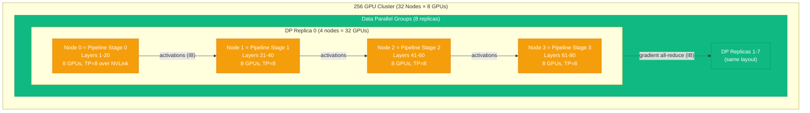
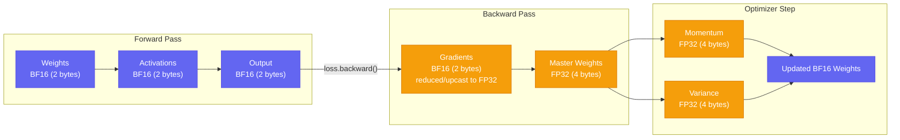
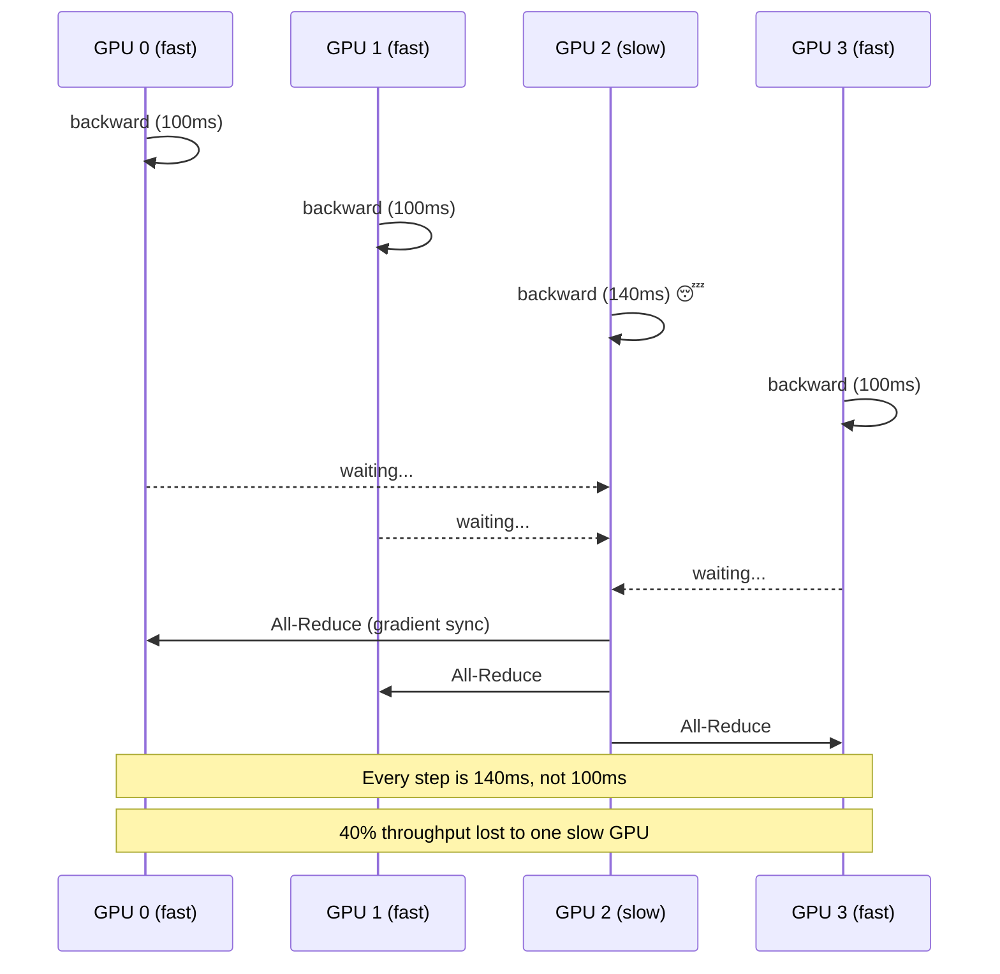

*By Gopi Krishna Tummala*

---

<div class="series-nav" style="background: linear-gradient(135deg, #059669 0%, #0d9488 100%); color: white; padding: 1.5rem; border-radius: 12px; margin-bottom: 2rem; box-shadow: 0 4px 6px rgba(0,0,0,0.1);">
  <div style="font-size: 0.875rem; opacity: 0.9; margin-bottom: 0.5rem; text-transform: uppercase; letter-spacing: 0.05em;">Infrastructure-First MLOps — Building the Engine of AI</div>
  <div style="display: flex; gap: 0.75rem; flex-wrap: wrap; align-items: center;">
    <a href="/posts/mlops/parquet-arrow-quest-for-analytic-speed" style="background: rgba(255,255,255,0.1); padding: 0.5rem 1rem; border-radius: 6px; text-decoration: none; color: white; opacity: 0.9;">Module 1: Data DNA</a>
    <a href="/posts/mlops/datasets-and-dataloaders" style="background: rgba(255,255,255,0.1); padding: 0.5rem 1rem; border-radius: 6px; text-decoration: none; color: white; opacity: 0.9;">Module 2: Dataloaders</a>
    <a href="/posts/mlops/hidden-engine-of-ai" style="background: rgba(255,255,255,0.25); padding: 0.5rem 1rem; border-radius: 6px; text-decoration: none; color: white; font-weight: 600; border: 2px solid rgba(255,255,255,0.5);">Module 3: Training</a>
    <a href="/posts/mlops/modern-post-training-peft-2026" style="background: rgba(255,255,255,0.1); padding: 0.5rem 1rem; border-radius: 6px; text-decoration: none; color: white; opacity: 0.9;">Module 4: Post-Training</a>
    <a href="/posts/mlops/vllm-trilogy-of-modern-llm-scaling" style="background: rgba(255,255,255,0.1); padding: 0.5rem 1rem; border-radius: 6px; text-decoration: none; color: white; opacity: 0.9;">Module 5: Serving</a>
    <a href="/posts/mlops/custom-kernel-craze" style="background: rgba(255,255,255,0.1); padding: 0.5rem 1rem; border-radius: 6px; text-decoration: none; color: white; opacity: 0.9;">Module 6: Kernels</a>
    <a href="/posts/mlops/beyond-inference-agentic-mlops-mcp" style="background: rgba(255,255,255,0.1); padding: 0.5rem 1rem; border-radius: 6px; text-decoration: none; color: white; opacity: 0.9;">Module 7: Agentic AI</a>
    <a href="/posts/mlops/ml-pipeline-orchestration-layers" style="background: rgba(255,255,255,0.1); padding: 0.5rem 1rem; border-radius: 6px; text-decoration: none; color: white; opacity: 0.9;">Module 8: Orchestration</a>
  </div>
  <div style="margin-top: 0.75rem; font-size: 0.875rem; opacity: 0.8;">📖 You are reading <strong>Module 3: Training Frameworks</strong> — The Engine of AI</div>
</div>

---

## TL;DR

- **The memory formula**: mixed-precision Adam costs 2 bytes (BF16 params) + 2 bytes (BF16 grads) + 12 bytes (FP32 master weights, Adam m and v) = **16 bytes/param**. A 7B model needs ~112 GB before activations.
- **DDP** replicates the full model on every GPU — works until the model doesn't fit on one GPU.
- **FSDP / ZeRO-3** shards parameters, gradients, and optimizer states across GPUs — lets you train models 8–16× larger than a single GPU can hold.
- **3D parallelism** (DP + PP + TP) is the only way to train 70B+ models at production throughput on real hardware.
- **Gradient checkpointing** trades roughly 33% extra compute (one extra forward) for a several-fold cut in activation memory — almost always worth it on large models.
- The straggler problem: in synchronous training, your cluster is as fast as its slowest GPU. Know how to detect and mitigate it.

---

## Table of contents

---

## The Module in One Picture



---

### Act 0: The Memory Problem

Here is the problem stated plainly. You want to train Llama-3 70B. A single H100 has 80GB of VRAM. The model alone, in BF16, is 140GB. You cannot fit it. Not even close.

Even for a "small" 7B model, the math is brutal:

| Component | Bytes per Param | 7B Model Total |
|---|---|---|
| Parameters (BF16) | 2 | 14 GB |
| Gradients (BF16) | 2 | 14 GB |
| Master weights (FP32) | 4 | 28 GB |
| Adam m (momentum, FP32) | 4 | 28 GB |
| Adam v (variance, FP32) | 4 | 28 GB |
| **Total (mixed precision)** | **16** | **~112 GB** |

(This is the accounting from the ZeRO paper. With plain PyTorch autocast, weights and gradients stay FP32 instead, which is 4 + 4 + 4 + 4 = the same 16 bytes/param.)

Plus activations. A batch of 4 sequences of 2048 tokens through a 7B transformer adds another ~20–40 GB depending on whether you checkpoint activations.

A single H100 has 80GB. You need at least 2 to train a 7B model naively, and in practice more once activations are included. This is why distributed training exists.

---

### Act I: The Parallelism Ladder

There are three orthogonal axes along which you can distribute training. You compose them based on your hardware topology.



*Figure 1: The three parallelism axes and how they compose. Each axis solves a different bottleneck.*

#### Data Parallelism (DDP)

Every GPU holds a full model copy. Each GPU processes a different mini-batch. After the backward pass, all GPUs participate in an **All-Reduce** to average their gradients.

```
All-Reduce cost ≈ 2 × (N-1)/N × model_size_bytes / bandwidth
```

For a 7B model (14GB of BF16 gradients) across 8 GPUs on 200 Gb/s InfiniBand (~25 GB/s):
```
≈ 2 × 7/8 × 14GB / (25 GB/s) ≈ 1 second per step
```

That's a big chunk of a step. PyTorch DDP hides most of it by **bucketing** gradients and launching each bucket's all-reduce (a ring or tree algorithm in NCCL) as soon as that bucket's gradients are ready, overlapping communication with the rest of the backward pass. Inside a node, NVLink makes the same all-reduce far cheaper.

**When DDP breaks**: model > GPU VRAM. That's when you need ZeRO/FSDP.

#### Pipeline Parallelism

Split the model's layers across GPUs. GPU 0 runs layers 1–8, GPU 1 runs layers 9–16, etc. Data flows sequentially through stages.

The **pipeline bubble** is the fundamental inefficiency: GPU 0 is idle while GPUs 1–3 are computing the forward pass. The bubble ratio = `(num_stages - 1) / num_microbatches`. With 4 stages and 8 microbatches, bubble = 3/8 = 37.5% wasted compute.

**GPipe** (Google) and **PipeDream** (Microsoft) reduce the bubble via microbatch scheduling (1F1B interleaves forwards and backwards so activation memory stays bounded). Megatron-LM's **interleaved** schedule gives each GPU several smaller "virtual" stages, shrinking the bubble by that factor at the cost of more point-to-point communication.

#### Tensor Parallelism

Split individual matrix multiplications across GPUs. For a weight matrix $W \in \mathbb{R}^{d \times 4d}$ (FFN layer), column-parallel splits it column-wise across $N$ GPUs. Each GPU computes $XW_i$ where $W_i$ is its column shard.

Megatron pairs a column-parallel matmul with a row-parallel one so each attention block and each MLP block needs just **one all-reduce in the forward pass (and one in the backward)**. That's still several all-reduces of full activations per layer, so you need NVLink-class bandwidth (about 900 GB/s per GPU on H100's NVLink 4, 600 GB/s on A100) for this not to dominate. Tensor parallelism across nodes over InfiniBand is usually not worth it.

---

### Act II: ZeRO and FSDP — The Memory Shavers

ZeRO (Zero Redundancy Optimizer) is the key insight: **DDP stores N identical copies of the optimizer state**. With N GPUs, every GPU stores the same master weights, momentum and variance. That's N-1 copies wasted.

```mermaid
graph LR
    subgraph Base["DDP (Baseline)\n16 bytes/param per GPU"]
        B_P["Params\n2 bytes"]
        B_G["Gradients\n2 bytes"]
        B_M["Optimizer states\n(master + m + v)\n12 bytes"]
    end

    subgraph Z1["ZeRO-1\nOptimizer Sharded"]
        Z1_P["Params\n2 bytes"]
        Z1_G["Gradients\n2 bytes"]
        Z1_M["Optimizer states\n12/N bytes"]
    end

    subgraph Z2["ZeRO-2\nOptimizer + Grad Sharded"]
        Z2_P["Params\n2 bytes"]
        Z2_G["Gradients\n2/N bytes"]
        Z2_M["Optimizer states\n12/N bytes"]
    end

    subgraph Z3["ZeRO-3 / FSDP\nFully Sharded"]
        Z3_P["Params\n2/N bytes"]
        Z3_G["Gradients\n2/N bytes"]
        Z3_M["Optimizer states\n12/N bytes"]
    end

    Base -->|"shard opt states"| Z1
    Z1 -->|"shard gradients"| Z2
    Z2 -->|"shard parameters"| Z3

    classDef heavy fill:#ef4444,color:#fff,stroke:#dc2626
    classDef medium fill:#f59e0b,color:#fff,stroke:#d97706
    classDef light fill:#10b981,color:#fff,stroke:#059669
    class Base heavy
    class Z1,Z2 medium
    class Z3 light
```



*Figure 2: ZeRO stages reduce memory per GPU linearly with GPU count. ZeRO-3 / FSDP achieve close to `total_memory / N` per GPU.*

#### Concrete Memory Math for ZeRO-3 on 7B, 8 GPUs

Without sharding (DDP): **~112 GB per GPU** → doesn't fit on H100.

With ZeRO-3 (8 GPUs):
- Parameters: 14GB / 8 = **1.75 GB per GPU**
- Gradients: 14GB / 8 = **1.75 GB per GPU**
- Optimizer states (FP32 master + m + v): 84GB / 8 = **10.5 GB per GPU**
- Activations (batch 4, seq 2048, with checkpointing): **~4 GB per GPU**
- Plus temporary buffers for the layer currently being gathered
- **Total: roughly 18–20 GB per GPU** — fits comfortably on a 40GB A100

The cost: ZeRO-3 **all-gathers each layer's parameters** just before its forward pass, **all-gathers them again** for the backward pass, and **reduce-scatters the gradients** afterward. Total traffic is about 1.5× DDP's (3 × model size vs 2 ×). Prefetching the next layer's parameters overlaps most of it with compute on NVLink; on InfiniBand at scale, it matters.

#### PyTorch FSDP vs. DeepSpeed ZeRO

Both implement ZeRO-3. Choose based on your stack:

| | PyTorch FSDP | DeepSpeed ZeRO-3 |
|---|---|---|
| Integration | Native PyTorch | Separate library |
| Config | Python API | JSON config |
| CPU offload | Basic (params and grads) | Extensive (ZeRO-Offload, ZeRO-Infinity to NVMe) |
| Overlap comm | Yes (prefetching; FSDP2 `fully_shard` is the current API) | Yes |
| Activation checkpointing | `apply_activation_checkpointing` / `torch.utils.checkpoint` | `activation_checkpointing` config |
| Best for | Standard PyTorch training | Max memory savings (CPU offload) |

FSDP (now FSDP2, built on per-parameter DTensor sharding) is the right default for PyTorch-native training unless you need aggressive CPU/NVMe offload for extreme memory savings (e.g., fine-tuning a 70B model on 8 × 40GB A100s).

---

### Act III: 3D Parallelism in Practice

For 70B+ models, you compose all three parallelism axes. Here's what a 70B training run at Adobe-scale looks like:



*Figure 3: One data-parallel replica of an 80-layer, 70B model: 4 pipeline stages (one per node) × 8-way tensor parallelism inside each node = 32 GPUs. Eight such replicas = 256 GPUs.*

**The communication hierarchy:**
- TP (within a node): NVLink, ~900 GB/s per GPU on H100, several all-reduces per layer
- PP (between stages): InfiniBand, ~25–50 GB/s per GPU (200–400 Gb/s NICs), point-to-point every microbatch
- DP (across replicas): InfiniBand, gradient all-reduce (or reduce-scatter) once per step

---

### Act IV: Gradient Checkpointing and Mixed Precision

These are not optional on large models. They're load-bearing.

#### Gradient Checkpointing (Activation Recomputation)

During the forward pass, PyTorch stores all intermediate activations to compute gradients in the backward pass. For a 70B model at batch size 4, sequence length 2048, this is **~30–50 GB of activations** — often more than the model weights themselves.

Gradient checkpointing discards activations during the forward pass and recomputes them during the backward pass when needed. The cost: roughly one extra forward pass (≈33% more compute, since backward is about 2× forward). The benefit: you keep only the activations at checkpoint boundaries, often a several-fold reduction in activation memory. **Selective** recomputation (Megatron-LM) recomputes only the cheap-to-redo but memory-hungry parts, such as attention, for a few percent of overhead.

```python
from torch.utils.checkpoint import checkpoint_sequential

# Wrap model layers to enable checkpointing
output = checkpoint_sequential(model.layers, segments=8, input=x)
```

In Hugging Face Transformers:
```python
model.gradient_checkpointing_enable()
```

This is almost always the right call for models >7B. The extra compute is usually worth the memory savings that allow larger batch sizes or longer sequences.

#### Mixed Precision Training (BF16)



*Figure 4: Mixed precision training. The forward pass is in BF16 for speed; optimizer state is kept in FP32 for numerical stability. This is why Adam optimizer states cost 12 bytes/param, not 4.*

**BF16 vs FP16**: BF16 has the same exponent range as FP32 (8 bits), so it rarely overflows or underflows and typical LLM training needs no loss scaling. (It has fewer mantissa bits, which is why master weights and optimizer states stay in FP32.) FP16 (5-bit exponent) frequently overflows and requires a dynamic loss scaler (`torch.cuda.amp.GradScaler`). On H100s, use BF16 unconditionally.

---

### Act V: Fault Tolerance and Checkpointing

At scale, hardware failures are not exceptions — they're the steady state. Meta's Llama 3 paper reported **419 unexpected interruptions in a 54-day window** of 405B pre-training on 16K H100s, roughly one every three hours, mostly GPU and HBM faults. Failure rates scale with GPU count: at 0.1% daily failure probability per GPU, a 1,000-GPU job sees about one failure per day.

#### Synchronous Checkpointing (Naive)

```python
if step % 1000 == 0:
    torch.save(model.state_dict(), f"checkpoint_{step}.pt")
```

Problem: Saving a 70B model from a single rank is slow — the BF16 weights alone are 140GB, and a full training checkpoint with FP32 master weights and Adam states is about 16 bytes/param, **~1.1 TB**. If that takes ~15 minutes and you checkpoint hourly over a 2-week run, that's 336 × 15 min ≈ **84 hours of idle time per GPU**, a quarter of the run.

#### Async Distributed Checkpointing

The modern approach: each rank saves its own shard in parallel, without blocking training.

```python
import torch.distributed.checkpoint as dcp
from torch.distributed.checkpoint.state_dict import get_state_dict

model_sd, optim_sd = get_state_dict(model, optimizer)

# Every rank writes only its own shard, in parallel.
# async_save snapshots to CPU memory, then writes in the background
# while training continues; wait on the future before the next save.
future = dcp.async_save(
    {"model": model_sd, "optimizer": optim_sd},
    checkpoint_id=f"/checkpoint/step_{step}",
)
```

Each GPU writes ~`total_size / world_size` of data in parallel. A 1.1TB checkpoint across 256 GPUs becomes 256 concurrent ~4.4GB writes, and with async save the GPUs only block for the copy to host memory (seconds), not for the upload.

#### Straggler Detection

In synchronous All-Reduce, one slow GPU stalls the whole cluster:



*Figure 5: The straggler problem. In synchronous training, 1 slow GPU penalizes the entire cluster every step.*

**Detection**: Log per-rank step times. A straggler shows consistent 20%+ higher times. Check:
- `nvidia-smi` for thermal throttling (GPU hits 83°C → slows to protect itself)
- PCIe bandwidth degradation (flaky cable)
- Uneven data shard sizes (some ranks process longer sequences)

**Mitigation options**:
1. **TorchElastic**: Elastic training that can remove a failed rank and rebalance shards
2. **Gradient accumulation**: sync every K micro-batches instead of every one, so a straggler's jitter is averaged over more work (it doesn't remove a persistently slow GPU)
3. **Asynchronous SGD**: Let fast GPUs run ahead, accept stale gradients (Hogwild-style). Used at Google scale but rarely in LLM training due to convergence sensitivity.

---

### Act VI: Interview Scenarios

#### "Design the training infrastructure for a 70B model on 256 H100s."

**Parallelism strategy**:
- Each H100 has 80GB VRAM
- 70B model ≈ 140GB BF16 parameters
- With ZeRO-3 across 256 GPUs: 140GB / 256 ≈ 0.55 GB parameters per GPU (trivial)
- In practice: use 8-way TP (one full node, NVLink) × 4-way PP (across nodes) × 8-way DP = 256 GPUs, as in Figure 3
- TP=8 keeps the per-layer all-reduces on NVLink. PP=4 with 16+ microbatches keeps the bubble at (4−1)/16 ≈ 19% (interleaving lowers it further). DP=8 gives 8 data-parallel replicas, with optimizer states sharded across them (ZeRO-1, Megatron's "distributed optimizer").
- Memory check: each GPU holds 1/32 of the model (~2.2B params). At 16 bytes/param that's ~35 GB; sharding optimizer states 8 ways brings it to ~12 GB, leaving plenty of the 80 GB for activations.

**Communication schedule**:
- TP all-reduces: two per layer in forward and two in backward, each moving a microbatch's activations; fast on NVLink but not free, which is why TP stays inside a node
- PP activations: point-to-point at each stage boundary for every microbatch, overlapped with compute
- DP gradient sync: once per step, each GPU's ~4.4 GB of BF16 gradients across 8 replicas ≈ 2 × 7/8 × 4.4 GB / 50 GB/s ≈ 0.15 s on 400 Gb/s InfiniBand, overlapped with the backward pass

**Checkpointing**: async distributed checkpoint every 1000 steps, each rank writes to S3 in parallel. Keep 3 checkpoints. Total overhead: ~30 seconds every ~4 hours of training.

---

#### "Your 128-GPU job shows 85% MFU at 16 GPUs but 40% MFU at 128. What's wrong?"

MFU = Model FLOP Utilization = actual throughput / theoretical peak FLOP throughput.

A drop from 85% → 40% when scaling from 16 → 128 GPUs is a **communication bottleneck** problem, not a compute problem.

Diagnose:
1. Is the bubble ratio increasing? If you're adding pipeline stages (PP) as you scale, the bubble term `(stages-1)/microbatches` grows. Fix: increase microbatch count.
2. Is DP All-Reduce dominating? Time the gradient sync separately. If it's more than 15% of step time, you need better interconnect or gradient compression.
3. Are you adding cross-node TP? TP across nodes over InfiniBand is slow. Keep TP within a node (NVLink).
4. Load imbalance? With variable-length sequences (LLM pretraining), some microbatches are much longer. Use sequence bucketing or padding to equalize compute per microbatch.

---

#### "Explain gradient accumulation and when to use it."

Gradient accumulation runs K mini-batches through the model, summing (not averaging) gradients, before doing one optimizer step and one All-Reduce. Effective batch size = `per_gpu_batch × K × world_size`.

```python
optimizer.zero_grad()
for i, (x, y) in enumerate(loader):
    loss = model(x, y) / accumulation_steps   # scale loss
    loss.backward()                           # accumulates .grad
    if (i + 1) % accumulation_steps == 0:
        optimizer.step()
        optimizer.zero_grad()
```

**Use cases**:
1. **Memory**: can't fit large batch in VRAM → accumulate smaller batches
2. **Communication**: reduces All-Reduce frequency by K× — critical when network is the bottleneck
3. **Training stability**: LLM pretraining often benefits from large effective batch sizes (1M+ tokens)

**Gotcha 1**: With DDP, `loss.backward()` triggers the all-reduce on *every* micro-batch unless you wrap the non-final micro-batches in `with model.no_sync():`. Forget that and you get none of the communication savings.

**Gotcha 2**: Gradient accumulation interacts with BatchNorm (running stats update every micro-batch) and dropout (different masks per micro-batch). For LLM training, these rarely matter, but be aware. Also normalize the loss by the number of *tokens* across all micro-batches, not by K, when sequences have different lengths.

---

### Key Takeaways

1. **Memorize the memory formula**: 16 bytes/param for BF16 + Adam mixed precision. A 7B model needs ~112GB across all states — always more than one GPU.
2. **DDP for fits-on-one-GPU; FSDP/ZeRO-3 for anything larger.** FSDP is the native PyTorch path; DeepSpeed ZeRO-3 is better if you need aggressive CPU offload.
3. **3D parallelism = TP within node (NVLink) + PP across nodes + DP across replicas.** TP over InfiniBand is usually a mistake.
4. **Gradient checkpointing is almost always worth ~33% extra compute for a several-fold activation memory saving.** Enable it by default on any model >7B, and prefer selective recomputation when your framework supports it.
5. **BF16 > FP16** on modern hardware. BF16 has FP32's range, so no loss scaler is needed; keep master weights and optimizer states in FP32.
6. **Async distributed checkpointing** is the production pattern. Synchronous saves kill throughput.
7. **Stragglers dominate in synchronous training.** Monitor per-rank step times; detect thermal throttling and PCIe issues early.

<details>
<summary><strong>Self-check</strong></summary>

1. Break down the 16 bytes/param of mixed-precision Adam. Which parts does each ZeRO stage shard?
2. Estimate the per-GPU memory for a 13B model with ZeRO-3 on 16 GPUs, before activations.
3. Why does tensor parallelism stay inside a node while pipeline parallelism spans nodes?
4. With 8 pipeline stages and 32 microbatches, what's the bubble fraction? How would you shrink it?
5. Your step time grows from 1.0 s to 1.4 s, and one rank is consistently slow. What do you check?
6. You add gradient accumulation with DDP but network traffic doesn't drop. What did you forget?
7. Why is asynchronous, sharded checkpointing so much cheaper than a rank-0 `torch.save`?

</details>

---

**Previous:** [Module 2 — Dataloaders](/posts/mlops/datasets-and-dataloaders)

**Next:** [Module 4 — Post-Training (PEFT & Alignment)](/posts/mlops/modern-post-training-peft-2026)


---

**Related deep dives:** [Ray Train](/posts/mlops/ray-field-guide-core-to-production#ray-train-supervising-distributed-training) shows how DDP/FSDP worker groups are launched, checkpointed and restarted, and [placement groups](/posts/mlops/ray-field-guide-core-to-production#putting-work-on-the-right-hardware) explain gang scheduling · [Multimodal pre-training curricula](/posts/generative-ai/multimodal-foundation-models-end-to-end#how-a-model-learns-to-see-and-talk) apply this memory math to vision-language and video models.
