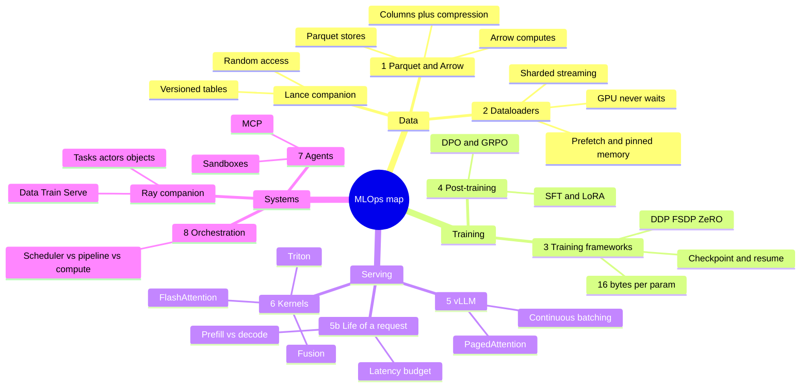
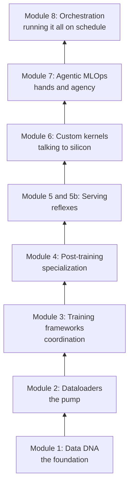

*By Gopi Krishna Tummala*

*A guide to this site's MLOps series: eight short modules that follow a model from the files its data lives in to the GPUs that serve it, with the one trade-off each layer is about.*

---

Most MLOps advice starts with Git, Docker and a model registry. Those matter, but they're not where most of the money goes. A team can spend tens of thousands of dollars a month on GPUs that sit idle because data arrives too slowly, a training job that doesn't fit in memory, or a serving stack that handles a tenth of the users it could.

This series is about that layer: the infrastructure between a dataset and a model answering users. Each module follows the same idea through one part of the stack, and each one comes down to a single trade-off you should be able to explain.

One way to see how the modules connect is to follow a single image-captioning model through its life. Its training images sit in compressed files in object storage (Module 1). A dataloader has to stream them to the GPUs fast enough to keep them busy (Module 2). The model is too big for one GPU, so training is split across many (Module 3). A base model then gets fine-tuned to behave the way the product needs (Module 4). In production it serves thousands of requests at once (Modules 5 and 5b), with a few hot operations hand-optimized for the hardware (Module 6). Some requests turn into multi-step agents that call tools (Module 7). And all of it runs on a schedule, with a record of which data and code produced which model (Module 8).

## The idea in one picture

*The series in four groups. Numbered posts are the core path; Lance and Ray are companions to the modules next to them. Come back to this after each module: if you can explain every leaf out loud, you own that part of the stack.*

## The modules

- **Module 1: [Data DNA: Parquet and Arrow](/posts/mlops/parquet-arrow-quest-for-analytic-speed).** Store data in a compressed, column-oriented format; work on it in a shared in-memory format. The trade: CPU spent decompressing for far less disk and network traffic.
- **Module 2: [Datasets and Dataloaders](/posts/mlops/datasets-and-dataloaders).** The GPU should never wait for the CPU. The trade: host memory and CPU workers for GPU utilization.
- **Module 3: [Training Frameworks](/posts/mlops/hidden-engine-of-ai).** When a model doesn't fit on one GPU, split its memory across many. The trade: network bandwidth for per-GPU memory.
- **Module 4: [Post-Training](/posts/mlops/modern-post-training-peft-2026).** Turn a base model into a useful one with fine-tuning, preferences and rewards. The trade: a bit of quality ceiling (with LoRA) for much less compute.
- **Module 5: [LLM Serving with vLLM](/posts/mlops/vllm-trilogy-of-modern-llm-scaling).** Memory, not compute, limits how many users a GPU can serve. The trade: scheduling complexity for throughput.
- **Module 5b: [Life of a Request](/posts/mlops/life-of-a-tensor-production-inference)**. Follow one request from the network to the GPU and back. The trade: batch size and throughput against each user's latency.
- **Module 6: [Custom Kernels](/posts/mlops/custom-kernel-craze).** Most operations are slow because they move too much data, not because they do too much math. The trade: engineering effort for memory bandwidth.
- **Module 7: [Agentic MLOps](/posts/mlops/beyond-inference-agentic-mlops-mcp).** Models that use tools need sandboxes, permissions and traces. The trade: autonomy for control.
- **Module 8: [Pipeline Orchestration](/posts/mlops/ml-pipeline-orchestration-layers).** Schedulers, pipeline frameworks and compute engines are different layers. The trade: one more system to run for lineage and reproducibility.

The modules stack: each one is built on the one below, which is why the series starts at the data and not at the model.

*Read from the bottom up. A data format chosen in Module 1 decides whether the serving system in Module 5 can scale.*

Two companion posts go deeper on pieces that span several modules: [Beyond Parquet: Lance](/posts/mlops/lance-lancedb-data-layer-for-ml), next to Modules 1 and 2, and [the Ray Field Guide](/posts/mlops/ray-field-guide-core-to-production), the distributed runtime under parts of Modules 2, 3, 5 and 8. [The Multimodal Atlas](/posts/generative-ai/multimodal-foundation-models-end-to-end) applies the same stack to vision and video models.

## Three ways through

- **If you have an infrastructure interview soon:** Modules 1, 2, 3, 5 and 5b, then the first section of the Ray guide. Make sure you can explain each module's trade-off out loud.
- **If you're moving from research to production:** Modules 2, 3, 4, 5 and 8. They cover the gap between a training script and a service.
- **If you want the whole picture:** read in order, with each companion right after the module it extends.

## The trade-offs in one table

| Layer | The idea | What you give up for it |
|---|---|---|
| Storage | Compressed columns, shared memory format | CPU time to decompress |
| Data loading | Keep the GPU fed | Host memory and CPU workers |
| Training | Shard what doesn't fit | Network bandwidth |
| Post-training | Small adapters, preference signals | Some quality ceiling |
| Serving | Pack more users into GPU memory | Scheduler complexity and per-user latency |
| Kernels | Move fewer bytes | Engineering effort |
| Agents | Let models act | Control, which you buy back with guardrails |
| Orchestration | Know what produced what | Another system to run |

## What I'd remember

- **Infrastructure decides what models cost.** Idle GPUs, out-of-memory jobs and half-empty servers are infrastructure problems.
- **Each layer is one trade-off.** If you can name it and say when it's worth it, you understand the layer.
- **Data format choices made early limit what's possible later.** The layers are connected; a slow dataloader wastes the best training setup.

## Where to go next

Start with [Module 1: Data DNA](/posts/mlops/parquet-arrow-quest-for-analytic-speed). If you'd rather start from the middle, [Training Frameworks](/posts/mlops/hidden-engine-of-ai) and [LLM Serving with vLLM](/posts/mlops/vllm-trilogy-of-modern-llm-scaling) stand well on their own.
