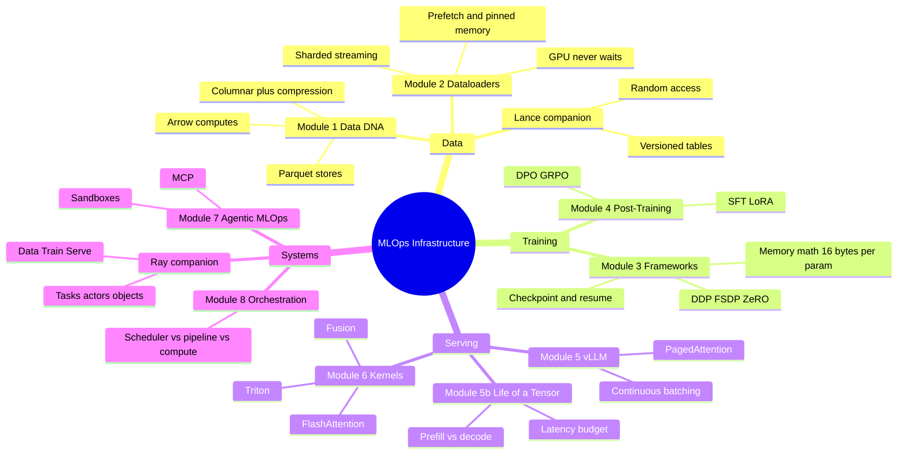
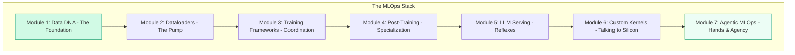

*By Gopi Krishna Tummala*

---

  
Infrastructure-First MLOps — Building the Engine of AI

  

    <a href="/posts/mlops/parquet-arrow-quest-for-analytic-speed" style="background: rgba(255,255,255,0.1); padding: 0.5rem 1rem; border-radius: 6px; text-decoration: none; color: white; opacity: 0.9;">Module 1: Data DNA</a>
    <a href="/posts/mlops/datasets-and-dataloaders" style="background: rgba(255,255,255,0.1); padding: 0.5rem 1rem; border-radius: 6px; text-decoration: none; color: white; opacity: 0.9;">Module 2: Dataloaders</a>
    <a href="/posts/mlops/hidden-engine-of-ai" style="background: rgba(255,255,255,0.1); padding: 0.5rem 1rem; border-radius: 6px; text-decoration: none; color: white; opacity: 0.9;">Module 3: Training</a>
    <a href="/posts/mlops/modern-post-training-peft-2026" style="background: rgba(255,255,255,0.1); padding: 0.5rem 1rem; border-radius: 6px; text-decoration: none; color: white; opacity: 0.9;">Module 4: Post-Training</a>
    <a href="/posts/mlops/vllm-trilogy-of-modern-llm-scaling" style="background: rgba(255,255,255,0.1); padding: 0.5rem 1rem; border-radius: 6px; text-decoration: none; color: white; opacity: 0.9;">Module 5: Serving</a>
    <a href="/posts/mlops/custom-kernel-craze" style="background: rgba(255,255,255,0.1); padding: 0.5rem 1rem; border-radius: 6px; text-decoration: none; color: white; opacity: 0.9;">Module 6: Kernels</a>
    <a href="/posts/mlops/beyond-inference-agentic-mlops-mcp" style="background: rgba(255,255,255,0.1); padding: 0.5rem 1rem; border-radius: 6px; text-decoration: none; color: white; opacity: 0.9;">Module 7: Agentic AI</a>
    <a href="/posts/mlops/ml-pipeline-orchestration-layers" style="background: rgba(255,255,255,0.1); padding: 0.5rem 1rem; border-radius: 6px; text-decoration: none; color: white; opacity: 0.9;">Module 8: Orchestration</a>
  

  
📖 You are reading <strong>The Roadmap</strong> — A Blueprint for AI Infrastructure

---

### Act 0: MLOps in Plain English

Most people think building an AI company is about having the smartest "Brain" (The Model). But if you have a genius brain inside a body that can't move, has no blood flow, and can't eat, that genius is useless.

**MLOps Infrastructure** is the body. 
*   **Data DNA:** The food and how it's digested.
*   **Dataloaders:** The veins and arteries moving nutrients to the muscles.
*   **Training Frameworks:** The nervous system coordinating thousands of muscles (GPUs) at once.
*   **Post-Training:** Sculpting the raw brain into a specialized professional.
*   **Serving:** The reflexes and speech that allow the brain to interact with the world.
*   **Kernels:** Hand-grinding custom tools for impossible tasks.
*   **Agentic AI:** Giving the body hands and autonomy to act in the world.

If your infrastructure is weak, you spend $40,000 on a GPU just to watch it sit idle. **This roadmap is how you build a body strong enough to support a super-intelligence.**

---

## Table of contents

---

## The Whole Series in One Picture

Before diving in, here's the entire roadmap as a mind map. Come back to it after each module: if you can explain every leaf out loud, you own that part of the stack.

---

## The Infrastructure-First Philosophy

Every production AI system is built on seven layers. This roadmap starts at the foundation and builds upward. Why? Because **data format choices made in Module 1 determine whether your Module 5 serving system can scale**.

---

## The 7-Module Learning Path

### 📦 Module 1: The DNA of Data (Storage & Pipelines)
**The Core Idea:** Store in Parquet, Compute in Arrow.
Learn how modern systems like HuggingFace Datasets handle petabytes of data by understanding the fundamental trade-off between storage efficiency (Parquet) and compute speed (Arrow).

📖 **[Deep Dive: Parquet, Arrow, and Speed](/posts/mlops/parquet-arrow-quest-for-analytic-speed)**

---

### 🔄 Module 2: Datasets & Dataloaders (The Intake Valve)
**The Core Idea:** The GPU should never wait for the CPU.
Understand the "Zero-Copy" pipeline that moves data from S3 to GPU registers. Master prefetching, pinned memory, and hardware-accelerated decoding.

📖 **[Deep Dive: The Pump of AI](/posts/mlops/datasets-and-dataloaders)**

---

### ⚡ Module 3: Training Frameworks & Resilience (The Scale-Out)
**The Core Idea:** 3D Parallelism (Data, Pipeline, Tensor).
Learn how to train models that don't fit on a single GPU. Master **ZeRO (Zero Redundancy Optimizer)** and build clusters that survive node failures without losing progress.

📖 **[Deep Dive: The Engine of AI](/posts/mlops/hidden-engine-of-ai)**

---

### 🎨 Module 4: Post-Training (PEFT & Alignment)
**The Core Idea:** Sculpting Intelligence.
Pre-training is just the start. Learn how to use **LoRA, DoRA, and DPO** to turn a raw model into a specialized, safe, and controllable assistant without spending millions on compute.

📖 **[Deep Dive: Sculpting Intelligence](/posts/mlops/modern-post-training-peft-2026)**

---

### 🚀 Module 5: The Serving Infrastructure (vLLM & Inference)
**The Core Idea:** Memory is the bottleneck, not compute.
Deep dive into **PagedAttention** and **Continuous Batching**. Learn how to fit 10x more users on the same GPU by managing the KV cache like an Operating System.

📖 **[Deep Dive: vLLM and the Trilogy of Speed](/posts/mlops/vllm-trilogy-of-modern-llm-scaling)**

---

### 🧬 Module 5b: Life of a Tensor (Production Inference, End to End)
**The Core Idea:** Follow one request from the load balancer to the GPU and back.
Where the milliseconds actually go: tokenization, batching queues, prefill vs decode, KV cache transfer and post-processing. This is the module that turns "I know vLLM" into "I can debug a p99 latency spike."

📖 **[Deep Dive: Life of a Tensor](/posts/mlops/life-of-a-tensor-production-inference)**

---

### ⚙️ Module 6: Custom Kernels & GPU Optimization (The Deep Tech)
**The Core Idea:** Hand-grinding your own tools.
When standard libraries fail, we write **Triton** or **CUDA**. Learn why **FlashAttention** was a breakthrough in I/O management and how to bypass the "Memory Wall."

📖 **[Deep Dive: Handcrafting GPU Speed](/posts/mlops/custom-kernel-craze)**

---

### 🤖 Module 7: Agentic MLOps (Beyond Inference)
**The Core Idea:** Giving the AI Hands.
The shift from stateless request-response to stateful, autonomous agents. Master the **Model Context Protocol (MCP)** and secure execution sandboxes (Firecracker/gVisor).

📖 **[Deep Dive: Beyond Stateless Inference](/posts/mlops/beyond-inference-agentic-mlops-mcp)**

---

### 🧭 Module 8: Pipeline Orchestration (Who Runs What, When)
**The Core Idea:** Schedulers, pipelines and compute engines are different layers.
Temporal, Airflow, Kubeflow and Ray solve different problems. Learn which layer owns retries, lineage, scheduling and distributed compute, and how to compose them instead of picking "one tool."

📖 **[Deep Dive: Which Layer Does What](/posts/mlops/ml-pipeline-orchestration-layers)**

---

### 📚 Companion Deep Dives

These sit alongside the numbered modules. Read them when the module they extend clicks.

| Companion | Extends | Why read it |
|---|---|---|
| [Beyond Parquet: Lance & LanceDB](/posts/mlops/lance-lancedb-data-layer-for-ml) | Modules 1–2 | What changes when the file format is designed for random access, embeddings and versioned datasets |
| [The Ray Field Guide](/posts/mlops/ray-field-guide-core-to-production) | Modules 2, 3, 5, 8 | The distributed runtime under many of these systems: when a process pool is enough and when Ray earns its keep |
| [The Multimodal Atlas](/posts/generative-ai/multimodal-foundation-models-end-to-end) | Modules 1–5 | The same stack applied to vision-language, image and video models |
| [Coding With AI Without Losing Your Edge](/posts/interview-prep/ai-assisted-coding-conscious-practice-and-interviews) | All | How to use AI tools while learning this material without losing the skills; see also [AI-enabled interviews](/posts/interview-prep/ai-enabled-coding-interviews) |

---

## Three Ways Through This Roadmap

- **"I have an infra interview in two weeks":** Modules 1 → 2 → 3 → 5 → 5b, then the Ray Field Guide's Part 0 and cheat sheet. Focus on the trade-offs table below.
- **"I'm moving from research to production":** Modules 2 → 3 → 4 → 5 → 8. These cover the gap between a training script and a service.
- **"I want the full picture":** in order, 1 through 8, reading each companion right after the module it extends.

---

## The Interview Philosophy: "Why" Over "What"

Senior ML infrastructure interviews don't test whether you know what PagedAttention is. They test whether you understand *why* it was necessary.

Throughout this roadmap, focus on the **Trade-offs**:
1. **Data:** Why Parquet? → Trade CPU cycles for Disk I/O.
2. **Training:** Why FSDP? → Trade Network Bandwidth for VRAM capacity.
3. **Serving:** Why Quantization? → Trade Accuracy for Throughput.
4. **Kernels:** Why Fusion? → Trade logic complexity for Memory Bandwidth.

---

## Remember This: The Trade-Offs Cheat Sheet

If you remember only one line per module, make it this one.

| Module | The one-line idea | The trade-off you should be able to defend |
|---|---|---|
| 1. Data DNA | Store in Parquet, compute in Arrow | CPU decompression cycles for far less disk and network I/O |
| 2. Dataloaders | The GPU should never wait for the CPU | Host memory and CPU workers (prefetch, pinned memory) for GPU utilization |
| 3. Training | Shard what doesn't fit | Network bandwidth (all-gathers, reduce-scatters) for per-GPU memory |
| 4. Post-Training | Adapt cheaply, align with preferences | A little quality ceiling (LoRA) for much less compute and memory |
| 5. Serving | Memory, not compute, is the bottleneck | Scheduling complexity (paging, continuous batching) for throughput |
| 5b. Life of a Tensor | Latency is a budget across many stages | Batch size and throughput vs per-request latency (TTFT, TPOT) |
| 6. Kernels | Move less data | Engineering complexity for memory bandwidth |
| 7. Agentic MLOps | Agents need state, tools and sandboxes | Autonomy for safety and control surface |
| 8. Orchestration | Know which layer owns what | One more system to run for retries, lineage and reproducibility |

<strong>Self-check: can you answer these without looking?</strong>

1. Why is Parquet slower to *write* but much faster to *query* than CSV for analytics?
2. Your GPU utilization is 55% during training. Name three places to look before buying more GPUs.
3. How many bytes of memory per parameter does mixed-precision Adam need, and how does ZeRO-3 split them?
4. Why does LoRA use so much less memory than full fine-tuning?
5. What problem does PagedAttention solve, and why does it raise throughput rather than per-token speed?
6. What's the difference between time-to-first-token and time-per-output-token, and which one does batch size hurt more?
7. Why can a fused kernel be faster even though it does the same arithmetic?
8. Airflow, Temporal, Kubeflow and Ray: which one would you use for a daily retraining DAG, a long-running stateful workflow, and distributed GPU batch inference?

Each answer is in the corresponding module above.

---

## Ready to Start?

Begin with **[Module 1: The DNA of Data](/posts/mlops/parquet-arrow-quest-for-analytic-speed)**. Master the foundation, and the rest of the stack becomes intuitive.

**The journey from \"I can train a model\" to \"I can build the infrastructure that powers AI at scale\" starts here.**

---

*Have questions? Reach out on [Twitter/X](https://twitter.com/gopikrishnat) or [LinkedIn](https://linkedin.com/in/gopikrishnat).*

---

**New in the series:** [The Ray Field Guide](/posts/mlops/ray-field-guide-core-to-production) (distributed compute, from process pools to KubeRay) · [The Multimodal Atlas](/posts/generative-ai/multimodal-foundation-models-end-to-end) (how MLLMs, text-to-image and text-to-video models are built end to end) · [Beyond Parquet: Lance](/posts/mlops/lance-lancedb-data-layer-for-ml).
