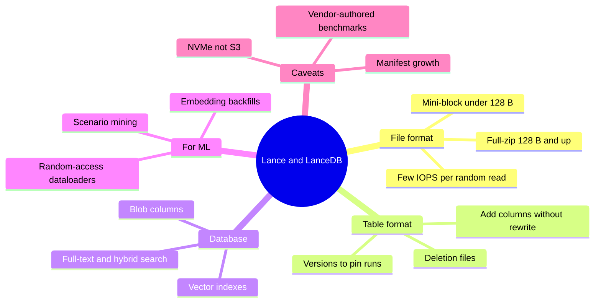
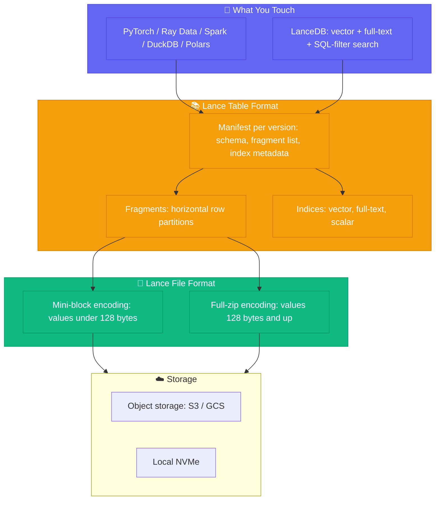
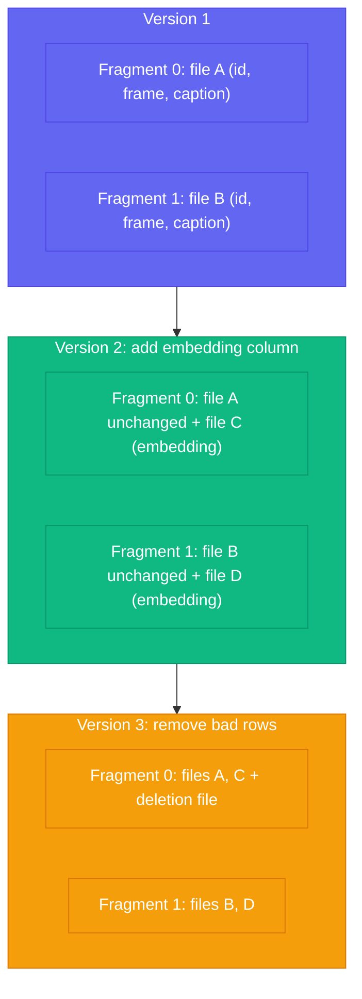
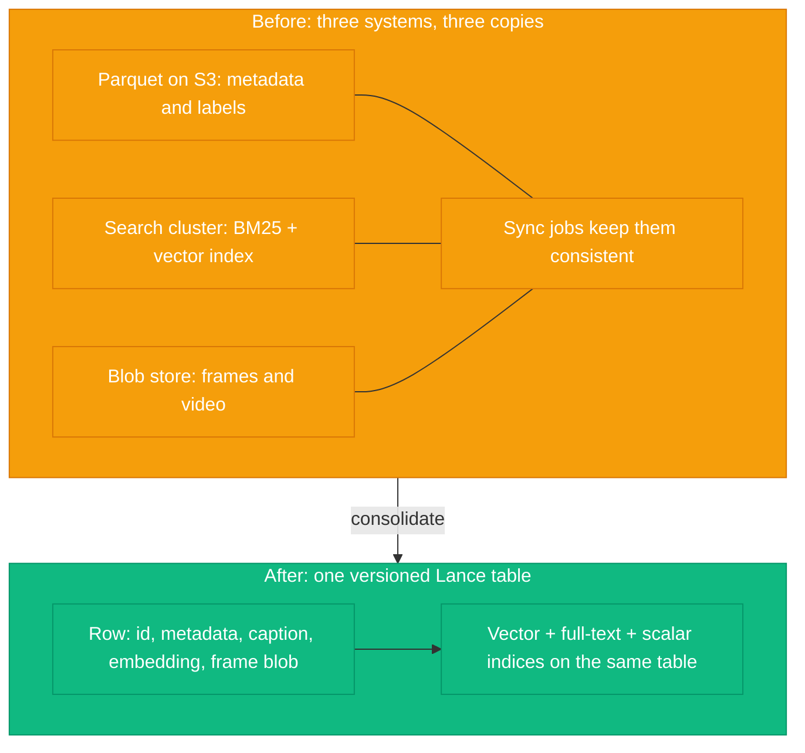

*By Gopi Krishna Tummala*

---

> **Companion to** [Module 1: Data DNA](/posts/mlops/parquet-arrow-quest-for-analytic-speed) **and** [Module 2: Dataloaders](/posts/mlops/datasets-and-dataloaders). This post revisits two claims I made there ("Store in Parquet, Compute in Arrow" and "sequential reads are not optional at scale") and asks what changes when the storage format itself is designed around ML access patterns.

---

## TL;DR

- **Lance** is an open-source (Apache-2.0) columnar *file format* plus a versioned *table format*. **LanceDB** is the database built on top, adding vector, full-text, and SQL-filter search. Roughly: what you get if the file format, the table format, and the vector index are designed together for ML ([Lance README](https://github.com/lance-format/lance)).
- The strongest evidence is a paper by the Lance team ([Pace et al., 2025](https://arxiv.org/abs/2504.15247)). On local NVMe, its 2.1 encodings roughly **tie or beat *tuned* Parquet at random access**, **match or beat it on full scans**, use less metadata RAM, and remove row-group tuning.
- The famous "100×" to "2000×" headlines are **not** that comparison. The paper's own "60×" is *default Parquet settings vs. tuned Parquet settings*. Numbers this different are usually explained by column type, baseline configuration, and storage medium.
- For many ML teams the **table format** matters more than the raw speed: add a column (say, a new embedding) without rewriting the dataset, delete rows with deletion files, and pin a training run to an exact dataset version.
- The catch: vendor-authored evidence, NVMe rather than S3 measurements, a younger ecosystem than Parquet's, and real metadata costs for very frequent small commits on huge tables.
- **Interview one-liner:** *"Parquet optimizes for scans; Lance's adaptive encodings target point lookups and scans together, and its table format adds cheap column evolution and versioning. I'd keep Parquet as the interchange format and use Lance for the hot, ML-facing layer."*

---

## Table of contents

---

## The Post in One Picture



---

### Act 0: Why Parquet Starts to Hurt (in Plain English)

In Module 1 I used a moving-house analogy: pack by topic instead of by room, and you can grab all the snacks without digging through the mattress box. Parquet is the champion of that world, and for scan-heavy analytics "Store in Parquet, Compute in Arrow" is still a good rule.

But ML workloads keep asking questions the warehouse wasn't laid out for:

1. **"Get me snack #48,213,907."** A random row. Shuffling, curating, debugging one bad sample, retrieval for RAG.
2. **"Put a new label on every item."** A new column. Every new model generation adds embeddings, scores, and labels.
3. **"Show me the warehouse exactly as it was when I trained model v12."** A version.

Parquet can answer all three, but usually with workarounds. The shard-and-approximate-shuffle recipe in Module 2 is one of them. I told the story there of a Zoox training run stuck at 58% GPU utilization because of JPEG decoding in Python workers. Fixing that was a pipeline problem, and pipeline fixes still matter. But the *design pressure* behind WebDataset tarballs (avoid random reads) is a constraint of the storage layer. Change the storage format and part of that design space changes with it.

---

### Act I: What Lance Actually Is (Three Layers, Not One Product)

"Lance" gets used loosely, so let's separate the layers.



*Figure 1: The Lance stack. Engines talk to the table format; the table format organizes files; the file format decides how each column is physically encoded.*

- **File format:** how a column is laid out on disk. This is where the random-access story lives (Act II).
- **Table format:** a dataset is a versioned collection of *fragments*. Each version is described by an immutable *manifest* listing the schema, the fragments, and the indices. Each fragment holds one or more data files (each storing a subset of the columns) plus an optional deletion file ([table format spec](https://lance.org/format/table/)).
- **LanceDB:** the database and company. It adds vector, full-text (BM25), and SQL-filtered search on top of Lance tables. The project lists integrations with Arrow, Pandas, Polars, DuckDB, Spark, Ray, Trino, and Flink ([README](https://github.com/lance-format/lance)).

Two ecosystem signals are worth noting because they come from *other* projects' docs, not LanceDB's marketing: Ray Data documents a [`read_lance`](https://docs.ray.io/en/latest/data/api/doc/ray.data.read_lance.html) reader, and Hugging Face's Hub documentation describes [hosting and streaming Lance datasets](https://github.com/huggingface/hub-docs/blob/main/docs/hub/datasets-lance.md). That connects to the [Ray Data material in the Ray Field Guide](/posts/mlops/ray-field-guide-core-to-production#10-ray-data-streaming-batch-processing) and the orchestration layers in [Module 8](/posts/mlops/ml-pipeline-orchestration-layers).

---

### Act II: The Core Trick, Structural Encoding

This is the part that is genuinely new, so it is worth understanding rather than memorizing a speedup number.

#### The two currencies of a random read

The paper evaluates every format on two things: how many **IOPS** it takes to reach one value, and how much **read amplification** you pay (bytes read beyond what you needed). Parquet's page-offset index lets a reader find the right page with a single IOP, but it then reads and decodes the *whole page*, so read amplification equals the page size. Shrink the pages and random access improves, but the offset index grows and scans get worse.

#### What the paper measured (and how)

- **Rig:** an Intel i7-10700K and a Samsung 970 EVO Plus 2 TB NVMe drive, benchmarked at roughly 850K random 4 KiB reads/s and 3,400 MiB/s.
- **Protocol:** parallel `take` operations of 256 random row indices, measured in rows/s, on datasets up to one billion rows (large enough that lucky neighboring reads stop helping).
- **Types:** 8-byte scalars, short strings, lists, 768-dim float vectors (3 KiB), lists of vectors, images (20 KiB), and image lists (100 KiB).

**Finding 1: the "60×" is Parquet vs. Parquet.** With default `parquet-rs` settings the authors measured about 5,500 rows/s on small scalars; with tuned settings (8 KiB pages, with compression and dictionary encoding turned off) about 350,000 rows/s. That ~64× gap is the abstract's "over 60×." It is a lesson about *configuring Parquet*, not a Lance-vs-Parquet number.

**Finding 2: Lance's answer is to encode by width.** Instead of one structural encoding for everything, Lance alternates based on how wide a value is:

| | **Mini-block** | **Full zip** |
|---|---|---|
| **Used for** | Values under 128 B (scalars, short strings) | Values of 128 B and up (embeddings, tensors, images, long text) |
| **Layout** | Columnar chunks of about 1–2 disk sectors (4–8 KiB compressed), vectorized | Repetition levels, definition levels, and data zipped together per value, row-major |
| **Random access** | Must decode a whole chunk (read *and* compute amplification) | At most 1 IOP for fixed-width, 2 for variable-width, regardless of nesting depth |
| **Compression** | Opaque encodings allowed | Must be *transparent* (bit-packing, FSST, per-value LZ4) |
| **Metadata in RAM** | About 24 B per chunk (41 with a repetition index) | None |

The intuition: small values are cheap to decode in bulk, so chunking wins; large values are already expensive to read, so you can afford to keep each one independently addressable.

**Finding 3: Lance 2.1 roughly ties or beats tuned Parquet at random access.** Arrow-style encodings do fine on simple types but collapse on nested ones (a `List<String>` needs about 5 IOPS per value). Lance 2.1 stays consistent regardless of nesting, though it slightly *underperforms* the older Arrow-style Lance 2.0 encoding on simple scalars because mini-block must decode a chunk to fetch one value. As values get larger, tuned Parquet's gap to the disk baseline narrows (for the paper's biggest types it essentially matches it), so the practical difference shifts from throughput to metadata: Parquet's offset index costs about 20 bytes per page, which for large values and small pages works out to roughly **20 GiB of search cache per billion rows**. Lance's full-zip encoding needs none.

**Finding 4: scans are not sacrificed.** In the authors' full-scan tests, Parquet often reaches only about **half of the drive's peak bandwidth**. Their profiling points to I/O scheduling (readers alternate between waiting on I/O and decoding) rather than a compute limit, and adding threads did not fix it. Lance matched or beat Parquet's best-tuned scan on nearly all eight test datasets, in a few cases by close to 2×, with similar compression ratios.

**Finding 5: no row-group tuning.** Back in Module 1 I called 128–512 MB per row group the sweet spot for scans. The paper sweeps row-group sizes in *rows* (1Ki to 1Mi) and finds that small types prefer bigger row groups while large types prefer smaller ones, yet a file must pick one size for every column. A Lance file behaves as if it has a single row group and still scans in parallel, so that knob disappears.

#### How to read "100×"

The Lance README advertises "100× faster than Parquet or Iceberg for random access." Third-party write-ups, including [Dremio's comparison of Parquet, Lance, Nimble, and Vortex](https://www.dremio.com/blog/exploring-the-evolving-file-format-landscape-in-ai-era-parquet-lance-nimble-and-vortex-and-what-it-means-for-apache-iceberg/) (Dremio is itself a vendor with an Iceberg stake), repeat figures near 2000× for certain workloads. My read: numbers that spread from ~2× to ~2000× are explained by *what you compare against*: untuned Parquet vs. tuned Parquet, small scalars vs. nested columns, NVMe vs. object storage, warm vs. cold metadata. When someone quotes a multiplier, ask which of those they chose.

#### The paper's own caveats (please read these)

- **Authors:** every author is affiliated with LanceDB, so this is vendor research. It is unusually candid (it shows tuned Parquet doing well), and the authors provide scripts to reproduce it, but it is not independent.
- **NVMe, not S3:** the paper notes that S3-class services are generally limited to tens of thousands of IOPS and don't benefit from reads much smaller than about 100 KB, while NVMe supports hundreds of thousands of IOPS at 4 KiB.
- **Test conditions favor Parquet's best case:** compression was disabled for the random-access runs, and dictionary encoding dropped Parquet to about 2% of ideal on their random data.
- **Both formats leave NVMe performance on the table** for small accesses (system-call overhead, sector alignment).
- **Maturity:** the 2.1 encodings were flagged experimental at the time of writing. Check current status before you depend on them.

---

### Act III: The Table Format, Where ML Teams Actually Feel It

Speed gets the headlines, but the table format is what changes daily workflow.



*Figure 2: Every write commits a new immutable manifest. Adding a column appends data files to existing fragments instead of rewriting them; deletes are tracked in side files.*

#### 1. Column evolution without a rewrite

Per the spec, adding a column appends new data files to existing fragments, and most schema operations leave existing data files untouched ([data evolution guide](https://lance.org/guide/data_evolution/)). Compare that with the usual Parquet answer: rewrite the dataset, or keep a side table and pay for a join forever.

```python
import lance
import pyarrow as pa

ds = lance.dataset("s3://my-bucket/scenes.lance")

# Backfill a brand-new embedding column batch by batch, with a resumable checkpoint
@lance.batch_udf(checkpoint_file="clip_v2_checkpoint.sqlite")
def embed(batch):
    vecs = my_encoder(batch.column("frame"))      # your model; returns an (n, 768) float32 array
    return pa.RecordBatch.from_arrays(
        [pa.FixedSizeListArray.from_arrays(vecs.astype("float32").flatten(), 768)],
        names=["clip_v2"],
    )

ds.add_columns(embed)

# Attach labels computed elsewhere, joined on id
ds.merge(new_labels_table, "id")

# Retire a column you no longer need
ds.drop_columns(["clip_v1"])
```

Runway's testimonial on LanceDB's [customer page](https://www.lancedb.com/customers) makes exactly this point: appending columns without rewriting entire datasets speeds up model iteration. (It is a vendor-published testimonial, so weigh it accordingly, but the mechanism is documented in the spec.)

#### 2. Deletes without rewrites

Removed rows are recorded in a *deletion file*, stored as an Arrow IPC list for sparse deletes or a Roaring bitmap for dense ones; readers filter them out. That is a cheap way to drop a corrupted sample, a mislabeled batch, or data you no longer have rights to use, at least until compaction physically removes it.

#### 3. Versions you can pin a training run to

Every commit creates a new version, and versions can be tagged:

```python
ds = lance.dataset("s3://my-bucket/scenes.lance")
ds.versions()                          # inspect history
ds.tags.create("run-v12", 42)          # pin the version this run used (42 is illustrative)

train_ds = lance.dataset("s3://my-bucket/scenes.lance", version="run-v12")
```

Reproducibility is the sort of lineage concern I covered in [Module 8](/posts/mlops/ml-pipeline-orchestration-layers): a run is only reproducible if the *data* is addressable, not just the code and config.

#### 4. Concurrency on object storage

Lance relies on atomic primitives (put-if-not-exists or rename-if-not-exists) so that exactly one writer wins when several try to create the same manifest, and it classifies conflicts as rebasable, retryable, or incompatible ([transaction spec](https://lance.org/format/table/transaction/)). For stores without those primitives, an external manifest store coordinates commits.

#### The honest limits of the table format

The "small file problem" from Module 1 does not vanish. It moves. A current design proposal in the Lance repo ([PR #9060](https://github.com/lance-format/lance/pull/9060)) states the issue plainly: each version stores every fragment inline in the manifest, so appends, replacements, and deletes rewrite metadata proportional to the *table's* size rather than the size of the *change*. As of this writing that PR is open and contested. The practical takeaway: on very large tables, avoid thousands of tiny commits, batch your writes, and budget for compaction and version cleanup. Frequent small appends are the workload to test before you commit to it.

---

### Act IV: The Dataloader, Reconsidered

Here is the payoff for anyone who read Module 2. I gave this interview answer for shuffling a 50 TB dataset across 256 GPUs: shuffle shard order globally, shuffle a buffer locally, and skip true global shuffle because random object-store GETs are roughly 100× slower than sequential reads. That answer is still right for its premise. So what actually changes with Lance?

**What does not change: the physics of object storage.** The paper's own S3 figures (tens of thousands of IOPS, no benefit from tiny reads) are why streaming pretraining data from S3 still wants sequential, prefetched access and a local NVMe cache like the one in Module 2's data pump diagram. Lance's own PyTorch integration reflects that: it ships a `ShardedFragmentSampler` (as the name suggests, sharding by fragment), the same idea as sharding by tarball.

**What does change: the cost of a random row on fast storage, and the freedom that buys you.** With at most 1-2 IOPS per value on NVMe, `take(indices)` becomes a routine operation rather than a last resort:

```python
import lance

ds = lance.dataset("s3://my-bucket/scenes.lance")

# Exact random access: no tar shard, no full scan
batch = ds.take([48_213_907, 12, 907_331_004], columns=["frame", "label"])

# Predicate pushdown: pull just the subset for a curriculum stage
rainy = ds.to_table(
    columns=["id", "frame"],
    filter="weather = 'rain' AND is_night = true",
    limit=10_000,
)
```

And a distributed loader, following the pattern in Lance's [PyTorch docs](https://lance.org/integrations/pytorch/):

```python
import torch
from lance.sampler import ShardedFragmentSampler
from lance.torch.data import LanceDataset

dataset = LanceDataset(
    "scenes.lance",
    columns=["frame", "label"],
    batch_size=128,
    batch_readahead=8,
    sampler=ShardedFragmentSampler(rank=rank, world_size=world_size),
)
loader = torch.utils.data.DataLoader(dataset)
```

| Module 2 question | WebDataset shards | Lance dataset |
|---|---|---|
| Unit of sharding | Tar files | Fragments |
| Fetch one arbitrary sample | Not cheap; use an approximate shuffle buffer | `take(indices)`, at most 1-2 IOPS per value on NVMe |
| Change the sampling strategy | Often means re-sharding | Change the index list or filter |
| Add a label or embedding column | Rewrite shards | `add_columns` |
| Train on a filtered subset | Scan everything, or build a new shard set | Filter pushdown / scalar index |
| Ecosystem maturity | Mature, simple, well understood | Newer; first-party integrations for PyTorch and Ray |

Where this bites in practice is not 50 TB pretraining. It is the *many-small-experiments* regime: fine-tuning sets, preference data for DPO, eval sets, active-learning loops, and dataset curation, where you want exact shuffles, surgical subsets, and cheap label changes. One honest hedge from Hugging Face's own Lance documentation: streaming is fast for scalar metadata but not as quick for embeddings or large multimodal assets. Benchmark your own column mix.

---

### Act V: One Table for Vectors, Text, and Blobs (RAG Revisited)

In my [multimodal RAG post](/posts/generative-ai/building-production-rag-opensearch) the architecture was: HNSW or IVF for vectors, BM25 for keywords, merge with Reciprocal Rank Fusion, then rerank, with frame-level CLIP embeddings stored beside a `parent_id` for video. That works, and it is also three systems that must stay in sync: the metadata store, the search cluster, and the blob store.



*Figure 3: Consolidating retrieval data. The indices live with the data, and the version pins all of it together.*

Lance stores images, video, and audio in blob columns with lazy reads and streaming byte access, and LanceDB exposes hybrid search with the same RRF fusion I described:

```python
import lancedb
from lancedb.rerankers import RRFReranker

db = lancedb.connect("data/scenes-db")
table = db.open_table("scenes")   # schema has a caption text field and an embedding vector field
table.create_fts_index("caption") # index builds asynchronously; wait for it in production

results = (
    table.search(
        "pedestrian crossing against the light",
        query_type="hybrid",
        vector_column_name="vector",
        fts_columns="caption",
    )
    .where("weather = 'rain'", prefilter=True)
    .rerank(RRFReranker())
    .limit(10)
    .to_pandas()
)
```

The trade-offs are real. You still make the index-algorithm and recall-vs-latency decisions from the RAG post (the Lance README lists IVF_PQ for vector search). A storage-native engine over object storage is a different operating point from a distributed search cluster built for very high QPS, multi-tenant traffic, and real-time indexing. Vendor-published case studies claim strong results (Character.ai reports a p90 latency drop of over 90% after moving full-text search off Elasticsearch, and LanceDB's page lists Netflix at 20K+ vector queries per second), but treat those as testimonials, not benchmarks you can reproduce.

---

### Act VI: Autonomous Driving, Scenario Mining as a Retrieval Problem

AV log corpora hit all three ML demands at once: you need rare events out of petabytes (random access plus filtering), every new model generation adds columns (embeddings, predictions, metrics), and regression suites must be reproducible (versions).

The vendor-published numbers here come from LanceDB's [Series A announcement](https://www.lancedb.com/blog/series-a-funding): WeRide is quoted as cutting data-mining time from a week to an hour and improving ML developer productivity 90×, and a robotics-data example claims 1.7–6× faster reads and 42% lower storage. WeRide was also named as a customer in independent [TechCrunch coverage](https://techcrunch.com/2024/05/15/lancedb-which-counts-midjourney-as-a-customer-is-building-databases-for-multimodal-ai/) of LanceDB's 2024 seed round. Again: claims, not audited benchmarks.

There is a pattern from my own work that maps onto this. In a Zoox patent, [US 12,668,281 "Database generation including predicted scenarios"](https://patents.justia.com/patent/12668281), driving scenarios are clustered by feature similarity, each cluster gets an encoded representation (a key) and associated prediction information (a value), and key-value pairs are stored in a database vehicles can access while navigating. That is an embedding-keyed lookup over a large log corpus, precisely the shape of workload vector-native tables target. To be clear, the patent's abstract doesn't mention Lance; I'm pointing at the *pattern*, not describing a Lance deployment. For the modeling side, see [Module 7: The Fortune Teller](/posts/robotics/autonomous-stack-module-7-prediction) and [The Role of Predictions in Closed-Loop Autonomous Driving](/posts/robotics/behavior-prediction-closed-loop-driving).

---

### Act VII: The Honest Scorecard

| Workload | Parquet (+ Iceberg) | Lance | Notes |
|---|---|---|---|
| Batch SQL / BI scans | Excellent, universal tooling | Comparable scan throughput in the paper | Lance's BI-tool integrations are thinner |
| Full-scan training reads | Often ~50% of NVMe bandwidth in the paper | Equal or better in nearly all tests | Needs your own benchmark on your columns |
| Point lookups / shuffling | Needs tuning (page size, dictionary, compression) | Designed for it | Biggest gap on NVMe, smaller on object storage |
| Wide / blob / embedding columns | Works; large offset-index RAM for big values | Full-zip encoding, no search cache | Vector, blob, and index support built in |
| Add a column to a huge table | Rewrite or side-table join | Append data files | Lance's clearest structural win |
| Vector + full-text search on the data | Separate system | Built in | Trade-off: different scale-out model than a search cluster |
| Frequent tiny commits on huge tables | Also painful (small files) | Manifest growth; compaction needed | Test before committing |
| Ecosystem / hiring / tooling | Ubiquitous | Growing, still smaller | Dremio's own summary calls it less mature |

**Evidence grading, so you know how much to trust each claim:**

| Claim | Source | How much weight |
|---|---|---|
| Tuned Parquet is ~64× faster than default on small scalars | [Lance paper](https://arxiv.org/abs/2504.15247) | Measured, reproducible scripts, vendor-authored |
| Lance 2.1 ≥ tuned Parquet on random access and scans (NVMe) | Same paper | Vendor-authored, NVMe only, 2.1 was experimental |
| "100× faster than Parquet or Iceberg" | [README](https://github.com/lance-format/lance) | Marketing headline; check the configuration |
| ~2000× on certain workloads | [Dremio](https://www.dremio.com/blog/exploring-the-evolving-file-format-landscape-in-ai-era-parquet-lance-nimble-and-vortex-and-what-it-means-for-apache-iceberg/) | Secondary source from a vendor with its own stake |
| WeRide: 1 week to 1 hour; 90× productivity | [LanceDB announcement](https://www.lancedb.com/blog/series-a-funding) | Vendor-published customer claim |
| Runway, Character.ai, Netflix results | [Customer page](https://www.lancedb.com/customers) | Vendor-published testimonials |
| Named customers and ~600K monthly downloads (2024) | [TechCrunch](https://techcrunch.com/2024/05/15/lancedb-which-counts-midjourney-as-a-customer-is-building-databases-for-multimodal-ai/) | Independent reporting of a founder's claim |
| Ray and Hugging Face document Lance support | [Ray docs](https://docs.ray.io/en/latest/data/api/doc/ray.data.read_lance.html), [HF docs](https://github.com/huggingface/hub-docs/blob/main/docs/hub/datasets-lance.md) | First-party docs from other projects: a real adoption signal |

**The landscape is not a two-horse race.** The paper itself cites Meta's Nimble and Spiral's Vortex as other emerging formats. Dremio's summary describes Nimble as favoring decode speed for training pipelines and Vortex as a general-purpose Parquet successor, and notes Apache Iceberg's proposed File Format API, which would make formats pluggable under one table layer. So "Lance vs. Parquet" may increasingly become "which file format sits under which table format."

**My updated rule of thumb** (provisional, and yours to test): *archive and exchange in Parquet; train, curate, and retrieve from a layer that supports random access, column evolution, and versions.* It refines "Store in Parquet, Compute in Arrow" rather than replacing it. Lance is also Arrow-native, so the compute half of that rule still holds.

---

### Act VIII: System Design & Interview Scenarios

#### Scenario 1: The Embedding Backfill
*   **Question:** "You have 500M images and a new embedding model every quarter. Adding a column to a Parquet dataset means rewriting everything. Design the storage layer."
*   **Answer:** Use a table format with **column-level evolution**. In Lance, `add_columns` appends data files to existing fragments, and a checkpointed batch UDF makes the backfill resumable. Mention the costs: old versions retain storage until cleaned up, and fragments should be compacted afterward. Also propose a tag per model generation so evaluations can pin their data.

#### Scenario 2: The Shuffle Revisited
*   **Question:** "You answered the 50 TB / 256 GPU shuffle question with a two-tier shuffle. Does a random-access format change that?"
*   **Answer:** For streaming pretraining from S3, not really: S3 IOPS limits are unchanged, so you still want sequential prefetched reads and an NVMe cache (shard by fragment instead of tarball). It changes the *small-experiment* regime: fine-tuning, preference data, and eval sets can use exact shuffles and filter pushdown without re-sharding. Say the distinction out loud; interviewers reward "it depends on the storage medium."

#### Scenario 3: Scenario Search for AV Logs
*   **Question:** "Engineers want to find 'unprotected left turns in rain with a pedestrian near the crosswalk' across petabytes of logs. Design it."
*   **Answer:** Embed scenarios (or clips), keep structured tags (weather, map region, agent types) as scalar columns, and run **filtered vector search plus full-text search over auto-generated captions**, fused with RRF. Keep it in one versioned table so results are reproducible against a dataset version. Then flag the trade-off: at very high QPS or real-time indexing needs, a dedicated search cluster may still win.

#### Scenario 4: "Why Not Just Tune Parquet?"
*   **Question:** "The paper says tuned Parquet is 60× faster than default. Why adopt anything new?"
*   **Answer:** Tuning is real and you should do it first. But per the paper, the tuned setup trades away scan performance and RAM (offset-index size for large values), and a single row-group size must serve every column in the file. Lance's adaptive encodings aim to avoid those trade-offs; the table format adds column evolution and versioning that no Parquet setting provides. If your workload is scan-only BI, stay on Parquet.

#### Scenario 5: "Why Not a Vector DB Next to Parquet?"
*   **Question:** "We already store vectors in a vector database and features in Parquet. What's wrong with that?"
*   **Answer:** Nothing is *wrong*, but you now have two sources of truth. Vectors and their source rows can drift apart, the two systems version independently, and every new embedding column becomes a synchronization job. A single versioned table with indices makes the pair atomic. The counterargument: dedicated vector databases may offer better scale-out and operational tooling.

---

### Key Takeaways

1. **Lance is three things:** a file format, a versioned table format, and (via LanceDB) a search-capable database. Evaluate each layer separately.
2. **The 60× in the paper is tuned vs. default Parquet.** Whenever you see a multiplier, ask what the baseline was.
3. **Adaptive encoding is the real idea:** narrow values get chunked (mini-block), wide values get zipped for at most 1-2 IOP lookups (full zip).
4. **Scans stay competitive,** so you are not forced to pick between training throughput and point lookups (per vendor-authored NVMe benchmarks).
5. **The table format is the quiet win:** add columns without rewriting, delete with deletion files, and pin runs to versions.
6. **The physics of S3 didn't change.** Fewer requests per sample helps; it isn't free.
7. **Watch manifest growth and commit frequency** on huge tables, and plan for compaction.
8. **Keep Parquet for interchange and BI.** Add Lance where random access, evolving columns, and retrieval dominate.

<details>
<summary><strong>Self-check</strong></summary>

1. What are Lance's three layers, and which one do most ML teams benefit from first?
2. What does "60×" in the paper actually compare?
3. Why does a wide value (an embedding) use a different encoding from a narrow one (an int64)?
4. How does Lance add a new embedding column to a billion-row table without rewriting it?
5. Name two honest limitations you'd raise before adopting Lance.

</details>

---

### Graduate Assignment: The IOPS Calculator

These are back-of-envelope exercises using the paper's hardware figures, not the paper's own results.

**Given:** an NVMe drive that sustains 850K random 4 KiB reads/s, and a dataset of 1 billion rows.

1. **Ceiling for full-zip vectors.** A 768-dim float32 vector is 3,072 bytes. If a fixed-width full-zip lookup costs 1 IOP, what is the upper bound on random vector fetches per second? What if a variable-width value costs 2 IOPS?
2. **Ceiling for Parquet pages.** With 8 KiB pages, each lookup reads 8 KiB (two 4 KiB sectors). What is the resulting upper bound? The paper measured about 350,000 rows/s for tuned Parquet on 8-byte scalars. What fraction of your bound is that, and where might the rest go?
3. **Read amplification.** Compute the amplification of fetching one 8-byte scalar from an 8 KiB page, and of fetching one 3 KiB vector. Use the two numbers to explain why the gap between tuned Parquet and the disk baseline narrows as values get larger.
4. **Metadata RAM.** Parquet's offset index costs about 20 bytes per page. If each 3 KiB vector lands on its own page, how much RAM does a billion-row column need, and what fraction of the column's raw size is that? Compare it with the paper's stated target of roughly 0.1% of data size for the search cache.
5. **Encoding choice.** For a schema of `id: int64`, `caption: string` (about 200 bytes average), `embedding: float32[768]`, and `thumbnail: binary` (about 20 KiB), which columns would use mini-block and which full-zip under the 128-byte threshold? Which column would you move to the blob API instead?

<details>
<summary><strong>Show worked answers</strong> (back-of-envelope, same assumptions as the questions)</summary>

1. **Full-zip ceiling:** at 1 IOP per lookup, at most **850K vector fetches/s**; at 2 IOPS per lookup (variable width), **425K/s**. Nothing above that is possible on this drive, whatever the format.
2. **Parquet page ceiling:** an 8 KiB page costs two 4 KiB sector reads, so about **425K lookups/s**. The measured ~350K rows/s is **~82%** of that bound; the rest goes to decompression and decoding CPU, page-index lookups and I/O queueing.
3. **Read amplification:** one 8-byte scalar from an 8 KiB page is **1,024×**. One 3 KiB vector on its own 8 KiB page is about **2.7×** (or ~1.3× if it fit in a single 4 KiB sector). As values grow, the fixed page cost is amortized over more useful bytes, so tuned Parquet approaches the raw-disk baseline.
4. **Metadata RAM:** 10⁹ pages × 20 B = **20 GB** of offset index. The column is 10⁹ × 3,072 B ≈ 3.07 TB, so the index is about **0.65%** of the data, roughly 6–7× the ~0.1% target.
5. **Encoding choice:** `id` (8 B) → **mini-block**. `caption` (~200 B average) → **full-zip** (at or above 128 B). `embedding` (3,072 B) → **full-zip**. `thumbnail` (~20 KiB) → the **blob API**, so scans and searches never drag image bytes along and reads stream lazily.

</details>

---

### Further Reading & Sources

*   Pace, She, Xu, Jones, Lockett, Wang, Shah. [*Lance: Efficient Random Access in Columnar Storage through Adaptive Structural Encodings*](https://arxiv.org/abs/2504.15247), arXiv:2504.15247 (April 2025). All figures in Act II come from this paper.
*   [Lance on GitHub](https://github.com/lance-format/lance): README, feature list, and license.
*   Lance specs: [table format](https://lance.org/format/table/) and [transactions and concurrency](https://lance.org/format/table/transaction/); guides for [data evolution](https://lance.org/guide/data_evolution/) and [PyTorch integration](https://lance.org/integrations/pytorch/).
*   [LanceDB hybrid search docs](https://docs.lancedb.com/search/hybrid-search), [Ray Data `read_lance`](https://docs.ray.io/en/latest/data/api/doc/ray.data.read_lance.html), and [Hugging Face Hub Lance datasets](https://github.com/huggingface/hub-docs/blob/main/docs/hub/datasets-lance.md).
*   Lance [PR #9060](https://github.com/lance-format/lance/pull/9060) on fragment-metadata growth.
*   TechCrunch (May 15, 2024): [*LanceDB, which counts Midjourney as a customer, is building databases for multimodal AI*](https://techcrunch.com/2024/05/15/lancedb-which-counts-midjourney-as-a-customer-is-building-databases-for-multimodal-ai/).
*   LanceDB (vendor): [Series A announcement](https://www.lancedb.com/blog/series-a-funding) and [customer stories](https://www.lancedb.com/customers).
*   Dremio (vendor), Alex Merced: [*Exploring the Evolving File Format Landscape in the AI Era*](https://www.dremio.com/blog/exploring-the-evolving-file-format-landscape-in-ai-era-parquet-lance-nimble-and-vortex-and-what-it-means-for-apache-iceberg/).
*   Zoox patent [US 12,668,281](https://patents.justia.com/patent/12668281): *Database generation including predicted scenarios*.

*Written September 2026. Lance and LanceDB APIs and file-format versions evolve quickly; verify version-specific behavior against the current docs before you build on it.*

---

**Companion reading:** [Module 1: Data DNA](/posts/mlops/parquet-arrow-quest-for-analytic-speed) · [Module 2: Dataloaders](/posts/mlops/datasets-and-dataloaders) · [Module 8: Orchestration](/posts/mlops/ml-pipeline-orchestration-layers) · [Multimodal RAG](/posts/generative-ai/building-production-rag-opensearch)


---

**Related deep dives:** [Ray Data](/posts/mlops/ray-field-guide-core-to-production#10-ray-data-streaming-batch-processing) reads and writes Lance for streaming batch inference · [Multimodal data curation](/posts/generative-ai/multimodal-foundation-models-end-to-end#most-of-the-work-is-data) is the add-a-column-again workload Lance is built for.
