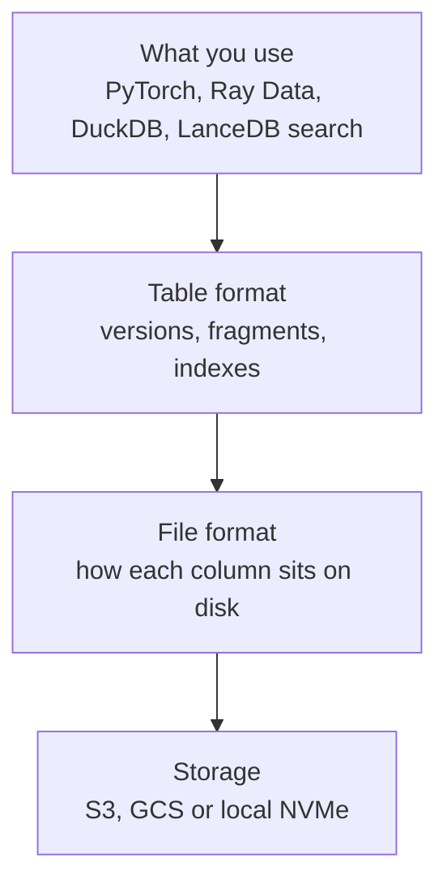

*By Gopi Krishna Tummala*

*Parquet was built for scanning. ML keeps asking for single rows, new columns and exact dataset versions. Here's what Lance changes, what its benchmarks actually show, and where Parquet is still the right answer.*

Companion to [Data DNA: Parquet and Arrow](/posts/mlops/parquet-arrow-quest-for-analytic-speed) and [Datasets and Dataloaders](/posts/mlops/datasets-and-dataloaders).

---

In the Parquet post I gave a rule I still like: store in Parquet, compute in Arrow. Parquet stores data by column and compresses it well, so reading a few columns across many rows is fast. That's exactly what analytics and most training scans need.

But picture a typical ML dataset: half a billion frames from driving logs, each with a timestamp, weather tags, a caption and an image. Over a year, the team keeps asking it three kinds of questions:

1. **"Give me row 48,213,907."** One sample, to debug a bad label, build an exact shuffle, or fetch a retrieval result.
2. **"Add a column."** Every quarter a new embedding model runs over every frame.
3. **"Show me the data exactly as it was when we trained v12."** A version, so an evaluation can be reproduced.

Parquet can answer all three, but with workarounds: tar-file shards and approximate shuffles for random access, rewriting the dataset or keeping a side table for new columns, and an external system for versions. [Lance](https://github.com/lance-format/lance) is an open-source format designed around those three questions. This post follows the driving-scene dataset through each one.

## The idea in one picture



*Lance is three layers. The file format makes single rows cheap to read, the table format makes new columns and versions cheap, and LanceDB adds search on top.*

## Three layers, not one product

The name gets used loosely, so it helps to separate the layers:

- **File format:** how a column is laid out on disk. This is where cheap random access comes from.
- **Table format:** a dataset is a set of fragments (horizontal slices of rows), and every change writes a new immutable manifest that lists the fragments, the schema and the indexes. Each manifest is a version ([table format spec](https://lance.org/format/table/)).
- **LanceDB:** a database built on Lance tables that adds vector search, full-text search and SQL filters.

It works with the tools ML teams already use. Ray Data documents a [`read_lance`](https://docs.ray.io/en/latest/data/api/doc/ray.data.read_lance.html) reader and Hugging Face's Hub [can host and stream Lance datasets](https://github.com/huggingface/hub-docs/blob/main/docs/hub/datasets-lance.md), which matter as adoption signals because they come from other projects, not from LanceDB.

## Reading one row cheaply

To read one value from Parquet, a reader finds the right page (a chunk of a column, often several kilobytes) and then reads and decodes the whole page. For an 8-byte number, that's a lot of wasted reading. Smaller pages help random reads but make the index of pages bigger and scans slower.

Lance's main idea is to store each column differently depending on how wide its values are ([Pace et al., 2025](https://arxiv.org/abs/2504.15247)):

- **Narrow values** (numbers, short strings, under 128 bytes) are stored in small compressed chunks, because decoding a small chunk is cheap.
- **Wide values** (embeddings, images, long text) are stored so each value can be fetched on its own, with at most one or two disk reads regardless of how nested the data is.

For our dataset, the weather tags and timestamps get the first treatment and the 3 KB embeddings and 20 KB images get the second.

The paper, written by the Lance team and measured on a local NVMe drive, reports three results worth knowing:

- **The famous "60×" is Parquet versus Parquet.** Default Parquet settings read about 5,500 random rows per second on small values; tuned settings (8 KiB pages, compression and dictionary encoding off) read about 350,000. That gap is a lesson about configuring Parquet, not a Lance-versus-Parquet number.
- **Lance roughly ties or beats tuned Parquet on random reads,** and stays consistent on nested data where simpler layouts need several reads per value.
- **Scans aren't sacrificed.** Lance matched or beat Parquet's best-tuned full scans on nearly all test datasets, and it removes the row-group size setting that has to be tuned per dataset.

There's also a quieter memory cost it avoids. Parquet's page index takes about 20 bytes per page, which for large values on small pages adds up to around 20 GiB of index memory per billion rows. Lance's layout for wide values needs none.

## Adding a column without rewriting the dataset

For many ML teams the table format matters more than read speed. When the new embedding model arrives, adding a column to a Parquet dataset usually means rewriting it, or keeping a separate table and paying for a join forever. In Lance, adding a column writes new data files next to the existing ones, and the old files stay untouched ([data evolution guide](https://lance.org/guide/data_evolution/)):

```python
ds = lance.dataset("s3://bucket/scenes.lance")

@lance.batch_udf(checkpoint_file="clip_v2.sqlite")   # resumable backfill
def embed(batch):
    return encode_frames(batch)  # returns a RecordBatch with a "clip_v2" column

ds.add_columns(embed)
ds.tags.create("run-v12", ds.version)                # pin this version for training
```

*Simplified.*

Deleting rows works the same way: removed rows are recorded in a small deletion file that readers skip, until compaction physically removes them. That's a cheap way to drop a mislabeled batch or data you no longer have rights to use. And because every commit is a version you can tag, a training run can name the exact data it used, which is the part of reproducibility that code and config alone can't give you.

The limit to know about: each version's manifest lists every fragment, so on very large tables, thousands of tiny commits each rewrite a lot of metadata. A [design proposal in the Lance repo](https://github.com/lance-format/lance/pull/9060) discusses changing that. Until then, batch your writes and plan for compaction.

## What doesn't change: object storage

In the Dataloaders post I answered "how do you shuffle 50 TB across 256 GPUs?" with a two-tier shuffle, because random reads from S3 are far slower than sequential ones. Lance doesn't change that. The paper itself notes that S3-class storage tops out around tens of thousands of operations per second and gains nothing from reads much smaller than about 100 KB. Streaming pre-training data from object storage still wants big sequential reads and a local cache, and Lance's PyTorch integration shards by fragment for the same reason WebDataset shards by tar file.

What changes is the work around large-scale pre-training: fine-tuning sets, preference data, evaluation sets and curation loops, usually on faster storage. There, exact shuffles, filtered subsets ("rain at night, 10,000 frames") and cheap label changes become routine instead of a re-sharding project. Hugging Face's own Lance documentation adds a fair hedge: streaming is fast for small metadata but less so for embeddings and large media, so benchmark your own columns.

## One table for search

A retrieval system for these frames usually has three parts that must stay in sync: Parquet for metadata, a search cluster for keyword and vector search, and a blob store for the images. LanceDB keeps the metadata, caption, embedding and image in one versioned table, with vector, full-text and scalar indexes on it and [hybrid search](https://docs.lancedb.com/search/hybrid-search) that fuses the results. You still choose index types and trade recall for latency, as in the [multimodal RAG post](/posts/generative-ai/building-production-rag-opensearch), and a storage-native engine is a different operating point from a search cluster built for very high query rates.

This shape is familiar from my own work. A Zoox patent, [US 12,668,281](https://patents.justia.com/patent/12668281), describes storing clusters of driving scenarios as encoded keys with associated prediction information for vehicles to look up. That's an embedding-keyed lookup over a large log corpus, the kind of workload vector-native tables are designed for. The patent doesn't involve Lance; I mention it for the pattern.

## Reading the numbers honestly

| Claim | Source | How much to trust it |
|---|---|---|
| Tuned Parquet is about 64× faster than default on small values | [Lance paper](https://arxiv.org/abs/2504.15247) | Measured, with scripts to reproduce, but written by the Lance team |
| Lance matches or beats tuned Parquet on NVMe | Same paper | Vendor-authored, NVMe only; the encodings were experimental at the time |
| "100× faster than Parquet" | [Lance README](https://github.com/lance-format/lance) | Marketing headline; ask what the baseline was |
| Customer speedups (WeRide, Runway, Character.ai) | [LanceDB customer stories](https://www.lancedb.com/customers) | Vendor-published testimonials, not benchmarks |

Numbers that range from 2× to 2,000× across write-ups are mostly explained by the comparison: default versus tuned Parquet, small versus nested values, NVMe versus object storage. Whenever someone quotes a multiplier, ask which of those they chose. And Lance isn't the only new format: Meta's Nimble and Spiral's Vortex aim at similar problems, and Apache Iceberg is working on making file formats pluggable under one table layer.

## What I'd remember

- **Lance is a file format, a table format and a database.** Judge each layer separately.
- **The 60× is tuned versus default Parquet.** Tune Parquet first, and always ask what a multiplier compares.
- **Encoding by value width is the core idea.** Small values in chunks, large values individually addressable.
- **The table format is the everyday win.** New columns without rewrites, cheap deletes, and versions you can pin a training run to.
- **Object storage physics didn't change.** Keep Parquet for interchange and BI; use Lance where random access, evolving columns and retrieval dominate.

## Where to go next

- The paper: [Lance: Efficient Random Access in Columnar Storage through Adaptive Structural Encodings](https://arxiv.org/abs/2504.15247).
- Lance docs: [table format](https://lance.org/format/table/), [transactions](https://lance.org/format/table/transaction/), [PyTorch integration](https://lance.org/integrations/pytorch/).
- [Data DNA: Parquet and Arrow](/posts/mlops/parquet-arrow-quest-for-analytic-speed) and [Datasets and Dataloaders](/posts/mlops/datasets-and-dataloaders) on this site.
- Dremio's [survey of Parquet, Lance, Nimble and Vortex](https://www.dremio.com/blog/exploring-the-evolving-file-format-landscape-in-ai-era-parquet-lance-nimble-and-vortex-and-what-it-means-for-apache-iceberg/) (written by a vendor with its own stake).

*Written September 2026, revised October 2026. Lance APIs and format versions change quickly, so check current docs before building on them.*

**Questions to sit with**

1. Which of the three questions (one row, new column, exact version) does your team ask most often, and how do you answer it today?
2. If your training data lives on S3, which of Lance's benefits still apply?
3. What would you need to see before trusting a vendor's 100× claim?
