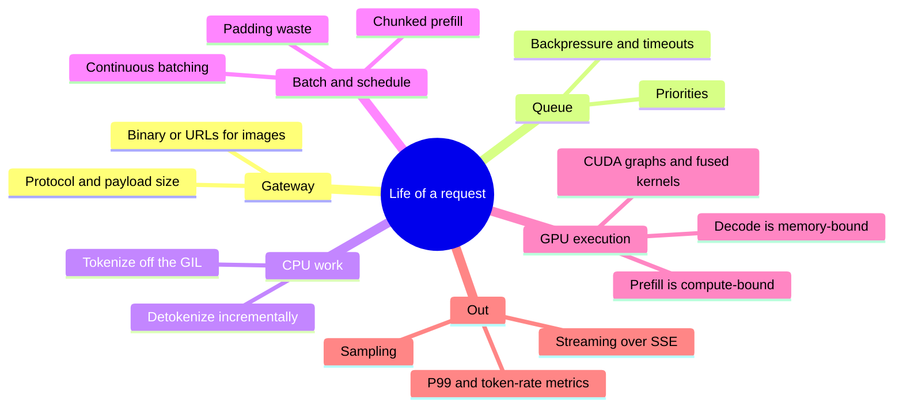
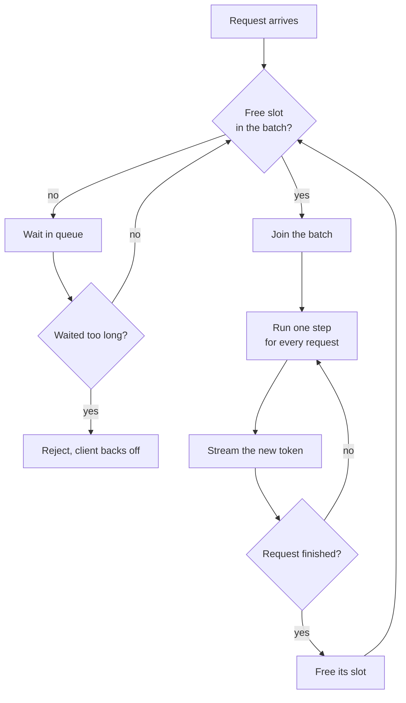
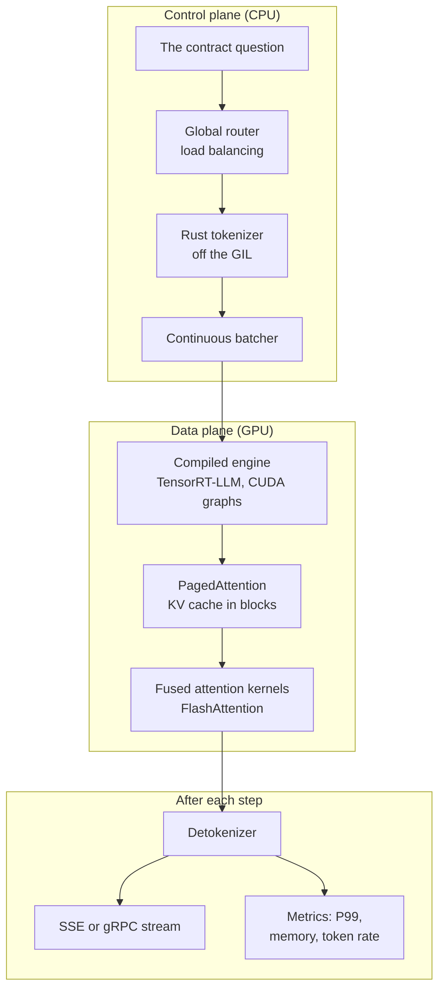

*By Gopi Krishna Tummala*

*Where the time goes when you send a prompt to a model in production: the network, the queue, tokenization, batching, the two very different GPU phases, and streaming the answer back. Following one request from start to finish.*

Part 5b of [the MLOps map](/posts/mlops/infrastructure-first-mlops-roadmap). Previous: [LLM Serving with vLLM](/posts/mlops/vllm-trilogy-of-modern-llm-scaling). Next: [Custom Kernels](/posts/mlops/custom-kernel-craze).

---

A user pastes a 20-page contract into a chat app and asks, "What are the termination clauses?" About two seconds later the first words of the answer appear, and the rest streams in over the next ten seconds.

Those twelve seconds are spread across many places: the network, a queue, a CPU turning text into tokens, a scheduler deciding which requests share the GPU, two very different kinds of GPU work, and a stream back to the browser. When a serving system is slow, the fix depends entirely on which of those places the time went. This post follows the contract question through each one.

## The idea in one picture

*Six stops, in order. Time to the first word is mostly gateway, queue, tokenization and prefill. Time for the rest of the answer is mostly decode.*

## Arriving: the gateway and the queue

The request arrives over HTTP or gRPC. For text this part is usually quick, but it's a common place for surprises with images and other large payloads: decoding base64-encoded images from JSON can take longer than people expect, and sending a link to the file in object storage or a binary format often helps.

If every GPU slot is busy, the request waits in a queue. The queue is where you decide what happens under load: which requests go first (interactive users before batch jobs), how long one may wait before it's rejected, and when to tell clients to back off. A queue with no limits doesn't protect the system; it just turns overload into very long waits for everyone.

## On the CPU: tokenization

Before the model sees anything, the contract is turned into token IDs, perhaps 15,000 of them. Tokenization is CPU work, and in a Python server it can quietly become a bottleneck under heavy load. Fast Rust-based tokenizers and running tokenization outside the main serving loop keep the GPU from waiting on it.

## Scheduling: joining a batch

GPUs are efficient when many requests run together. Modern servers use continuous batching: at every step, finished requests leave the batch and waiting ones join, so the GPU stays full even though requests have very different lengths. The older approach, padding a batch of requests to the longest one and running them all to completion, wasted a large share of compute on padding and idle slots.

*The scheduler makes this decision at every step, not once per batch. Our contract question joins the moment a slot frees up and leaves the moment its answer ends.*

The [vLLM post](/posts/mlops/vllm-trilogy-of-modern-llm-scaling) covers how memory is managed to make this work.

## On the GPU: two very different phases

**Prefill** reads the whole prompt at once. All 15,000 contract tokens are processed in parallel in one big pass, which writes their keys and values into the KV cache. This is heavy matrix math, limited by compute, and it's most of the two seconds before the first word appears.

**Decode** generates the answer one token at a time. Each step does relatively little math but has to read all the model's weights and this conversation's KV cache from GPU memory, so it's limited by memory bandwidth. A rough ceiling for a single request: tokens per second can't exceed memory bandwidth divided by the bytes read per step. An 8B-parameter model in 16-bit precision is about 16 GB, so on a GPU with about 3.35 TB/s of bandwidth, one request can't go much faster than about 200 tokens per second. Batching helps exactly because one read of the weights serves every request in the batch.

The two phases interfere. Our 15,000-token prefill can stall everyone else's decode steps for a moment, so servers split long prompts into chunks and interleave them with decode work. And because decode launches many small GPU operations per step, servers record the whole step once as a CUDA graph and replay it, avoiding the overhead of launching each operation separately.

Serving an image generator looks different. There's no token-by-token loop and no KV cache; instead the same network runs 20 to 50 times on a latent image, then a decoder turns it into pixels. There, the biggest wins come from needing fewer steps.

## Back to the user: sampling and streaming

At each step the model produces a score for every possible next token. The sampler turns those scores into a choice, applying temperature, top-p and any constraints such as a required JSON format. Detokenizing has to be incremental, because a single character can be split across several tokens.

Each token is sent back as soon as it exists, usually over Server-Sent Events. Streaming doesn't make generation faster, but it changes what the user waits for: the first words of the answer instead of the whole thing. One thing to check: proxies and load balancers that buffer responses can silently undo streaming.

## The whole path, as one system

In production, the pieces above split into a CPU side that decides what runs and a GPU side that runs it. Many stacks also compile the model ahead of time with TensorRT-LLM or ONNX Runtime, so the GPU side runs a prebuilt engine rather than Python.

*Keeping Python out of the per-step path is the theme: Rust on the CPU side, a compiled engine on the GPU side.*

## Measuring where the time went

Log, for every request: time in queue, time to first token, time between tokens, input and output lengths, and KV cache usage. Averages hide the interesting problems, which live in the slowest one percent of requests. If a few users see 30-second delays, split their time into queue, prefill and decode, and the cause is usually obvious: a traffic burst, a very long prompt, or the server running out of KV cache memory and pausing requests.

One measurement to be careful with: the "GPU utilization" figure in `nvidia-smi` only reports whether any GPU operation was running, not how busy the chip was. A small decode step can keep it near 100% while most of the GPU waits on memory. Profilers like Nsight show the real picture.

## What I'd remember

- **A request lives in three places.** The CPU (gateway, queue, tokenizer), the scheduler, and the GPU.
- **Prefill and decode are different problems.** Prefill is compute-heavy and sets time to first token; decode is memory-bound and sets time between tokens.
- **Batching is how decode gets efficient.** One read of the weights serves every request in the batch.
- **Streaming changes what users wait for.** First words, not the whole answer.
- **Debug from the slowest requests, not averages,** and don't trust GPU utilization alone.

## Where to go next

- [LLM Serving with vLLM](/posts/mlops/vllm-trilogy-of-modern-llm-scaling), for memory management and continuous batching in detail.
- [Custom Kernels](/posts/mlops/custom-kernel-craze), the next module: why moving data dominates GPU time.
- The [Orca paper](https://www.usenix.org/conference/osdi22/presentation/yu), which introduced continuous batching.

Previous: [LLM Serving with vLLM](/posts/mlops/vllm-trilogy-of-modern-llm-scaling). Next: [Custom Kernels](/posts/mlops/custom-kernel-craze).

**Questions to sit with**

1. For the contract question, which stages would grow if the contract were twice as long, and which wouldn't change?
2. Why does decode get more efficient with bigger batches, and what does each user lose?
3. Which metrics would you add to your own serving stack first?
