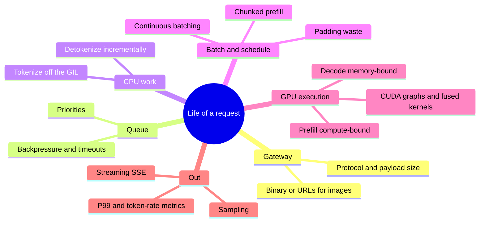
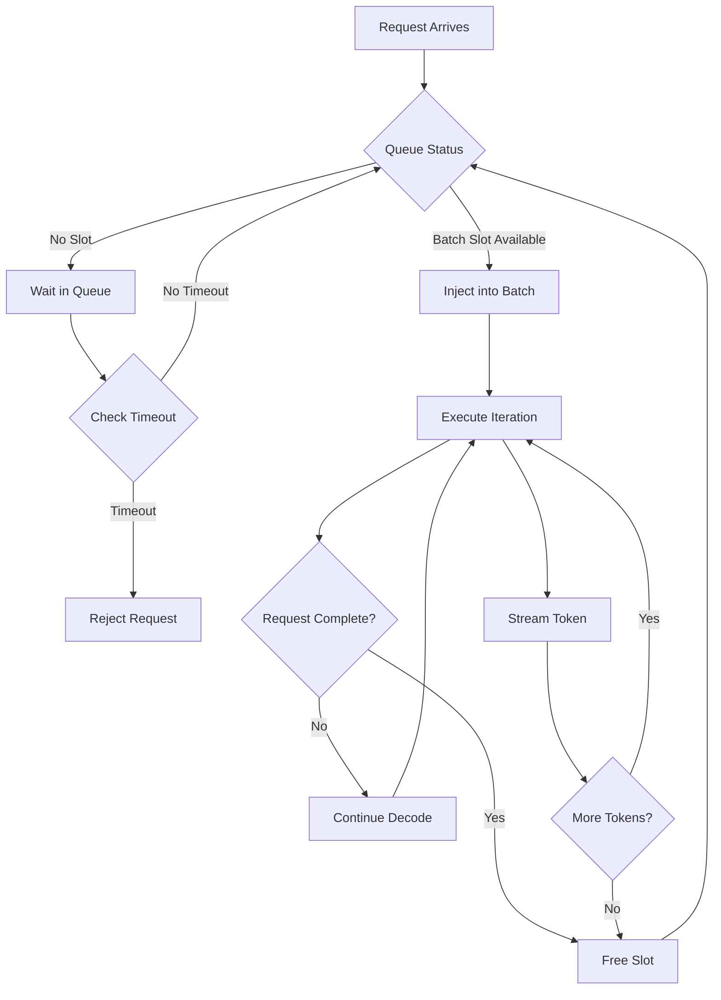
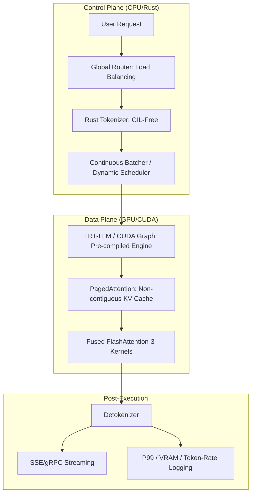

*By Gopi Krishna Tummala*

---

<div class="series-nav" style="background: linear-gradient(135deg, #059669 0%, #0d9488 100%); color: white; padding: 1.5rem; border-radius: 12px; margin-bottom: 2rem; box-shadow: 0 4px 6px rgba(0,0,0,0.1);">
  <div style="font-size: 0.875rem; opacity: 0.9; margin-bottom: 0.5rem; text-transform: uppercase; letter-spacing: 0.05em;">Infrastructure-First MLOps — Building the Engine of AI</div>
  <div style="display: flex; gap: 0.75rem; flex-wrap: wrap; align-items: center;">
    <a href="/posts/mlops/parquet-arrow-quest-for-analytic-speed" style="background: rgba(255,255,255,0.1); padding: 0.5rem 1rem; border-radius: 6px; text-decoration: none; color: white; opacity: 0.9;">Module 1: Data DNA</a>
    <a href="/posts/mlops/datasets-and-dataloaders" style="background: rgba(255,255,255,0.1); padding: 0.5rem 1rem; border-radius: 6px; text-decoration: none; color: white; opacity: 0.9;">Module 2: Dataloaders</a>
    <a href="/posts/mlops/hidden-engine-of-ai" style="background: rgba(255,255,255,0.1); padding: 0.5rem 1rem; border-radius: 6px; text-decoration: none; color: white; opacity: 0.9;">Module 3: Training</a>
    <a href="/posts/mlops/modern-post-training-peft-2026" style="background: rgba(255,255,255,0.1); padding: 0.5rem 1rem; border-radius: 6px; text-decoration: none; color: white; opacity: 0.9;">Module 4: Post-Training</a>
    <a href="/posts/mlops/vllm-trilogy-of-modern-llm-scaling" style="background: rgba(255,255,255,0.1); padding: 0.5rem 1rem; border-radius: 6px; text-decoration: none; color: white; opacity: 0.9;">Module 5: Serving</a>
    <a href="/posts/mlops/custom-kernel-craze" style="background: rgba(255,255,255,0.1); padding: 0.5rem 1rem; border-radius: 6px; text-decoration: none; color: white; opacity: 0.9;">Module 6: Kernels</a>
    <a href="/posts/mlops/beyond-inference-agentic-mlops-mcp" style="background: rgba(255,255,255,0.1); padding: 0.5rem 1rem; border-radius: 6px; text-decoration: none; color: white; opacity: 0.9;">Module 7: Agentic AI</a>
    <a href="/posts/mlops/ml-pipeline-orchestration-layers" style="background: rgba(255,255,255,0.1); padding: 0.5rem 1rem; border-radius: 6px; text-decoration: none; color: white; opacity: 0.9;">Module 8: Orchestration</a>
  </div>
  <div style="margin-top: 0.75rem; font-size: 0.875rem; opacity: 0.8;">📖 You are reading a <strong>Deep Dive</strong> — Lifecycle of an Inference Request</div>
</div>

---

### Act 0: Tensor Life in Plain English

Imagine you are running a high-end sushi restaurant (The Inference System). 

1.  **Request (Order):** A customer orders a "Dragon Roll."
2.  **Tokenization (Prep):** The waiter translates the order into a code for the chef (e.g., `Order #15`).
3.  **Batching (Assembly Line):** The chef waits for 3 people to order the same roll so he can cut all the cucumbers at once.
4.  **Execution (Cooking):** The chef actually puts the rice and fish together. This is the **GPU Kernel** doing math.
5.  **Post-Processing (Plating):** The waiter adds ginger and wasabi to make it look nice.
6.  **Streaming (Serving):** Instead of waiting for the whole meal, the waiter brings out the miso soup first so the customer doesn't get hungry.

If the kitchen is slow, the waiter (API) is bored. If the kitchen (GPU) is idle, the waiter is slow. **Inference Optimization** is the art of making the kitchen and the waiter move in perfect harmony.

---

## Table of contents

---

## The Module in One Picture



---

## Phase 1: The Gateway and The Queue

**The Bottleneck:** Scheduling & Serialization

The journey begins at the model serving endpoint (e.g., vLLM, TGI, TRT-LLM). But before we even get to the model, there are three bottlenecks that will kill your latency if you ignore them.

### 1. Request: The Gateway

**"The cost of entry."**

Every inference journey begins at the network edge. Whether via gRPC or HTTP, the request payload defines the initial constraints. For LLMs, this is lightweight text JSON; for Diffusion models, it's often heavy Base64-encoded images. This phase isn't just about receiving data—it's about serialization overhead, protocol decoding, and unmarshalling payloads without blocking the event loop. If your ingress is slow, your GPU sits idle.

#### Protocol Overhead

The request arrives via gRPC or HTTP. While the payload for an LLM is small (text), diffusion requests often carry base64 images or masks. I've seen teams spend weeks optimizing CUDA kernels only to realize they're spending 200ms just deserializing JSON image payloads.

```
Request Flow:
┌─────────┐     HTTP/gRPC      ┌──────────────┐     Binary/Protobuf    ┌──────────┐
│ Client  │ ──────────────────> │ Load Balancer│ ─────────────────────> │  Model   │
│         │   (JSON/Base64)     │              │   (Optimized Format)   │  Server  │
└─────────┘                      └──────────────┘                        └──────────┘
```

**The Fix:** For diffusion, avoid JSON/HTTP for image payloads. Use binary formats (Protobuf/FlatBuffers) or pre-signed S3 URLs to keep the control plane light. I've seen teams achieve a 3x reduction in request deserialization time by moving from base64 JSON to Arrow IPC for image payloads.

### 2. Queue: The Waiting Room

**"Managing the flood."**

When the system is under load, we can't shove every request into the GPU immediately. The queue acts as the pressure valve. This is where we make critical decisions about priority, backpressure, and timeouts. Do we use a simple FIFO queue, or a priority queue that favors VIP users? A poorly managed queue leads to increased latency for everyone, while a smart queue protects the system from collapse during traffic spikes.

### 3. Tokenize: The CPU Bottleneck

**"Turning text into math."**

Before a model can understand "Hello," it must become `[15496]`. This step seems trivial but is a frequent silent killer in Python-based stacks. Because tokenization is CPU-bound, the Python Global Interpreter Lock (GIL) can strangle throughput, starving the GPU even if it has capacity. Efficient systems often offload this to Rust-based services or separate processes to ensure the GPU never waits on the CPU.

This is CPU-bound, and here's where Python's Global Interpreter Lock (GIL) becomes your enemy. If your tokenizer runs in Python while your model runs in C++/Rust, the GIL can strangle high-concurrency throughput. I've profiled systems where tokenization was the bottleneck at 80% CPU utilization, even though the GPU was sitting at 30%.

**The Fix:** Use Rust-based tokenizers (e.g., Hugging Face `tokenizers`) released from the GIL, or offload tokenization to a separate microservice layer to decouple CPU load from the GPU hosts. The microservice approach also gives you better horizontal scaling when you're serving multiple model variants.

### 4. Batch: The "Ragged Tensor" Problem

**"Tetris with data."**

In training, we love uniform rectangles of data. In inference, real-world user prompts are chaotic: one user asks a 5-token question, another pastes a 4,000-token document.

* **The Problem:** Naive "Static Batching" forces us to pad the short 5-token request with 3,995 "empty" tokens just to match the long one, wasting massive amounts of compute and VRAM on nothing.
* **The Goal:** We need to construct batches that minimize padding waste, grouping requests dynamically to maximize the useful work done per clock cycle.

**Static Batching (Old School):** Wait for N requests to arrive, pad them to the longest sequence, and send them to the GPU. This wastes huge amounts of VRAM and compute on padding tokens. I've seen teams padding 512-token sequences to 2048 just to batch them together—that's 75% wasted compute.

```
Static Batching (Inefficient):
Request 1: [tok1, tok2, tok3, ..., tok512, <PAD>, <PAD>, ..., <PAD>]  ← 1536 wasted tokens
Request 2: [tok1, tok2, ..., tok1024, <PAD>, <PAD>, ..., <PAD>]      ← 1024 wasted tokens
Request 3: [tok1, tok2, ..., tok2048]                                 ← reference length
```

### 5. Schedule: The Orchestrator

**"The heartbeat of the system."**

Batching groups the data; scheduling decides *when* it runs. Modern LLM serving moves beyond request-level scheduling to **Iteration-Level Scheduling** (Continuous Batching). Instead of waiting for a whole batch to finish, the scheduler injects new requests into the batch the moment a previous request finishes a token generation. It manages the "Prefill" (processing the prompt) vs. "Decode" (generating tokens) trade-off to ensure Time-to-First-Token (TTFT) remains low without destroying overall throughput.

**Continuous Batching (State of the Art):** We schedule at the *iteration* level, not the request level. New requests are injected into the batch immediately as soon as a slot frees up. This is what vLLM and TGI do, and it's the difference between 2x and 10x throughput.

```
Continuous Batching (Efficient):
Iteration 1: [Req1: tok1-512, Req2: tok1-1024, Req3: tok1-2048]
Iteration 2: [Req1: tok513, Req2: tok1025, Req3: tok2049, Req4: tok1-256]  ← Req4 joins!
Iteration 3: [Req2: tok1026, Req3: tok2050, Req4: tok257-512, Req5: tok1-128]  ← Req5 joins!
```

#### Iteration-Level Scheduler Flow



---

## Phase 2: Execution on the GPU

**The Bottleneck:** Compute in prefill, memory bandwidth in decode

Once a batch is scheduled, the request finally touches the GPU, and it lives two very different lives.

### 6. Prefill: Reading the Prompt

All prompt tokens are processed **in parallel** in one big forward pass, which writes their keys and values into the KV cache. This is dense matrix multiplication: **compute-bound**, and it dominates **time-to-first-token (TTFT)**. A 4,000-token prompt costs roughly 4,000× the FLOPs of a single decode step.

### 7. Decode: One Token at a Time

Each new token needs a full forward pass that reads **every weight** plus that sequence's KV cache from HBM, but does very little math per byte read. Decode is **memory-bandwidth-bound**, and it sets **inter-token latency (ITL)**. That's why batching matters so much here: one weight read serves every sequence in the batch.

```
Rough decode ceiling for one GPU (batch 1, BF16):
  tokens/sec ≈ HBM bandwidth / bytes of weights
  H100 (~3.35 TB/s) serving an 8B model (~16 GB): ≈ 200 tokens/sec at best
```

### 8. Diffusion Is Different

A diffusion request has no KV cache and no token loop. Instead it runs the same denoiser **N times** (20–50 steps, or 1–8 after distillation) on a latent, then a VAE decoder turns the latent into pixels. Each step is compute-bound, so batching helps less than for LLM decode, and the biggest wins are **fewer steps** (distillation, better samplers), caching across steps, and compiling the denoiser. See [Sampling & Guidance](/posts/generative-ai/sampling-guidance-diffusion-models) for the step-count side.

---

## Phase 3: Post-Processing and Streaming

### 9. Sample and Detokenize

The model outputs logits; the sampler applies temperature, top-p/top-k, repetition penalties and any structured-output constraints (JSON schemas, grammars), then picks a token. Detokenization must be **incremental**: a single character can span several tokens, so servers buffer partial bytes before emitting text.

### 10. Stream

Tokens go back over **Server-Sent Events** (OpenAI-style APIs) or gRPC streams as soon as they exist. Streaming doesn't make generation faster, but it makes perceived latency equal to TTFT instead of total generation time. Watch for proxies and load balancers that buffer responses and silently undo streaming.

### 11. Measure

Log per-request **TTFT, ITL (or TPOT), total latency, input/output token counts, queue time and KV-cache usage**. Averages hide everything interesting: the problems live in P99 and in the correlation between long prompts and slow responses.

---

#### Act V.V: Mature Architecture — The Global Inference Pipeline

In a 2025 production stack, inference is a multi-tier orchestration. We use **NVIDIA TensorRT** or **ONNX Runtime** to compile the model into a hardware-specific executable, bypassing Python entirely.

**The Production Inference Pipeline (Mature Architecture):**



##### 1. CUDA Graphs: Bypassing the Kernel Launch Overhead
For small models or low batch sizes, the time it takes the CPU to tell the GPU "do math" can be longer than the math itself. 
*   **The SOTA Fix:** **CUDA Graphs**. We record the entire assembly line of kernel launches once. During inference, the CPU replays the whole graph with a *single* launch, removing per-kernel launch overhead. Because graphs need fixed shapes, servers like vLLM capture one graph per common decode batch size and pad to the nearest one.

##### 2. Trade-offs & Reasoning
*   **Dynamic vs. Static Shapes:** Pre-compiling a model (TensorRT) works best when it knows the input sizes. *Trade-off:* static shapes allow more aggressive kernel selection and CUDA graphs but force padding waste. Modern stacks compile for a few shape ranges ("optimization profiles") or bucket batch sizes, and use ragged/variable-length attention kernels so padding doesn't cost FLOPs.
*   **Quantization-Aware Training (QAT) vs. PTQ:** Post-Training Quantization (PTQ) needs only a small calibration set. FP8 PTQ is usually near-lossless; INT4 PTQ (AWQ, GPTQ) costs a little accuracy that varies by task. *Trade-off:* QAT simulates quantization during training to recover that accuracy, at the cost of a training run.
*   **Citations:** *TensorRT LLM Architecture (NVIDIA 2024)* and *FlashAttention-3: Fast and Accurate Attention with Asynchrony (Hopper Specific, 2024)*.

---

### Act VI: System Design & Interview Scenarios

#### Scenario 1: The "Long-Tail" Latency
*   **Question:** "Your average response time is 2 seconds, but 1% of users are seeing 30-second delays. How do you find the leak?"
*   **Answer:** This is a **P99 Latency** problem, so look at the slow requests specifically. Break their latency into queue time, TTFT and decode time. Common causes: **queueing** during bursts; **preemption** when the KV cache fills (too many concurrent long-context users, so some requests are evicted and recomputed); **prefill stalls** (one massive 4k-token prefill blocking 100 small decode steps, fixed with **chunked prefill**); and very long outputs. Fixes: chunked prefill, admission control, more replicas, and routing long-context requests to dedicated capacity.

#### Scenario 2: GPU Under-utilization
*   **Question:** "Your NVIDIA-SMI shows 90% Volatile GPU-Util, but your token throughput is only 10% of theoretical max. Why?"
*   **Answer:** First, `nvidia-smi`'s "GPU-Util" only reports the fraction of time *some* kernel was running; it says nothing about how many SMs were busy or how close you are to peak FLOPs. A tiny decode kernel keeps it at 90%+. The real culprit is usually being **memory-bandwidth-bound** in decode: the cores wait for weights to stream from HBM. **Increase batch size** (more tokens per weight read), use **quantization** (fewer bytes per weight), and confirm with Nsight Compute or DCGM metrics such as SM occupancy and achieved memory bandwidth.

---

### Graduate Assignment: The Bottleneck Hunt

**Task:**
You are serving a Stable Diffusion XL model.
1.  **The Math:** If a single denoising step takes 100ms and you run 50 steps, what is your base latency?
2.  **The Scale:** If you implement **Static Batching** with size 8, and the GPU memory transfer for the weights takes 200ms, calculate the throughput (Images/sec).
3.  **The SOTA:** Why would using **S-LoRA** (Unified Paging for LoRAs) be better than simple weight-swapping if you serve 100 different artistic styles?

<details>
<summary><strong>Show the answers</strong></summary>

1.  **Base latency:** 50 × 100 ms = **5 seconds** per image (plus text encoding and VAE decode).
2.  **Throughput:** the question is deliberately underspecified, so state assumptions. If the 200 ms weight transfer happens once per batch and a batch of 8 still took 100 ms per step, one batch takes 0.2 + 5 = 5.2 s → 8 / 5.2 ≈ **1.5 images/s**, versus 0.2 images/s unbatched. In reality SDXL steps are compute-bound, so a batch of 8 makes each step several times slower; measure step time at each batch size and pick the size that meets your latency target. (And weights should stay resident on the GPU, not be transferred per batch.)
3.  **S-LoRA-style serving:** swapping full weights per style means reloading or re-merging weights and serving one style at a time. Keeping many small adapters in paged GPU memory and computing `x·W + x·A_i·B_i` with batched multi-adapter kernels lets one batch contain requests for **different** styles at once, with no reload stalls. (S-LoRA introduced this for LLMs; the same idea applies to multi-LoRA diffusion serving.)

</details>

## Remember This

- **A request lives in three places:** the CPU (gateway, queue, tokenize), the scheduler (batching), and the GPU (prefill, then decode).
- **Prefill is compute-bound and sets TTFT; decode is memory-bound and sets ITL.** Almost every serving optimization targets one of the two.
- **Continuous batching plus paged KV memory** is what turned LLM serving from 30% to near-full GPU utilization.
- **CPU work matters:** slow JSON parsing, GIL-bound tokenization or buffered proxies can starve a fast GPU.
- **Measure TTFT, ITL, queue time and KV usage per request,** and debug from P99, not averages.

<details>
<summary><strong>Self-check</strong></summary>

1. Why is prefill compute-bound but decode memory-bound?
2. Estimate the best-case batch-1 decode speed of an 8B BF16 model on a GPU with 3.35 TB/s of bandwidth.
3. What does `nvidia-smi` GPU-Util actually measure, and why can it mislead you?
4. Why does streaming improve perceived latency without changing generation speed?
5. How does serving a diffusion model differ from serving an LLM?

</details>

---

**Further Reading (State-of-the-Art):**
*   [Orca: A Distributed Serving System for Transformer-Based Generative Models (OSDI 2022)](https://www.usenix.org/conference/osdi22/presentation/yu) - The foundation of continuous (iteration-level) batching.
*   [FlashAttention-3 (2024)](https://arxiv.org/abs/2407.08608) - Specifically for NVIDIA Hopper architectures.
*   [S-LoRA: Serving Thousands of Concurrent LoRA Adapters (2023)](https://arxiv.org/abs/2311.03285).
*   *DeepSpeed-Inference: High-Performance Serving for LLMs*.

---

**Previous:** [Module 5 — LLM Serving (vLLM)](/posts/mlops/vllm-trilogy-of-modern-llm-scaling)

**Next:** [Module 6 — Custom Kernels](/posts/mlops/custom-kernel-craze)


---

**Related deep dives:** [Ray Serve](/posts/mlops/ray-field-guide-core-to-production#ray-serve-answering-requests) for composing multi-model inference graphs with batching and autoscaling · [Ray Data batch inference](/posts/mlops/ray-field-guide-core-to-production#ray-data-streaming-the-pipeline) for the offline counterpart.
